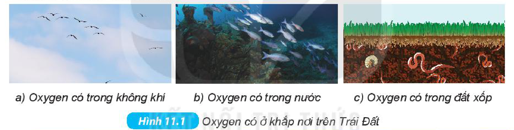
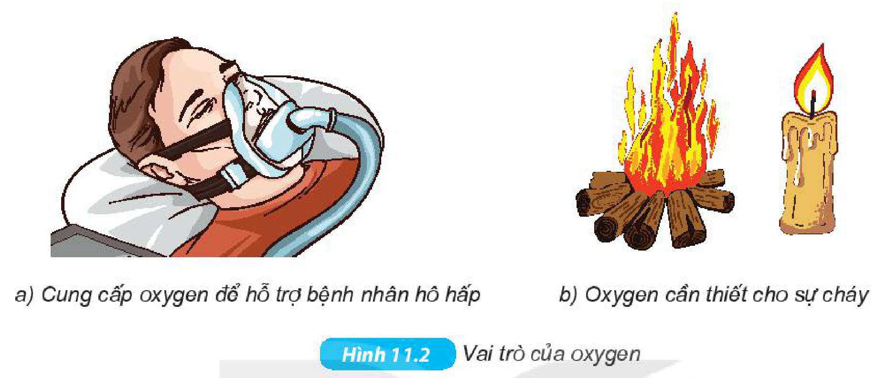
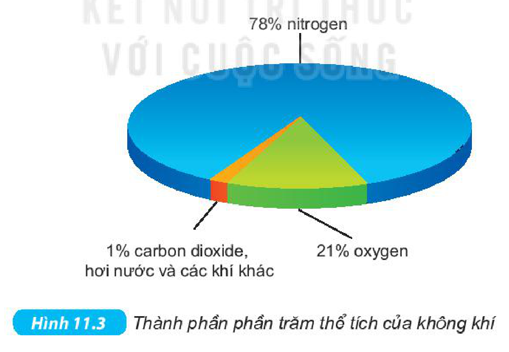
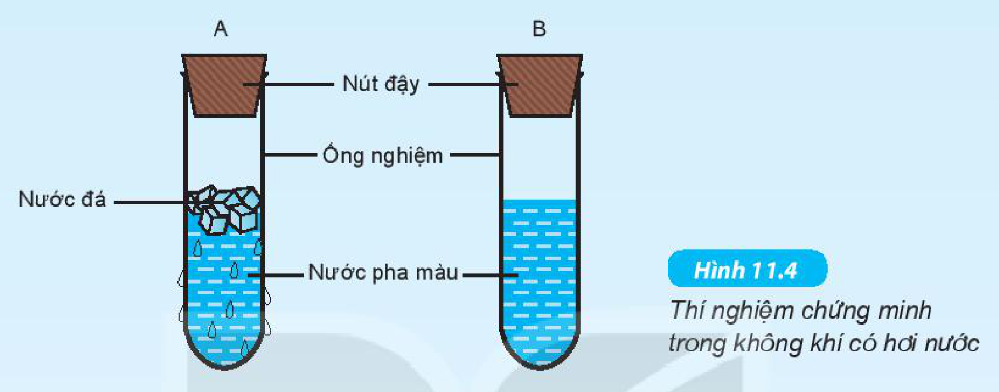
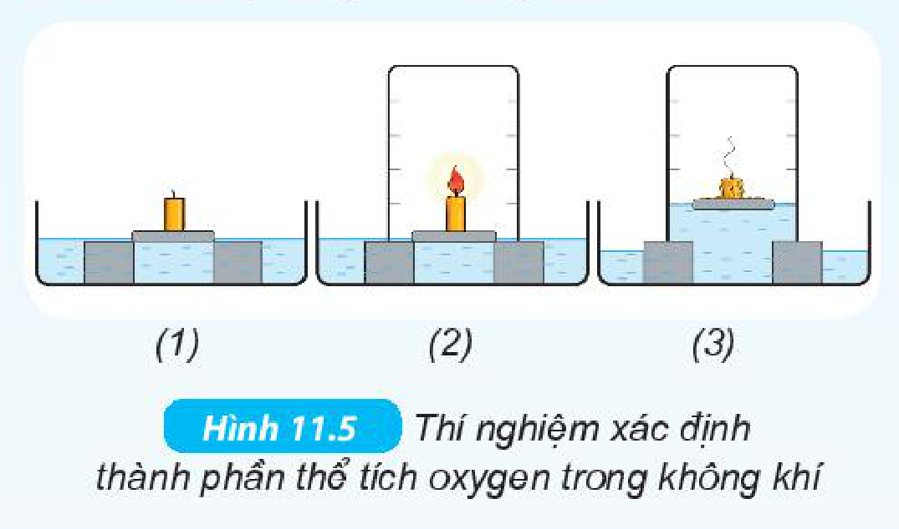
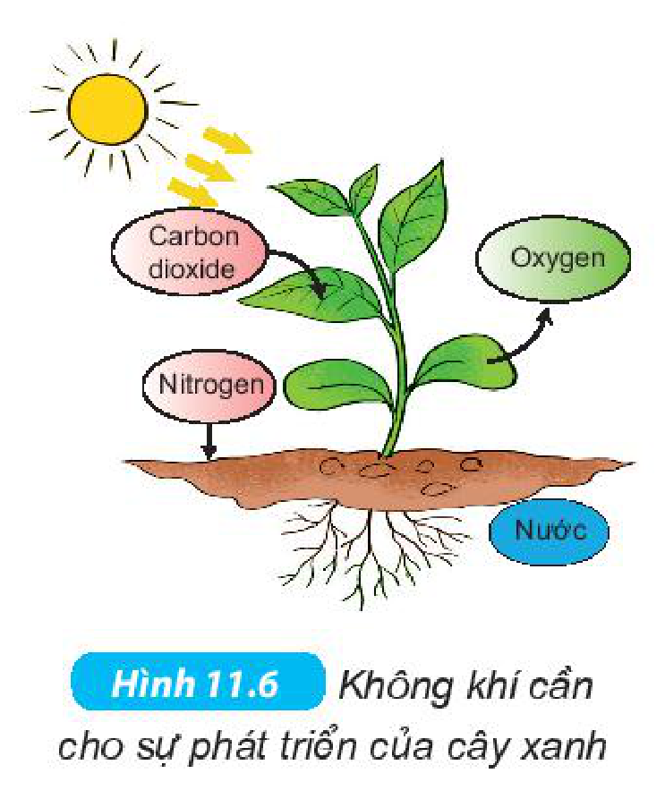
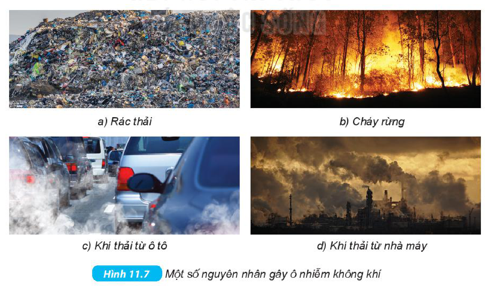
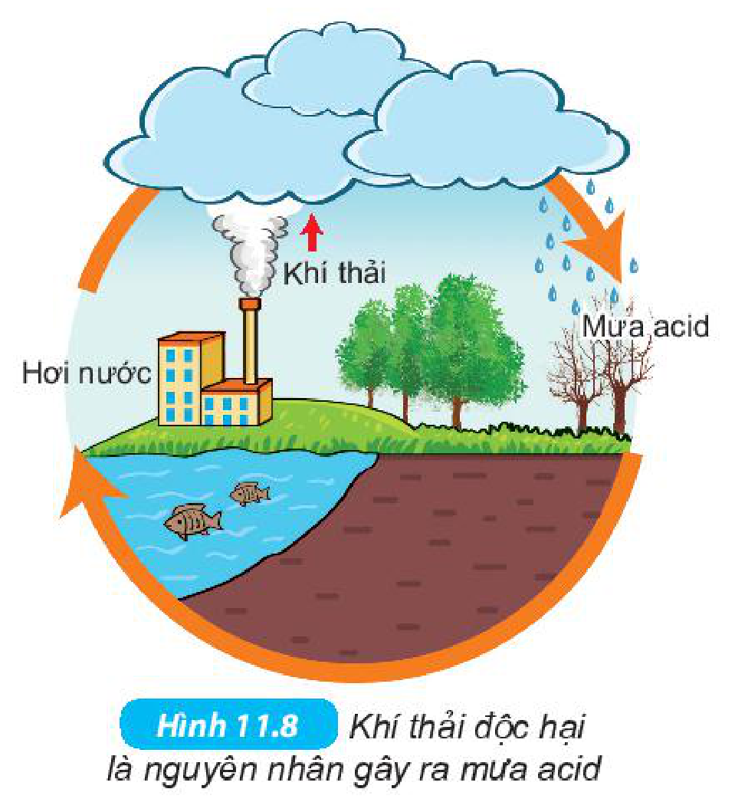

<!-- pdf:37 -->

# BÀI 11: OXYGEN. KHÔNG KHÍ

## 🎯 Mục tiêu

- Nêu được một số tính chất của oxygen và tầm quan trọng của oxygen với sự sống, sự cháy và quá trình đốt nhiên liệu.
- Tiến hành được thí nghiệm xác định thành phần phần trăm thể tích của oxygen trong không khí.
- Nêu được thành phần, vai trò của không khí đối với tự nhiên và sự ô nhiễm không khí. Nêu được một số biện pháp bảo vệ môi trường không khí.

## 🔴 Mở đầu

Em đã biết không khí xung quanh ta cần thiết cho sự sống và sự cháy. Em có thể giải thích tại sao con người phải sử dụng bình dưỡng khí khi lặn dưới nước, khi lên núi cao hoặc khi du hành tới Mặt Trăng không?

## I. Oxygen trên Trái Đất

Dù sống trên mặt đất, trong nước hay trong lòng đất, các loài động vật, thực vật đều cần oxygen cho quá trình hô hấp. Cá sống được trong nước vì trong nước có một lượng oxygen hoà tan, dù rất nhỏ.

*a) Oxygen có trong không khí; b) Oxygen có trong nước; c) Oxygen có trong đất xốp*

Hình 11.1. Oxygen có ở khắp nơi trên Trái Đất

> ❓ Nêu dẫn chứng cho thấy oxygen có trong không khí, trong nước, trong đất.

## II. Tính chất vật lí và tầm quan trọng của oxygen

### 1. Tính chất vật lí của oxygen

Ở điều kiện thường, oxygen ở thể khí, không màu, không mùi, không vị, ít tan trong nước và nặng hơn không khí. <!-- term: Oxygen -->

Oxygen hoá lỏng ở $-183\text{ }^\circ\text{C}$, hoá rắn ở $-218\text{ }^\circ\text{C}$. Ở thể lỏng và rắn, oxygen có màu xanh nhạt. <!-- term: Oxygen -->

> ❓ 1. Ở nhiệt độ phòng, oxygen tồn tại ở thể nào?
>
> 2. Nhiệt độ lạnh nhất trên Trái Đất từng ghi lại được là $-89\text{ }^\circ\text{C}$. Khi đó oxygen ở thể khí, lỏng hay rắn?
>
> 3. Em biết rằng oxygen có ở mọi nơi trên Trái Đất.
>
> a) Em có nhìn thấy khí oxygen không? Vì sao?
>
> b) Cá và nhiều sinh vật sống được trong nước. Em hãy giải thích vì sao.

<!-- pdf:38 -->

### 2. Tầm quan trọng của oxygen

Thông thường, ở đâu có oxygen thì ở đó có sự sống. Oxygen không chỉ cần thiết cho quá trình hô hấp của động vật, thực vật trên Trái Đất, mà còn không thể thiếu cho quá trình đốt cháy nhiên liệu để thắp sáng, cung cấp nhiệt,... Nếu không có oxygen thì sự cháy không thể xảy ra. <!-- term: Oxygen -->

*a) Cung cấp oxygen để hỗ trợ bệnh nhân hô hấp; b) Oxygen cần thiết cho sự cháy*

Hình 11.2. Vai trò của oxygen
<!-- ocr-ok: đã đối chiếu ảnh trang 38, OCR không đọc được chữ trắng nhãn Hình 11.2 -->

> ❓ 1. Kể các ứng dụng của khí oxygen trong đời sống và trong sản xuất mà em biết.
>
> 2. Nêu một số ví dụ cho thấy vai trò của oxygen đối với sự sống và sự cháy.

## III. Thành phần của không khí

Không khí xung quanh ta ngoài oxygen còn có nhiều chất khí khác. Trong điều kiện thông thường, thành phần không khí (gần đúng theo thể tích) như sau: $78\%$ nitrogen; $21\%$ oxygen; $1\%$ carbon dioxide, hơi nước và các khí khác. <!-- term: Không khí -->

Hình 11.3. Thành phần phần trăm thể tích của không khí

> ❓ 1. Khí oxygen chiếm bao nhiêu phần trăm thể tích không khí?
>
> 2. Khí nào có phần trăm thể tích lớn nhất trong không khí?

<!-- pdf:39 -->

> ✋ Tìm hiểu một số thành phần của không khí
>
> *1. Chứng minh trong không khí có hơi nước*
>
> *Chuẩn bị:* nước pha màu, nước đá, 2 ống nghiệm có nút.
>
> *Tiến hành:* Cho nước pha màu vào 2 ống nghiệm A và B. Cho vài viên nước đá vào ống nghiệm A và đậy nút cả hai ống nghiệm lại.
>
> 
>
> Hình 11.4. Thí nghiệm chứng minh trong không khí có hơi nước
>
> *Em hãy cho biết hiện tượng nào chứng minh trong không khí có chứa hơi nước.*
>
> *2. Xác định thành phần thể tích oxygen trong không khí*
>
> *Chuẩn bị:* chậu, nước vôi trong (hoặc dung dịch kiềm loãng), cây nến có gắn đế và cốc thuỷ tinh hình trụ có vạch chia.
>
> *Tiến hành:*
>
> Đặt cây nến vào giá đỡ trong chậu chứa nước vôi trong (1). Châm lửa cho nến cháy.
>
> Nhanh chóng úp cốc thuỷ tinh lên giá đỡ, chụp lấy cây nến (2). Oxygen trong không khí có trong cốc giúp duy trì sự cháy và sẽ hết dần. Chất lỏng dần dâng lên chiếm chỗ oxygen đã cháy. Sau một thời gian, nến tắt (3).
>
> Sau khi nến tắt, để nguội, quan sát vị trí cuối cùng của chất lỏng dâng lên trong cốc.
>
> Nến cháy trong oxygen sinh ra khí carbon dioxide và hơi nước. Hơi nước sẽ ngưng tụ lại còn khí carbon dioxide sẽ bị nước vôi trong hấp thụ hết.
>
> 
>
> Hình 11.5. Thí nghiệm xác định thành phần thể tích oxygen trong không khí
>
> *Hãy trả lời câu hỏi:*
>
> a) Khi nến tắt có thể coi là do oxygen đã hết được không? Hãy giải thích.
>
> b) Chiều cao cột nước dâng lên bằng bao nhiêu phần chiều cao của cốc? Từ đó suy ra oxygen chiếm khoảng bao nhiêu phần trong không khí?

<!-- pdf:40 -->

## IV. Vai trò của không khí

- Sự luân chuyển không khí giúp điều hoà khí hậu, khiến bề mặt Trái Đất không quá nóng hoặc quá lạnh. Ngoài ra, không khí còn có tác dụng bảo vệ Trái Đất khỏi các thiên thạch rơi từ vũ trụ, do khi cọ xát với không khí, các thiên thạch bốc cháy hoặc bay hơi gần hết. <!-- term: Không khí -->
- Oxygen trong không khí cần cho sự hô hấp của động vật, thực vật, đốt cháy nhiên liệu.
- Khi mưa dông có sấm sét, nitrogen trong không khí được chuyển hoá thành chất có chứa nitrogen có lợi cho cây cối (dạng phân bón tự nhiên).
- Carbon dioxide cần thiết cho quá trình quang hợp của cây xanh.

Hình 11.6. Không khí cần cho sự phát triển của cây xanh

> ❓ Nêu vai trò của không khí đối với sự sống.

## V. Sự ô nhiễm không khí

### 1. Nguyên nhân và hậu quả của ô nhiễm không khí

Khi thành phần không khí bị thay đổi như lượng oxygen giảm, lượng carbon dioxide tăng, xuất hiện các khí độc hại, khói, bụi, ta nói không khí bị ô nhiễm. Sự ô nhiễm không khí có nguyên nhân từ tự nhiên và từ hoạt động của con người. Núi lửa phun là nguyên nhân từ tự nhiên. Cháy rừng là nguyên nhân có thể từ tự nhiên, có thể từ hoạt động của con người. Rác thải, khí thải,... là những nguyên nhân xuất phát từ hoạt động của con người. <!-- term: Sự ô nhiễm không khí -->

*a) Rác thải; b) Cháy rừng; c) Khí thải từ ô tô; d) Khí thải từ nhà máy*

Hình 11.7. Một số nguyên nhân gây ô nhiễm không khí

<!-- pdf:41 -->

Ô nhiễm không khí làm ảnh hưởng nghiêm trọng đến môi trường và chất lượng đời sống con người. Ví dụ, khi lượng khí carbon dioxide tăng lên sẽ làm Trái Đất ấm lên, băng ở hai địa cực tan ra làm nước biển dâng,... Bụi, khói và các khí độc gây nhiều bệnh nguy hiểm cho con người đặc biệt là bệnh về đường hô hấp, gây ra mưa acid làm phá huỷ các công trình xây dựng, giảm chất lượng đất, giảm khả năng quang hợp của cây,... <!-- term: Sự ô nhiễm không khí --> <!-- term: Mưa acid -->

Hình 11.8. Khí thải độc hại là nguyên nhân gây ra mưa acid

### 2. Bảo vệ môi trường không khí

Để giữ bầu khí quyển trong lành, mỗi cộng đồng, mỗi cá nhân cần hành động mạnh mẽ để bảo vệ môi trường sống. Các quốc gia nỗ lực cùng nhau thực hiện các giải pháp như:

- Tìm nguồn năng lượng sạch.
- Hướng dẫn người dân sử dụng năng lượng hợp lí, tiết kiệm.
- Đề ra những quy định nghiêm ngặt về xử lí khí thải, chất thải độc hại,...
- Bảo vệ và trồng cây xanh.

Từng hành động nhỏ của mỗi con người trong cộng đồng cũng góp phần làm giảm ô nhiễm không khí, bảo vệ môi trường.

GIỮ GÌN KHÔNG KHÍ TRONG LÀNH:

- Bảo vệ và trồng cây xanh: Cây giúp giữ không khí trong lành$^{(1)}$.
- Đi phương tiện công cộng: Giảm khí thải từ phương tiện giao thông cá nhân.
- Không xả rác bừa bãi: Hạn chế mùi hôi thối trong không khí.
- Phát triển năng lượng sạch$^{(2)}$: Mặt Trời, Gió, Nước.

> $^{(1)}$ Xem thêm về *vai trò của thực vật đối với môi trường* ở Bài 34, Chương VII.
>
> $^{(2)}$ Xem thêm thông tin về *năng lượng tái tạo* ở Bài 50, Chương IX.

<!-- pdf:42 -->

> ❓ 1. Quan sát Hình 11.7 và nêu ra các nguyên nhân gây ô nhiễm không khí.
>
> 2. Ô nhiễm không khí có tác hại gì đối với đời sống?
>
> 3. Em có thể làm gì để góp phần giảm ô nhiễm không khí?
>
> 4. Một bạn nói: “Carbon dioxide không phải là khí độc nhưng có nhiều trong không khí thì không khí cũng bị ô nhiễm, có hại cho sức khoẻ”. Ý kiến của bạn đó có đúng không?

> 🔭 Em có biết?
>
> Không khí có hàm lượng oxygen khoảng $21\%$ về thể tích, là môi trường sống quen thuộc của con người. Ở nơi không có oxygen hoặc có hàm lượng oxygen thấp hơn, ta cần phải sử dụng thiết bị dưỡng khí. Oxygen được vận chuyển dưới dạng oxygen lỏng.
>
> Ví dụ:
>
> Bình dưỡng khí loại Trimix được dùng trong lặn kĩ thuật thông thường (độ sâu không quá 65 mét). Bình chứa $21\%$ oxygen, $78\%$ nitrogen và $1\%$ helium về thể tích.

## 📌 Em đã học

- Trên Trái Đất, oxygen có trong không khí, trong đất, trong nước,...
- Khí oxygen không màu, không mùi, ít tan trong nước.
- Oxygen cần cho quá trình hô hấp của động vật, thực vật, đốt nhiên liệu,...
- Không khí bảo vệ sự sống trên Trái Đất khỏi các tác động từ vũ trụ.
- Không khí chứa $78\%$ nitrogen, $21\%$ oxygen về thể tích, còn lại là carbon dioxide, hơi nước và các khí khác. <!-- term: Không khí -->
- Không khí có thể bị ô nhiễm bởi khói, bụi, khí thải độc hại. Ô nhiễm không khí gây tác hại nghiêm trọng đối với môi trường và đời sống con người. Cần giữ cho bầu không khí trong lành.

## ✏️ Em có thể

- Nêu được ý nghĩa của việc trồng rừng và bảo vệ rừng (nguồn cung cấp oxygen cho Trái Đất).
- Lập kế hoạch các công việc mà em có thể làm để bảo vệ môi trường không khí.

## 📷 Danh sách hình trong bài

| Mã hình | Trang PDF | Trang sách | Chú thích |
|---|---|---|---|
| H6-khoa_hoc_tu_nhien-b11-01 | 37 | 36 | Hình 11.1. Oxygen có ở khắp nơi trên Trái Đất |
| H6-khoa_hoc_tu_nhien-b11-02 | 38 | 37 | Hình 11.2. Vai trò của oxygen
<!-- ocr-ok: đã đối chiếu ảnh trang 38, OCR không đọc được chữ trắng nhãn Hình 11.2 --> |
| H6-khoa_hoc_tu_nhien-b11-03 | 38 | 37 | Hình 11.3. Thành phần phần trăm thể tích của không khí |
| H6-khoa_hoc_tu_nhien-b11-04 | 39 | 38 | Hình 11.4. Thí nghiệm chứng minh trong không khí có hơi nước |
| H6-khoa_hoc_tu_nhien-b11-05 | 39 | 38 | Hình 11.5. Thí nghiệm xác định thành phần thể tích oxygen trong không khí |
| H6-khoa_hoc_tu_nhien-b11-06 | 40 | 39 | Hình 11.6. Không khí cần cho sự phát triển của cây xanh |
| H6-khoa_hoc_tu_nhien-b11-07 | 40 | 39 | Hình 11.7. Một số nguyên nhân gây ô nhiễm không khí |
| H6-khoa_hoc_tu_nhien-b11-08 | 41 | 40 | Hình 11.8. Khí thải độc hại là nguyên nhân gây ra mưa acid |
