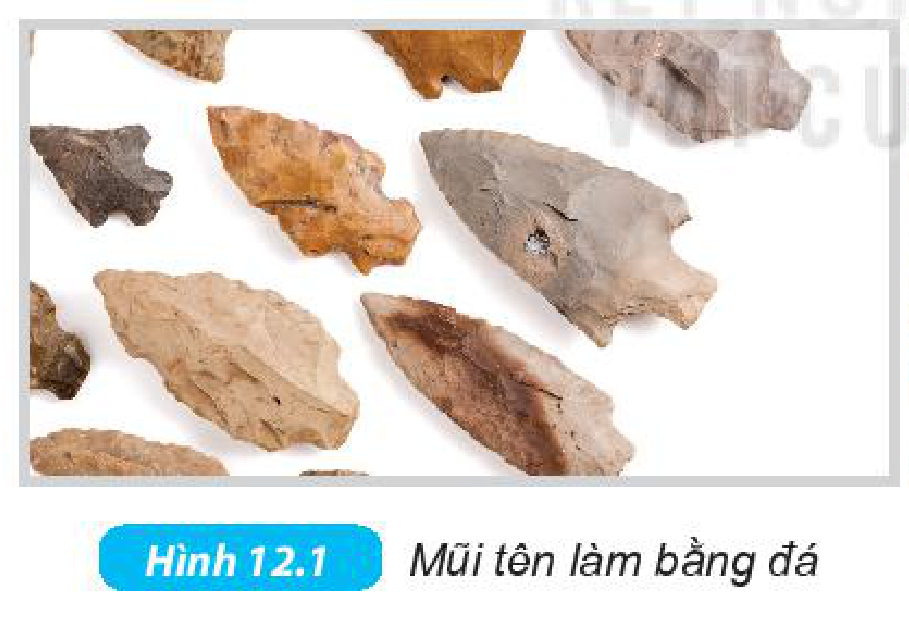
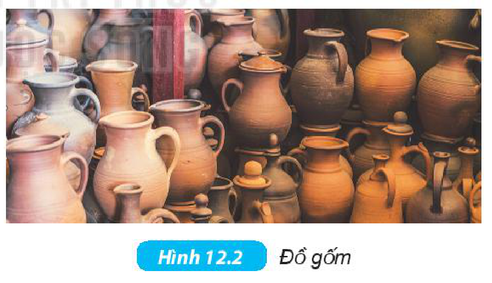
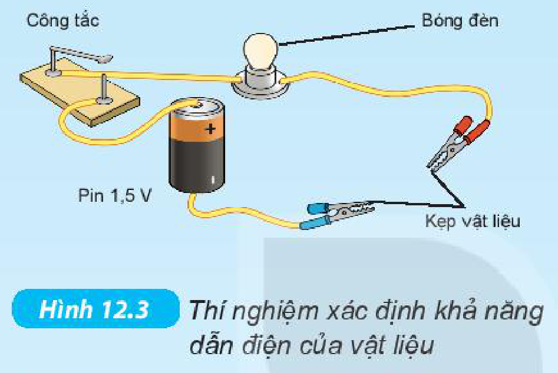
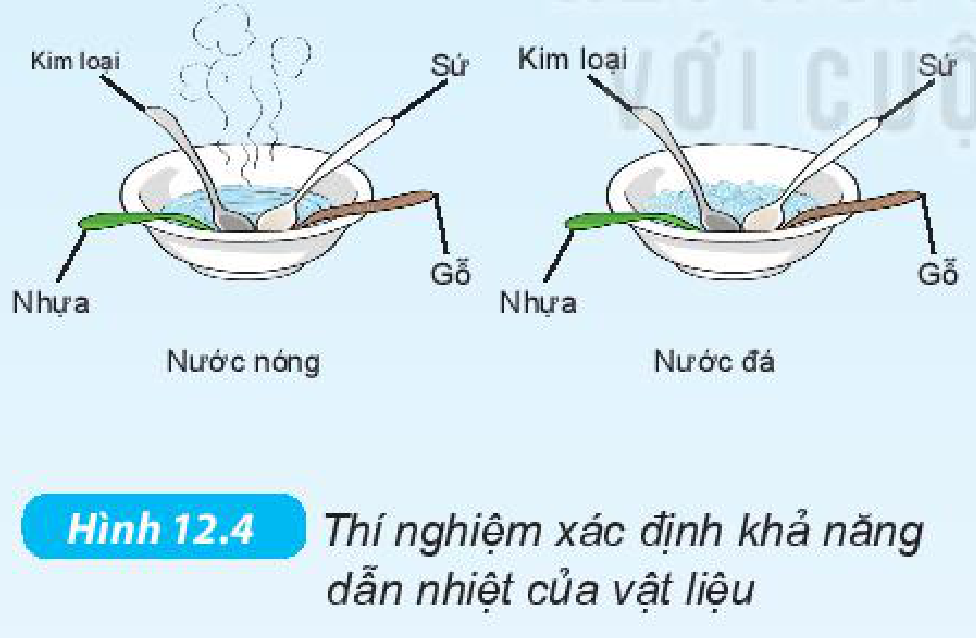
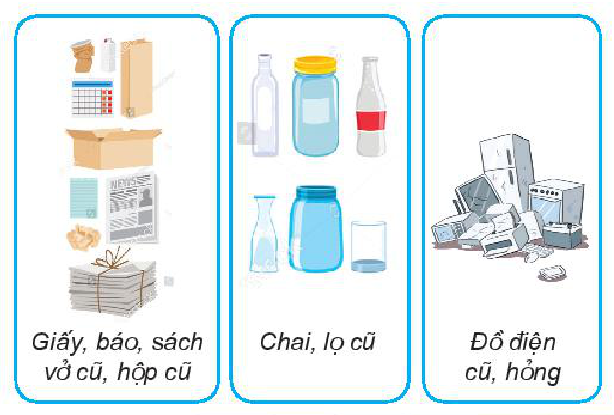

<!-- pdf:43 -->

# BÀI 12: MỘT SỐ VẬT LIỆU

## 🎯 Mục tiêu

- Trình bày được tính chất và ứng dụng của một số vật liệu.
- Đề xuất được phương án tìm hiểu tính chất của một số vật liệu.
- Nêu được cách sử dụng vật liệu an toàn, hiệu quả.

## 🔴 Mở đầu

Lịch sử loài người trải qua thời đại đồ đá (dùng đá làm công cụ), thời đại đồ đồng (dùng đồng làm công cụ) và thời đại đồ sắt (dùng sắt, thép làm công cụ). Do vậy, tên vật liệu đã được dùng để đại diện cho một thời kì trong nền văn minh của con người. Em có thể chọn một loại vật liệu tiêu biểu để đặt tên cho thời đại ngày nay không?

## I. Vật liệu

<!-- term: Vật liệu -->
<!-- term: Vật liệu tự nhiên -->
Từ xa xưa, con người đã biết dùng vật liệu tự nhiên như đá và gỗ làm dụng cụ lao động, săn bắt, hái lượm, xây nhà, đóng tàu, thuyền, dựng thành luỹ và pháo đài,...

<!-- term: Vật liệu -->
Sau đó, con người chế tạo ra các vật liệu không có trong tự nhiên như gốm, sứ, thuỷ tinh, kim loại, nhựa,... Nhựa, thuỷ tinh hữu cơ là những vật liệu phổ biến để sản xuất đồ gia dụng, tấm lợp nhựa,... Gang, thép (chứa sắt) được dùng làm các ống dẫn, vỏ tàu thuyền, khung nhà, cầu cống,...

Hình 12.1. Mũi tên làm bằng đá
<!-- ocr-ok: OCR không đọc được nhãn Hình 12.1 chữ trắng trên nền xanh; đã đối chiếu ảnh trang gốc 43 -->

Hình 12.2. Đồ gốm
<!-- ocr-ok: OCR không đọc được nhãn Hình 12.2 chữ trắng trên nền xanh; đã đối chiếu ảnh trang gốc 43 -->

> ❓ 1. Em hãy cho biết các đồ dùng trong hình bên được làm từ những vật liệu nào.
>
>    - Lốp xe; Bàn; Cốc; Chậu; Bát; Thìa, dĩa
>
> 2. Em hãy nêu một số ví dụ về một vật dụng có thể làm bằng nhiều vật liệu khác nhau.
>
> 3. Em hãy nêu một số ví dụ về việc sử dụng một vật liệu làm ra được nhiều vật dụng khác nhau.

<!-- pdf:44 -->

## II. Tính chất và ứng dụng của vật liệu
<!-- ocr-ok: OCR đọc hỏng tiêu đề mục II chữ màu xanh trên trang gốc 44; đã đối chiếu ảnh -->

<!-- term: Vật liệu -->
Mỗi loại vật liệu có các tính chất khác nhau. Cần dựa vào các tính chất này để lựa chọn vật liệu làm những vật dụng mong muốn. Ví dụ: Dây dẫn điện bằng kim loại cần được bọc nhựa cách điện để tránh bị điện giật khi tiếp xúc. Nồi nấu bằng kim loại có quai bằng gỗ hoặc nhựa (là những vật liệu dẫn nhiệt kém) để tránh bị bỏng khi cầm. Để giữ hoặc vận chuyển các vật nặng cần các giá đỡ làm bằng vật liệu cứng và chắc như kim loại, gỗ,...

> ✋ **1. Tìm hiểu khả năng dẫn điện của vật liệu**
>
> *Chuẩn bị:* bộ dụng cụ như sơ đồ ở Hình 12.3, một số đồ vật làm bằng kim loại, nhựa, gỗ, cao su, thuỷ tinh, gốm,...
>
> *Tiến hành:*
>
> - Kiểm tra dụng cụ: Kẹp hai đầu kẹp trực tiếp vào nhau và xem đèn có sáng không. Nếu đèn sáng thì bộ dụng cụ hoạt động tốt.
> - Lần lượt kẹp từng đồ vật vào hai chiếc kẹp.
>
> Nếu đèn sáng thì vật liệu đó dẫn điện. Nếu đèn không sáng, vật liệu đó không dẫn điện (cách điện).
>
> 
>
> Hình 12.3. Thí nghiệm xác định khả năng dẫn điện của vật liệu
>
> *Hãy quan sát hiện tượng khi thực hiện thí nghiệm và điền kết quả quan sát được theo mẫu bảng sau:*
>
> | Vật liệu | Bóng đèn sáng hay không sáng? | Vật liệu dẫn điện hay không dẫn điện? |
> |---|---|---|
> | ? | ? | ? |
>
> **2. Tìm hiểu khả năng dẫn nhiệt của vật liệu**
>
> *Chuẩn bị:* bát sứ, các thìa bằng kim loại, sứ, nhựa, gỗ.
>
> *Tiến hành:*
>
> - Đổ nước nóng già (khoảng 90 °C) vào 2/3 bát và đặt 4 chiếc thìa vào bát. Sau khoảng 2 – 3 phút, dùng tay cầm vào cán của từng chiếc thìa.
> - Lặp lại thí nghiệm trên, nhưng thay nước nóng bằng nước đá.
>
> *Lưu ý:* Cẩn thận tránh bị bỏng nước nóng.
>
> 
>
> Hình 12.4. Thí nghiệm xác định khả năng dẫn nhiệt của vật liệu
>
> *Hãy nhận xét sự thay đổi nhiệt độ của các loại thìa. Điền kết quả quan sát, nhận xét theo mẫu bảng sau:*
>
> | Vật liệu | Chiếc thìa nóng hơn/lạnh hơn/không nhận thấy sự thay đổi? (Khi nhúng vào nước nóng) | Chiếc thìa nóng hơn/lạnh hơn/không nhận thấy sự thay đổi? (Khi nhúng vào nước đá) | Vật liệu dẫn nhiệt tốt hay không? |
> |---|---|---|---|
> | ? | ? | ? | ? |

<!-- pdf:45 -->

Ngoài tính dẫn điện và dẫn nhiệt, các vật liệu còn có các tính chất khác (xem Bảng 12.1).

**Bảng 12.1** Tính chất của một số vật liệu thông dụng

<!-- term: Kim loại -->
<!-- term: Thuỷ tinh -->
<!-- term: Nhựa -->
<!-- term: Gốm, sứ -->
<!-- term: Cao su -->
<!-- term: Gỗ -->
| Vật liệu | Tính chất |
|---|---|
| *Kim loại* thông dụng được dùng làm dây dẫn điện, nồi đun nấu, làm cầu, cống, khung nhà, cửa,... | Có ánh kim, dẫn điện tốt, dẫn nhiệt tốt, có thể kéo thành sợi và dát mỏng, cứng và bền, có thể bị gỉ. |
| *Thuỷ tinh* được dùng làm bình hoa, chai lọ, cửa kính,... | Trong suốt, cho ánh sáng đi qua, dẫn nhiệt kém, không dẫn điện, cứng nhưng giòn, dễ vỡ. |
| *Nhựa* được dùng làm ghế ngồi, ống dẫn nước, tấm lợp,... | Dẻo, nhẹ, không dẫn điện, dẫn nhiệt kém, không bị ăn mòn, dễ bị biến dạng nhiệt. |
| *Gốm, sứ* được dùng làm chum vại, bát đĩa, chậu hoa,... với các hình dạng khác nhau. | Không bị ăn mòn, dẫn nhiệt kém, hầu như không dẫn điện, cứng nhưng giòn, dễ vỡ. |
| *Cao su* (tự nhiên hoặc nhân tạo) được dùng làm lốp xe, gioăng cao su, đệm,... | Đàn hồi, bền, không dẫn điện và nhiệt, không thấm nước, dễ cháy. |
| *Gỗ* được dùng làm nhà, khung cửa, bàn, ghế, tủ,... | Bền, chịu lực tốt, dễ tạo hình, dễ cháy, có thể bị mối mọt. |

> ❓ 1. Để làm chiếc ấm điện đun nước, người ta đã sử dụng các vật liệu gì? Giải thích.
>
> 2. Quan sát các đồ vật trong hình bên rồi ghi nhận xét theo mẫu bảng sau:
>
> | Đồ vật | Vật liệu | Tính chất | Công dụng |
> |---|---|---|---|
> | Chiếc ấm | Gốm sứ | Cứng, không thấm nước, dẫn nhiệt kém,... | Pha trà |
> | ? | ? | ? | ? |
>
> 3. Hãy cho biết cách sử dụng một số đồ dùng gia đình sao cho an toàn (tránh bị bỏng, tránh bị điện giật,...).

<!-- pdf:46 -->

## III. Thu gom rác thải và tái sử dụng đồ dùng trong gia đình

Rất nhiều đồ dùng cũ hoặc bị hỏng (đồ điện, chai lọ, túi đựng,...), rau, quả, thực phẩm hỏng hay dư thừa có thể được sử dụng lại với mục đích khác hoặc được gom lại để tái chế. Hạn chế rác thải, phân loại rác khi bỏ đi là những hành động thiết thực để góp phần bảo vệ môi trường.

Hình 12.5. Rác thải sinh hoạt hằng ngày (Giấy, báo, sách vở cũ, hộp cũ; Chai, lọ cũ; Đồ điện cũ, hỏng)
<!-- ocr-ok: OCR đọc dính chữ chú thích Hình 12.5 và nhãn ba khung hình trên trang gốc 46; đã đối chiếu ảnh -->

<!-- term: Chu trình 3R -->
> 💡 **Em có biết?**
>
> 1. Chu trình 3R
>
>    *Reduce:* Giảm thiểu việc sử dụng.
>    *Reuse:* Tái sử dụng.
>    *Recycle:* Tái chế.
>
> 2. Không nên tái sử dụng những chai nhựa có kí hiệu sau:
>
>    Đây là kí hiệu chỉ loại nhựa chỉ sử dụng duy nhất một lần (1 PETE). Nếu dùng đi dùng lại có thể gia tăng nguy cơ làm hoà tan các hoá chất cấu tạo nên chúng, gây độc hại cho cơ thể. Chai nước khoáng, nước ngọt,... thường sử dụng loại nhựa này.

> ❓ 1. Hãy nêu cách xử lí các đồ dùng bỏ đi trong gia đình sau đây:
>    a) Chai nhựa, chai thuỷ tinh, túi nylon.
>    b) Quần áo cũ.
>    c) Đồ điện cũ, hỏng.
>    d) Pin điện hỏng.
>    e) Đồ gỗ đã qua sử dụng.
>    g) Giấy vụn.
>
> 2. Hãy nêu cách xử lí rác thải dễ phân huỷ từ những thức ăn bỏ đi hằng ngày thành phân bón cho cây trồng.

## 📌 Em đã học

- Các vật liệu khác nhau có các tính chất khác nhau.
- Ứng dụng của mỗi loại vật liệu dựa vào tính chất của chúng.
- Sử dụng vật liệu tiết kiệm và không sử dụng các vật liệu gây hại cho môi trường.

## ✏️ Em có thể

- Phân loại rác thải trong gia đình theo chu trình 3R.
- Tạo ra một sản phẩm tái chế từ rác thải đã thu gom và phân loại.

## 📷 Danh sách hình trong bài

| Mã hình | Trang PDF | Vị trí | Chú thích gốc |
|---|---|---|---|
| H6-khoa_hoc_tu_nhien-b12-01 | 43 | Mục I | Hình 12.1 Mũi tên làm bằng đá |
| H6-khoa_hoc_tu_nhien-b12-02 | 43 | Mục I | Hình 12.2 Đồ gốm |
| H6-khoa_hoc_tu_nhien-b12-03 | 44 | Mục II, hộp Hoạt động 1 (cạnh khung đi qua màu nền hộp xanh lam) | Hình 12.3 Thí nghiệm xác định khả năng dẫn điện của vật liệu |
| H6-khoa_hoc_tu_nhien-b12-04 | 44 | Mục II, hộp Hoạt động 2 | Hình 12.4 Thí nghiệm xác định khả năng dẫn nhiệt của vật liệu |
| H6-khoa_hoc_tu_nhien-b12-05 | 46 | Mục III (chú thích in lệch cột trái dưới đoạn văn) | Hình 12.5 Rác thải sinh hoạt hằng ngày |
