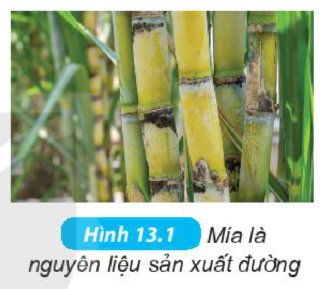
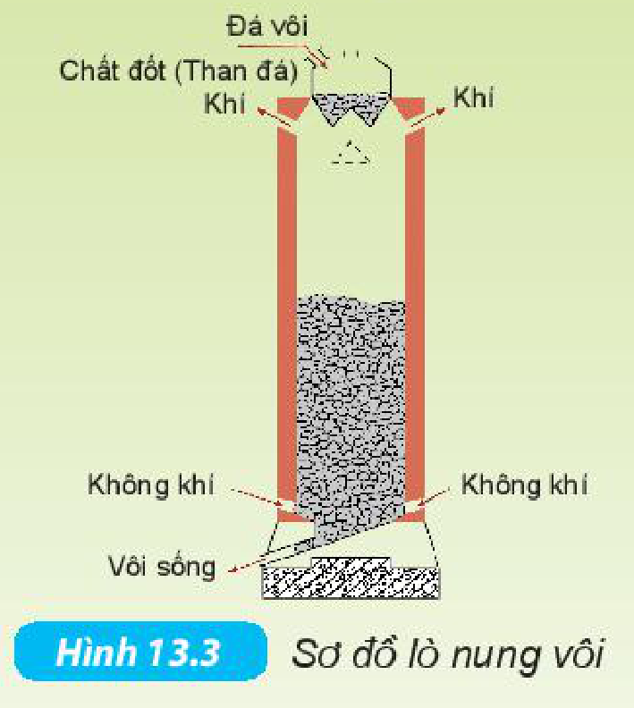
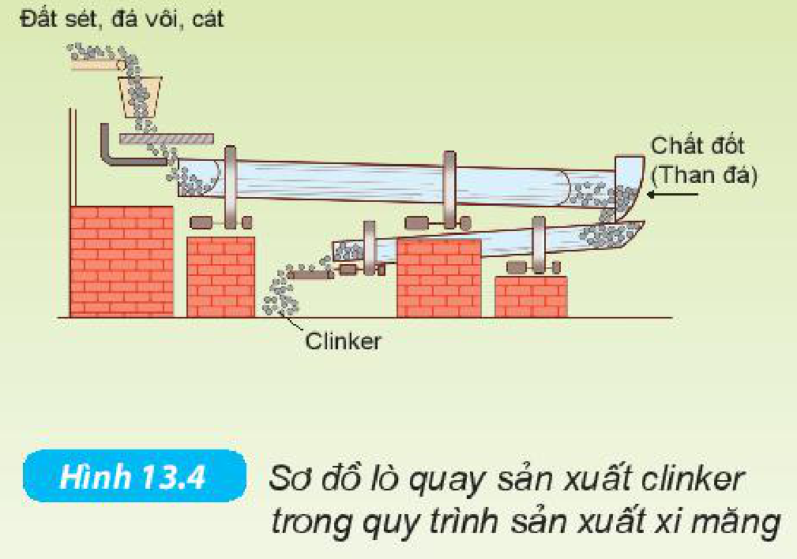
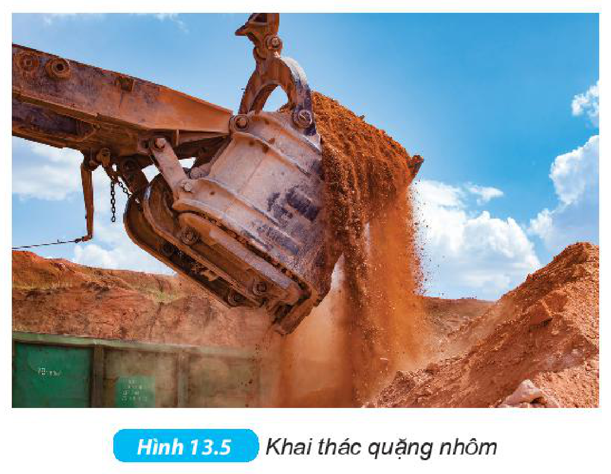
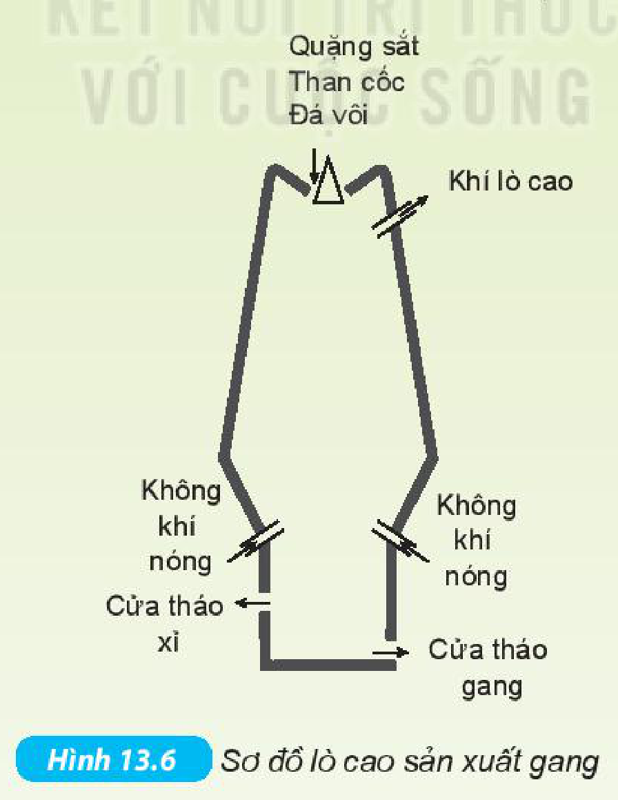

<!-- pdf:47 -->

# BÀI 13: MỘT SỐ NGUYÊN LIỆU

## 🎯 Mục tiêu

- Trình bày được tính chất và ứng dụng của một số nguyên liệu.
- Đề xuất phương án tìm hiểu, thu thập dữ liệu, thảo luận, so sánh để rút ra tính chất của một số nguyên liệu.
- Đề xuất được cách sử dụng nguyên liệu hiệu quả, đảm bảo phát triển bền vững.

## 🔴 Mở đầu

Con người chế biến các nguyên liệu tự nhiên hay nhân tạo để làm ra những sản phẩm mới. Em hãy kể ra một số ví dụ về việc chế biến nguyên liệu thành sản phẩm mới mà em biết.

## I. Các loại nguyên liệu

<!-- term: Nguyên liệu -->
<!-- term: Nguyên liệu tự nhiên -->
<!-- term: Nguyên liệu nhân tạo -->
Nguyên liệu được con người lấy từ tự nhiên để chế biến gồm các loại đất, đá, quặng, dầu mỏ,...
- Từ đá vôi sản xuất ra vôi sống.
- Từ quặng sản xuất ra sắt, nhôm (aluminium), đồng (copper), phosphorus,...
- Từ đất, đá, cát sản xuất ra xi măng, gạch ngói, đồ gốm, thuỷ tinh,...
- Từ dầu mỏ điều chế ra các hoá chất cơ bản, đó là nguyên liệu nhân tạo, dùng để sản xuất phân bón, thuốc trừ sâu, dược phẩm, mĩ phẩm, các loại len, tơ,...

Hình 13.1. Mía là nguyên liệu sản xuất đường
<!-- ocr-ok: OCR bỏ sót chú thích Hình 13.1 chữ nhỏ dưới ảnh trên trang gốc 47; đã đối chiếu ảnh -->

Hình 13.2. Nước hoa, son môi, dầu gội là những sản phẩm thường được tạo ra từ nguyên liệu nhân tạo

> ❓ Hãy tìm hiểu và cho biết quặng bauxite được dùng làm nguyên liệu để sản xuất chất gì.

## II. Đá vôi

<!-- term: Đá vôi -->
Đá vôi được dùng để:
- Sản xuất vôi sống.
- Đập nhỏ để làm đường, làm bê tông.
- Chế biến thành chất độn (bột nhẹ) dùng trong sản xuất cao su, xà phòng,...

<!-- term: Đá vôi -->
Đá vôi có thành phần chủ yếu là calcium carbonate. Trong đá vôi thường lẫn các tạp chất như đất sét, cát,... nên màu sắc đa dạng: trắng, xám, xanh nhạt, vàng, hồng sẫm hay đen,... Người ta thường khai thác đá vôi ở những nơi đá vôi có ít tạp chất và thuận tiện cho việc vận chuyển.

Ở nước ta có nhiều vùng núi đá vôi, tập trung ở các tỉnh phía Bắc và Bắc Trung Bộ (Lạng Sơn, Cao Bằng, Bắc Kạn, Hà Giang, Tuyên Quang, Sơn La, Hoà Bình, Ninh Bình, Thanh Hoá và một số đảo ở Cát Bà, Hạ Long).

<!-- pdf:48 -->

> ✋ **Tìm hiểu tính chất của đá vôi**
>
> *Chuẩn bị:* 1 viên đá vôi, dung dịch hydrochloric acid, 1 ống hút hoặc pipet, 1 chiếc đĩa, 1 chiếc đinh sắt.
>
> *Tiến hành:*
>
> 1. Dùng chiếc đinh sắt vạch mạnh lên bề mặt viên đá vôi. Quan sát hiện tượng.
>
> 2. Lấy ống hút hoặc pipet nhỏ từng giọt hydrochloric acid lên một viên đá vôi. Quan sát hiện tượng (Acid, Bọt khí, Đá vôi).
>
> *Trả lời câu hỏi:*
>
> a) Đá vôi có dễ dàng bị đinh sắt làm trầy xước không?
> b) Khi nhỏ acid vào đá vôi, em quan sát thấy hiện tượng gì?

> ❓ 1. Hãy nêu một số tính chất và ứng dụng của đá vôi.
>
> 2. Hãy tìm hiểu và cho biết tác hại của việc khai thác đá vôi đối với môi trường.

> 💡 **Em có biết?**
>
> - Đá vôi được nung trong lò để biến thành vôi sống.
> - Đất sét, đá vôi, cát được nung thành clinker rồi chế biến để tạo thành xi măng.
>
> 
>
> Hình 13.3. Sơ đồ lò nung vôi
>
> 
>
> Hình 13.4. Sơ đồ lò quay sản xuất clinker trong quy trình sản xuất xi măng
<!-- ocr-ok: OCR đọc sai chữ trong hộp Em có biết? nền xanh lục đè logo chìm trên trang gốc 48; đã đối chiếu ảnh -->

<!-- pdf:49 -->

## III. Quặng

**Quặng** là loại đất đá chứa các chất có giá trị với hàm lượng lớn, được khai thác và chế biến thành các sản phẩm hữu dụng.

<!-- term: Quặng sắt -->
Quặng sắt dùng để chế tạo **gang** và **thép** (hai loại vật liệu quan trọng chứa thành phần chính là sắt, được dùng trong xây dựng, chế tạo máy, dụng cụ,...).

<!-- term: Quặng bauxite -->
Quặng bauxite dùng để sản xuất nhôm, một vật liệu quan trọng trong chế tạo máy bay, ô tô, kĩ thuật điện, xây dựng,...

Hình 13.5. Khai thác quặng nhôm
<!-- ocr-ok: OCR không đọc được nhãn Hình 13.5 chữ trắng trên nền xanh trang gốc 49; đã đối chiếu ảnh -->

Thiên nhiên ban tặng cho Việt Nam nhiều mỏ quặng, như quặng sắt ở Thái Nguyên, quặng nhôm ở Tây Nguyên,...

Nguồn quặng tự nhiên ngày một cạn đi, không thể tái tạo, do đó cần phải khai thác và sử dụng một cách hợp lí để gìn giữ tài sản quốc gia. Ngoài ra khi khai thác quặng cần gìn giữ và bảo vệ môi trường.

> ✋ 1. Em hãy tìm hiểu về các mỏ quặng ở Việt Nam thông qua các phương tiện thông tin và cho biết các quặng này chứa các khoáng chất gì và ứng dụng của nó.
>
> 2. Tìm hiểu và trao đổi với bạn về tác động đến môi trường trong các vùng có khai thác quặng mà em biết.

## 📌 Em đã học

- Nhận biết được các nguyên liệu tự nhiên và nguyên liệu nhân tạo.
- Dựa vào thành phần, tính chất của các chất chính có trong nguyên liệu để sản xuất ra các sản phẩm cần thiết.
- Nguyên liệu tự nhiên là nguồn tài nguyên hữu hạn nên cần khai thác và sử dụng hợp lí.

## ✏️ Em có thể

Đề xuất các hành động để bảo vệ tài nguyên rừng và biển của Việt Nam.

<!-- pdf:50 -->

> 💡 **Em có biết?**
>
> 1. Một số loại quặng và ứng dụng
>
> | Quặng | Ứng dụng |
> |---|---|
> | Quặng chứa phosphorus | Sản xuất phosphorus và các loại phân bón chứa phosphorus (phân lân) tốt cho cây trồng. |
> | Quặng đồng | Sản xuất đồng, một kim loại dẫn điện tốt, được sử dụng làm dây dẫn điện. |
> | Quặng titanium | Sản xuất titanium, một kim loại nhẹ, có độ bền cao, chịu mài mòn tốt, nhiệt độ nóng chảy cao, làm vật liệu quan trọng cho ngành hàng không (động cơ phản lực), khung xe đạp thể thao,... |
>
> 2. Sản xuất gang, thép từ quặng sắt
>
> Quặng sắt được nghiền nhỏ, loại bỏ bớt tạp chất rồi nung với than cốc ở lò cao thu được gang (chứa hơn 95% sắt) (Hình 13.6). Từ gang người ta lại luyện thành thép (giảm lượng carbon và có thêm các kim loại khác,...) có nhiều công dụng hơn.
>
> 
>
> Hình 13.6. Sơ đồ lò cao sản xuất gang

## 📷 Danh sách hình trong bài

| Mã hình | Trang PDF | Vị trí | Chú thích gốc |
|---|---|---|---|
| H6-khoa_hoc_tu_nhien-b13-01 | 47 | Mục I | Hình 13.1 Mía là nguyên liệu sản xuất đường |
| H6-khoa_hoc_tu_nhien-b13-02 | 47 | Mục I | Hình 13.2 Nước hoa, son môi, dầu gội là những sản phẩm thường được tạo ra từ nguyên liệu nhân tạo |
| H6-khoa_hoc_tu_nhien-b13-03 | 48 | Mục II, hộp Em có biết? (cạnh khung đi qua màu nền hộp xanh lục) | Hình 13.3 Sơ đồ lò nung vôi |
| H6-khoa_hoc_tu_nhien-b13-04 | 48 | Mục II, hộp Em có biết? (cạnh khung đi qua màu nền hộp xanh lục) | Hình 13.4 Sơ đồ lò quay sản xuất clinker trong quy trình sản xuất xi măng |
| H6-khoa_hoc_tu_nhien-b13-05 | 49 | Mục III | Hình 13.5 Khai thác quặng nhôm |
| H6-khoa_hoc_tu_nhien-b13-06 | 50 | Hộp Em có biết? cuối bài (cạnh khung đi qua màu nền hộp xanh lục) | Hình 13.6 Sơ đồ lò cao sản xuất gang |
