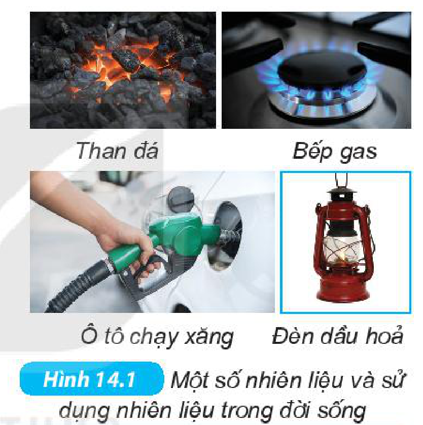
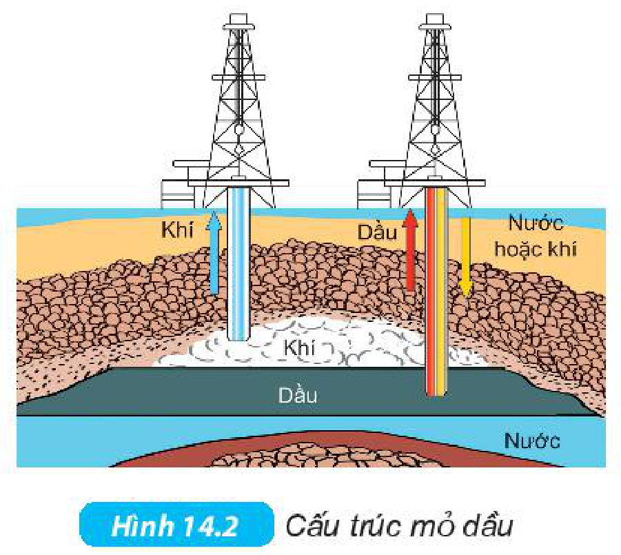

<!-- pdf:51 -->

# BÀI 14: MỘT SỐ NHIÊN LIỆU

## 🎯 Mục tiêu

- Trình bày được tính chất và ứng dụng của một số nhiên liệu.
- Đề xuất phương án tìm hiểu, thu thập dữ liệu, thảo luận, so sánh để rút ra tính chất của một số nhiên liệu.
- Nêu được cách sử dụng nhiên liệu an toàn, hiệu quả, đảm bảo sự phát triển bền vững.

## 🔴 Mở đầu

Với tốc độ tiêu thụ như hiện tại, loài người sẽ nhanh chóng cạn kiệt các nguồn nhiên liệu thông thường như than đá, dầu mỏ, khí thiên nhiên. Em hình dung khi đó loài người sẽ sống thế nào?

## I. Các loại nhiên liệu

**Nhiên liệu** là những chất cháy được và khi cháy toả nhiều nhiệt. Đó là gỗ, than, dầu mỏ, khí đốt, xăng,... Nhiệt toả ra khi đốt cháy nhiên liệu được sử dụng để sưởi ấm, nấu ăn, chạy động cơ và phát điện.

Nhiên liệu có thể tồn tại ở thể rắn (than đá, gỗ,...), thể lỏng (xăng, dầu hoả,...), thể khí (các loại khí đốt). Hầu hết các loại nhiên liệu nhẹ hơn nước (trừ than đá) và không tan trong nước (trừ cồn).

Hình 14.1. Một số nhiên liệu và sử dụng nhiên liệu trong đời sống (Than đá; Bếp gas; Ô tô chạy xăng; Đèn dầu hoả)
<!-- ocr-ok: OCR đọc dính chữ chú thích và nhãn phụ của Hình 14.1 trên trang gốc 51; đã đối chiếu ảnh -->

> ❓ 1. Nhiên liệu tồn tại ở những thể nào?
>
> 2. Em hãy cho biết ứng dụng của các nhiên liệu: dầu hoả, gỗ, xăng, than đá, khí thiên nhiên.

## II. Nguồn nhiên liệu, tính chất và cách sử dụng nhiên liệu

Than đá, dầu mỏ và khí thiên nhiên được tạo thành cách đây hàng triệu năm do sự phân huỷ của các thảm thực vật ở điều kiện không có oxygen. Ở nước ta, than đá tập trung nhiều nhất ở tỉnh Quảng Ninh (Cửa Ông, Vàng Danh,...). Than đá chứa nhiều tạp chất nên khi đốt cháy sinh ra nhiều chất độc hại, do đó được khuyến cáo là loại nhiên liệu gây ô nhiễm nhất trong các nguồn **nhiên liệu hoá thạch**.

<!-- term: Dầu mỏ -->
Dầu mỏ và khí thiên nhiên thường tồn tại cùng nhau trong mỏ dầu. Ở Việt Nam, các mỏ dầu có trữ lượng lớn được phát hiện ở biển Đông (Bạch Hổ, Lan Tây,...). Khi chưng cất dầu thô ta thu được các nhiên liệu là dầu hoả, xăng và khí đốt.

Hình 14.2. Cấu trúc mỏ dầu
<!-- ocr-ok: OCR không đọc được nhãn Hình 14.2 chữ trắng trên nền xanh trang gốc 51; đã đối chiếu ảnh -->

<!-- pdf:52 -->

> ❓ 1. Hãy kể tên các nhiên liệu thường dùng trong việc đun nấu và nêu cách dùng nhiên liệu đó an toàn, tiết kiệm.
>
> 2. Hãy cho biết một số tác động đến môi trường khi sử dụng nhiên liệu hoá thạch.

> ✋ **Tìm hiểu tính chất của nhiên liệu**
>
> 1. Quan sát việc sử dụng nhiên liệu trong đời sống hằng ngày như bật bếp gas, bật chiếc bật lửa gas, châm lửa đèn dầu, đốt cháy than củi,... Em hãy nhận xét về tính bắt lửa của nhiên liệu gas, dầu, than. Để dập tắt bếp than củi, em làm thế nào?
>
> 2. Khi mở nắp bình chứa xăng, dầu, ta ngửi thấy mùi đặc trưng của chúng. Tại sao?
>
> 3. Nêu các tính chất của nhiên liệu mà em quan sát thấy.

## III. Sơ lược về an ninh năng lượng
<!-- ocr-ok: OCR bỏ sót tiêu đề mục III chữ màu xanh trên trang gốc 52; đã đối chiếu ảnh -->

Tất cả các hoạt động của chúng ta, từ sinh hoạt hằng ngày đến lao động sản xuất hay vui chơi giải trí, đều cần đến năng lượng. Do đó, mỗi quốc gia đều phải có chương trình đảm bảo đủ năng lượng cho mọi hoạt động.

Các nguồn năng lượng thông thường là than đá, dầu mỏ và khí thiên nhiên (nhiên liệu hoá thạch), phải mất hàng triệu năm để hình thành (không tái tạo), do đó sẽ cạn kiệt dần.

Để thay thế nguồn **năng lượng không tái tạo**, người ta đã nghiên cứu các nguồn **năng lượng tái tạo**$^{(1)}$ như thuỷ điện, địa nhiệt, năng lượng mặt trời, năng lượng gió, năng lượng sinh học,...

> ❓ Hãy nêu một số nguồn năng lượng khác có thể dùng để thay thế năng lượng từ nhiên liệu hoá thạch.

## 📌 Em đã học

- Nhiên liệu là những chất cháy được và toả nhiều nhiệt. Một số nhiên liệu thường dùng là gỗ, than đá (rắn); dầu hoả, xăng (lỏng); khí thiên nhiên,...
- Nhiên liệu hoá thạch có hạn và dần cạn kiệt, cần sử dụng tiết kiệm và tìm các nguồn năng lượng thay thế khác.
- Hiểu biết về tính chất của các nhiên liệu giúp em biết sử dụng nhiên liệu an toàn và biết dập tắt các đám cháy nhiên liệu.

## ✏️ Em có thể

Biết sử dụng an toàn và tiết kiệm các loại nhiên liệu trong đời sống hằng ngày.

<!-- term: Đá cháy -->
> 💡 **Em có biết?**
>
> “Đá cháy” hay “băng cháy” là methane hydrate được hình thành ở áp suất cao và nhiệt độ thấp, được phát hiện với lượng rất lớn ở sâu dưới biển Bắc cực. Hiện nay, nhiều công ty khai thác và cung cấp năng lượng đang đẩy nhanh tiến độ khai thác “đá cháy” với mong muốn kéo dài thời gian sử dụng năng lượng hoá thạch của loài người.

> $^{(1)}$ Xem thêm về *các dạng năng lượng, năng lượng tái tạo, tiết kiệm năng lượng* ở Chương IX.

## 📷 Danh sách hình trong bài

| Mã hình | Trang PDF | Vị trí | Chú thích gốc |
|---|---|---|---|
| H6-khoa_hoc_tu_nhien-b14-01 | 51 | Mục I | Hình 14.1 Một số nhiên liệu và sử dụng nhiên liệu trong đời sống |
| H6-khoa_hoc_tu_nhien-b14-02 | 51 | Mục II | Hình 14.2 Cấu trúc mỏ dầu |
