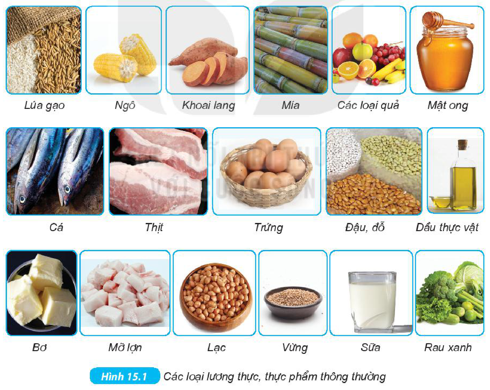

<!-- pdf:53 -->

# BÀI 15: MỘT SỐ LƯƠNG THỰC, THỰC PHẨM

## 🎯 Mục tiêu

- Trình bày được tính chất và ứng dụng của một số lương thực, thực phẩm.
- Thu thập số liệu, thảo luận, so sánh để rút ra tính chất của một số lương thực, thực phẩm.
- Đề xuất phương án tìm hiểu tính chất của một số lương thực, thực phẩm.

## 🔴 Mở đầu

Chúng ta sử dụng lương thực, thực phẩm hằng ngày để ăn uống, lấy năng lượng (nhiên liệu), dưỡng chất (nguyên liệu) cho cơ thể phát triển và hoạt động. Em có thể lựa chọn thức ăn cho mình và gia đình như thế nào để đủ chất dinh dưỡng, giúp cơ thể khoẻ mạnh?

## I. Vai trò của lương thực, thực phẩm

Hình 15.1. Các loại lương thực, thực phẩm thông thường (Lúa gạo; Ngô; Khoai lang; Mía; Các loại quả; Mật ong; Cá; Thịt; Trứng; Đậu, đỗ; Dầu thực vật; Bơ; Mỡ lợn; Lạc; Vừng; Sữa; Rau xanh)
<!-- ocr-ok: OCR bỏ sót phần lớn các nhãn thực phẩm dưới các ô ảnh Hình 15.1 trang gốc 53; đã đối chiếu ảnh -->

<!-- term: Lương thực -->
<!-- term: Thực phẩm -->
Con người cần năng lượng và chất dinh dưỡng để duy trì sự sống, phát triển và hoạt động. Thức ăn của con người ở dạng lương thực (như ngũ cốc: lúa gạo, ngô, khoai sắn, lúa mì) và thực phẩm (như thịt, cá, rau, củ, quả,...). Thức ăn được cơ thể chuyển hoá thành năng lượng và các chất dinh dưỡng cần thiết cho cơ thể.

<!-- pdf:54 -->

<!-- term: Thực phẩm -->
Lương thực và thực phẩm dễ bị hư hỏng, nhất là trong môi trường nóng, ẩm. Khi đó, chúng sinh ra những chất độc, có hại cho sức khỏe. Ví dụ: thịt, cá, rau bị ôi thiu (nhiễm khuẩn) gây ra ngộ độc cho cơ thể$^{(1)}$; gạo, lạc dễ bị mốc, sinh ra những chất cực độc gây ung thư;... Vì vậy, lương thực, thực phẩm cần được bảo quản thích hợp.

> ❓ 1. Quan sát Hình 15.1 và trả lời câu hỏi:
>    a) Lương thực, thực phẩm nào có nguồn gốc từ thực vật, từ động vật?
>    b) Lương thực, thực phẩm nào có thể ăn sống, phải nấu chín?
>
> 2. Tại sao cần phải bảo quản lương thực, thực phẩm đúng cách?

## II. Các nhóm chất dinh dưỡng trong lương thực, thực phẩm
<!-- ocr-ok: OCR đọc hỏng tiêu đề mục II chữ màu xanh trên trang gốc 54; đã đối chiếu ảnh -->

### 1. Carbohydrate: nguồn năng lượng chính

**Carbohydrate** là tên gọi chung của nhóm chất chứa **tinh bột**, đường và chất xơ. Phần lớn carbohydrate có nguồn gốc thực vật.

<!-- term: Lương thực -->
Người Việt Nam thường ăn cơm nấu từ gạo và các loại bún, bánh chế biến từ gạo, ngô, khoai và sắn. Ở các nước khác, ngô, lúa mì, lúa mạch được sử dụng làm nguồn tinh bột và thường chế biến thành bánh mì, bánh ngô,... Khái niệm lương thực thường dùng để chỉ các nguồn tinh bột.

Khi tiêu hoá, tinh bột được chuyển hoá thành đường, rồi thành nước và khí carbon dioxide đồng thời giải phóng năng lượng. Tinh bột là nguồn cung cấp năng lượng chính cho cơ thể.

<!-- term: Đường -->
Đường cũng là một loại carbohydrate. Đường cung cấp nhiều năng lượng và có nhiều trong cây mía, thốt nốt, củ cải đường, các hoa quả ngọt.

> ❓ 1. Hãy kể tên các lương thực có trong Hình 15.1 và một số thức ăn được chế biến từ các loại lương thực đó.
>
> 2. Nhóm carbohydrate có vai trò gì đối với cơ thể?

> ✋ **Tìm hiểu sự biến đổi của lương thực**
>
> 1. Cho một thìa gạo vào hai hộp nhựa nhỏ, thêm nước vào một hộp cho ướt hết gạo. Để yên ngoài không khí khoảng 5 – 10 giờ. So sánh độ cứng của hạt gạo ở hai hộp nhựa (có thể ép chúng bằng một vật cứng).
>
> 2. Em đã từng thấy cơm bị thiu chưa? Em hãy chỉ ra các dấu hiệu (mùi, màu sắc,...) cho thấy cơm đã bị thiu.
>
> 3. Em hãy đề xuất cách bảo quản lương thực khô (gạo, ngô, khoai, sắn) và lương thực đã được nấu chín (cơm, cháo).

> $^{(1)}$ Xem thêm về *vi khuẩn*, nguyên nhân khiến thức ăn hư hỏng ở Bài 27, Chương VII.

<!-- pdf:55 -->

### 2. Các chất dinh dưỡng khác

**a) Protein (chất đạm)**

**Protein** còn gọi là chất đạm, có vai trò cấu tạo, duy trì và phát triển cơ thể. Protein liên quan đến mọi chức năng sống của cơ thể và cần thiết cho sự chuyển hoá các chất dinh dưỡng. Protein có nhiều trong thịt, cá, trứng, sữa và các loại hạt như đậu, đỗ,...

**b) Lipid (chất béo)**

**Lipid**, còn gọi là chất béo. Lipid là nguồn dự trữ năng lượng trong cơ thể và có tác dụng chống lạnh. Lipid có ở dạng sản phẩm đã chế biến như bơ, dầu thực vật,... và trong các thực phẩm tự nhiên như sữa, lòng đỏ trứng, thịt, cá, lạc, vừng,...

> ❓ 1. Quan sát Hình 15.1 và cho biết thực phẩm nào cung cấp protein, thực phẩm nào cung cấp lipid.
>
> 2. Hãy tìm hiểu và cho biết những mặt tốt và mặt xấu của lipid đối với sức khoẻ con người.

**c) Chất khoáng và vitamin**

**Chất khoáng** trong cơ thể người gồm calcium, phosphorus, iodine, sắt, kẽm (zinc),... Chất khoáng vô cùng cần thiết cho sự phát triển của cơ thể. Ví dụ: Thiếu calcium, xương trở nên xốp, yếu; Thiếu iodine gây ra các bệnh về tuyến giáp (bướu cổ,...).

**Vitamin** là những chất chỉ cần một lượng nhỏ nhưng có tác dụng lớn đến quá trình trao đổi chất. Vitamin được đặt tên theo chữ cái A, B1, B2, C, D, E,... Vitamin được chia thành hai nhóm, nhóm vitamin tan trong chất béo như A, D, E, K và nhóm vitamin tan trong nước như B, C,...

Cơ thể không tự tổng hợp được đa số vitamin mà phải lấy vào qua thức ăn. Nếu cơ thể thiếu vitamin sẽ dẫn tới nhiều rối loạn chuyển hoá. Ví dụ: thiếu vitamin A khiến cho mắt kém, thiếu vitamin D khiến xương và cơ thể sẽ kém phát triển,...

Nguồn thực phẩm giàu chất khoáng và vitamin là các loại hải sản, các loại rau xanh, củ, quả tươi,...

> ❓ 1. Hãy tìm hiểu và cho biết những thực phẩm bổ sung nhiều calcium cho cơ thể.
>
> 2. Vitamin nào tốt cho mắt?
>
> 3. Vitamin nào tốt cho sự phát triển của xương?

> ✋ **Tìm hiểu sự biến đổi của thực phẩm trong đời sống**
>
> 1. Quan sát một số loại rau khi để ngoài không khí một vài ngày và nhận xét sự biến đổi của chúng.
>
> 2. Quan sát một miếng cá hoặc thịt hoặc một ít sữa khi để ngoài không khí một vài ngày và nhận xét sự biến đổi của chúng.
>
> 3. Hãy cho biết người ta bảo quản thịt tươi và thịt nấu chín bằng cách nào.

<!-- pdf:56 -->

## III. Sức khoẻ và chế độ dinh dưỡng

Các loại thức ăn khác nhau cung cấp lượng năng lượng và các chất dinh dưỡng khác nhau. Năng lượng và chất dinh dưỡng cần thiết cho mỗi người là khác nhau, phụ thuộc vào lứa tuổi, giới tính, cân nặng và chiều cao, công việc đòi hỏi vận động nhiều hay ít,...

Nếu ăn quá nhiều mà ít hoạt động thì thức ăn sẽ được dự trữ dưới dạng chất béo. Nếu ăn ít không đủ chất, cơ thể sẽ bị suy dinh dưỡng.

Một số chất cần cho cơ thể với lượng nhỏ (như chất khoáng, vitamin) nhưng rất quan trọng.

> ❓ Tại sao khẩu phần cho một bữa ăn nên có nhiều loại thức ăn khác nhau?

## 📌 Em đã học

- Vai trò của lương thực, thực phẩm đối với con người$^{(1)}$.
- Lương thực và thực phẩm dễ bị biến chất, cần được bảo quản đúng cách.
- Các nhóm chất dinh dưỡng trong lương thực, thực phẩm: carbohydrate, protein, lipid, chất khoáng và vitamin.

## ✏️ Em có thể

Biết lựa chọn thức ăn, đồ uống an toàn, đủ chất dinh dưỡng để có cơ thể khoẻ mạnh.

> 💡 **Em có biết?**
>
> **Cơ thể cần dầu, mỡ để hấp thụ vitamin A**
>
> Vitamin A có vai trò rất quan trọng đối với cơ thể. Thiếu vitamin A sẽ ảnh hưởng đến thị lực, gây ra bệnh "quáng gà". Trẻ em thiếu vitamin A sẽ bị còi cọc.
>
> Vitamin A thuộc nhóm vitamin tan trong chất béo. Vì vậy, bữa ăn hằng ngày phải có dầu, mỡ thì cơ thể mới hấp thu được vitamin A trong thức ăn. Nếu chúng ta ăn đủ các thực phẩm chứa vitamin A nhưng lại ăn thiếu dầu, mỡ thì cơ thể vẫn bị thiếu vitamin A.
>
> Những loại củ quả cung cấp nhiều vitamin A như cà rốt, cà chua khi được xào, nấu cùng với dầu, mỡ sẽ giúp cho cơ thể hấp thụ vitamin A tốt hơn.

> $^{(1)}$ Xem thêm về *thực phẩm, dinh dưỡng, bảo quản và chế biến thực phẩm* ở sách Công nghệ 6.

## 📷 Danh sách hình trong bài

| Mã hình | Trang PDF | Vị trí | Chú thích gốc |
|---|---|---|---|
| H6-khoa_hoc_tu_nhien-b15-01 | 53 | Mục I | Hình 15.1 Các loại lương thực, thực phẩm thông thường |
