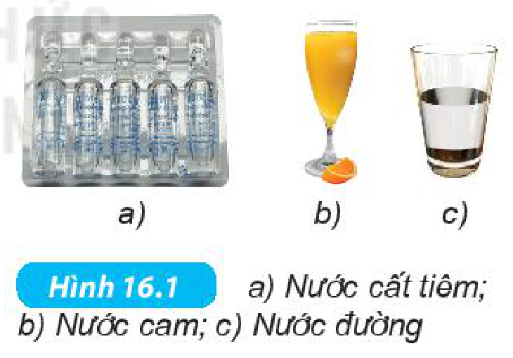
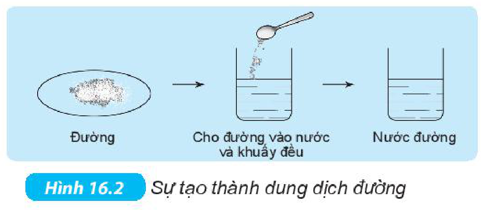
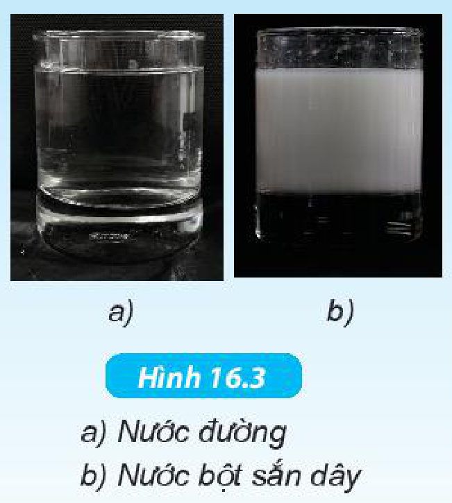
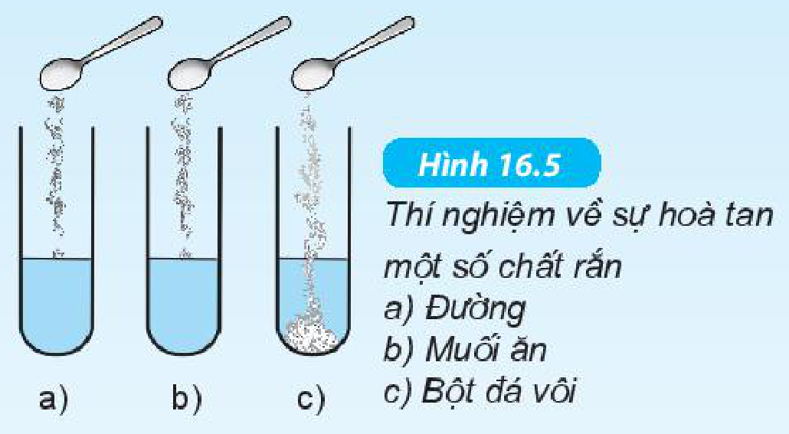
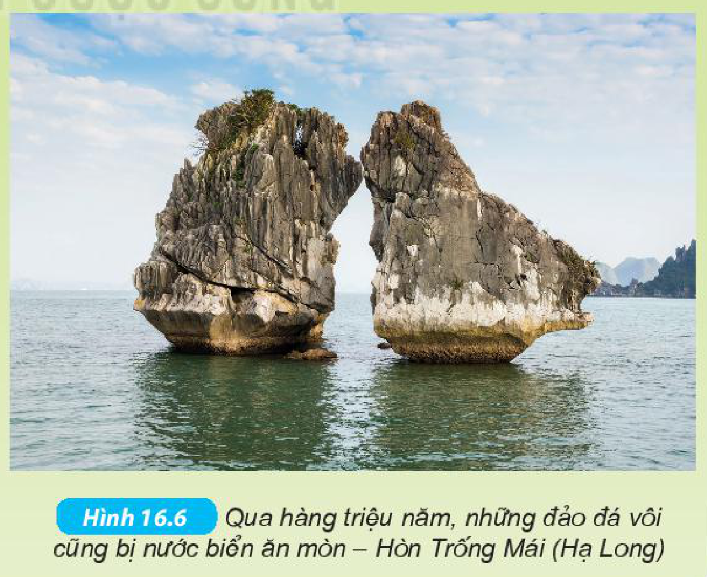

<!-- pdf:57 -->

# BÀI 16: HỖN HỢP CÁC CHẤT

## 🎯 Mục tiêu

- Nêu được khái niệm hỗn hợp, chất tinh khiết.
- Thực hiện được một số thí nghiệm để nhận ra dung môi, dung dịch, chất tan và chất không tan.
- Phân biệt được hỗn hợp đồng nhất và không đồng nhất, dung dịch và huyền phù, nhũ tương qua quan sát.
- Nêu được các yếu tố ảnh hưởng đến lượng chất rắn hoà tan trong nước. Lấy được ví dụ về sự hoà tan của chất khí.

## 🔴 Mở đầu

Nước biển có chứa những chất gì mà lại có vị mặn?

## I. Chất tinh khiết và hỗn hợp

Vật thể xung quanh ta có thể chứa một chất duy nhất hoặc nhiều chất khác nhau. Nước cất dùng pha thuốc tiêm chỉ có một chất duy nhất là nước, một chiếc thìa bạc cũng chỉ được tạo thành từ một chất là bạc (silver), bình khí oxygen cũng chỉ chứa một chất là oxygen. Nước cất, bạc, oxygen nói trên là những ví dụ về **chất tinh khiết**.

Chất tinh khiết chỉ có một chất duy nhất và có những tính chất xác định. Ví dụ nước tinh khiết sôi ở 100 °C, nóng chảy ở 0 °C; oxygen hoá lỏng ở $-183\text{ °C}$, hoá rắn ở $-218\text{ °C}$.

Khác với nước cất, trong cốc nước đường ngoài nước còn có đường. Trong cốc nước cam còn có nhiều thành phần hơn nữa, ngoài nước, đường còn có thêm các acid hữu cơ, tinh dầu,... Trong nước biển cũng có nhiều chất khác nhau như nước, muối ăn,... Nước đường, nước cam và nước biển là các ví dụ về **hỗn hợp**.

Hỗn hợp chứa từ hai chất trở lên. Tính chất của hỗn hợp thay đổi tuỳ thuộc vào thành phần các chất có trong hỗn hợp.

Hình 16.1. a) Nước cất tiêm; b) Nước cam; c) Nước đường

> ❓ 1. Khi pha thêm nước vào cốc nước cam, em thấy màu và vị nước cam thay đổi thế nào? Từ đó, hãy cho biết tính chất của hỗn hợp có phụ thuộc thành phần không.
>
> 2. Hãy kể một số chất tinh khiết và hỗn hợp xung quanh em.

## II. Dung dịch

Tiến hành hoà tan đường vào nước (Hình 16.2):

Hình 16.2. Sự tạo thành dung dịch đường

<!-- pdf:58 -->

<!-- term: Hỗn hợp đồng nhất -->
Trong thí nghiệm này, đường bị tách ra thành những hạt vô cùng nhỏ mà mắt thường không thể nhìn thấy được, chúng phân bố đồng đều trong nước, tạo thành hỗn hợp đồng nhất chứa nước và đường. Trong quá trình này, đường là **chất tan**, nước là **dung môi** còn nước đường là **dung dịch**. Dung dịch là một hỗn hợp đồng nhất của dung môi và chất tan.

> ❓ 1. Khi hoà tan đường vào nước, đường có bị biến đổi thành chất khác không?
>
> 2. Nước muối, giấm ăn, nước giải khát có gas là các dung dịch. Em hãy chỉ ra dung môi và chất tan trong các trường hợp đó.
>
> 3. Quan sát Hình 16.1 và hãy chỉ ra loại nước nào là hỗn hợp đồng nhất? không đồng nhất?

> ✋ ***Thực hiện ở nhà (trước bài học)***
>
> **Tính chất của chất tan trong dung dịch có khác với ban đầu không?**
>
> *Chuẩn bị:* 1 cốc, 1 thìa, muối ăn, nước.
>
> *Tiến hành:*
> Pha 3 – 5 thìa nhỏ muối ăn vào cốc đựng 20 mL nước ấm, khuấy đều. Nếm thử vị dung dịch thu được. Nhỏ vài giọt dung dịch lên thìa inox, hơ trên lửa đến khi nước bay hơi hết. Để nguội, quan sát màu sắc và nếm thử vị của chất rắn thu được trên thìa.
>
> *Em hãy:* nhận xét về màu sắc, vị của chất rắn thu được và so sánh với muối ăn ban đầu.

## III. Huyền phù và nhũ tương

<!-- term: Hỗn hợp không đồng nhất -->
**Huyền phù** gồm các hạt chất rắn lơ lửng trong chất lỏng, ví dụ nước phù sa, nước bột màu,... **Nhũ tương** gồm các giọt chất lỏng lơ lửng trong một chất lỏng khác, ví dụ sữa, hỗn hợp dầu ăn và nước (khi được khuấy trộn),... Huyền phù và nhũ tương là những hỗn hợp không đồng nhất. Chúng thường không trong suốt.

> ❓ 1. Khi hoà muối ăn vào nước, nếu muối không tan hết, bị lắng xuống đáy thì có tạo thành huyền phù không?
>
> 2. Kể tên một số nhũ tương và huyền phù xung quanh em.

> ✋ **Phân biệt huyền phù với dung dịch**
>
> *Chuẩn bị:* 2 cốc nước, đường, bột sắn dây.
>
> *Tiến hành:* Cho 1 thìa đường vào cốc thứ nhất, cho 1 thìa bột sắn dây vào cốc thứ hai. Khuấy đều hai cốc. Để yên 2 – 3 phút.
>
> 
>
> Hình 16.3. a) Nước đường; b) Nước bột sắn dây
>
> *Quan sát và trả lời câu hỏi:*
>
> 1. Nước đường và nước bột sắn dây có cùng trong suốt không? Cốc nào là dung dịch, cốc nào là huyền phù?
>
> 2. Sau 30 phút, ở mỗi cốc có sự thay đổi nào không?

<!-- pdf:59 -->

## IV. Sự hoà tan các chất

### 1. Khả năng tan của các chất

<!-- term: Sự hoà tan -->
Các chất rắn, chất lỏng và chất khí đều có thể hoà tan trong nước để tạo thành dung dịch. Khi hoà tan các chất khác nhau vào cùng một dung môi thì có chất tan nhiều, có chất tan ít và có chất không tan.

Đường tan nhiều trong nước; muối ăn, bột nở tan khá nhiều; còn thạch cao, đá vôi hầu như không tan trong nước.

Rượu, giấm ăn là các dung dịch mà chất tan là các chất lỏng.

Khi mở chai nước ngọt, ta thấy các bọt khí sủi lên. Đó là khí carbon dioxide đã hoà tan khi nén vào nước ngọt, giờ mới thoát ra.

Hình 16.4. Sự sống trong nước biển do có oxygen hoà tan

> ❓ Nêu vài ví dụ trong thực tế cho thấy chất rắn, chất lỏng, chất khí tan trong nước.

> ✋ **Sự hoà tan của một số chất rắn**
>
> *Chuẩn bị:* 3 ống nghiệm, thìa, muối ăn, đường, bột đá vôi, nước.
>
> *Tiến hành:*
>
> - Rót cùng một thể tích nước (khoảng 5 mL) vào 3 ống nghiệm.
> - Thêm vào mỗi ống nghiệm 1 thìa chất rắn lần lượt là muối ăn, đường và bột đá vôi (mỗi thìa khoảng 1 gam) và lắc đều ống nghiệm khoảng 1 – 2 phút. Quan sát.
>
> 
>
> Hình 16.5. Thí nghiệm về sự hoà tan một số chất rắn: a) Đường; b) Muối ăn; c) Bột đá vôi
>
> *Quan sát và trả lời câu hỏi:*
>
> 1. Trong số các chất đã dùng, chất nào đã tan, chất nào không tan trong nước?
>
> 2. Không làm thí nghiệm, hãy dự đoán bột mì, bột gạo có tan trong nước không.

<!-- pdf:60 -->

### 2. Ảnh hưởng của nhiệt độ tới sự hoà tan

Cho từng thìa đường vào một cốc nước nóng và một cốc nước lạnh, khuấy đều đến khi đường không tan được nữa. Ta thấy trong cốc nước nóng, đường tan nhanh và nhiều hơn so với trong cốc nước lạnh.

Thông thường, các chất rắn sẽ tan tốt hơn trong nước nóng, với các chất khí thì ngược lại.

Ngoài ra, quá trình hoà tan một chất rắn sẽ xảy ra nhanh hơn nếu chất đó được khuấy, trộn hoặc nghiền thành hạt nhỏ mịn.

> 💡 **Em có biết ?**
>
> - Ở 20 °C, 100 mL nước hoà tan được 204 g đường.
> - Ở 100 °C, 100 mL nước hoà tan được 487 g đường.

> ❓ Để hoà tan được nhiều muối ăn hơn, ta phải pha muối vào nước nóng hay lạnh? Vì sao?

## 📌 Em đã học

- Chất tinh khiết chỉ có một chất, hỗn hợp có từ hai chất trở lên.
- Dung dịch là hỗn hợp đồng nhất.
- Huyền phù là hỗn hợp rắn-lỏng không đồng nhất.
- Nhũ tương là hỗn hợp lỏng-lỏng không đồng nhất.
- Các chất có khả năng tan trong nước khác nhau.
- Khi tăng nhiệt độ, chất rắn tan nhiều và nhanh hơn trong nước, ngược lại chất khí tan ít hơn.

## ✏️ Em có thể

Hiểu được tại sao trên vỏ hộp đựng một số sản phẩm như sữa có ghi dòng hướng dẫn: “Lắc đều trước khi sử dụng”.

> 💡 **Em có biết ?**
>
> Các chất như đá vôi được coi là không tan trong nước do chúng tan rất ít. Trong $1\text{ m}^3$ nước chỉ hoà tan được khoảng 15 g đá vôi. Dù vậy, qua hàng triệu năm, núi đá bị nước mưa, nước sông, nước biển ăn mòn tạo ra nhiều hình thù khác nhau.
>
> 
>
> Hình 16.6. Qua hàng triệu năm, những đảo đá vôi cũng bị nước biển ăn mòn – Hòn Trống Mái (Hạ Long)

## 📷 Danh sách hình trong bài

| Mã hình | Trang PDF | Vị trí | Chú thích gốc |
|---|---|---|---|
| H6-khoa_hoc_tu_nhien-b16-01 | 57 | Mục I | Hình 16.1 a) Nước cất tiêm; b) Nước cam; c) Nước đường |
| H6-khoa_hoc_tu_nhien-b16-02 | 57 | Mục II | Hình 16.2 Sự tạo thành dung dịch đường |
| H6-khoa_hoc_tu_nhien-b16-03 | 58 | Mục III, hộp Hoạt động (cạnh khung đi qua màu nền hộp xanh lam) | Hình 16.3 a) Nước đường b) Nước bột sắn dây |
| H6-khoa_hoc_tu_nhien-b16-04 | 59 | Mục IV.1 (chú thích vươn sang phải sát biểu tượng hộp Câu hỏi) | Hình 16.4 Sự sống trong nước biển do có oxygen hoà tan |
| H6-khoa_hoc_tu_nhien-b16-05 | 59 | Mục IV.1, hộp Hoạt động | Hình 16.5 Thí nghiệm về sự hoà tan một số chất rắn a) Đường b) Muối ăn c) Bột đá vôi |
| H6-khoa_hoc_tu_nhien-b16-06 | 60 | Hộp Em có biết ? cuối bài (cạnh khung đi qua màu nền hộp xanh lục) | Hình 16.6 Qua hàng triệu năm, những đảo đá vôi cũng bị nước biển ăn mòn – Hòn Trống Mái (Hạ Long) |
