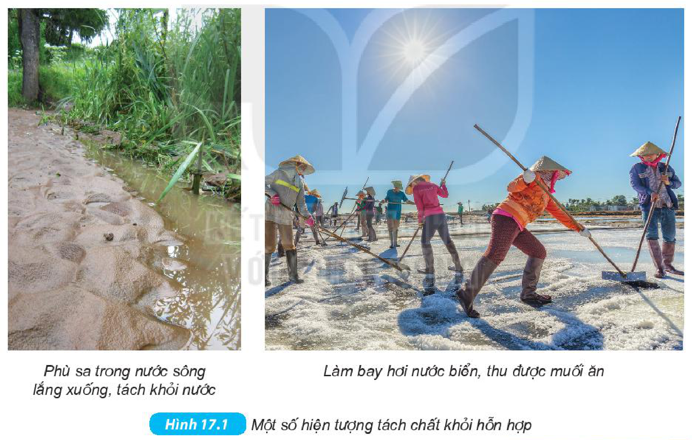
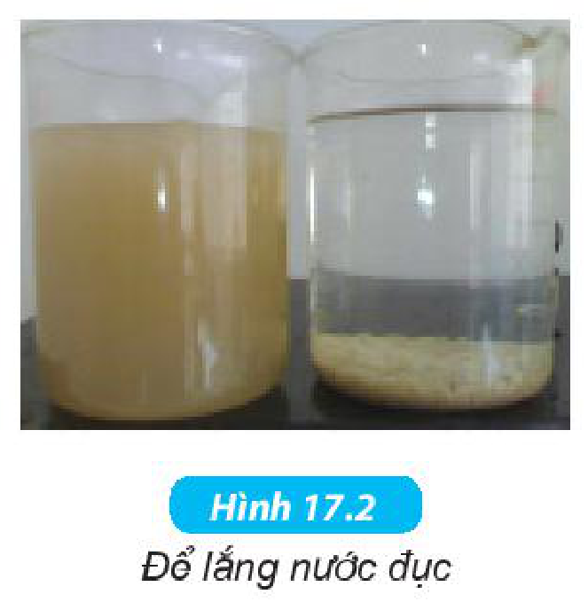
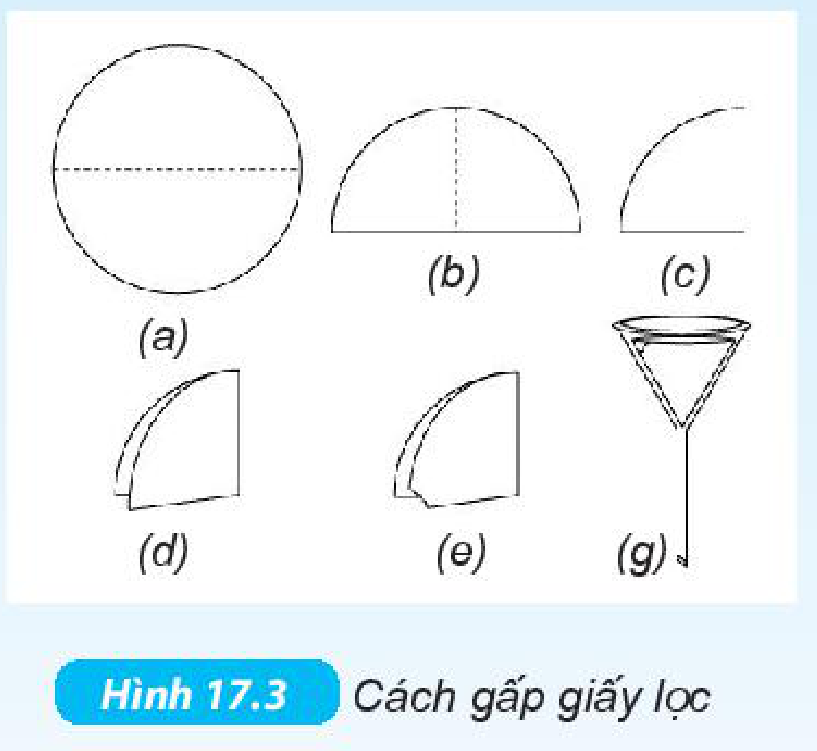
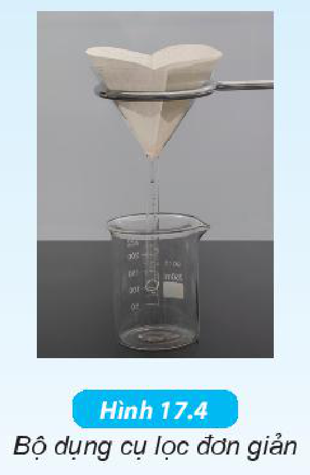
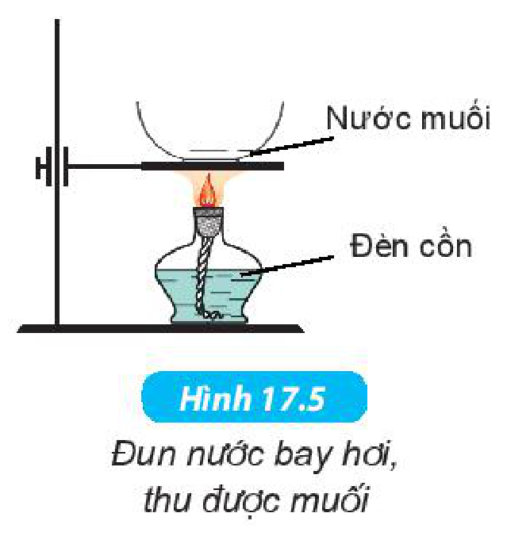
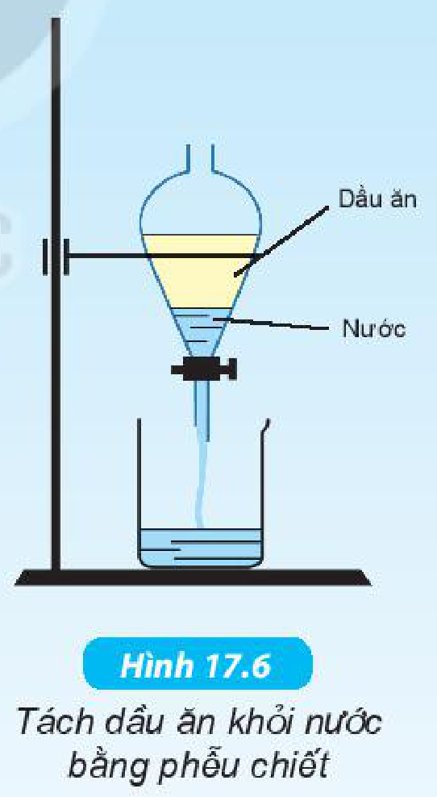
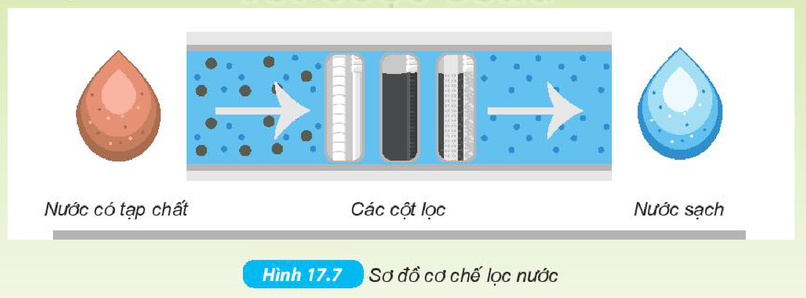

<!-- pdf:61 -->

# BÀI 17: TÁCH CHẤT KHỎI HỖN HỢP

## 🎯 Mục tiêu

- Trình bày được một số cách đơn giản để tách chất ra khỏi hỗn hợp và ứng dụng.
- Sử dụng được một số dụng cụ và thiết bị cơ bản để tách các chất ra khỏi hỗn hợp dựa trên tính chất vật lí bằng cách lọc, cô cạn, chiết.

## 🔴 Mở đầu

Từ xưa có câu: “Đãi cát tìm vàng”. Vậy người ta đã tách vàng ra khỏi cát như thế nào?

## I. Nguyên tắc tách chất

Trong tự nhiên và cuộc sống, ta gặp rất nhiều hiện tượng tách chất ra khỏi hỗn hợp theo những cách khác nhau.

Hình 17.1. Một số hiện tượng tách chất khỏi hỗn hợp (Phù sa trong nước sông lắng xuống, tách khỏi nước; Làm bay hơi nước biển, thu được muối ăn)

<!-- term: Nguyên tắc tách chất -->
Trong các ví dụ ở Hình 17.1, hạt phù sa nặng hơn nước nên lắng xuống đáy sông, muối ăn không bị bay hơi nên khi làm cho nước biển bay hơi sẽ thu được muối rắn. Vậy, có thể tách các chất trong hỗn hợp dựa trên sự khác nhau về tính chất của chúng.

> ❓ 1. Trên thực tế em thường gặp chất tinh khiết hay hỗn hợp? Vì sao chúng ta lại cần phải tách chất?
>
> 2. Lấy một số ví dụ về quá trình tách chất trong tự nhiên và trong đời sống mà em biết.

<!-- pdf:62 -->

## II. Một số cách tách chất

### 1. Lắng, gạn và lọc

<!-- term: Lắng -->
<!-- term: Gạn -->
Trong không khí thường có lẫn bụi. Khi lặng gió, sau một thời gian, hạt bụi nặng hơn tự động lắng xuống, giúp làm sạch không khí một cách tự nhiên. Đối với nước đục do bị lẫn đất, bùn, khi để yên, các hạt bùn, đất nặng hơn nước sẽ lắng xuống đáy. Gạn lấy lớp nước ở phía trên ta được nước trong hơn.

<!-- term: Lọc -->
Khi các hạt chất rắn lơ lửng, khó lắng xuống, ta có thể lọc để tách chúng ra khỏi chất lỏng hoặc chất khí. Để lọc chất rắn ra khỏi chất lỏng, ta thường dùng phễu lót giấy lọc. Giấy lọc chứa những lỗ nhỏ li ti. Khi chất lỏng chảy qua giấy lọc, những hạt chất rắn có kích thước lớn hơn lỗ này sẽ bị giữ lại.

Hình 17.2. Để lắng nước đục

> ❓ Tại sao hạt bụi bị tách ra khỏi không khí, hạt phù sa bị tách khỏi nước sông?

> ✋ **Lọc nước từ hỗn hợp nước lẫn đất**
>
> *Chuẩn bị:* nước, 2 cốc thuỷ tinh, đất, phễu lọc, giấy lọc.
>
> *Tiến hành:*
>
> - Lấy một cốc nước, cho 1 thìa đất vào cốc. Khuấy mạnh cho hỗn hợp trong cốc đục đều lên. Dừng khuấy và quan sát.
> - Gấp giấy lọc và đặt vào phễu (Hình 17.3).
> - Gạn lấy lớp nước phía trên (gọi là nước gạn), đem rót từ từ đến hết vào phễu lọc có giấy lọc (Hình 17.4). Nước chảy ra khỏi phễu lọc được thu vào cốc hứng, gọi là nước lọc.
>
> Em hãy quan sát, so sánh màu sắc của nước gạn và nước lọc.
>
> 
>
> Hình 17.3. Cách gấp giấy lọc
>
> 
>
> Hình 17.4. Bộ dụng cụ lọc đơn giản

<!-- pdf:63 -->

### 2. Cô cạn

Khi chất rắn tan trong chất lỏng, hoặc kích thước hạt chất rắn quá nhỏ không lọc được, làm thế nào để tách chất rắn ra khỏi chất lỏng?

Người ta có thể tách muối ăn từ nước muối bằng cách đun nóng dung dịch này cho đến khi nước bay hơi hết, còn lại muối (Hình 17.5). Người làm muối cũng biết lợi dụng nắng, gió để nước bay hơi, thu được muối ăn.

Phương pháp **cô cạn** dùng để tách chất tan rắn ra khỏi dung dịch hoặc huyền phù bằng cách làm cho dung môi bay hơi, thu được chất rắn còn lại.

Hình 17.5. Đun nước bay hơi, thu được muối

> ❓ 1. Quá trình làm muối từ nước biển sử dụng phương pháp tách chất nào?
>
> 2. Có một mẫu muối có lẫn cát. Em hãy đề xuất phương pháp tách muối khỏi cát.

### 3. Chiết

<!-- term: Chiết -->
Khi hai chất lỏng không tan vào nhau, hỗn hợp sẽ tách thành hai lớp chất lỏng riêng biệt. Dùng các dụng cụ như bình chiết, phễu chiết ta có thể tách hai chất lỏng ra.

> ✋ **Tách dầu ăn khỏi nước**
>
> *Chuẩn bị:* 1 chai nhựa khoảng 500 mL, dầu ăn, phễu chiết, cốc thuỷ tinh.
>
> *Tiến hành:*
>
> - Rót nước đến 1/4 chai nhựa, thêm dầu ăn đến 1/2 chai. Đậy nắp chai, lắc mạnh, quan sát hỗn hợp trong chai.
> - Rót hỗn hợp trong chai ra phễu chiết, để yên vài phút cho tách lớp. Mở từ từ khoá phễu chiết cho chất lỏng phía dưới (nước) chảy xuống cốc. Khi phần dầu ăn chạm vào bề mặt khoá thì vặn khoá lại. Quan sát chất lỏng thu được trong cốc.
>
> 
>
> Hình 17.6. Tách dầu ăn khỏi nước bằng phễu chiết
>
> *Quan sát và trả lời câu hỏi:*
>
> 1. Nước và dầu ăn, chất lỏng nào nặng hơn?
>
> 2. Tại sao phải mở khoá phễu chiết một cách từ từ?
>
> 3. Các chất lỏng thu được có còn lẫn vào nhau không?

<!-- pdf:64 -->

> ❓ Khai thác dầu mỏ dưới đáy biển thường thu được hỗn hợp dầu mỏ và nước biển. Người ta làm thế nào để tách dầu mỏ ra khỏi hỗn hợp?

## 📌 Em đã học

Dựa vào các tính chất khác nhau có thể áp dụng cách phù hợp để tách chất ra khỏi hỗn hợp:
- Lọc (tách chất rắn không tan ra khỏi chất lỏng).
- Lắng (tách các chất rắn lơ lửng nặng hơn ra khỏi các chất nhẹ hơn).
- Cô cạn (tách các chất khó bay hơi ra khỏi các chất dễ bay hơi).
- Chiết (tách các chất lỏng không tan vào nhau ra khỏi nhau).

## ✏️ Em có thể

1. Sử dụng khẩu trang khi không khí nơi em sống bị ô nhiễm bụi mịn.
2. Làm sạch nước trong bể cá khi bể cá nhà em bị bẩn.

> 💡 **Em có biết?**
>
> **Máy lọc nước**
>
> Máy lọc nước gia đình chứa các lõi lọc. Trong lõi lọc lại chứa cột lọc, đây là “trái tim” của máy lọc nước. Một máy lọc nước có thể có nhiều cột lọc chứa khe màng lọc với kích thước khác nhau. Nước từ nguồn nước được bơm qua các lõi lọc, các hạt tạp chất sẽ được giữ lại và chỉ cho nước đi qua.
>
> 
>
> Hình 17.7. Sơ đồ cơ chế lọc nước (Nước có tạp chất; Các cột lọc; Nước sạch)

## 📷 Danh sách hình trong bài

| Mã hình | Trang PDF | Vị trí | Chú thích gốc |
|---|---|---|---|
| H6-khoa_hoc_tu_nhien-b17-01 | 61 | Mục I | Hình 17.1 Một số hiện tượng tách chất khỏi hỗn hợp |
| H6-khoa_hoc_tu_nhien-b17-02 | 62 | Mục II.1 | Hình 17.2 Để lắng nước đục |
| H6-khoa_hoc_tu_nhien-b17-03 | 62 | Mục II.1, hộp Hoạt động | Hình 17.3 Cách gấp giấy lọc |
| H6-khoa_hoc_tu_nhien-b17-04 | 62 | Mục II.1, hộp Hoạt động | Hình 17.4 Bộ dụng cụ lọc đơn giản |
| H6-khoa_hoc_tu_nhien-b17-05 | 63 | Mục II.2 | Hình 17.5 Đun nước bay hơi, thu được muối |
| H6-khoa_hoc_tu_nhien-b17-06 | 63 | Mục II.3, hộp Hoạt động (cạnh khung đi qua màu nền hộp xanh lam) | Hình 17.6 Tách dầu ăn khỏi nước bằng phễu chiết |
| H6-khoa_hoc_tu_nhien-b17-07 | 64 | Hộp Em có biết? cuối bài (cạnh khung đi qua màu nền hộp xanh lục) | Hình 17.7 Sơ đồ cơ chế lọc nước |
