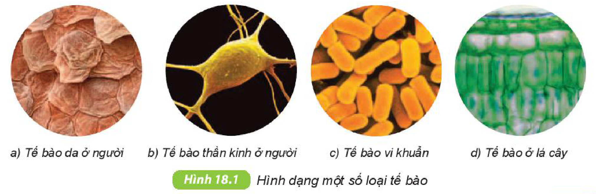
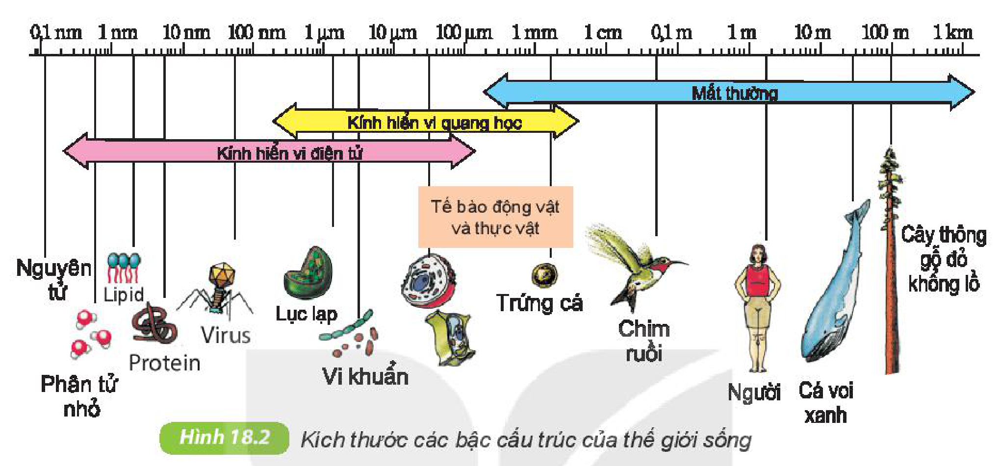
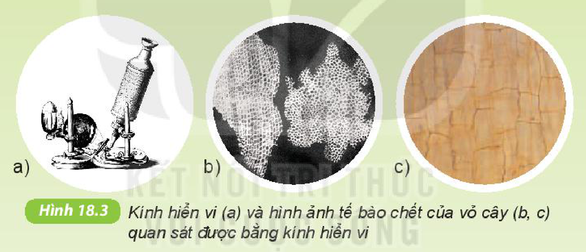

<!-- pdf:65 -->

# BÀI 18: TẾ BÀO – ĐƠN VỊ CƠ BẢN CỦA SỰ SỐNG

## 🎯 Mục tiêu

- Nêu được khái niệm, chức năng của tế bào.
- Nhận biết được tế bào là đơn vị cấu trúc của sự sống.
- Nêu được hình dạng và kích thước của một số loại tế bào.

## 🔴 Mở đầu

Ngôi nhà (hình bên) được xây nên từ nhiều viên gạch. Vậy đã bao giờ em tự hỏi: Những sinh vật xung quanh chúng ta được cấu tạo từ đơn vị cấu trúc nào?

## I. Tế bào là gì?

Tất cả các cơ thể sinh vật (thực vật, động vật, con người,...) đều được cấu tạo từ những đơn vị rất nhỏ bé, gọi là **tế bào**.

Tuy có kích thước nhỏ nhưng tế bào có thể thực hiện đầy đủ các quá trình sống cơ bản như sinh trưởng (lớn lên), hấp thụ chất dinh dưỡng, hô hấp, cảm ứng, bài tiết và sinh sản.

> **Câu hỏi:** Tại sao tế bào được coi là đơn vị cơ bản của các cơ thể sống?

## II. Hình dạng và kích thước tế bào

### 1. Hình dạng tế bào

Có nhiều loại tế bào. Hình dạng các loại tế bào thường phản ánh chức năng khác nhau của chúng.

Hình 18.1. Hình dạng một số loại tế bào

> **Câu hỏi:** Quan sát Hình 18.1, nêu nhận xét về hình dạng tế bào.

<!-- pdf:66 -->

### 2. Kích thước tế bào

Kích thước tế bào khác nhau giữa các nhóm sinh vật và giữa các cơ quan trong một cơ thể.

Có rất ít tế bào kích thước đủ lớn để có thể quan sát được bằng mắt thường, hầu hết tế bào đều rất nhỏ và chúng ta chỉ có thể quan sát thấy chúng bằng kính hiển vi.

Hình 18.2. Kích thước các bậc cấu trúc của thế giới sống

> **Câu hỏi:** Quan sát kích thước tế bào vi khuẩn, tế bào động vật và thực vật trong Hình 18.2 và cho biết tế bào nào phải quan sát bằng kính hiển vi, tế bào nào có thể quan sát bằng mắt thường?

> **Hoạt động:** Khi thảo luận về kích thước và hình dạng tế bào, bốn bạn học sinh có ý kiến như sau:
>
> - A: Tất cả các loại tế bào đều có cùng hình dạng, nhưng chúng luôn có kích thước khác nhau.
> - B: Tất cả các loại tế bào đều có hình dạng và kích thước giống nhau.
> - C: Tất cả các loại tế bào đều có cùng kích thước, nhưng hình dạng giữa chúng luôn khác nhau.
> - D: Các loại tế bào khác nhau thường có kích thước và hình dạng khác nhau.
>
> Đọc ý kiến trên của các bạn và trả lời các câu hỏi sau:
> 1. Phát biểu của bạn nào đúng?
> 2. Lấy ví dụ để giải thích tại sao các phát biểu khác không đúng.

<!-- pdf:67 -->

## 📌 Em đã học

- Mọi cơ thể sống đều được cấu tạo từ tế bào, vì vậy tế bào được xem là “đơn vị cơ bản của sự sống”.
- Các loại tế bào khác nhau về hình dạng và kích thước.

## ✏️ Em có thể

Giải thích được vì sao mỗi loại tế bào lại có hình dạng khác nhau.
<!-- ocr-ok: đã đối chiếu ảnh p067, OCR đọc nhầm 'Giải thích được vì sao' thành 'Cài trích được VÌ SeO' -->

## 💡 Em có biết?

> - **Tế bào đầu tiên được nhìn thấy và mô tả như thế nào?**
>
> Năm 1665, nhà khoa học người Anh là Rô–bớc Húc (Robert Hooke) đã dùng chiếc kính hiển vi đơn giản (Hình 18.3a) để quan sát một mẩu vỏ cây và thấy nó được tạo nên từ hàng trăm cấu trúc giống những hộp nhỏ mà ông gọi là “tế bào”. Ông đã mô tả bằng cách vẽ hình ảnh đầu tiên về tế bào mà mình quan sát thấy (Hình 18.3b); đó là những tế bào chết của vỏ cây mà ngày nay chúng ta có thể quan sát rõ hơn bằng kính hiển vi với độ phóng đại 300 lần (Hình 18.3c).

Hình 18.3. Kính hiển vi (a) và hình ảnh tế bào chết của vỏ cây (b, c) quan sát được bằng kính hiển vi

> - **Tại sao hầu hết các tế bào có kích thước rất nhỏ?**
>
> Kích thước tế bào bị hạn chế bởi mối quan hệ giữa diện tích bề mặt ($S$) và thể tích ($V$) của nó (tỉ lệ $S/V$). Khi tế bào lớn lên, thể tích tăng nhanh hơn nhiều so với diện tích bề mặt.
>
> Vì nguyên liệu cần cho sự sống của tế bào (như oxygen, chất dinh dưỡng) và chất thải được bài tiết (như khí carbon dioxide) phải đi vào và đi ra tế bào qua bề mặt của nó nên nếu tế bào quá lớn, các chất đi vào và đi ra không đủ về lượng và tốc độ theo yêu cầu của các quá trình sống. Vì vậy, hầu hết tế bào có kích thước rất nhỏ.

## 📷 Danh sách hình trong bài

| Mã hình | Trang PDF | Vị trí | Chú thích gốc |
|---|---|---|---|
| H6-khoa_hoc_tu_nhien-b18-01 | 65 | Mục II.1 | Hình 18.1. Hình dạng một số loại tế bào |
| H6-khoa_hoc_tu_nhien-b18-02 | 66 | Mục II.2 | Hình 18.2. Kích thước các bậc cấu trúc của thế giới sống |
| H6-khoa_hoc_tu_nhien-b18-03 | 67 | Em có biết? (nằm trong hộp nền xanh lục nhạt) | Hình 18.3. Kính hiển vi (a) và hình ảnh tế bào chết của vỏ cây (b, c) quan sát được bằng kính hiển vi |
