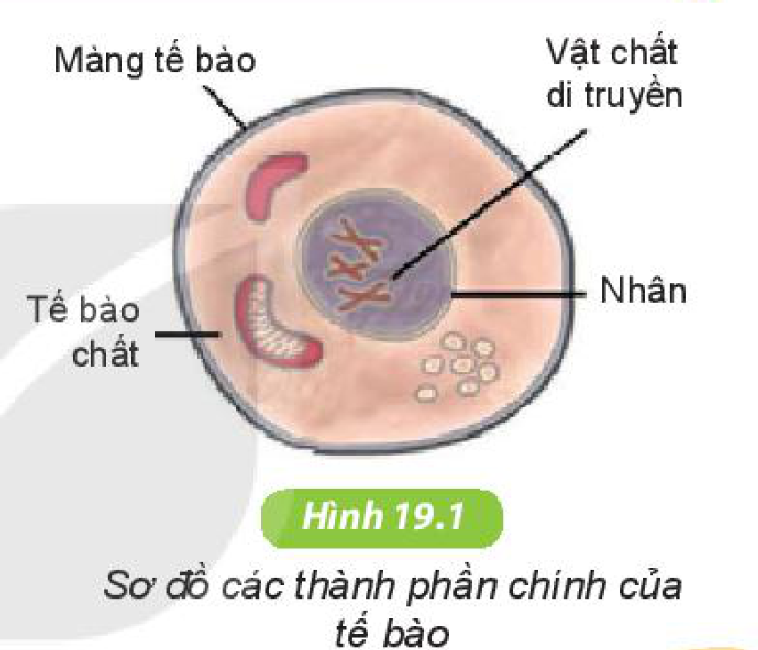
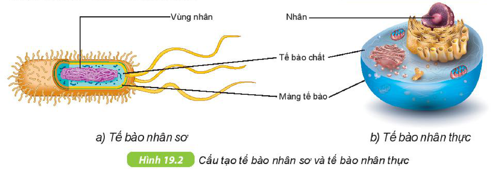
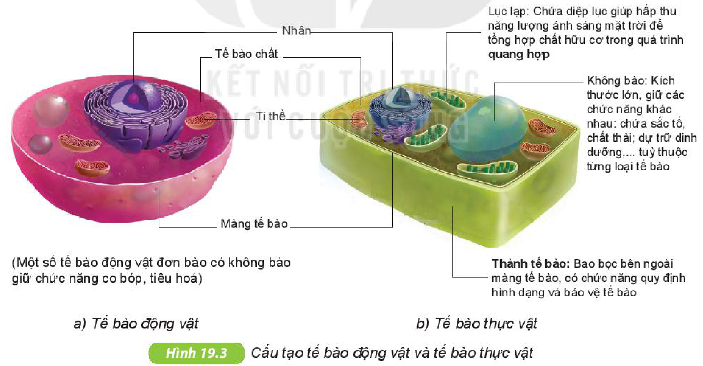
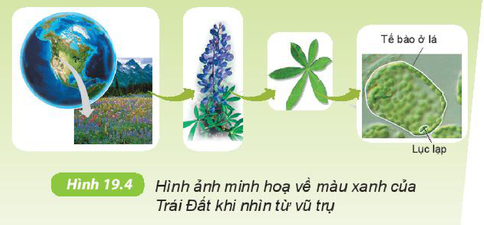

<!-- pdf:68 -->

# BÀI 19: CẤU TẠO VÀ CHỨC NĂNG CÁC THÀNH PHẦN CỦA TẾ BÀO

## 🎯 Mục tiêu

- Trình bày được cấu tạo và chức năng các thành phần chính của tế bào.
- Phân biệt được tế bào nhân sơ, tế bào nhân thực; tế bào động vật, tế bào thực vật.

## 🔴 Mở đầu

Tuy có kích thước nhỏ nhưng tế bào có thể thực hiện được các quá trình sống cơ bản.

Vậy tế bào được cấu tạo từ những thành phần nào và chúng có chức năng gì để có thể giúp tế bào thực hiện những quá trình sống đó?

## I. Cấu tạo của tế bào

Các loại tế bào khác nhau thường có hình dạng, kích thước và chức năng khác nhau nhưng chúng đều được cấu tạo từ các thành phần cơ bản sau:

**Màng tế bào** là thành phần có ở mọi tế bào, bao bọc tế bào chất. Màng tế bào tham gia vào quá trình trao đổi chất giữa tế bào và môi trường.

**Tế bào chất** là vùng nằm giữa màng tế bào và nhân hoặc vùng nhân. Phần lớn các hoạt động trao đổi chất (hấp thụ chất dinh dưỡng, chuyển hoá năng lượng, tạo các chất để tăng trưởng,...) của tế bào xảy ra ở tế bào chất.

**Nhân** hoặc **vùng nhân** là nơi chứa **vật chất di truyền**, là trung tâm điều khiển các hoạt động sống của tế bào.

Hình 19.1. Sơ đồ các thành phần chính của tế bào

> **Câu hỏi:**
> 1. Quan sát Hình 19.1 và đọc thông tin mục I, nêu các thành phần chính của tế bào và chức năng của chúng.
> 2. Trên màng tế bào có rất nhiều lỗ nhỏ li ti. Em hãy dự đoán xem vai trò của những lỗ nhỏ này là gì.

## II. Tế bào nhân sơ và tế bào nhân thực

Mọi sinh vật đều được cấu tạo từ tế bào. Có hai loại tế bào: tế bào nhân sơ và tế bào nhân thực.

Hình 19.2. Cấu tạo tế bào nhân sơ và tế bào nhân thực

<!-- pdf:69 -->

**Tế bào nhân sơ** chưa có nhân hoàn chỉnh (không có màng nhân ngăn cách giữa chất nhân và tế bào chất). Vùng chứa vật chất di truyền được gọi là vùng nhân. Tế bào chất không có hệ thống nội màng cũng như các bào quan có màng bao bọc, chỉ có bào quan duy nhất là **ribosome**. Tế bào vi khuẩn là tế bào nhân sơ.

**Tế bào nhân thực** đã có nhân hoàn chỉnh, vật chất di truyền nằm trong nhân được bao bọc bởi màng nhân. Tế bào chất được chia thành nhiều khoang bởi hệ thống nội màng và có các bào quan có màng bao bọc.

> **Hoạt động:** Quan sát và mô tả sự khác nhau về cấu tạo giữa tế bào nhân sơ và nhân thực
>
> *Chuẩn bị:* Hình 19.2: cấu tạo tế bào nhân sơ (vi khuẩn) và hình tế bào nhân thực (động vật).
>
> *Quan sát và vẽ:* Dựa vào hình ảnh hai tế bào đã chuẩn bị, hãy vẽ ra giấy hình dạng và cấu tạo của mỗi tế bào, ghi lại những đặc điểm đáng chú ý.
>
> *So sánh và trình bày:* Nói về cấu tạo của mỗi loại tế bào. So sánh sự giống nhau và khác nhau về cấu tạo giữa tế bào nhân sơ và nhân thực.

## III. Tế bào động vật và tế bào thực vật

Tế bào động vật và tế bào thực vật đều là các tế bào nhân thực. Chúng giống nhau về một số thành phần chính giúp tế bào thực hiện các quá trình sống, song chúng cũng có những thành phần khác nhau liên quan đến chức năng của từng loại tế bào.

Hình 19.3. Cấu tạo tế bào động vật và tế bào thực vật

- **Lục lạp**: Chứa diệp lục giúp hấp thu năng lượng ánh sáng mặt trời để tổng hợp chất hữu cơ trong quá trình **quang hợp**.

- **Không bào**: Kích thước lớn, giữ các chức năng khác nhau: chứa sắc tố, chất thải; dự trữ dinh dưỡng,... tuỳ thuộc từng loại tế bào. (Một số tế bào động vật đơn bào có không bào giữ chức năng co bóp, tiêu hoá).

- **Thành tế bào**: Bao bọc bên ngoài màng tế bào, có chức năng quy định hình dạng và bảo vệ tế bào.

> **Câu hỏi:**
> 1. Quan sát Hình 19.3, lập bảng so sánh sự giống nhau và khác nhau về thành phần cấu tạo giữa tế bào động vật và tế bào thực vật.
> 2. Những điểm khác nhau giữa tế bào động vật và tế bào thực vật có liên quan gì đến hình thức dinh dưỡng của chúng? Cấu trúc nào của tế bào thực vật giúp cây cứng cáp dù không có hệ xương nâng đỡ như ở động vật?

<!-- pdf:70 -->

## 📌 Em đã học

- Tế bào có ba thành phần chính là màng tế bào, tế bào chất và nhân (hoặc vùng nhân). Trong đó, màng tế bào là thành phần thiết yếu xác định sự tồn tại của tế bào.
- Có hai loại tế bào: tế bào nhân sơ (chưa có màng nhân cũng như hệ thống nội màng và các bào quan có màng bao bọc) và tế bào nhân thực (có màng nhân, hệ thống nội màng và các bào quan có màng bao bọc).
- **Tế bào thực vật** khác **tế bào động vật** là có thành tế bào (giữ hình dạng tế bào ổn định), lục lạp (chứa sắc tố quang hợp) và không bào lớn.

## ✏️ Em có thể

**Tạo mô hình mô phỏng tế bào thực vật và tế bào động vật**

Cách tiến hành

Bước 1: Đặt một túi nylon có khoá kéo vào một hộp nhựa đựng thực phẩm trong suốt để mô phỏng tế bào thực vật. Chuẩn bị một túi nylon tương tự (không đặt trong hộp nhựa) để mô phỏng tế bào động vật.

Bước 2: Sử dụng thìa chuyển gelatine dạng lỏng vào mỗi túi cho đến khi đạt khoảng 1/2 thể tích mỗi túi.

Bước 3: Chọn các loại rau, củ, quả mà em thấy có hình dạng giống (mô phỏng) các bào quan ở tế bào thực vật và tế bào động vật. Đưa chúng vào mỗi túi tương ứng để mô phỏng tế bào thực vật và tế bào động vật. Bổ sung thêm gelatine đến khi gần đầy rồi kéo khoá kín miệng túi lại.

Túi nylon, hộp nhựa, gelatine mô phỏng cho thành phần nào của tế bào? Nhận xét loại tế bào nào có thể xếp chặt hơn và đưa ra lời giải thích cho nhận xét đó.

*Lưu ý:*

- Cố gắng xếp chặt các rau, củ, quả trong mỗi túi.
- Vật liệu tạo mô hình nêu trên có thể thay thế bằng đất nặn, xốp hoặc vật liệu khác sẵn có của lớp học.

## 💡 Em có biết?

> Nếu em nhìn Trái Đất từ vũ trụ, em sẽ thấy hầu hết các vùng đất liền có màu xanh lá cây. Màu xanh đó do đâu?
>
> Chính những lục lạp (có chứa chất diệp lục) vô cùng nhỏ bé trong mỗi tế bào thực vật đã tạo nên màu xanh của lá cây.

Hình 19.4. Hình ảnh minh hoạ về màu xanh của Trái Đất khi nhìn từ vũ trụ

## 📷 Danh sách hình trong bài

| Mã hình | Trang PDF | Vị trí | Chú thích gốc |
|---|---|---|---|
| H6-khoa_hoc_tu_nhien-b19-01 | 68 | Mục I (cạnh dưới chạm nhẹ mép trên màu nền hộp câu hỏi nghiêng ở góc dưới phải để lấy trọn dòng chú thích 'tế bào') | Hình 19.1. Sơ đồ các thành phần chính của tế bào |
| H6-khoa_hoc_tu_nhien-b19-02 | 68 | Mục II | Hình 19.2. Cấu tạo tế bào nhân sơ và tế bào nhân thực |
| H6-khoa_hoc_tu_nhien-b19-03 | 69 | Mục III | Hình 19.3. Cấu tạo tế bào động vật và tế bào thực vật |
| H6-khoa_hoc_tu_nhien-b19-04 | 70 | Em có biết? (nằm trong hộp nền xanh lục nhạt) | Hình 19.4. Hình ảnh minh hoạ về màu xanh của Trái Đất khi nhìn từ vũ trụ |
