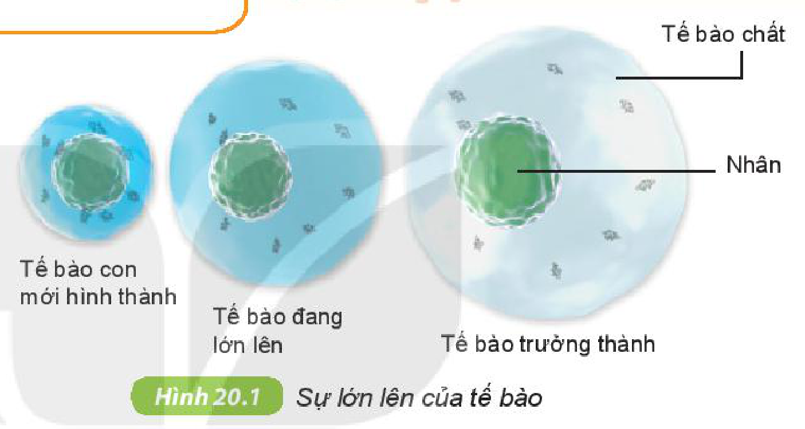
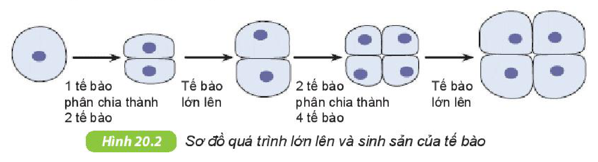
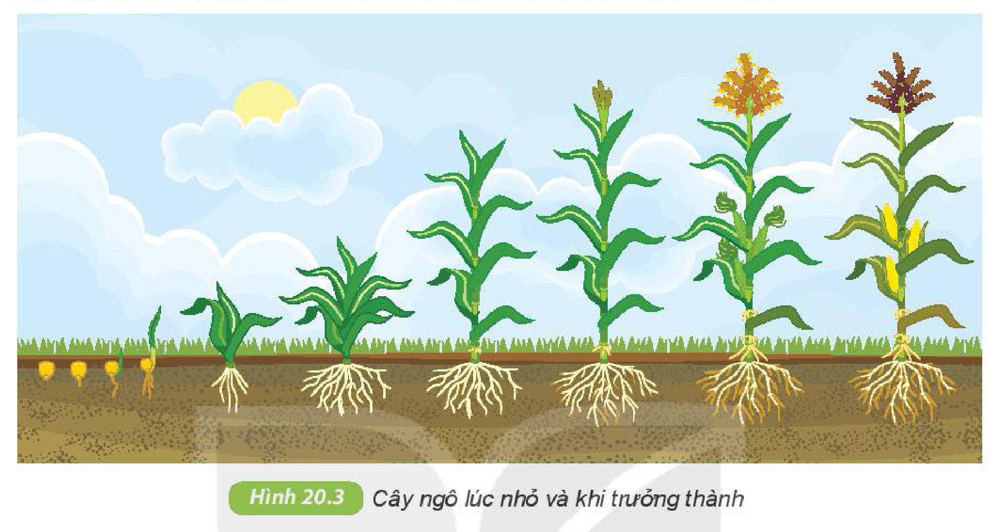
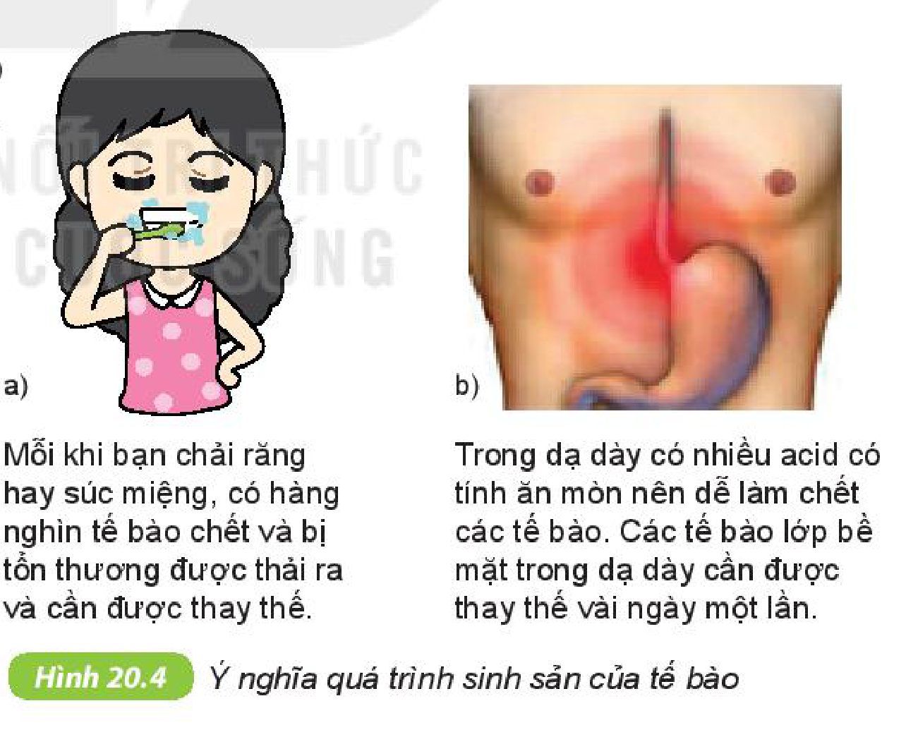

<!-- pdf:71 -->

# BÀI 20: SỰ LỚN LÊN VÀ SINH SẢN CỦA TẾ BÀO

## 🎯 Mục tiêu

- Nhận biết được sự lớn lên và sinh sản của tế bào.
- Nêu được ý nghĩa của sự lớn lên và sinh sản của tế bào.

## 🔴 Mở đầu

Em bé khi mới sinh có chiều dài trung bình là 50 cm. Theo thời gian, em bé lớn dần thành người trưởng thành với chiều cao trung bình (của người Việt Nam) là 164,4 cm (ở nam) và 154 cm (ở nữ). Quá trình nào đã giúp con người cũng như các sinh vật khác lớn lên như vậy?

## I. Sự lớn lên của tế bào

<!-- term: Sự lớn lên của tế bào -->
Các tế bào con mới hình thành có kích thước bé. Nhờ quá trình trao đổi chất mà kích thước và khối lượng của chúng tăng dần lên, trở thành các tế bào trưởng thành.

Hình 20.1. Sự lớn lên của tế bào

> **Câu hỏi:** Quan sát Hình 20.1 và trả lời các câu hỏi:
> 1. Kích thước tế bào chất và nhân thay đổi thế nào khi tế bào lớn lên?
> 2. Tế bào có lớn lên mãi được không? Tại sao?

## II. Sự sinh sản (phân chia) của tế bào

Mỗi tế bào lớn lên đến một kích thước nhất định sẽ phân chia thành hai tế bào con. Quá trình này còn được gọi là **sự sinh sản của tế bào**.

Hình 20.2. Sơ đồ quá trình lớn lên và sinh sản của tế bào

> **Câu hỏi:** Quan sát Hình 20.1 và 20.2 để trả lời các câu hỏi:
> 1. Khi nào thì tế bào phân chia?
> 2. Cơ thể chúng ta gồm hàng tỉ tế bào được hình thành nhờ quá trình nào?

<!-- pdf:72 -->

## III. Ý nghĩa sự lớn lên và sinh sản của tế bào

Sự lớn lên của hầu hết các sinh vật đa bào (cơ thể có cấu tạo gồm nhiều tế bào) chủ yếu là do sự tăng lên về kích thước và số lượng các tế bào trong cơ thể. Trong khi đó, ở các sinh vật đơn bào, sự lớn lên là do sự tăng lên của kích thước tế bào.

Hình 20.3. Cây ngô lúc nhỏ và khi trưởng thành
<!-- ocr-ok: đã đối chiếu ảnh p072, OCR bỏ sót dòng chú thích Hình 20.3 -->

> **Câu hỏi:** Quan sát Hình 20.3 và cho biết cây ngô (là cơ thể đa bào) lớn lên nhờ quá trình nào?
<!-- ocr-ok: đã đối chiếu ảnh p072, OCR bỏ sót hộp câu hỏi dưới Hình 20.3 -->

Khi cơ thể ngừng lớn, các tế bào trong cơ thể vẫn tiếp tục sinh sản.

Hình 20.4. Ý nghĩa quá trình sinh sản của tế bào

> **Câu hỏi:** Quan sát Hình 20.3 – 20.4, thảo luận và trả lời các câu hỏi:
> 1. Sự sinh sản của tế bào có ý nghĩa gì?
> 2. Nhờ quá trình nào mà cơ thể có được những tế bào mới để thay thế cho những tế bào già, các tế bào chết, tế bào bị tổn thương?

<!-- pdf:73 -->

## 📌 Em đã học

- Các tế bào con có kích thước nhỏ, nhờ quá trình trao đổi chất mà chúng lớn dần thành những tế bào trưởng thành.
- Tế bào lớn đến một kích thước nhất định thì sinh sản (từ một tế bào mẹ thành hai tế bào con).
- Sự sinh sản tế bào làm tăng số lượng tế bào, thay thế các tế bào già, các tế bào bị tổn thương, các tế bào chết, giúp cơ thể lớn lên (sinh trưởng) và phát triển.

## ✏️ Em có thể

Vận dụng được những hiểu biết về ý nghĩa của sự sinh sản tế bào đối với sự lớn lên của cơ thể để có chế độ dinh dưỡng và tập luyện hợp lí giúp cơ thể đạt được chiều cao tối ưu.

## 💡 Em có biết?

> - **Có phải tất cả tế bào đều có khả năng sinh sản?**
>
> Ở cơ thể thực vật, các tế bào đã sinh sản và **phân hoá** thì không sinh sản được nữa, chỉ có tế bào ở mô phân sinh (đầu chóp rễ, chồi,...) mới có khả năng sinh sản. Ở người, tế bào thần kinh sau khi được **biệt hoá** cũng không còn khả năng sinh sản. Tế bào hồng cầu sau khi được biệt hoá mất nhân thì chúng chỉ hoạt động một thời gian (có thể vài tuần) rồi bị chết và được thay thế bằng tế bào mới.
>
> - **Điều gì xảy ra nếu cơ thể không điều khiển được sự sinh sản của tế bào?**
>
> Thông thường, quá trình sinh sản của các tế bào trong cơ thể được điều khiển chính xác, tạo ra vừa đủ số lượng để bù vào số tế bào cần thay thế. Tuy nhiên, trong trường hợp sự sinh sản tế bào không thể kiểm soát dẫn đến tế bào sinh sản liên tục sẽ tạo nên các khối u. Các khối u ảnh hưởng đến chức năng bình thường của cơ thể.
>
> - Bình thường, tế bào ngừng sinh sản khi đủ số lượng. Tế bào tổn thương không sửa chữa được sẽ bị chết.
> - Khi quá trình sinh sản tế bào không thể kiểm soát, tế bào tổn thương không sửa chữa được sẽ sinh sản không ngừng tạo khối u.

## 📷 Danh sách hình trong bài

| Mã hình | Trang PDF | Vị trí | Chú thích gốc |
|---|---|---|---|
| H6-khoa_hoc_tu_nhien-b20-01 | 71 | Mục I (góc trên trái giao nhẹ nét viền cam hộp Mở đầu do nhãn 'Tế bào chất' cao ngang đáy hộp Mở đầu) | Hình 20.1. Sự lớn lên của tế bào |
| H6-khoa_hoc_tu_nhien-b20-02 | 71 | Mục II | Hình 20.2. Sơ đồ quá trình lớn lên và sinh sản của tế bào |
| H6-khoa_hoc_tu_nhien-b20-03 | 72 | Mục III | Hình 20.3. Cây ngô lúc nhỏ và khi trưởng thành |
| H6-khoa_hoc_tu_nhien-b20-04 | 72 | Mục III (cạnh trái chạm nhẹ mép phải chữ 'bào' bên trái do khối chú thích 'a) Mỗi khi...' đặt sát) | Hình 20.4. Ý nghĩa quá trình sinh sản của tế bào |
