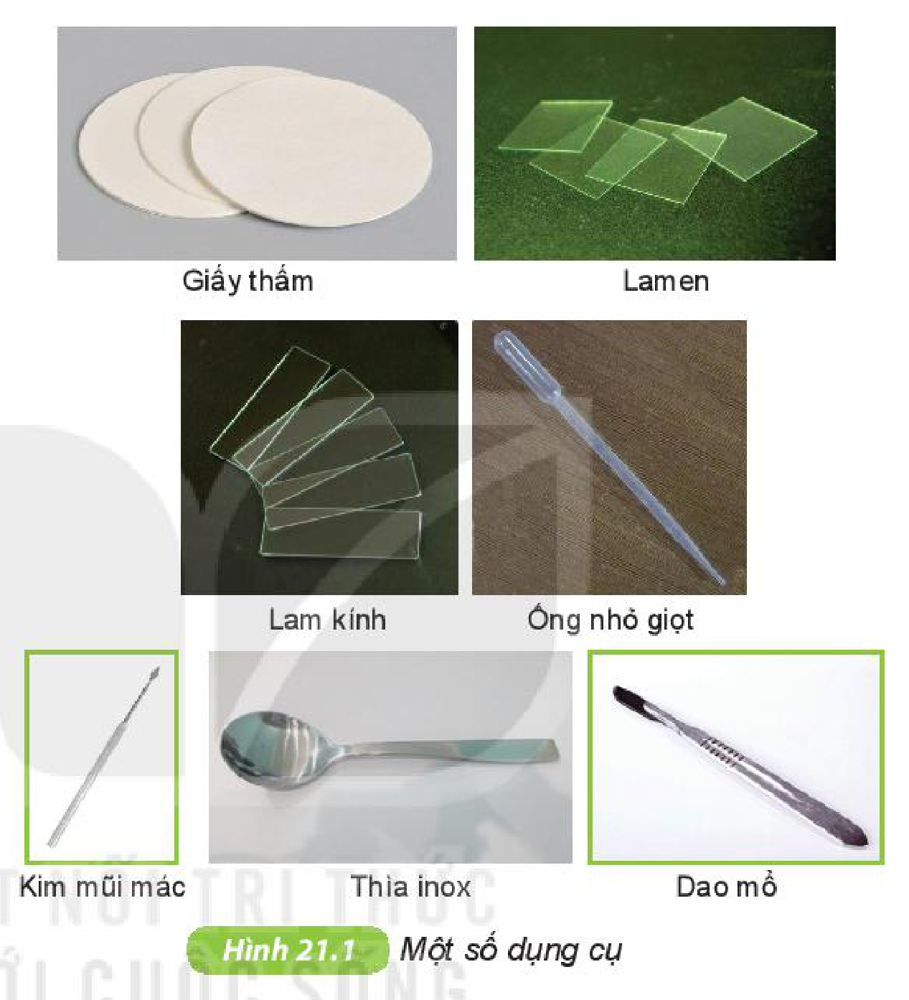
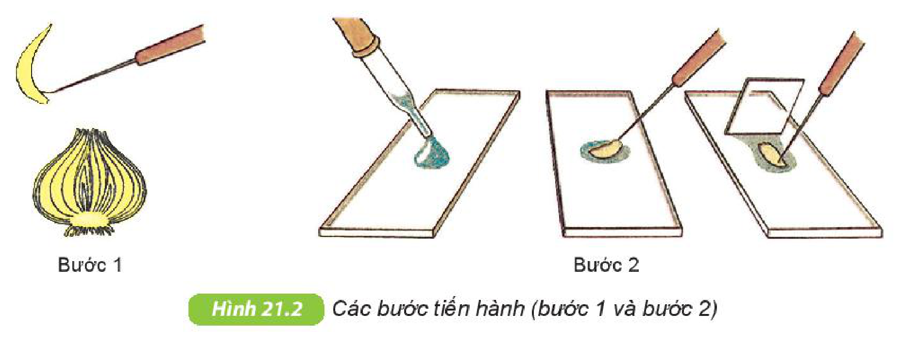
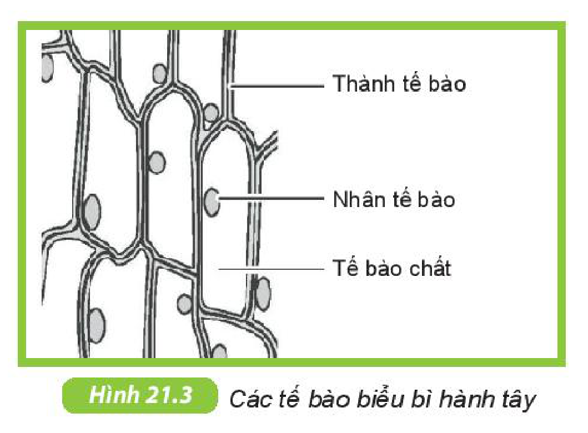
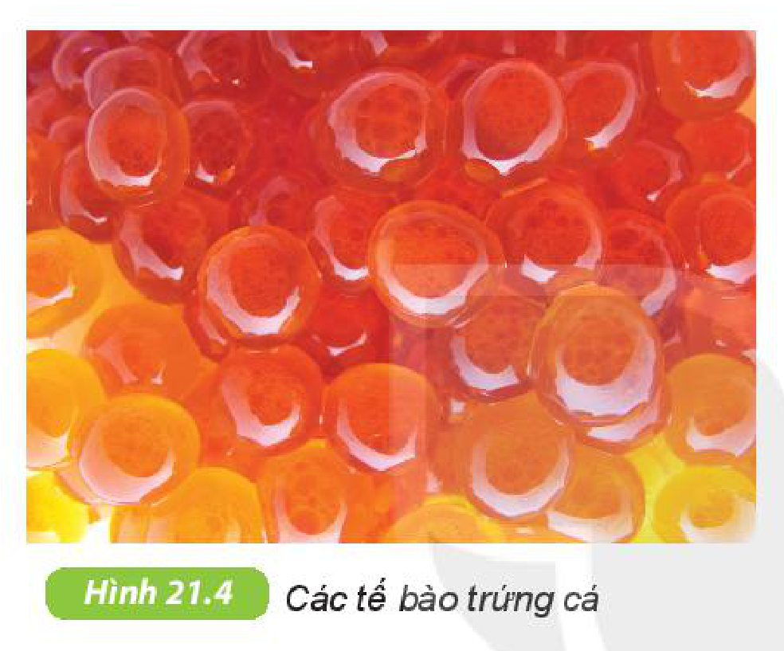

<!-- pdf:74 -->

# BÀI 21: THỰC HÀNH: QUAN SÁT VÀ PHÂN BIỆT MỘT SỐ LOẠI TẾ BÀO

## 🎯 Mục tiêu

- Thực hành quan sát tế bào lớn bằng mắt thường và tế bào nhỏ bằng kính hiển vi.

## I. Chuẩn bị

### 1. Thiết bị, dụng cụ

- Kính hiển vi có vật kính 40x và kính lúp (xem bài 4 – chương I)
- Nước cất đựng trong cốc thuỷ tinh
- Đĩa petri
- Các dụng cụ trong Hình 21.1

### 2. Mẫu vật

- Củ hành tây
- Trứng cá

Hình 21.1. Một số dụng cụ

## II. Cách tiến hành

### 1. Làm tiêu bản, quan sát và vẽ tế bào biểu bì hành tây

Hình 21.2. Các bước tiến hành (bước 1 và bước 2)

Bước 1: Dùng dao mổ tách lấy một vảy hành, sau đó tạo một vết cắt hình vuông nhỏ kích thước 7 – 8 mm ở mặt trong của vảy hành. Sử dụng panh/kim mũi mác lột nhẹ lớp tế bào trên cùng của vết cắt (lớp tế bào biểu bì).

<!-- pdf:75 -->

Bước 2: Đặt lớp tế bào này lên lam kính đã nhỏ sẵn một giọt nước cất rồi đậy lamen lại bằng cách trượt lamen từ một cạnh. Sử dụng giấy thấm để thấm phần nước thừa.

Bước 3: Đặt lam kính lên bàn kính của kính hiển vi và quan sát ở vật kính 10x rồi chuyển sang vật kính 40x.

(Quan sát tiêu bản bằng kính hiển vi theo các bước đã học ở bài 4 – chương I).

Hình 21.3. Các tế bào biểu bì hành tây
<!-- ocr-ok: đã đối chiếu ảnh p075, OCR bỏ sót dòng chú thích Hình 21.3 -->

### 2. Quan sát và vẽ tế bào trứng cá

Bước 1. Dùng thìa lấy một ít trứng cá cho vào đĩa petri.

Bước 2. Nhỏ một ít nước vào đĩa.

Bước 3. Dùng kim mũi mác khoắng nhẹ để trứng cá tách rời nhau.

Bước 4. Quan sát tế bào trứng cá bằng mắt thường hoặc bằng kính lúp.

Bước 5. Vẽ hình tế bào em quan sát được.

Hình 21.4. Các tế bào trứng cá
<!-- ocr-ok: đã đối chiếu ảnh p075, OCR đọc nhầm nhãn 'Hình 21.4' trên nền xanh thành 'EU' -->

## III. Thu hoạch

1. Vẽ lại các loại tế bào đã quan sát được bằng kính hiển vi.

2. Dựa vào hình ảnh quan sát được, em hãy nêu các thành phần của mỗi loại tế bào rồi hoàn thành theo mẫu bảng dưới đây.

| | Tế bào hành tây | Tế bào trứng cá |
|---|---|---|
| Thành phần quan sát được | ? | ? |
| Thành phần không quan sát được | ? | ? |
| Hình vẽ | ? | ? |

3. Trả lời câu hỏi:
   a) Thành phần nào em quan sát thấy ở cả hai loại tế bào?
   b) Đặc điểm nào giúp em phân biệt được tế bào hành tây với tế bào trứng cá?

## 📷 Danh sách hình trong bài

| Mã hình | Trang PDF | Vị trí | Chú thích gốc |
|---|---|---|---|
| H6-khoa_hoc_tu_nhien-b21-01 | 74 | Mục I | Hình 21.1. Một số dụng cụ |
| H6-khoa_hoc_tu_nhien-b21-02 | 74 | Mục II.1 | Hình 21.2. Các bước tiến hành (bước 1 và bước 2) |
| H6-khoa_hoc_tu_nhien-b21-03 | 75 | Mục II.1 | Hình 21.3. Các tế bào biểu bì hành tây |
| H6-khoa_hoc_tu_nhien-b21-04 | 75 | Mục II.2 | Hình 21.4. Các tế bào trứng cá |
