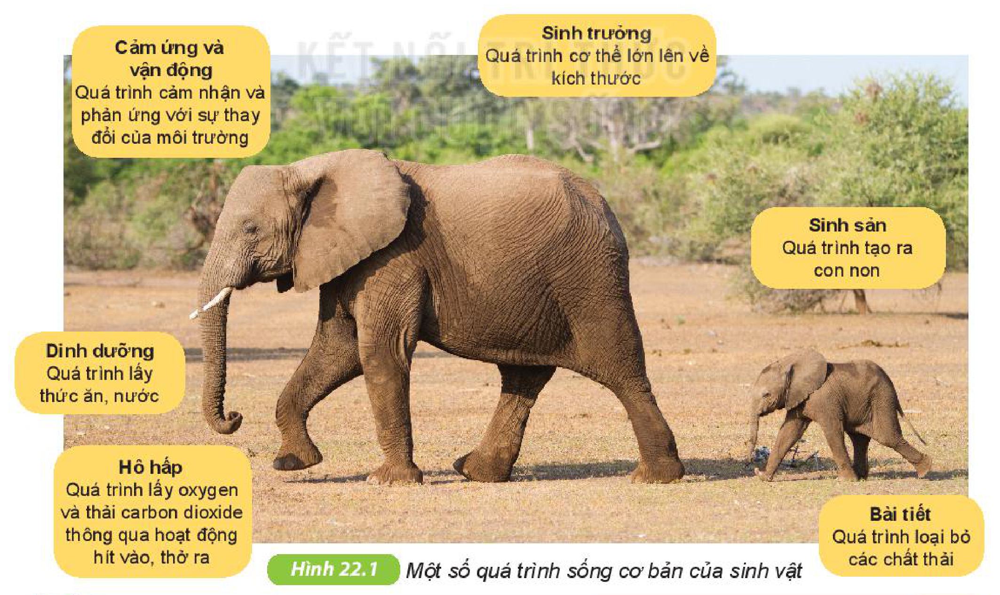
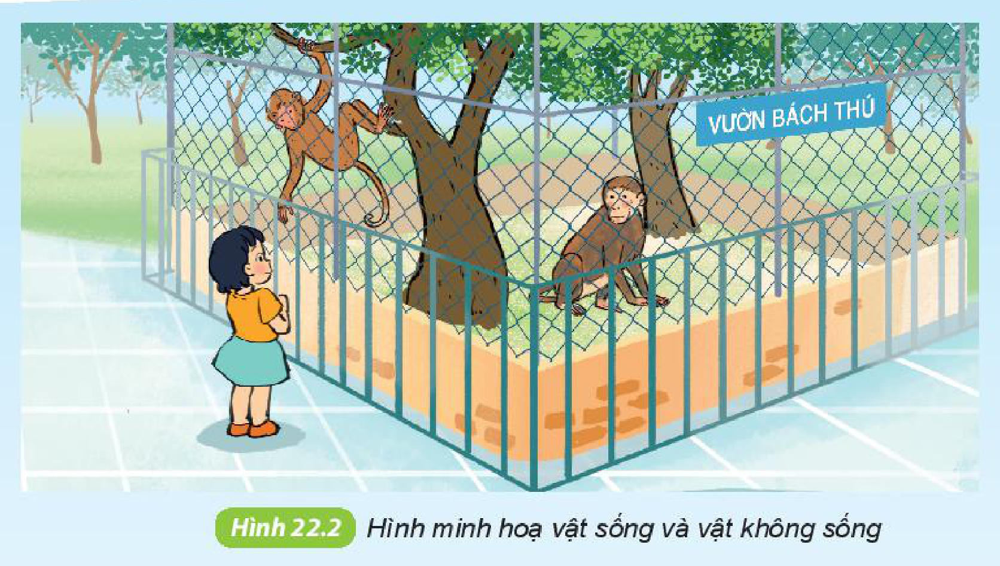
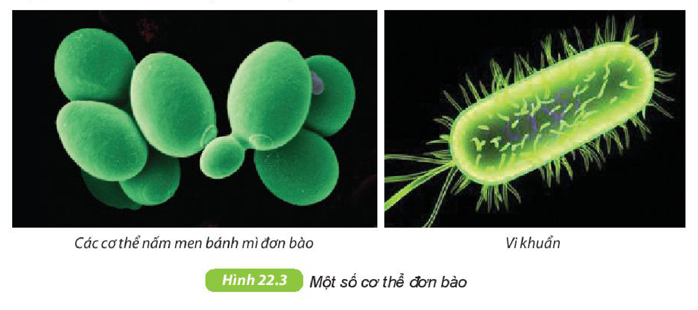
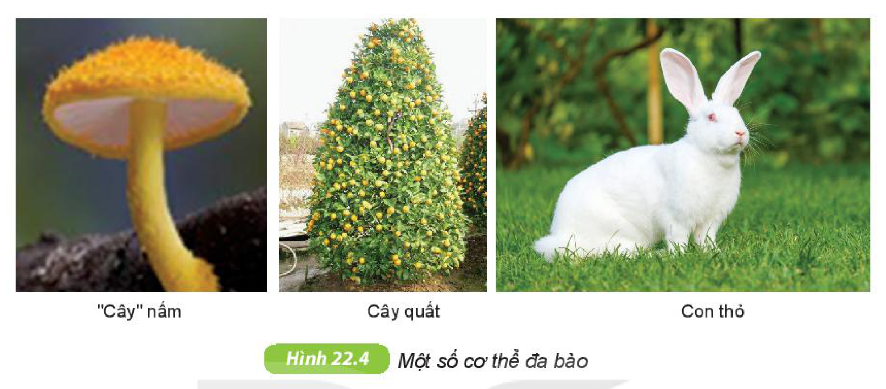
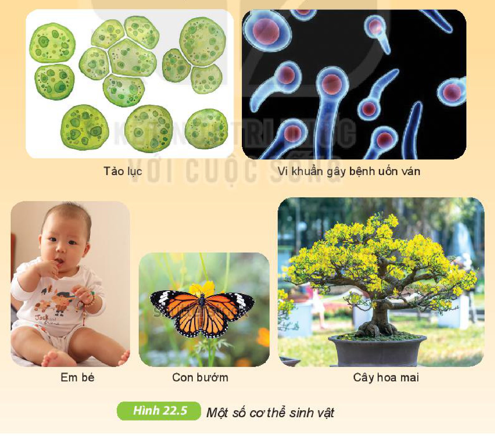

<!-- pdf:76 -->

# BÀI 22: CƠ THỂ SINH VẬT

## 🎯 Mục tiêu

- Nhận biết được cơ thể sống.
- Nhận biết được cơ thể đơn bào và cơ thể đa bào. Lấy được ví dụ minh hoạ.

## 🔴 Mở đầu

Bằng mắt thường, chúng ta có thể dễ dàng nhìn thấy con ếch. Tuy nhiên, chúng ta chỉ có thể nhìn thấy con trùng amip dưới kính hiển vi. Điều này có liên quan gì đến số lượng tế bào cấu tạo nên cơ thể các con vật đó không?

## I. Cơ thể là gì?

**Cơ thể** là từ dùng để chỉ một cá thể sinh vật có khả năng thực hiện các quá trình sống cơ bản như cảm ứng, dinh dưỡng, sinh trưởng và sinh sản,...

Hình 22.1. Một số quá trình sống cơ bản của sinh vật

> **Câu hỏi:** Quan sát Hình 22.1 và nêu các quá trình sống cơ bản của cơ thể.

<!-- pdf:77 -->

Hình 22.2. Hình minh hoạ vật sống và vật không sống

> **Hoạt động:** Quan sát Hình 22.2 và thảo luận nhóm các nội dung sau:
> 1. Kể tên vật sống và vật không sống mà em quan sát được trong hình trên. Những đặc điểm nào giúp các em nhận ra một vật sống?
> 2. Để chuyển động trên đường, một chiếc ô tô hoặc xe máy cần lấy khí oxygen để đốt cháy xăng và thải ra khí carbon dioxide. Vậy, vật sống giống với ô tô hoặc xe máy ở đặc điểm nào? Tại sao ô tô và xe máy không phải là vật sống?

## II. Cơ thể đơn bào và cơ thể đa bào

Hầu hết các sinh vật có kích thước khác nhau là do cơ thể chúng có số lượng tế bào khác nhau.

Tuỳ thuộc vào số lượng tế bào cấu tạo nên cơ thể, tất cả sinh vật trên Trái Đất được chia làm hai nhóm lớn là cơ thể đơn bào và cơ thể đa bào.

**Cơ thể đơn bào** có tổ chức đơn giản, cơ thể chỉ là một tế bào. Tế bào này đồng thời thực hiện tất cả các quá trình sống cơ bản. Ví dụ: vi khuẩn, nấm men, nguyên sinh động vật,... là cơ thể đơn bào (Hình 22.3).

Hình 22.3. Một số cơ thể đơn bào

<!-- pdf:78 -->

**Cơ thể đa bào** có cấu tạo gồm nhiều tế bào. Mỗi loại tế bào thường thực hiện một chức năng sống riêng biệt nhưng phối hợp với nhau thực hiện các quá trình sống của cơ thể. Ví dụ: thực vật (như cây quất), động vật (như con thỏ), người,... là các cơ thể đa bào (Hình 22.4).

Hình 22.4. Một số cơ thể đa bào

> **Câu hỏi:** Quan sát Hình 22.5 và xác định cơ thể đơn bào, cơ thể đa bào.

Hình 22.5. Một số cơ thể sinh vật

<!-- pdf:79 -->

## 📌 Em đã học

- Cơ thể là cấp tổ chức có khả năng thực hiện đầy đủ các quá trình sống cơ bản.
- Cơ thể đơn bào được cấu tạo từ một tế bào.
- Cơ thể đa bào được cấu tạo từ nhiều tế bào, các tế bào phối hợp với nhau cùng thực hiện các quá trình sống của cơ thể.

## ✏️ Em có thể

1. Phân biệt được vật sống và vật không sống.
2. Dựa vào các quá trình sống cơ bản của cơ thể sinh vật để có hành động phù hợp giúp chăm sóc và bảo vệ sinh vật.

## 💡 Em có biết?

> **Một cách giải thích vì sao cơ thể đa bào có nhiều tế bào chuyên hoá về chức năng**
>
> Cơ thể đơn bào (ví dụ: trùng biến hình) có kích thước nhỏ, tỉ lệ diện tích và thể tích của cơ thể lớn (diện tích bề mặt của cơ thể tiếp xúc với môi trường lớn), cho phép các chất dinh dưỡng và chất thải dễ dàng đi qua màng của tế bào, giúp tế bào trao đổi chất với môi trường một cách nhanh chóng.
>
> Cơ thể đa bào (ví dụ: con voi, con gà,...) thường có kích thước lớn, tỉ lệ diện tích và thể tích của cơ thể nhỏ nên sự khuếch tán và vận chuyển các chất dinh dưỡng, chất thải trực tiếp qua bề mặt cơ thể không đủ cho các quá trình sống. Vì vậy, cơ thể đa bào cần các tế bào chuyên hoá cho việc hấp thu các chất dinh dưỡng và loại bỏ các chất thải ra khỏi cơ thể.

## 📷 Danh sách hình trong bài

| Mã hình | Trang PDF | Vị trí | Chú thích gốc |
|---|---|---|---|
| H6-khoa_hoc_tu_nhien-b22-01 | 76 | Mục I | Hình 22.1. Một số quá trình sống cơ bản của sinh vật |
| H6-khoa_hoc_tu_nhien-b22-02 | 77 | Mục I (nằm trong hộp Hoạt động nền xanh lam nhạt) | Hình 22.2. Hình minh hoạ vật sống và vật không sống |
| H6-khoa_hoc_tu_nhien-b22-03 | 77 | Mục II | Hình 22.3. Một số cơ thể đơn bào |
| H6-khoa_hoc_tu_nhien-b22-04 | 78 | Mục II | Hình 22.4. Một số cơ thể đa bào |
| H6-khoa_hoc_tu_nhien-b22-05 | 78 | Mục II (nằm trong hộp Câu hỏi nền cam nhạt) | Hình 22.5. Một số cơ thể sinh vật |
