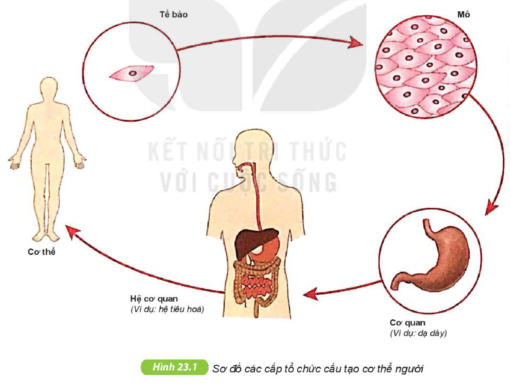
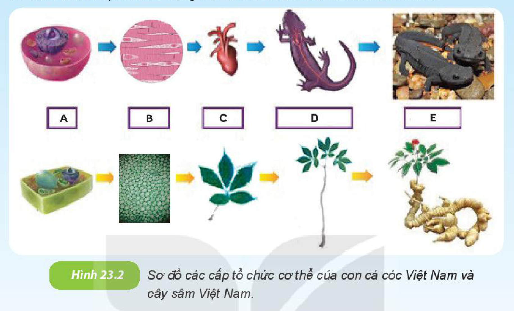
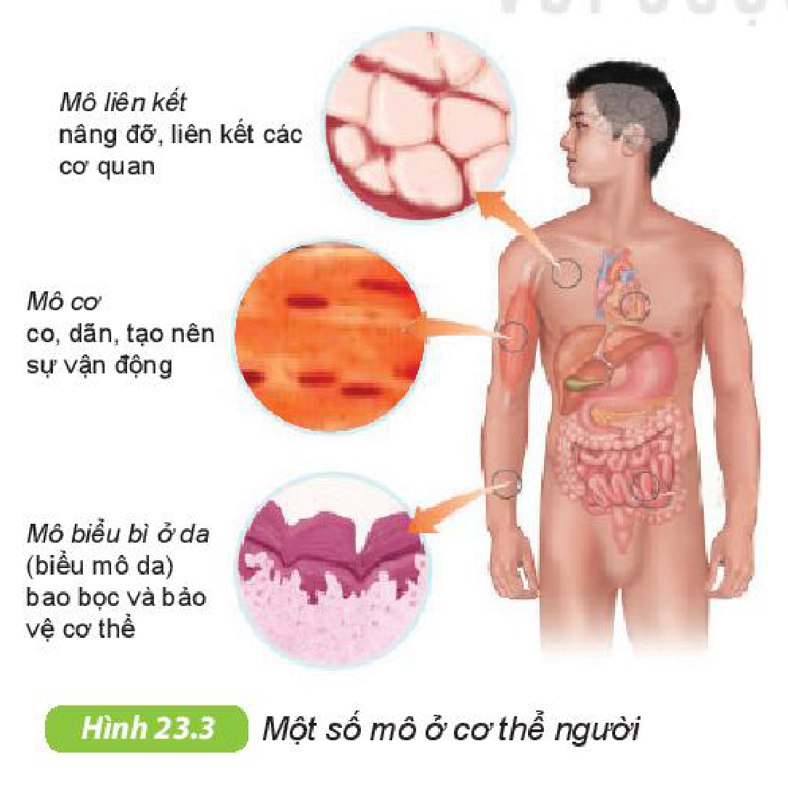
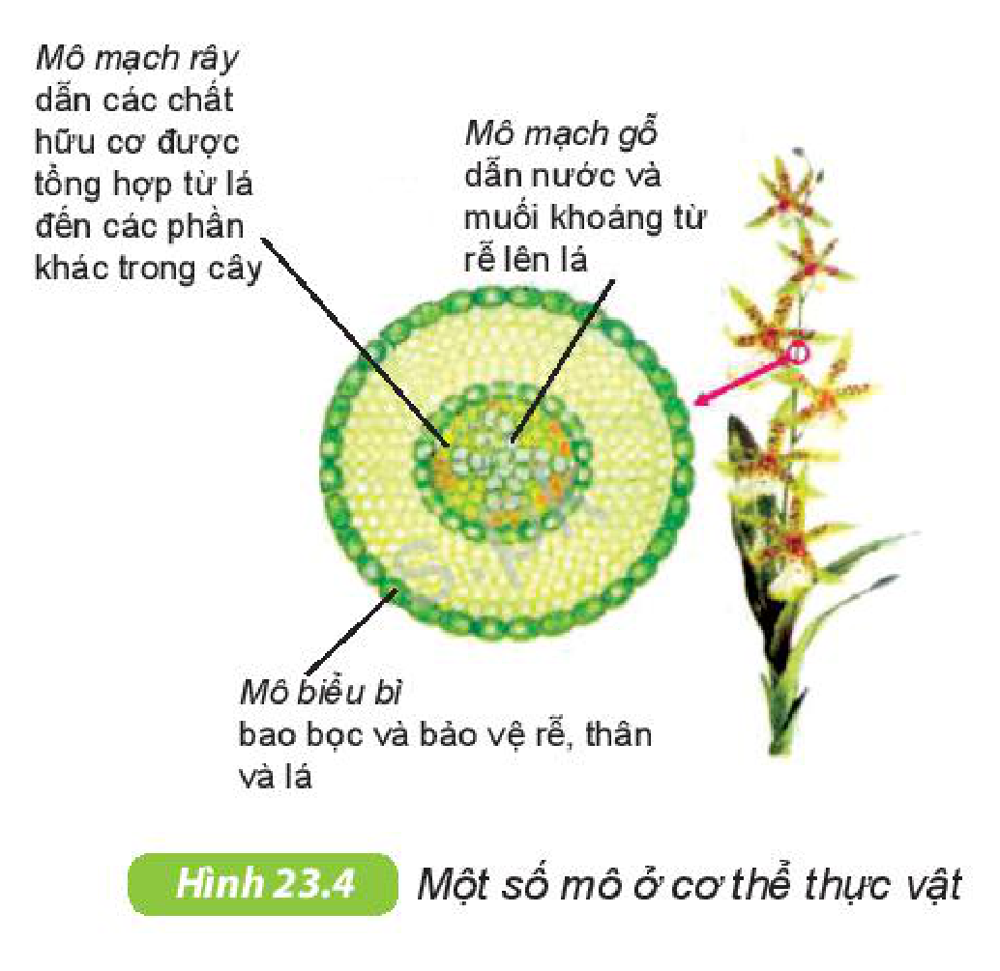
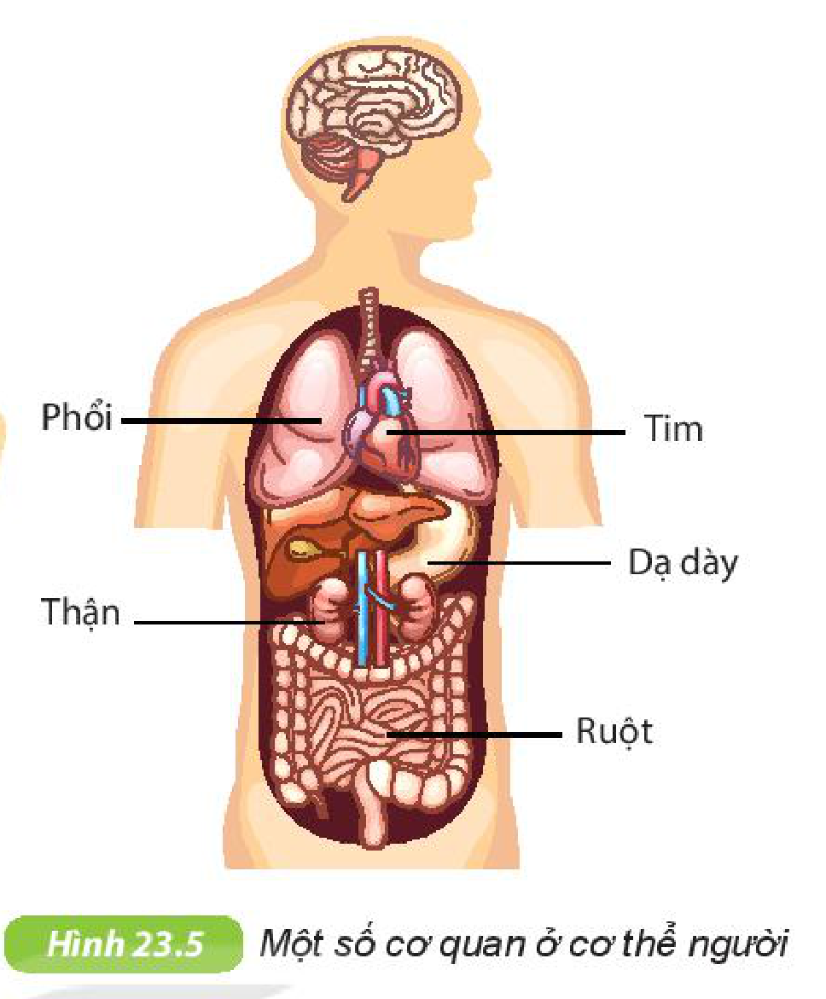
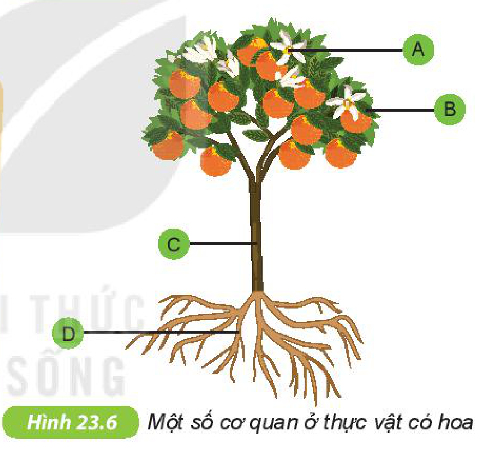
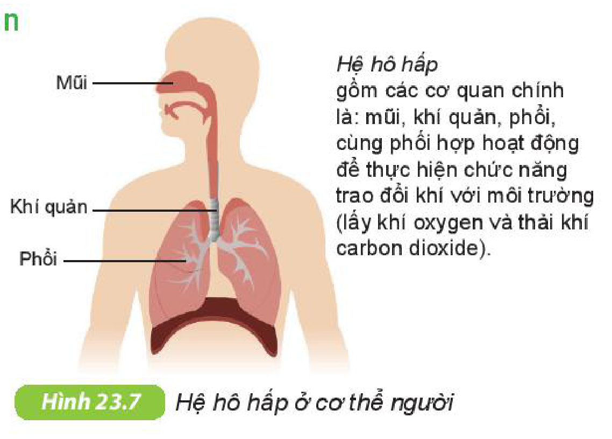
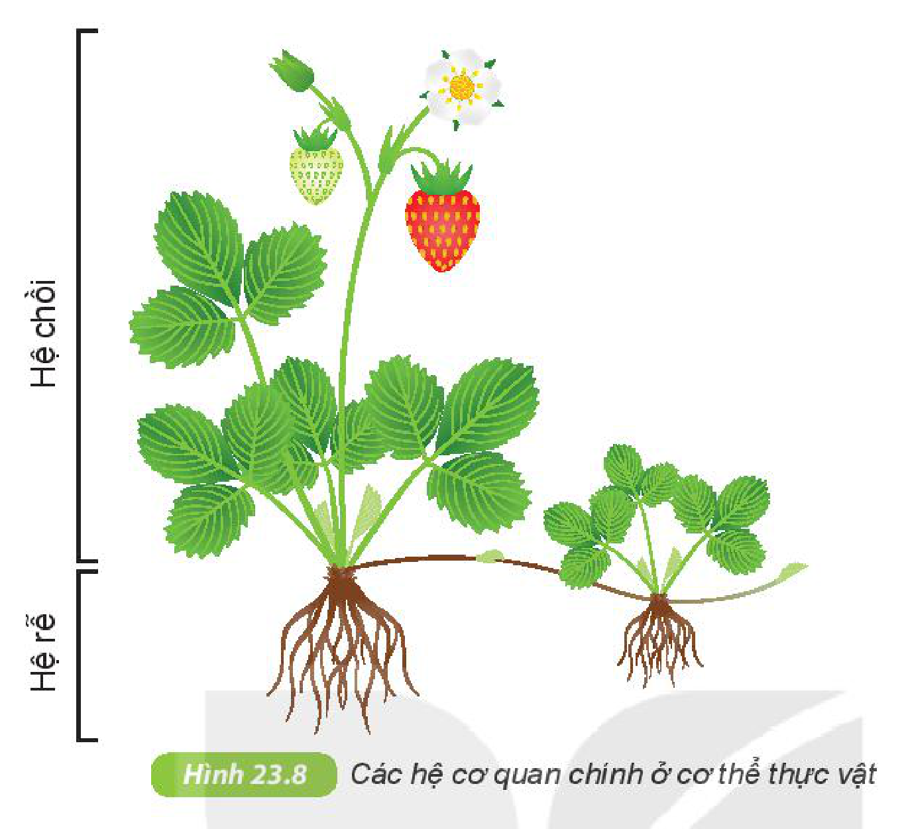

<!-- pdf:80 -->

# BÀI 23: TỔ CHỨC CƠ THỂ ĐA BÀO

## 🎯 Mục tiêu

- Nêu được mối quan hệ từ tế bào hình thành nên mô, cơ quan, hệ cơ quan, cơ thể.
- Nêu được các khái niệm mô, cơ quan, hệ cơ quan, cơ thể và lấy được ví dụ minh hoạ.

## 🔴 Mở đầu

Em không thể chiến thắng một trận bóng đá nếu chỉ đá một mình. Trong một đội bóng, mỗi cầu thủ ở các vị trí khác nhau cùng phối hợp trong khi chơi bóng. Trong cơ thể, các tế bào hoạt động theo cách đó. Vậy, các tế bào được tổ chức và phối hợp hoạt động với nhau như thế nào trong cơ thể đa bào?

## I. Các cấp tổ chức của cơ thể đa bào

Hình 23.1. Sơ đồ các cấp tổ chức cấu tạo cơ thể người

> **Câu hỏi:** Quan sát Hình 23.1, viết sơ đồ thể hiện mối quan hệ giữa các cấp tổ chức của cơ thể từ thấp đến cao.
<!-- ocr-ok: đã đối chiếu ảnh p080, OCR đọc sai dấu nhiều chữ trong hộp câu hỏi nền màu -->

<!-- pdf:81 -->

> **Hoạt động:** Quan sát Hình 23.2 rồi thực hiện các yêu cầu dưới đây:
> 1. Gọi tên các cấp tổ chức cơ thể tương ứng với các hình từ A đến E cho phù hợp.
> 2. Nêu tên cơ quan của động vật và thực vật được minh hoạ ở hình.

Hình 23.2. Sơ đồ các cấp tổ chức cơ thể của con cá cóc Việt Nam và cây sâm Việt Nam.

## II. Từ tế bào tạo thành mô

Ở cơ thể đa bào, nhóm các tế bào cùng thực hiện một chức năng liên kết với nhau tạo thành **mô**.

> **Câu hỏi:** Quan sát Hình 23.3 và 23.4, nêu một số mô ở người và ở thực vật.

Hình 23.3. Một số mô ở cơ thể người

Hình 23.4. Một số mô ở cơ thể thực vật

<!-- pdf:82 -->

## III. Từ mô tạo thành cơ quan

Các mô cùng thực hiện một hoạt động sống nhất định tạo thành **cơ quan**. Một số cơ quan ở cơ thể người như: não, tim, dạ dày, ruột, gan và thận.

Hình 23.5. Một số cơ quan ở cơ thể người

> **Câu hỏi:** Quan sát Hình 23.5 và xác định vị trí một số cơ quan trong cơ thể người.

Thực vật cũng có những cơ quan đặc trưng như: rễ, thân, lá, hoa,... Mỗi cơ quan giữ một vai trò nhất định với cơ thể.

Hình 23.6. Một số cơ quan ở thực vật có hoa

> **Câu hỏi:** Quan sát Hình 23.6, hãy xác định vị trí và gọi tên các cơ quan tương ứng với các chữ cái từ A đến D. Ghép tên mỗi cơ quan đó với chức năng phù hợp được mô tả dưới đây:
> 1. Nâng đỡ cơ thể và vận chuyển các chất dinh dưỡng.
> 2. Tổng hợp chất dinh dưỡng cho cơ thể.
> 3. Hút nước và chất khoáng cho cơ thể.
> 4. Tạo ra quả và hạt.

## IV. Từ cơ quan tạo thành hệ cơ quan
<!-- ocr-ok: đã đối chiếu ảnh p082, tiêu đề mục màu xanh lá OCR đọc nhầm dấu -->

Nhiều cơ quan cùng phối hợp hoạt động để thực hiện một quá trình sống nào đó của cơ thể gọi là **hệ cơ quan**. Ví dụ: cơ thể người có các hệ cơ quan như hệ tiêu hoá, hệ hô hấp, hệ tuần hoàn, hệ thần kinh, hệ bài tiết, hệ cơ,...

Hình 23.7. Hệ hô hấp ở cơ thể người

<!-- pdf:83 -->

Thực vật có hai hệ cơ quan chính là hệ rễ và hệ chồi (Hình 23.8).

Hình 23.8. Các hệ cơ quan chính ở cơ thể thực vật

> **Câu hỏi:** Tìm hiểu một hệ cơ quan ở người và thực hiện các yêu cầu sau:
> 1. Hệ cơ quan đó có những cơ quan nào?
> 2. Nêu chức năng của hệ cơ quan đó đối với cơ thể.

## 📌 Em đã học

<!-- term: Các cấp tổ chức của cơ thể đa bào -->
- Cơ thể đa bào được cấu tạo từ nhiều tế bào thực hiện các chức năng khác nhau. Các tế bào phối hợp qua một số cấp tổ chức (tế bào → mô → cơ quan → hệ cơ quan) để tạo thành cơ thể.

- Mô gồm nhiều tế bào cùng thực hiện một chức năng. Cơ quan được cấu tạo từ hai hay nhiều mô, cùng thực hiện một hoạt động sống. Hệ cơ quan gồm một nhóm các cơ quan cùng thực hiện một quá trình sống. Các hệ cơ quan phối hợp với nhau thực hiện đầy đủ các quá trình sống cơ bản, đảm bảo cho sự tồn tại và phát triển của cơ thể.

## ✏️ Em có thể

Giải thích vì sao khi một cơ quan trong cơ thể bị bệnh hay tổn thương thì cả cơ thể đều bị ảnh hưởng. Từ đó biết cách chăm sóc và bảo vệ cơ thể.

## 📷 Danh sách hình trong bài

| Mã hình | Trang PDF | Vị trí | Chú thích gốc |
|---|---|---|---|
| H6-khoa_hoc_tu_nhien-b23-01 | 80 | Mục I | Hình 23.1. Sơ đồ các cấp tổ chức cấu tạo cơ thể người |
| H6-khoa_hoc_tu_nhien-b23-02 | 81 | Mục I (nằm trong hộp Hoạt động nền xanh lam nhạt) | Hình 23.2. Sơ đồ các cấp tổ chức cơ thể của con cá cóc Việt Nam và cây sâm Việt Nam. |
| H6-khoa_hoc_tu_nhien-b23-03 | 81 | Mục II | Hình 23.3. Một số mô ở cơ thể người |
| H6-khoa_hoc_tu_nhien-b23-04 | 81 | Mục II | Hình 23.4. Một số mô ở cơ thể thực vật |
| H6-khoa_hoc_tu_nhien-b23-05 | 82 | Mục III (cạnh trái chạm nhẹ mép phải màu nền hộp Câu hỏi bên trái) | Hình 23.5. Một số cơ quan ở cơ thể người |
| H6-khoa_hoc_tu_nhien-b23-06 | 82 | Mục III (cạnh trái chạm nhẹ mép phải màu nền hộp Câu hỏi bên trái) | Hình 23.6. Một số cơ quan ở thực vật có hoa |
| H6-khoa_hoc_tu_nhien-b23-07 | 82 | Mục IV | Hình 23.7. Hệ hô hấp ở cơ thể người |
| H6-khoa_hoc_tu_nhien-b23-08 | 83 | Mục IV | Hình 23.8. Các hệ cơ quan chính ở cơ thể thực vật |
