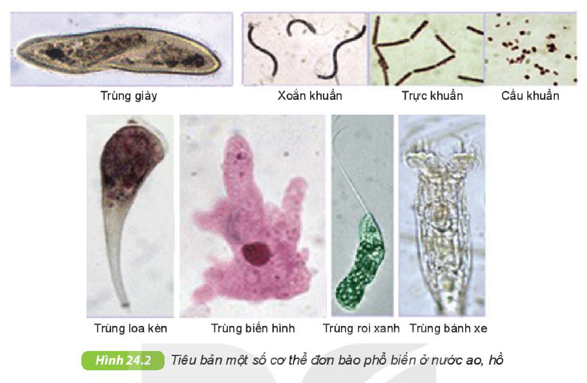
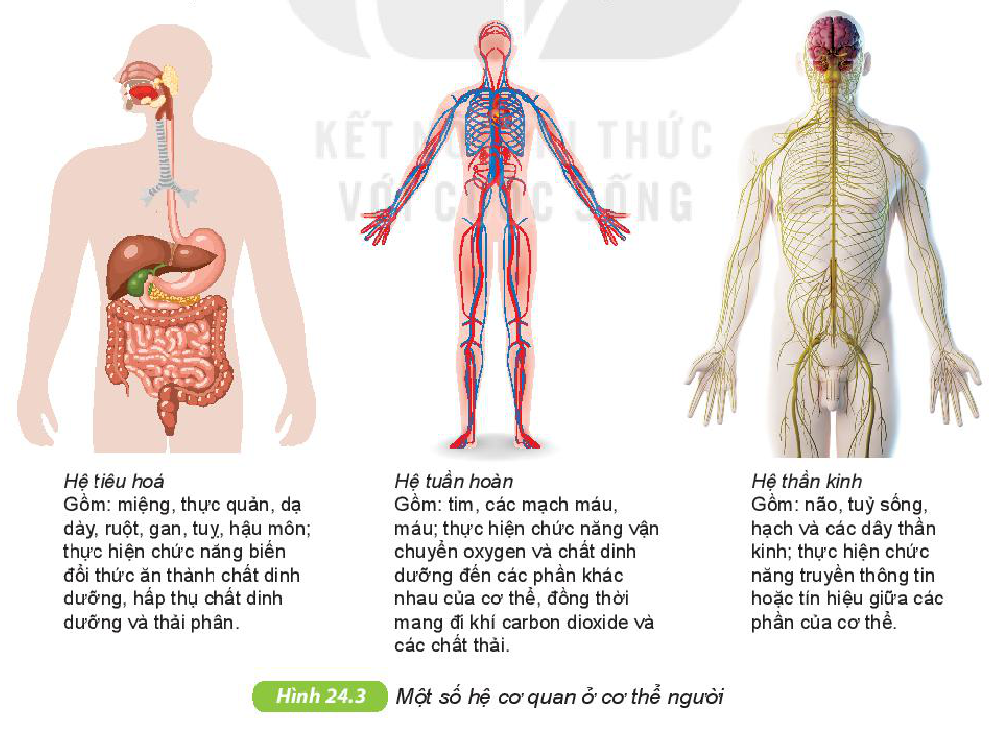

<!-- pdf:84 -->

# BÀI 24: THỰC HÀNH: QUAN SÁT VÀ MÔ TẢ CƠ THỂ ĐƠN BÀO, CƠ THỂ ĐA BÀO

## 🎯 Mục tiêu

- Quan sát và vẽ được hình cơ thể đơn bào.
- Quan sát mô hình và mô tả được cấu tạo cơ thể người.
- Quan sát và mô tả được các cơ quan cấu tạo thực vật.

## I. Chuẩn bị

### 1. Thiết bị, dụng cụ

- Lam kính
- Lamen
- Cốc đong
- Kính hiển vi có vật kính 10x, 40x
- Ống nhỏ giọt
- Giấy thấm
- Thìa

Hình 24.1. Cốc đong
<!-- ocr-ok: đã đối chiếu ảnh p084, OCR bỏ sót nhãn 'Hình 24.1' trên nền xanh -->

### 2. Mẫu vật

- Nước ao (hồ) hoặc nước trong môi trường nuôi.
- Mô hình, tranh, ảnh giải phẫu một số hệ cơ quan ở cơ thể người.
- Một số loài thực vật có hình thái các cơ quan khác nhau như cây lúa (hoặc hành), cây rau ngót, cây bưởi nhỏ,... hoặc tranh, ảnh của một số loại cây.

> **Lưu ý:** Mẫu vật thực vật có thể thay đổi cho phù hợp với từng địa phương.

## II. Cách tiến hành

### 1. Làm tiêu bản và quan sát cơ thể đơn bào trong nước ao (hồ)

Bước 1: Dùng thìa khuấy đều nước ao (hồ) trong cốc.

Bước 2: Dùng ống nhỏ giọt hút lấy một giọt nước ao (hồ) nhỏ lên lam kính rồi đậy bằng lamen.

Bước 3: Dùng giấy thấm hút phần nước tràn ra ngoài lamen.

Bước 4: Quan sát tiêu bản bằng kính hiển vi.
- Quan sát ở vật kính 10x và 40x. Vẽ lại cơ thể sinh vật đơn bào mà em quan sát được.
- Dựa vào Hình 24.2, xác định tên sinh vật đơn bào em đã quan sát được và hoàn thành vào bảng thu hoạch theo mẫu.

<!-- pdf:85 -->

Hình 24.2. Tiêu bản một số cơ thể đơn bào phổ biến ở nước ao, hồ

### 2. Quan sát mô hình hoặc tranh, ảnh cấu tạo một số hệ cơ quan của cơ thể người

Quan sát mô hình, tranh, ảnh đã chuẩn bị hoặc Hình 24.3, nêu tên và xác định vị trí một số cơ quan cấu tạo nên mỗi hệ cơ quan trong hình.

Hình 24.3. Một số hệ cơ quan ở cơ thể người

<!-- pdf:86 -->

### 3. Quan sát các cơ quan của thực vật

Quan sát các cây trên tranh, ảnh hoặc mẫu vật. Xác định vị trí và gọi tên các cơ quan của cây.

## III. Thu hoạch

1. Kết quả quan sát cơ thể đơn bào:
   a) Dựa vào kết quả quan sát tiêu bản sinh vật trong nước ao (hồ), em hãy hoàn thành bảng thu hoạch theo mẫu sau:

| Tên sinh vật quan sát được | Vẽ hình |
|---|---|
| ? | ? |
| ? | ? |

   b) Kể tên các cơ thể đơn bào có khả năng quang hợp mà em quan sát thấy. Dấu hiệu nhận biết chúng là gì?

2. Dựa vào kết quả quan sát mô hình hoặc tranh, ảnh một số hệ cơ quan trong cơ thể người, hoàn thành bảng theo mẫu sau:

| Hệ cơ quan / Đặc điểm | Các cơ quan cấu tạo | Vị trí trên cơ thể |
|---|---|---|
| Hệ tiêu hoá | ? | ? |
| Hệ tuần hoàn | ? | ? |
| Hệ thần kinh | ? | ? |

3. Từ kết quả quan sát các cơ quan của một số cây, hoàn thành bảng theo mẫu sau:

| Tên cây | Cơ quan quan sát được | Mô tả |
|---|---|---|
| ? | ? | ? |
| ? | ? | ? |

## 📷 Danh sách hình trong bài

| Mã hình | Trang PDF | Vị trí | Chú thích gốc |
|---|---|---|---|
| H6-khoa_hoc_tu_nhien-b24-01 | 84 | Mục I.1 | Hình 24.1. Cốc đong |
| H6-khoa_hoc_tu_nhien-b24-02 | 85 | Mục II.1 | Hình 24.2. Tiêu bản một số cơ thể đơn bào phổ biến ở nước ao, hồ |
| H6-khoa_hoc_tu_nhien-b24-03 | 85 | Mục II.2 | Hình 24.3. Một số hệ cơ quan ở cơ thể người |
