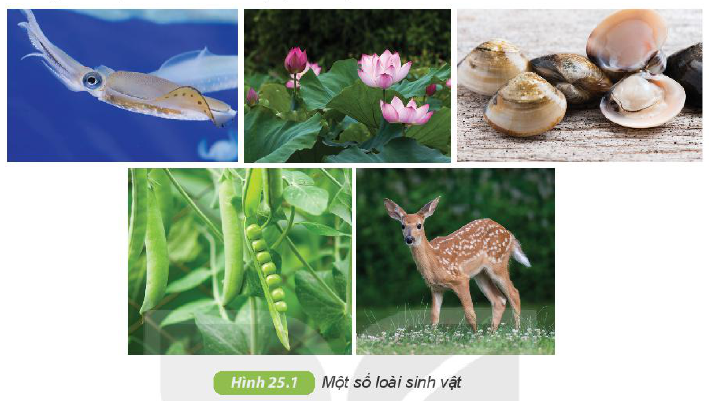
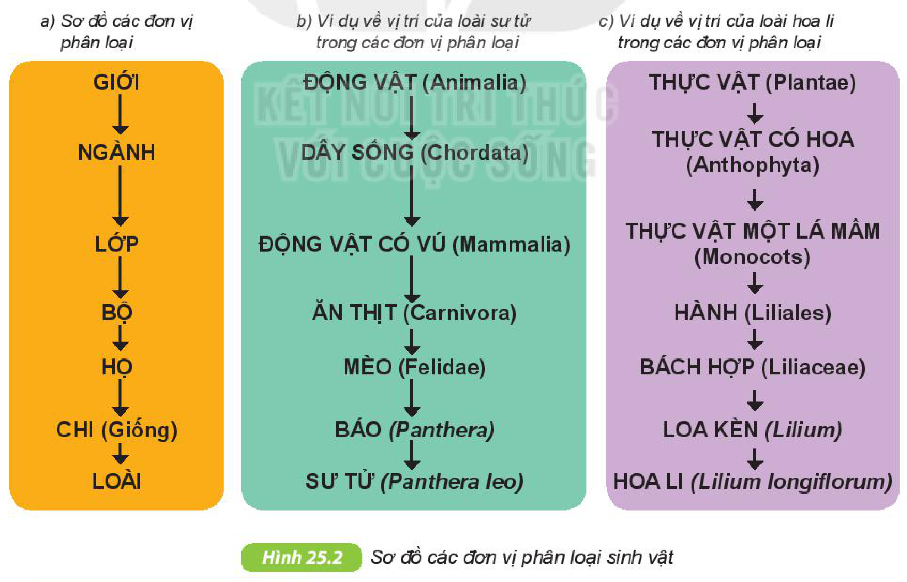
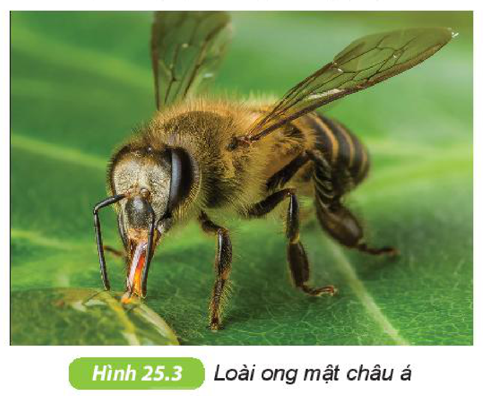
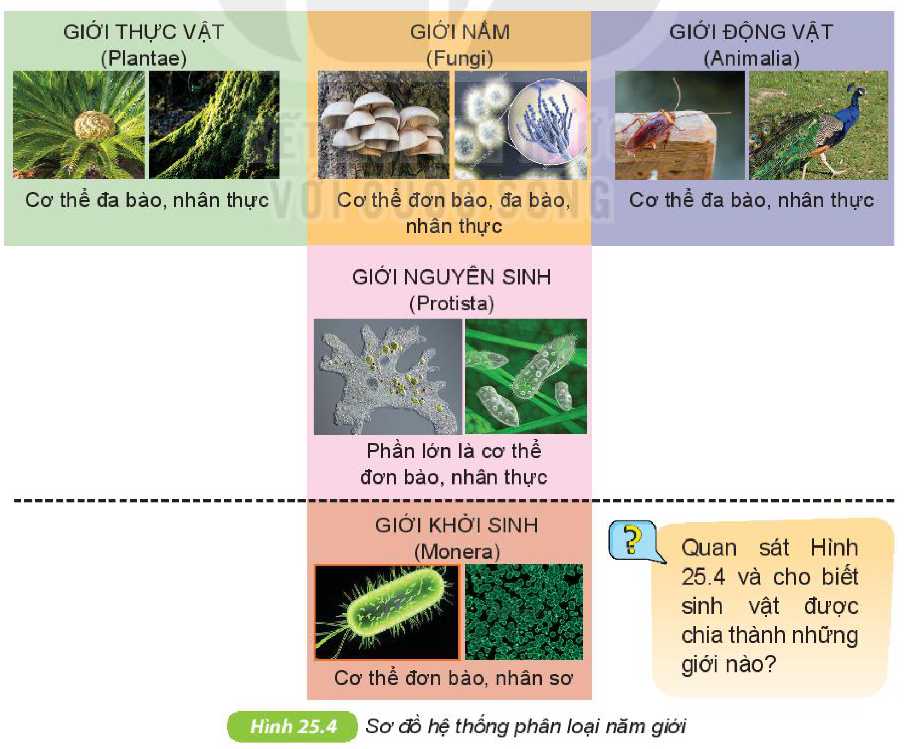
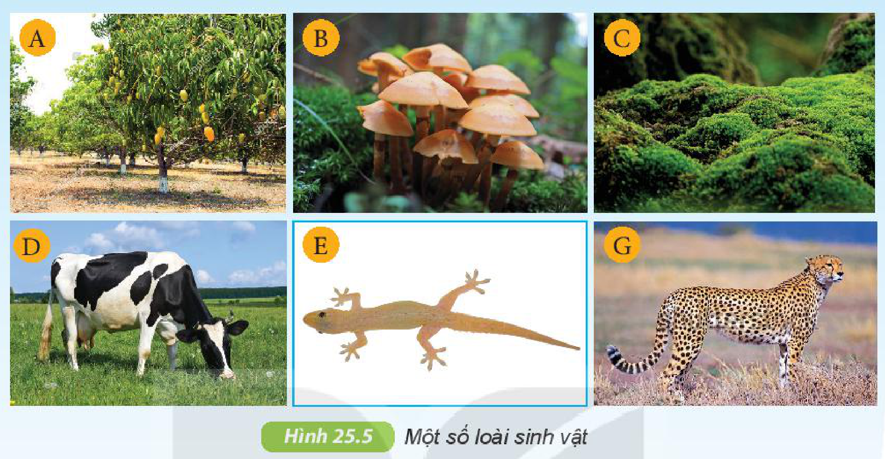

<!-- pdf:87 -->

# BÀI 25: HỆ THỐNG PHÂN LOẠI SINH VẬT

## 🎯 Mục tiêu

- Nêu được sự cần thiết của việc phân loại thế giới sống.
- Phân biệt được các đơn vị phân loại sinh vật.
- Nhận biết được năm giới sinh vật và lấy được ví dụ minh hoạ.

## 🔴 Mở đầu

Khi vào một cửa hàng sách, em sẽ dễ dàng tìm được cuốn sách mình cần vì sách trong cửa hàng đã được sắp xếp thành từng nhóm khác nhau. Vậy để có thể dễ dàng tìm ra một loài sinh vật trong vô số các loài sinh vật trong tự nhiên, các nhà khoa học đã phân loại thế giới sống như thế nào?

## I. Sự cần thiết của việc phân loại thế giới sống

> ❓ 1. Em hãy sắp xếp sách vở và đồ dùng học tập của em thành từng nhóm dựa vào đặc điểm chung giữa chúng.
>
> 2. Việc phân loại đó giúp ích gì cho em?

**Phân loại sinh học** là sự sắp xếp các đối tượng sinh vật có những đặc điểm chung vào từng nhóm, theo một thứ tự nhất định.

Phân loại sinh học giúp xác định được vị trí của các loài sinh vật trong thế giới sống và tìm ra chúng giữa các nhóm sinh vật dễ dàng hơn. Ngoài ra, phân loại sinh học còn cho thấy sự giống và khác nhau của các nhóm đối tượng phân loại, nguyên nhân của sự giống nhau đó và mối quan hệ giữa các nhóm sinh vật.

<!-- pdf:88 -->

## II. Hệ thống phân loại sinh vật

Trên Trái Đất có hàng triệu loài sinh vật, một số đại diện được thể hiện trong Hình 25.1. Chúng đã được các nhà khoa học phân loại như thế nào?

Hình 25.1. Một số loài sinh vật

<!-- term: Đơn vị phân loại sinh vật -->
Các nhà khoa học đã phân loại sinh vật thành các đơn vị phân loại khác nhau: lớn nhất là giới, tiếp theo là ngành, lớp, bộ, họ, chi \*(hoặc giống) rồi đến loài.

Hình 25.2. Sơ đồ các đơn vị phân loại sinh vật

> \* Ở động vật gọi là "giống"; ở thực vật gọi là "chi"

<!-- pdf:89 -->

<!-- term: Tên địa phương -->
Thông thường, mỗi loài sinh vật có hai cách gọi tên: tên địa phương và tên khoa học.

Ví dụ: Loài trong Hình 25.3 có tên khoa học là *Apis cerana*, tên địa phương là ong mật châu á.

Hình 25.3. Loài ong mật châu á

> 💡 Em có biết?
>
> Hiện nay, các nhà khoa học trên thế giới đã xác định được khoảng gần 2 triệu loài sinh vật khác nhau. Mỗi loài được đặt một tên khoa học khác nhau và không loài nào trùng tên với loài nào. **Tên khoa học** của loài là tên kép được viết nghiêng gồm hai phần: phần thứ nhất là tên chi (giống), phần thứ hai là tên của loài thuộc chi (giống) đó. Ví dụ: con ong mật có tên khoa học là *Apis cerana*. *Apis*: là tên giống (viết hoa chữ cái đầu tiên); *cerana*: là tên loài thuộc giống đó (viết thường).

## III. Giới và hệ thống phân loại năm giới

<!-- term: Hệ thống phân loại năm giới -->
**Giới sinh vật** được coi là đơn vị phân loại lớn nhất, bao gồm các ngành sinh vật có chung những đặc điểm nhất định. Các nhà khoa học đã phân chia sinh vật thành năm giới (Hình 25.4).

<!-- term: Giới Khởi sinh -->
- Giới Khởi sinh (Monera): Cơ thể đơn bào, nhân sơ.

<!-- term: Giới Nguyên sinh -->
- Giới Nguyên sinh (Protista): Phần lớn là cơ thể đơn bào, nhân thực.

<!-- term: Giới Nấm -->
- Giới Nấm (Fungi): Cơ thể đơn bào, đa bào, nhân thực.
<!-- ocr-ok: đã đối chiếu p089.png, OCR đọc sai chữ 'GIỚI NẤM (Fungi)' trong sơ đồ Hình 25.4 -->

<!-- term: Giới Thực vật -->
- Giới Thực vật (Plantae): Cơ thể đa bào, nhân thực.

<!-- term: Giới Động vật -->
- Giới Động vật (Animalia): Cơ thể đa bào, nhân thực.

Hình 25.4. Sơ đồ hệ thống phân loại năm giới

> ❓ Quan sát Hình 25.4 và cho biết sinh vật được chia thành những giới nào?

<!-- pdf:90 -->

> ✋ Các loài trong Hình 25.5 thuộc giới Nấm, giới Thực vật và giới Động vật.
>
> Em hãy sắp xếp các loài trong hình vào các giới cho phù hợp. Nêu lí do vì sao em sắp xếp như vậy.
>
> 
>
> Hình 25.5. Một số loài sinh vật

## 📌 Em đã học

<!-- term: Hệ thống phân loại năm giới -->
- Phân loại là sự sắp xếp các đối tượng phân loại có những đặc điểm chung vào từng nhóm theo một thứ tự nhất định.
- Theo hệ thống phân loại năm giới, sinh vật được chia thành các giới: Khởi sinh, Nguyên sinh, Nấm, Thực vật và Động vật.
- Thế giới sinh vật được phân chia thành các đơn vị phân loại theo thứ tự từ lớn đến nhỏ: giới, ngành, lớp, bộ, họ, chi (hoặc giống) rồi đến loài.

## ✏️ Em có thể

Dựa vào đặc điểm của các loài sinh vật để xếp chúng vào các giới sinh vật khác nhau.

> 💡 Em có biết?
>
> Trước đây, các nhà phân loại học chỉ phân chia sinh vật thành hai giới: Thực vật và Động vật. Theo quan điểm hai giới, thực vật là các cơ thể sống cố định và có khả năng tự tổng hợp chất hữu cơ (**tự dưỡng**), còn động vật là các cơ thể có khả năng vận động chủ động và dinh dưỡng theo kiểu **dị dưỡng**. Tuy nhiên, với sự phát hiện ra các cơ thể vi sinh vật (như vi khuẩn), tảo và nấm; từ năm 1969 nhà Khoa học người Mĩ là R.H. Whittaker đã xây dựng và đề xuất một hệ thống phân loại gồm năm giới và được nhiều nhà khoa học ủng hộ. Hiện nay, một số nhà khoa học đưa ra hệ thống phân loại sinh vật gồm ba lãnh giới: vi sinh vật cổ, vi khuẩn và lãnh giới thứ ba gồm các sinh vật nhân thực.

## 📷 Danh sách hình trong bài

| Mã hình | Trang PDF | Vị trí | Chú thích gốc |
| --- | --- | --- | --- |
| H6-khoa_hoc_tu_nhien-b25-01 | 88 | Mục II | Hình 25.1. Một số loài sinh vật |
| H6-khoa_hoc_tu_nhien-b25-02 | 88 | Mục II | Hình 25.2. Sơ đồ các đơn vị phân loại sinh vật |
| H6-khoa_hoc_tu_nhien-b25-03 | 89 | Mục II | Hình 25.3. Loài ong mật châu á |
| H6-khoa_hoc_tu_nhien-b25-04 | 89 | Mục III | Hình 25.4. Sơ đồ hệ thống phân loại năm giới |
| H6-khoa_hoc_tu_nhien-b25-05 | 90 | Hộp Hoạt động mục III (nền hộp xanh nhạt) | Hình 25.5. Một số loài sinh vật |
