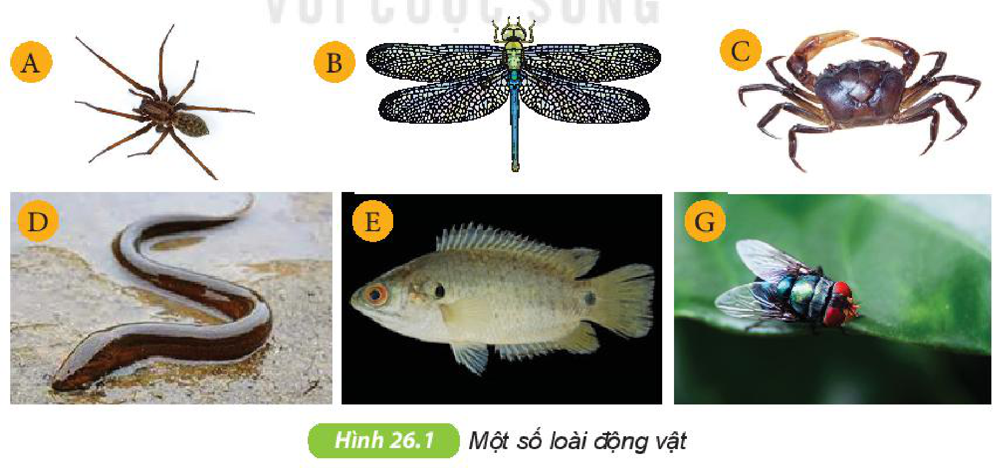
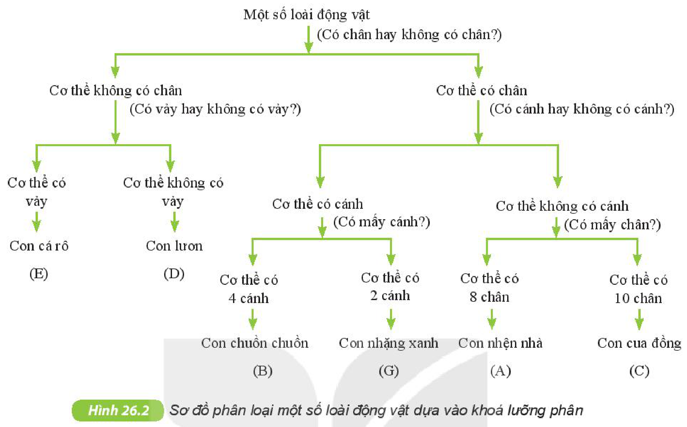

<!-- pdf:91 -->

# BÀI 26: KHOÁ LƯỠNG PHÂN

## 🎯 Mục tiêu

- Nhận biết được cách xây dựng khoá lưỡng phân.
- Thực hành xây dựng được khoá lưỡng phân với đối tượng sinh vật.

## 🔴 Mở đầu

Khi đi vào một khu vườn rộng, em bắt gặp rất nhiều loài sinh vật khác nhau bao gồm thực vật, động vật, nấm,... Em có thể phân biệt được các loài không? Làm thế nào em có thể thực hiện được việc đó?

## I. Khoá lưỡng phân là gì?

**Khoá lưỡng phân** là kiểu phổ biến nhất trong các khoá phân loại sinh vật. Nguyên tắc của khoá lưỡng phân là từ một tập hợp các đối tượng ban đầu được tách thành hai nhóm có những đặc điểm đối lập với nhau. Sau mỗi lần tách, ta được hai nhóm nhỏ hơn và khác nhau bởi các đặc điểm dùng để tách.

## II. Xây dựng khoá lưỡng phân

Xây dựng khoá lưỡng phân để phân loại một số loài động vật sau:

Hình 26.1. Một số loài động vật

Bước 1: Lựa chọn đặc điểm để phân chia được các loài cần phân loại thành hai nhóm (ví dụ: chọn đặc điểm có chân hay không có chân? trên cơ sở trả lời câu hỏi có hay không có đặc điểm đó, ta có thể xếp các động vật trên thành hai nhóm). Tiếp tục cách làm như vậy ở từng nhóm nhỏ tiếp theo cho đến khi xác định được từng loài.

<!-- pdf:92 -->

Bước 2: Lập sơ đồ phân loại như Hình 26.2.

Hình 26.2. Sơ đồ phân loại một số loài động vật dựa vào khoá lưỡng phân

> ✋ Cho các loài sinh vật như hình dưới đây. Tiến hành xây dựng khoá lưỡng phân để phân loại chúng.

## 📌 Em đã học

**Khoá phân loại** được xây dựng giúp xác định vị trí phân loại của loài một cách thuận lợi, trong đó khoá lưỡng phân là khoá phân loại phổ biến nhất.

## ✏️ Em có thể

Biết cách xây dựng khoá lưỡng phân và thực hành xây dựng được khoá lưỡng phân với đối tượng sinh vật.

## 📷 Danh sách hình trong bài

| Mã hình | Trang PDF | Vị trí | Chú thích gốc |
| --- | --- | --- | --- |
| H6-khoa_hoc_tu_nhien-b26-01 | 91 | Mục II | Hình 26.1. Một số loài động vật |
| H6-khoa_hoc_tu_nhien-b26-02 | 92 | Mục II | Hình 26.2. Sơ đồ phân loại một số loài động vật dựa vào khoá lưỡng phân |
