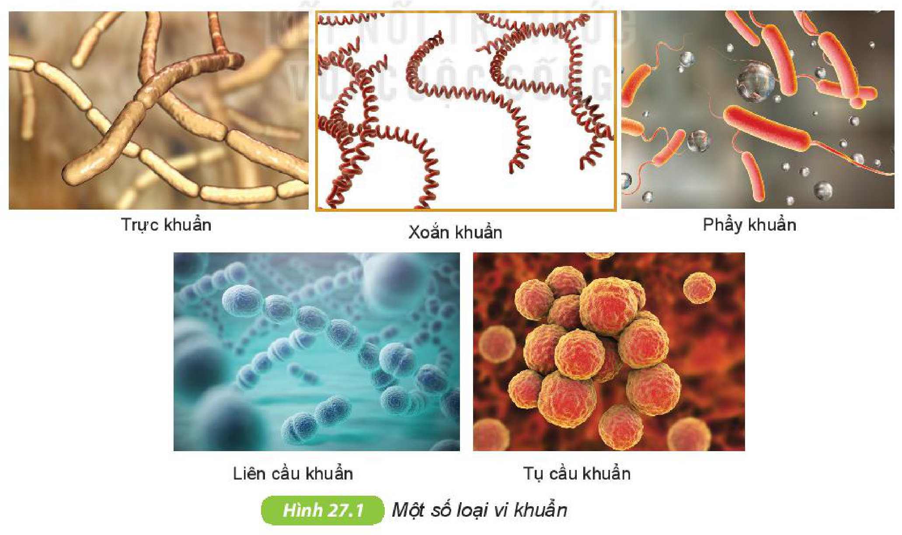
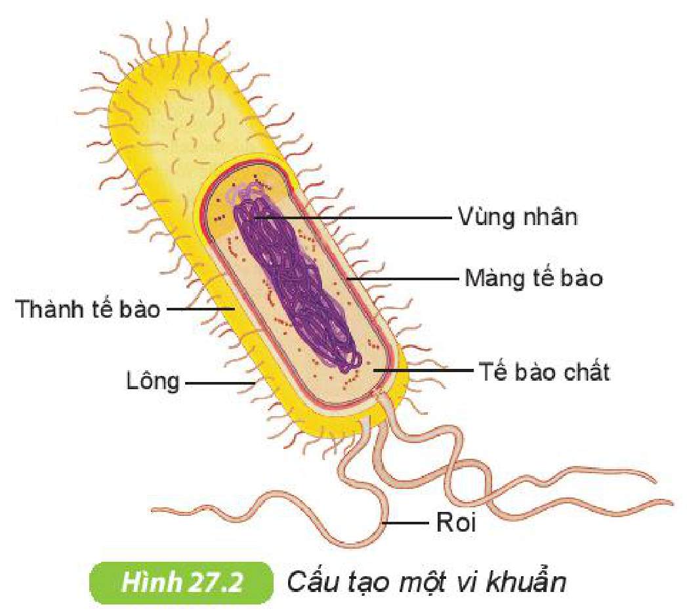
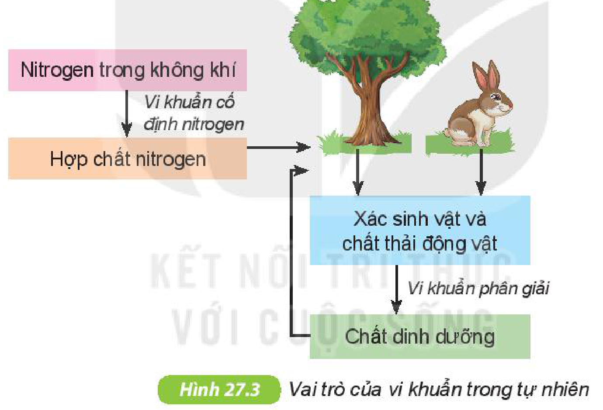
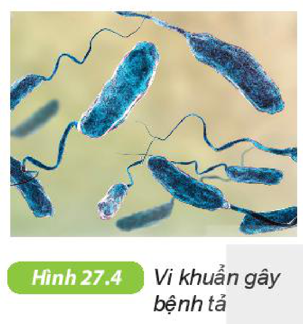
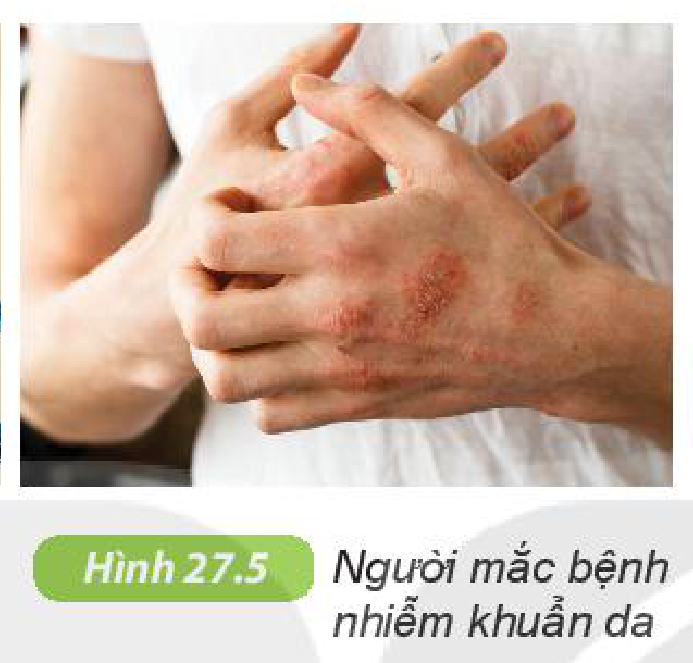
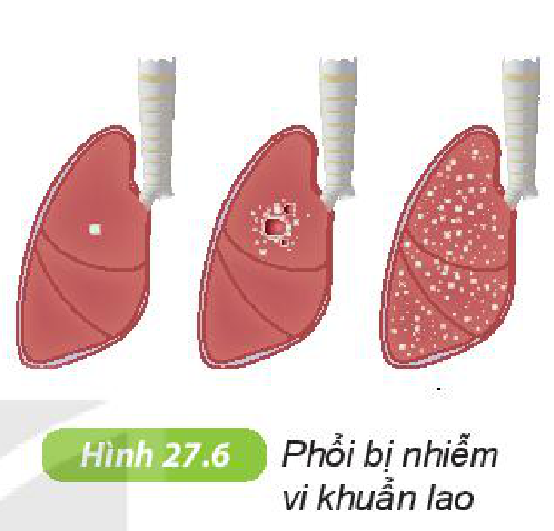
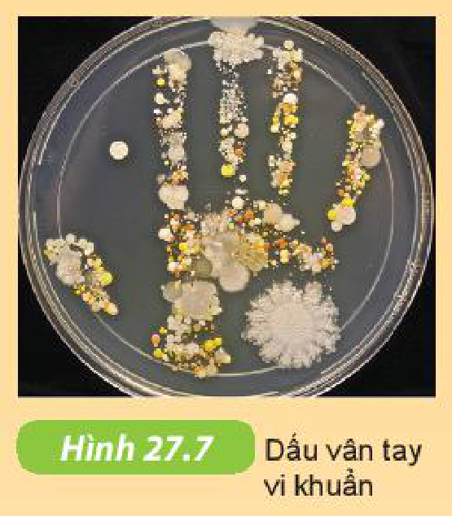

<!-- pdf:93 -->

# BÀI 27: VI KHUẨN

## 🎯 Mục tiêu

- Mô tả được hình dạng và cấu tạo của vi khuẩn. Nhận ra được sự đa dạng của vi khuẩn.
- Nêu được một số vai trò và ứng dụng của vi khuẩn trong đời sống.
- Nêu được một số bệnh do vi khuẩn gây ra và trình bày được cách phòng, tránh bệnh.
- Vận dụng kiến thức để giải thích các hiện tượng trong thực tiễn.

## 🔴 Mở đầu

Các sinh vật vô cùng nhỏ bé sống trong cơ thể chúng ta có số lượng lớn hơn một nửa tổng số tế bào cấu tạo nên cơ thể người. Em có biết chúng là những sinh vật nào không?

## I. Đa dạng vi khuẩn

**Vi khuẩn** là những sinh vật có kích thước nhỏ, chỉ có thể quan sát được bằng kính hiển vi. Chúng có mặt ở khắp mọi nơi: trong không khí, trong nước, trong đất, trong cơ thể chúng ta và cả các sinh vật sống khác.

> ✋ Quan sát Hình 27.1, nhận xét về hình dạng của các loại vi khuẩn, dựa vào hình dạng để xếp chúng vào các nhóm khác nhau.

Hình 27.1. Một số loại vi khuẩn

Vi khuẩn có rất nhiều hình dạng khác nhau, phân bố riêng lẻ hay thành từng đám, trong đó có ba dạng điển hình là: hình que, hình xoắn và hình cầu.

<!-- pdf:94 -->

## II. Cấu tạo của vi khuẩn

Vi khuẩn có cấu tạo đơn bào, hầu hết có thành tế bào bao ngoài màng tế bào. Nhiều vi khuẩn còn có roi làm nhiệm vụ di chuyển và lông giúp vi khuẩn bám vào tế bào vật chủ.

> ❓ Quan sát Hình 27.2, trình bày cấu tạo của tế bào vi khuẩn. Vì sao nói vi khuẩn là sinh vật có cấu tạo cơ thể đơn giản nhất trong thế giới sống?

Hình 27.2. Cấu tạo một vi khuẩn

## III. Vai trò của vi khuẩn

Phần lớn vi khuẩn có lợi, chúng có vai trò rất quan trọng không chỉ với con người mà còn với toàn bộ sự sống trên Trái Đất.

Hình 27.3. Vai trò của vi khuẩn trong tự nhiên

> ❓ Quan sát Hình 27.3, nêu vai trò của vi khuẩn trong tự nhiên.

Trong cơ thể người có thể chứa đến hàng trăm nghìn tỉ vi khuẩn. Vi khuẩn có lợi có số lượng rất lớn, giúp ức chế vi khuẩn có hại, bảo vệ da, tăng cường miễn dịch, hỗ trợ tiêu hoá.

Trong đời sống, vi khuẩn được sử dụng trong chế biến thực phẩm như làm sữa chua, muối dưa, làm nước mắm,...; sản xuất kháng sinh, thuốc trừ sâu; xử lí chất thải,...

> ❓ 1. Em hãy nêu một số ứng dụng của vi khuẩn trong đời sống con người.
>
> 2. Tại sao ăn sữa chua hằng ngày có thể giúp chúng ta ăn cơm ngon miệng hơn?

<!-- pdf:95 -->

## IV. Một số bệnh do vi khuẩn

Vi khuẩn gây ra nhiều bệnh nguy hiểm cho con người, một số bệnh phổ biến như: lao, viêm phổi, uốn ván, giang mai, phong (hủi), tả,...

Bệnh tả do vi khuẩn tả gây nên (Hình 27.4). Người mắc bệnh có các biểu hiện: tiêu chảy, nôn, sốt cao, xảy ra chủ yếu ở người lớn, trên 15 tuổi. Bệnh lây truyền qua đường ăn, uống.

Nhiễm khuẩn da do vi khuẩn tụ cầu vàng gây nên. Vi khuẩn xâm nhiễm vào các vùng da bị tổn thương, gây sưng đỏ (Hình 27.5). Bệnh dễ lây lan khi tiếp xúc trực tiếp hoặc gián tiếp với các vật dụng có chứa tác nhân gây bệnh.

Bệnh lao phổi do vi khuẩn lao xâm nhiễm vào phổi gây nên (Hình 27.6). Người mắc bệnh có các biểu hiện: ho kéo dài, sốt, mệt mỏi,... Bệnh dễ lây lan qua đường hô hấp khi tiếp xúc gần với người bệnh.

Hình 27.4. Vi khuẩn gây bệnh tả

Hình 27.5. Người mắc bệnh nhiễm khuẩn da

Hình 27.6. Phổi bị nhiễm vi khuẩn lao
<!-- ocr-ok: đã đối chiếu p095.png, OCR không đọc được chữ trắng trên nền xanh 'Hình 27.6' -->

<!-- term: Thuốc kháng sinh -->
<!-- term: Kháng thuốc -->
Hiện nay, thuốc kháng sinh được dùng để điều trị các bệnh do vi khuẩn gây ra. Tuy nhiên, việc sử dụng tuỳ tiện thuốc kháng sinh không theo chỉ định của bác sĩ gây ra hiện tượng kháng thuốc dẫn đến khó khăn trong điều trị bệnh.

> ❓ Dựa vào các thông tin trên, em hãy nêu một số biện pháp để phòng bệnh do vi khuẩn gây ra ở người.

Vi khuẩn còn gây nhiều bệnh trên thực vật và động vật như: héo xanh cà chua, khoai tây; thối nhũn bắp cải; bệnh tụ huyết trùng ở gia cầm, gia súc; bệnh đóng dấu ở lợn,... gây thiệt hại lớn về kinh tế.

Ngoài ra, vi khuẩn cũng là nguyên nhân khiến thức ăn, đồ uống,... bị hỏng.

> ❓ 1. Chúng ta có nên sử dụng thức ăn bị ôi thiu hay không? Tại sao?
>
> 2. Em hãy nêu các biện pháp bảo quản thức ăn tránh bị vi khuẩn làm hỏng.

## 📌 Em đã học

- Vi khuẩn là những cơ thể đơn bào, nhân sơ, có kích thước nhỏ bé, chỉ có thể quan sát được bằng kính hiển vi.
- Đa số vi khuẩn có lợi và được ứng dụng trong đời sống con người. Một số vi khuẩn có hại gây bệnh cho người, vật nuôi và cây trồng; làm hỏng đồ dùng, thực phẩm,...
- Để phòng bệnh do vi khuẩn gây ra cần thực hiện tốt việc vệ sinh cá nhân, vệ sinh ăn uống và vệ sinh môi trường.

<!-- pdf:96 -->

## ✏️ Em có thể

**Thực hành tạo dấu vân tay vi khuẩn**

Hình 27.7 là hình bàn tay được tạo ra từ sự phát triển của các vi khuẩn trên bàn tay của một em bé, còn gọi là “dấu vân tay vi khuẩn”. Chúng ta có thể tạo ra “dấu vân tay vi khuẩn” của chính mình theo hướng dẫn sau:

Hình 27.7. Dấu vân tay vi khuẩn

*Chuẩn bị:*

- Khay nuôi, Muối, Nước đậu nành/thịt hầm, Bột rau câu, Nước lọc, Bếp, Xoong, Đũa.

*Cách làm:*

Bước 1: Chuẩn bị khay nuôi vi khuẩn.

- Tiệt trùng khay đựng và nắp đậy bằng cách đun sôi trong nước 15 phút.
- Đổ vào xoong 100 mL nước lọc, 100 mL nước đậu nành hoặc nước thịt hầm, 4 gam bột rau câu (khoảng 1 thìa canh), 1 gam muối, dùng đũa khuấy cho tan.
- Đặt xoong lên bếp, đun lửa vừa, để sôi trong 15 phút rồi tắt lửa.
- Đổ hỗn hợp vừa đun vào khay đựng để tạo thành lớp thạch dày khoảng 4 mm.
- Chờ thạch đông lại rồi đậy nắp và cho vào tủ lạnh.

Bước 2: Mở nắp khay, nhanh chóng ấn nhẹ các ngón tay lên bề mặt thạch rau câu rồi đóng nắp lại (có thể đặt cả bàn tay vào nếu khay đủ to).

Bước 3: Đặt khay ở nơi ổn định, nhiệt độ khoảng $30\text{ }^\circ\text{C} - 37\text{ }^\circ\text{C}$. Sau 2 ngày, lấy khay nuôi ra và quan sát vi khuẩn mọc trên khay theo hình bàn tay.

> 💡 Em có biết?

<!-- term: Vi khuẩn lên men lactic -->
> Quá trình tạo ra dưa muối, sữa chua hay pho mát đều sử dụng vi khuẩn lên men lactic. Trong điều kiện không có oxygen, vi khuẩn này sẽ phân giải các chất trong nguyên liệu, sinh ra acid lactic tạo ra hương thơm và vị chua đặc trưng cho món ăn.

## 📷 Danh sách hình trong bài

| Mã hình | Trang PDF | Vị trí | Chú thích gốc |
| --- | --- | --- | --- |
| H6-khoa_hoc_tu_nhien-b27-01 | 93 | Mục I | Hình 27.1. Một số loại vi khuẩn |
| H6-khoa_hoc_tu_nhien-b27-02 | 94 | Mục II | Hình 27.2. Cấu tạo một vi khuẩn |
| H6-khoa_hoc_tu_nhien-b27-03 | 94 | Mục III | Hình 27.3. Vai trò của vi khuẩn trong tự nhiên |
| H6-khoa_hoc_tu_nhien-b27-04 | 95 | Mục IV | Hình 27.4. Vi khuẩn gây bệnh tả |
| H6-khoa_hoc_tu_nhien-b27-05 | 95 | Mục IV | Hình 27.5. Người mắc bệnh nhiễm khuẩn da |
| H6-khoa_hoc_tu_nhien-b27-06 | 95 | Mục IV | Hình 27.6. Phổi bị nhiễm vi khuẩn lao |
| H6-khoa_hoc_tu_nhien-b27-07 | 96 | Mục Em có thể (nền hộp vàng nhạt) | Hình 27.7. Dấu vân tay vi khuẩn |
