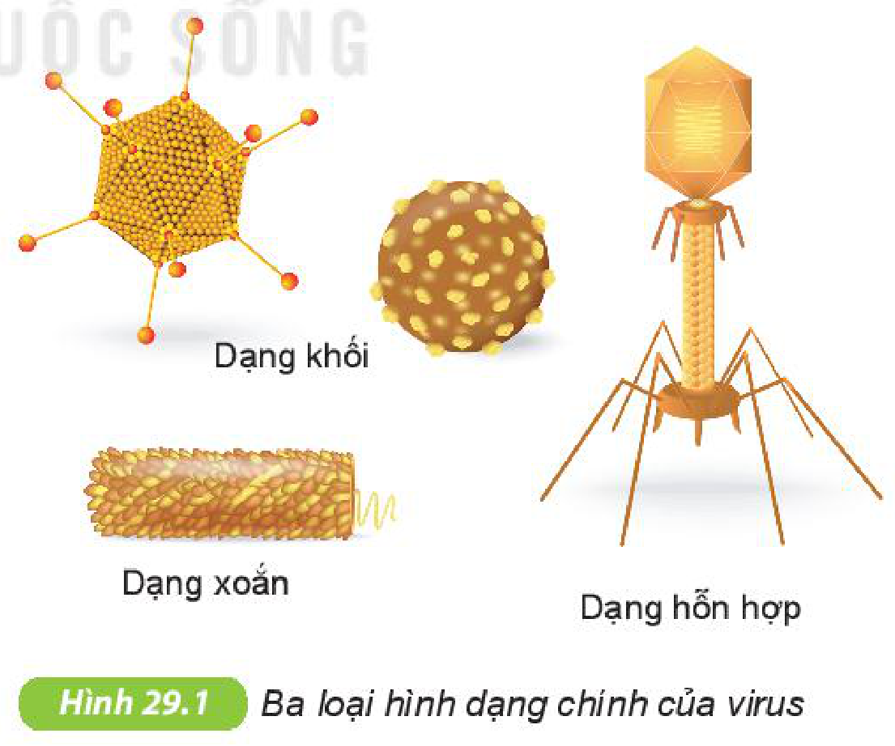
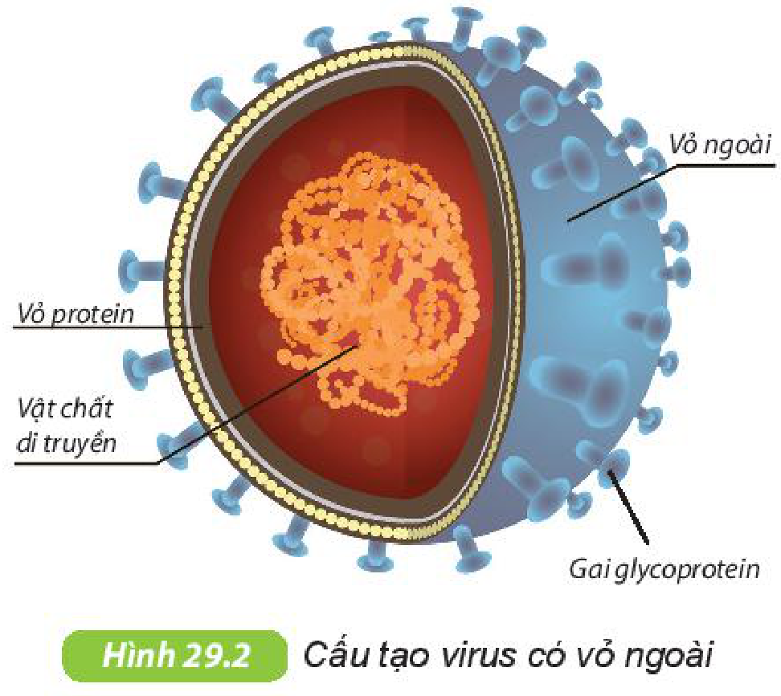
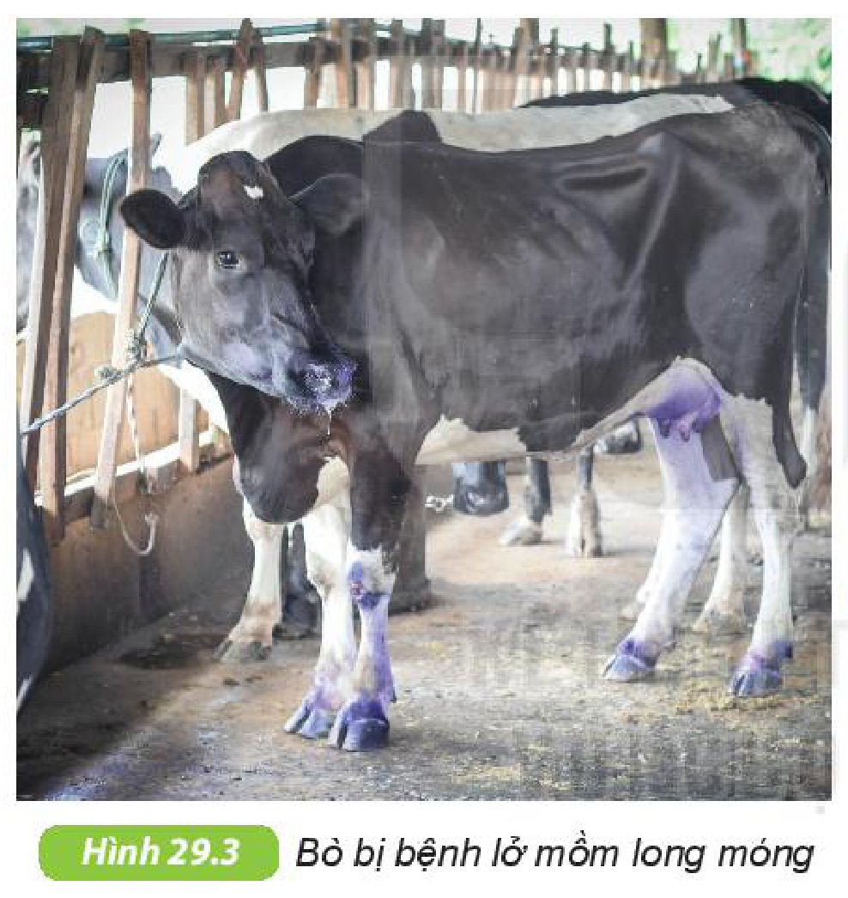
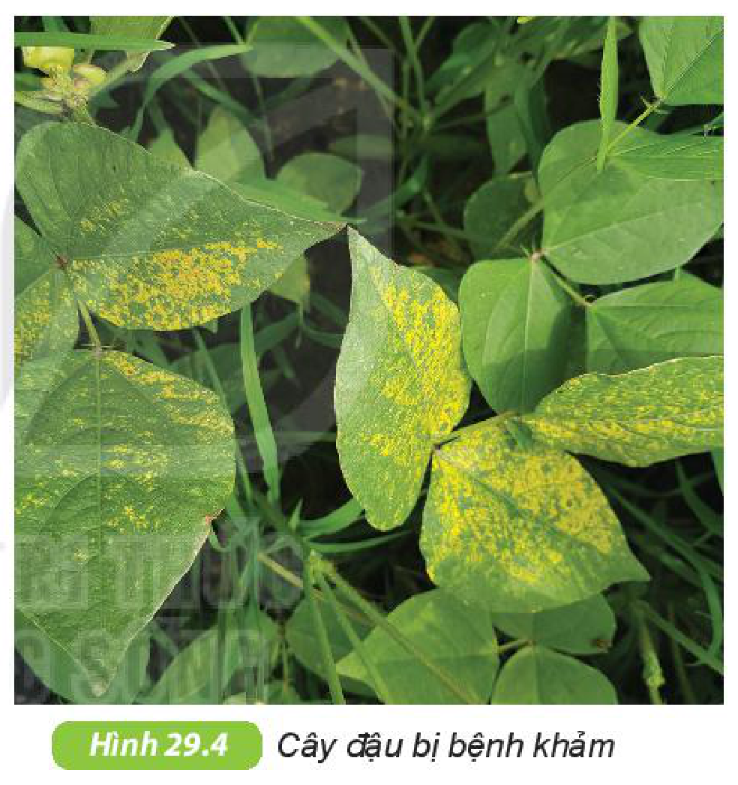
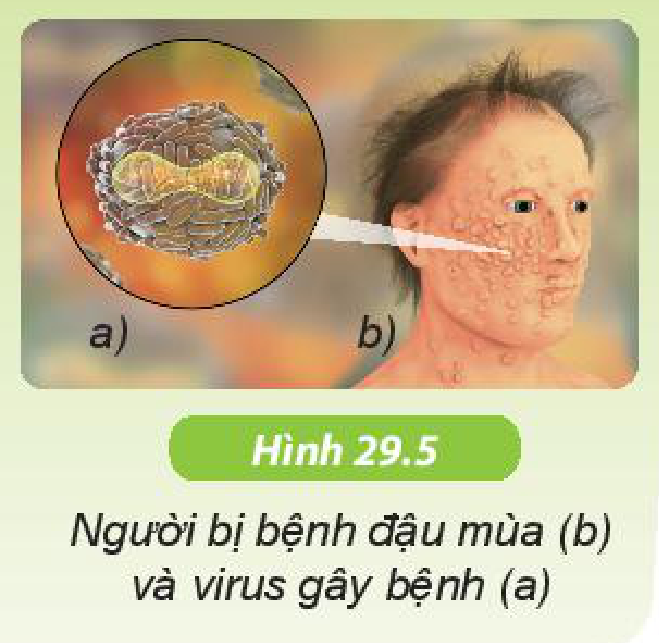

<!-- pdf:99 -->

# BÀI 29: VIRUS

## 🎯 Mục tiêu

- Mô tả được hình dạng và cấu tạo của virus.
- Phân biệt được virus và vi khuẩn.
- Nêu được một số vai trò và ứng dụng của virus trong đời sống.
- Nêu được một số bệnh do virus gây ra và trình bày được cách phòng, tránh bệnh.

## 🔴 Mở đầu

Sốt xuất huyết là bệnh truyền nhiễm phổ biến ở Việt Nam do virus gây ra. Theo ước tính của WHO, hằng năm có khoảng 50 000 đến 100 000 ca mắc trên 100 quốc gia. Vậy virus là gì? Làm cách nào để phòng bệnh do virus gây ra?

## I. Đa dạng virus

**Virus** là dạng sống có kích thước vô cùng nhỏ bé, không có cấu tạo tế bào, chỉ nhân lên được trong tế bào của sinh vật sống.

Hầu hết virus đều có kích thước vô cùng nhỏ, chỉ quan sát được bằng kính hiển vi điện tử.

Ví dụ: Một vi khuẩn đường ruột có kích thước từ 2 đến $4\text{ }\mu\text{m}$, kích thước đó gấp ba lần loại virus lớn nhất và dài gấp 300 lần một virus cảm lạnh.

<!-- term: Thể thực khuẩn -->
Virus có ba dạng chính: dạng xoắn (virus Ebola, virus cúm,...), dạng khối (virus HIV, virus bại liệt,...), dạng hỗn hợp (thể thực khuẩn T4, virus đậu mùa,...).

Hình 29.1. Ba loại hình dạng chính của virus

> ❓ Quan sát Hình 29.1, em có nhận xét gì về hình dạng của virus?

<!-- pdf:100 -->

## II. Cấu tạo của virus

Virus chưa có cấu tạo tế bào. Tất cả các virus đều gồm 2 thành phần cơ bản: vỏ protein và lõi là vật chất di truyền (ADN hoặc ARN). Một số virus có thêm vỏ ngoài và gai glycoprotein.

> ❓ 1. Vì sao nói virus chưa có cấu tạo tế bào điển hình? Em có đồng ý với ý kiến cho rằng virus là vật thể không sống không? Giải thích.
>
> 2. Quan sát Hình 29.2 và Hình 27.2 (bài 27 – chương VII), hãy phân biệt vi khuẩn và virus.

Hình 29.2. Cấu tạo virus có vỏ ngoài

> ✋ Dựa trên hình dạng và cấu tạo của virus mà em đã học, quan sát các hình trong bảng, nêu tên các thành phần được chú thích trong hình và hoàn thành bảng theo mẫu sau:
>
> | Tên virus | Hình ảnh virus | Tên thành phần cấu tạo virus |
> | --- | --- | --- |
> | HIV | (Hình minh hoạ đánh số 1, 2) | 1 ... ? ...; 2 ... ? ... |
> | Sởi | (Hình minh hoạ đánh số 1, 2) | 1 ... ? ...; 2 ... ? ... |
> | Dại | (Hình minh hoạ đánh số 1, 2) | 1 ... ? ...; 2 ... ? ... |
> | Dengue (gây bệnh sốt xuất huyết) | (Hình minh hoạ đánh số 1, 2) | 1 ... ? ...; 2 ... ? ... |
<!-- ocr-ok: đã đối chiếu p100.png, bảng bài tập có hình vẽ virus và các dòng chấm hỏi -->

## III. Vai trò và ứng dụng của virus

Virus có vai trò quan trọng, được ứng dụng rộng rãi trong y học và nông nghiệp.

Trong y học, virus được sử dụng trong sản xuất vaccine. Chúng cũng được sử dụng để sản xuất nhiều chế phẩm sinh học có giá trị như hormone, protein,...

<!-- pdf:101 -->

Trong nông nghiệp, virus được dùng để sản xuất thuốc trừ sâu cho hiệu quả cao mà không gây ô nhiễm môi trường. Chúng còn được sử dụng để chuyển gen từ loài này sang loài khác góp phần tạo ra các giống vật nuôi, cây trồng có năng suất và chất lượng cao, kháng bệnh tốt như giống bông kháng sâu hại, giống lúa "gạo vàng" có giá trị dinh dưỡng cao,....

## IV. Một số bệnh do virus và cách phòng bệnh

### 1. Một số bệnh do virus

Virus có thể gây bệnh cho người, động vật, thực vật, nấm và vi khuẩn.

Ở người, virus gây ra các bệnh như: thuỷ đậu, quai bị, viêm gan B, cúm,... Khoảng 90% các bệnh đường hô hấp ở người do virus gây ra.

Virus còn gây ra một số bệnh ở động vật như: tai xanh ở lợn; lở mồm long móng ở trâu, bò (Hình 29.3); cúm gia cầm,...

Ở thực vật, virus gây ra một số bệnh như: khảm ở cây đậu (Hình 29.4), xoăn lá cà chua,...

Hình 29.3. Bò bị bệnh lở mồm long móng

Hình 29.4. Cây đậu bị bệnh khảm

Các bệnh do virus gây ra dễ lây lan, trở thành dịch lớn gây thiệt hại nặng nề về sức khoẻ và kinh tế. Các virus ở vi khuẩn gây ra những thiệt hại nghiêm trọng trong ngành công nghiệp sản xuất thuốc kháng sinh, mì chính,...

> ❓ Đọc thông tin trên, kể tên các bệnh do virus gây ra. Ngoài các bệnh đó, virus còn gây ra các bệnh nào khác mà em biết?

<!-- pdf:102 -->

### 2. Phòng bệnh do virus

Phương pháp hữu hiệu nhất để phòng ngừa các bệnh do virus là sử dụng vaccine.

**Vaccine** dùng để phòng tránh nhiều bệnh lây truyền. Vaccine được tạo ra từ chính những vi khuẩn, virus đã chết hoặc được làm suy yếu.

Đưa vaccine vào cơ thể giúp cơ thể “làm quen” trước với mầm bệnh (virus đã được làm yếu đi) và tìm ra được cách đối phó với chúng. Nhờ vậy, lần tới khi tiếp xúc với mầm bệnh, cơ thể chúng ta có thể tiêu diệt chúng một cách nhanh chóng.

Ngoài ra, việc ăn uống và sinh hoạt điều độ, vệ sinh sạch sẽ cũng giúp phòng bệnh do virus.

> ❓ 1. Kể tên các loại vaccine em biết.
>
> 2. Em có biết mình đã từng tiêm những loại vaccine nào không? Tại sao cần tiêm phòng nhiều loại vaccine khác nhau?
>
> 3. Nêu cách phòng tránh các bệnh do virus gây ra.

## 📌 Em đã học

- Virus là dạng sống rất nhỏ, không có cấu tạo tế bào, chỉ có thể nhân lên trong tế bào của sinh vật sống.
- Virus có cấu tạo rất đơn giản chỉ gồm vỏ là protein và lõi là vật chất di truyền (ADN hoặc ARN).
- Virus gây bệnh cho con người, vật nuôi, cây trồng nhưng cũng có một số virus có lợi cho con người.
- Sử dụng vaccine là phương pháp hữu hiệu và cần thiết để phòng bệnh do virus.

## ✏️ Em có thể

1. Thực hiện được các biện pháp phòng tránh bệnh do virus.
2. Tuyên truyền về sự cần thiết của việc tiêm phòng vaccine.

> 💡 Em có biết?
>
> - Bệnh đậu mùa do virus gây ra (Hình 29.5) từng giết chết trên 500 triệu người trong lịch sử nhân loại. Nhờ có vaccine đậu mùa mà bệnh này gần như bị xoá sổ.
> - Hiện nay còn nhiều bệnh do virus gây ra vẫn chưa tìm ra vaccine phòng bệnh như: HIV/AIDS, herpes, tay chân miệng,...
>
> 
>
> Hình 29.5. Người bị bệnh đậu mùa (b) và virus gây bệnh (a)

## 📷 Danh sách hình trong bài

| Mã hình | Trang PDF | Vị trí | Chú thích gốc |
| --- | --- | --- | --- |
| H6-khoa_hoc_tu_nhien-b29-01 | 99 | Mục I | Hình 29.1. Ba loại hình dạng chính của virus |
| H6-khoa_hoc_tu_nhien-b29-02 | 100 | Mục II | Hình 29.2. Cấu tạo virus có vỏ ngoài |
| H6-khoa_hoc_tu_nhien-b29-03 | 101 | Mục IV.1 | Hình 29.3. Bò bị bệnh lở mồm long móng |
| H6-khoa_hoc_tu_nhien-b29-04 | 101 | Mục IV.1 | Hình 29.4. Cây đậu bị bệnh khảm |
| H6-khoa_hoc_tu_nhien-b29-05 | 102 | Hộp Em có biết (nền hộp xanh lá nhạt) | Hình 29.5. Người bị bệnh đậu mùa (b) và virus gây bệnh (a) |
