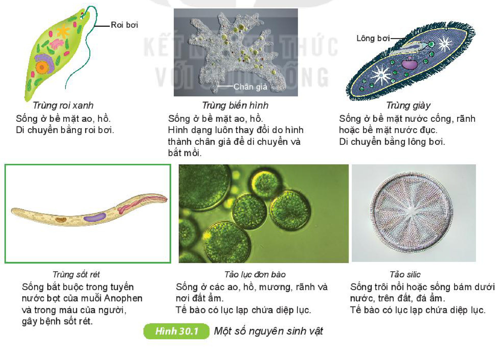
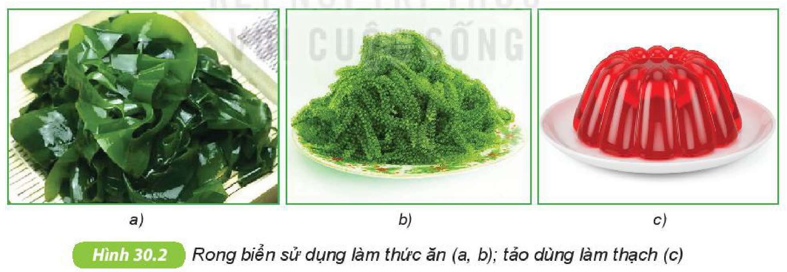
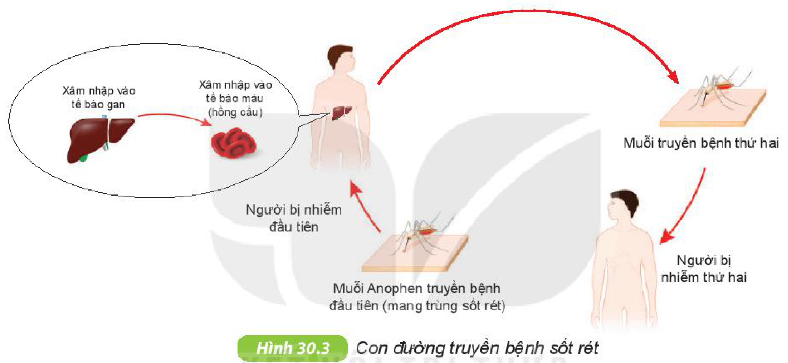
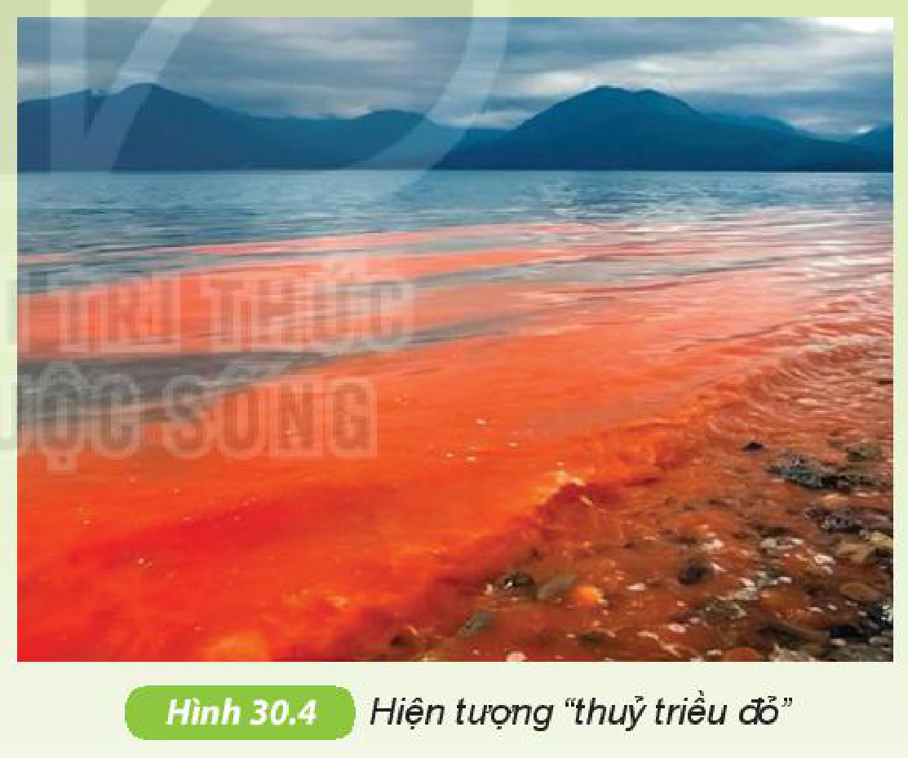

<!-- pdf:103 -->

# BÀI 30: NGUYÊN SINH VẬT

## 🎯 Mục tiêu

- Nhận biết được một số đối tượng nguyên sinh vật.
- Dựa vào hình dạng, nêu được sự đa dạng của nguyên sinh vật.
- Nêu được một số bệnh do nguyên sinh vật gây ra và trình bày được cách phòng tránh bệnh.

## 🔴 Mở đầu

Quan sát bề mặt ao, hồ chúng ta thường thấy một lớp váng có màu xanh, vàng hoặc đỏ. Lớp váng đó có chứa các nguyên sinh vật. Vậy nguyên sinh vật là gì?

## I. Đa dạng nguyên sinh vật

Khi quan sát một giọt nước ao, hồ, cống, rãnh bằng kính hiển vi sẽ thấy rất nhiều nhóm sinh vật khác nhau, trong đó có nguyên sinh vật.

Đa số **nguyên sinh vật** là những cơ thể đơn bào, nhân thực, có kích thước hiển vi. Một số nguyên sinh vật có cấu tạo đa bào, nhân thực, có thể quan sát bằng mắt thường.

- *Trùng roi xanh*: Sống ở bề mặt ao, hồ. Di chuyển bằng roi bơi.
- *Trùng biến hình*: Sống ở bề mặt ao, hồ. Hình dạng luôn thay đổi do hình thành chân giả để di chuyển và bắt mồi.
- *Trùng giày*: Sống ở bề mặt nước cống, rãnh hoặc bề mặt nước đục. Di chuyển bằng lông bơi.
- *Trùng sốt rét*: Sống bắt buộc trong tuyến nước bọt của muỗi Anophen và trong máu của người, gây bệnh sốt rét.
- *Tảo lục đơn bào*: Sống ở các ao, hồ, mương, rãnh và nơi đất ẩm. Tế bào có lục lạp chứa diệp lục.
- *Tảo silic*: Sống trôi nổi hoặc sống bám dưới nước, trên đất, đá ẩm. Tế bào có lục lạp chứa diệp lục.

Hình 30.1. Một số nguyên sinh vật

<!-- pdf:104 -->

> ✋ Quan sát Hình 30.1 và trả lời câu hỏi:
>
> 1. Em có nhận xét gì về hình dạng của nguyên sinh vật?
>
> 2. Kể tên các môi trường sống của nguyên sinh vật. Em có nhận xét gì về môi trường sống của chúng?

## II. Vai trò của nguyên sinh vật

### 1. Vai trò trong tự nhiên

<!-- term: Tảo -->
Tảo có khả năng quang hợp nên chúng có vai trò quan trọng trong việc cung cấp oxygen cho các động vật dưới nước.

Không chỉ vậy, nguyên sinh vật còn là nguồn thức ăn cho các động vật lớn hơn.

Một số nguyên sinh vật sống **cộng sinh** tạo nên mối quan hệ cần thiết cho sự sống của các loài động vật khác.

### 2. Vai trò đối với con người

Một số tảo có giá trị dinh dưỡng cao nên được chế biến thành thực phẩm chức năng bổ sung dinh dưỡng cho con người như tảo xoắn *Spirulina*.

<!-- term: Tảo -->
Nhiều loại rong biển (tảo) được con người dùng làm thức ăn và dùng trong chế biến thực phẩm (Ví dụ: chất tạo thạch trong tảo được chiết xuất để sử dụng làm đông thực phẩm như thạch,...) (Hình 30.2). Ngoài ra, chúng còn được dùng trong sản xuất chất dẻo, chất khử mùi, sơn, chất cách điện, cách nhiệt,...

Bên cạnh đó, một số nguyên sinh vật có vai trò quan trọng trong các hệ thống xử lí nước thải và chỉ thị độ sạch của môi trường nước.

Hình 30.2. Rong biển sử dụng làm thức ăn (a, b); tảo dùng làm thạch (c)

> ❓ 1. Nêu các vai trò của nguyên sinh vật đối với tự nhiên và đời sống con người.
>
> 2. Kể tên một số món ăn được chế biến từ tảo mà em biết.

<!-- pdf:105 -->

## III. Một số bệnh do nguyên sinh vật

Nhiều loài nguyên sinh vật gây bệnh cho động vật (như cá, tôm,...). Đặc biệt, chúng gây nhiều bệnh nguy hiểm cho con người như: bệnh sốt rét, bệnh kiết lị, bệnh ngủ li bì,...

### 1. Bệnh sốt rét

Bệnh do trùng sốt rét *Plasmodium* gây ra. Bệnh truyền theo đường máu, qua vật truyền bệnh là muỗi Anophen. Khi muỗi mang trùng sốt rét đốt người thì mầm bệnh trong nước bọt của muỗi đi vào mạch máu, chui vào tế bào gan và bắt đầu nhân lên rất nhanh. Khi số lượng mầm bệnh đủ lớn, chúng xâm nhập vào tế bào hồng cầu trong máu của người để tiếp tục sinh sản, sau đó phá vỡ hồng cầu, chui ra ngoài rồi lại chui vào hồng cầu khác để kí sinh. Cứ như vậy, chúng phá huỷ hàng loạt hồng cầu. Một số biểu hiện của bệnh sốt rét như rét run, sốt và đổ mồ hôi.

Hình 30.3. Con đường truyền bệnh sốt rét

### 2. Bệnh kiết lị

Bệnh kiết lị do nguyên sinh vật là amip lị *Entamoeba* gây nên. Amip lị kí sinh trong thành ruột của người, chúng ăn hồng cầu và có thể theo máu vào gan gây sưng gan. Amip lị có khả năng hình thành **bào xác**, bào xác của chúng theo phân của người bị bệnh ra ngoài. Nếu ăn phải thức ăn, nước uống có chứa bào xác của amip lị thì sau khi vào ruột người, amip lị sẽ chui ra khỏi bào xác tiếp tục gây bệnh. Người mắc bệnh kiết lị có các biểu hiện: đau bụng, đi ngoài, phân có thể lẫn máu và chất nhầy, cơ thể mệt mỏi vì mất nước và nôn ói,...

> ✋ Dựa vào những thông tin về bệnh sốt rét và bệnh kiết lị ở trên, hãy hoàn thành bảng theo mẫu sau:
>
> | Tiêu chí | Bệnh sốt rét | Bệnh kiết lị |
> | --- | --- | --- |
> | Tác nhân gây bệnh | ? | ? |
> | Con đường lây bệnh | ? | ? |
> | Biểu hiện bệnh | ? | ? |
> | Cách phòng tránh bệnh | ? | ? |

<!-- pdf:106 -->

## 📌 Em đã học

- Nguyên sinh vật có hình dạng đa dạng, hầu hết chúng là những sinh vật đơn bào, nhân thực, có kích thước hiển vi.
- Nhiều loài nguyên sinh vật có lợi nhưng cũng không ít loài gây bệnh nguy hiểm cho con người.
- Để phòng tránh các bệnh do nguyên sinh vật cần thực hiện tốt việc vệ sinh cá nhân, vệ sinh ăn uống và vệ sinh môi trường.

## ✏️ Em có thể

Biết cách phòng tránh bệnh sốt rét và bệnh kiết lị.
<!-- ocr-ok: đã đối chiếu p106.png, OCR đọc lỗi chữ trong hộp Em có thể -->

> 💡 Em có biết?

<!-- term: Tảo nở hoa -->
> Trong môi trường nước thải giàu chất dinh dưỡng, tảo sinh trưởng rất nhanh tạo ra số lượng lớn cá thể làm biến đổi màu nước cả một vùng (nước chuyển thành màu xanh, đỏ hoặc vàng,... tuỳ từng loại tảo), được gọi là hiện tượng “tảo nở hoa”. Sự gia tăng đột biến số lượng tảo làm kìm hãm sự phát triển, thậm chí gây chết hàng loạt cá, tôm và các sinh vật thuỷ sinh khác do nhiều loại tảo tiết chất độc vào nước.

<!-- term: Thuỷ triều đỏ -->
> Ở biển, hiện tượng này còn gọi là “thuỷ triều đỏ” (Hình 30.4), có hậu quả nghiêm trọng hơn do gây chết các sinh vật biển và làm ô nhiễm môi trường trên phạm vi rộng. Nó không chỉ làm chết hàng loạt các sinh vật biển mà còn gây độc cho cả con người khi ăn phải các loại trai, sò,... nhiễm độc.
>
> 
>
> Hình 30.4. Hiện tượng “thuỷ triều đỏ”

## 📷 Danh sách hình trong bài

| Mã hình | Trang PDF | Vị trí | Chú thích gốc |
| --- | --- | --- | --- |
| H6-khoa_hoc_tu_nhien-b30-01 | 103 | Mục I | Hình 30.1. Một số nguyên sinh vật |
| H6-khoa_hoc_tu_nhien-b30-02 | 104 | Mục II.2 | Hình 30.2. Rong biển sử dụng làm thức ăn (a, b); tảo dùng làm thạch (c) |
| H6-khoa_hoc_tu_nhien-b30-03 | 105 | Mục III.1 | Hình 30.3. Con đường truyền bệnh sốt rét |
| H6-khoa_hoc_tu_nhien-b30-04 | 106 | Hộp Em có biết (nền hộp xanh lá nhạt) | Hình 30.4. Hiện tượng “thuỷ triều đỏ” |
