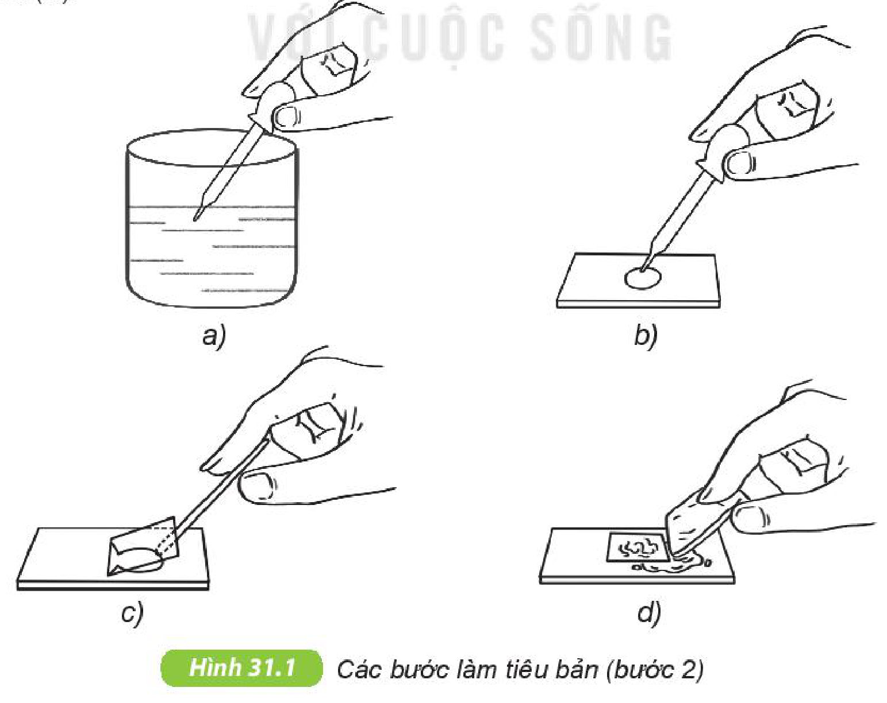

<!-- pdf:107 -->

# BÀI 31: THỰC HÀNH: QUAN SÁT NGUYÊN SINH VẬT

## 🎯 Mục tiêu

- Thực hành quan sát nguyên sinh vật bằng kính lúp hoặc kính hiển vi và vẽ lại hình quan sát được.

## I. Chuẩn bị

### 1. Thiết bị, dụng cụ

- Kính hiển vi có vật kính 10x, 40x
- Lam kính
- Lamen
- Ống nhỏ giọt
- Giấy thấm
- Cốc thuỷ tinh
<!-- ocr-ok: đã đối chiếu p107.png, danh sách dụng cụ chia 2 cột -->

### 2. Mẫu vật

Mẫu vật có trong môi trường tự nhiên như nước ao, hồ hoặc được thu thập trong môi trường nuôi.

Cách nuôi cấy mẫu: lấy nước ao, hồ hay nước ở những chỗ đọng có ánh sáng rọi tới, cho vào một lọ thuỷ tinh rộng miệng có đựng rơm, rạ, cỏ khô cắt nhỏ. Đặt lọ ở chỗ có ánh sáng trong một thời gian.

## II. Cách tiến hành

Bước 1: Chuyển mẫu vật vào cốc thuỷ tinh.

Bước 2: Làm tiêu bản: Dùng ống nhỏ giọt hút mẫu vật trong cốc thuỷ tinh (a), rồi nhỏ 1 – 2 giọt lên lam kính (b), đậy lamen lại (c). Sử dụng giấy thấm để thấm nước thừa trên lam kính (d).

Hình 31.1. Các bước làm tiêu bản (bước 2)

<!-- pdf:108 -->

> ⚠️ **Lưu ý:**
>
> Muốn quan sát được nguyên sinh vật phải hạn chế sự di chuyển của chúng bằng cách cho một số sợi bông vào trong giọt nước nuôi cấy trên lam kính trước khi đậy lamen lên trên. Các sợi bông sẽ tạo nên các chuồng nhỏ, nhốt trùng roi và trùng giày ở trong.

Bước 3: Đặt tiêu bản lên bàn kính của kính hiển vi, quan sát ở vật kính $10\times$.

Bước 4: Quan sát chi tiết hình dạng, cấu tạo, cách di chuyển của trùng roi và trùng giày ở vật kính $40\times$.

Hình 31.2. Trùng roi và trùng giày quan sát được qua kính hiển vi

## III. Thu hoạch

Dựa vào kết quả quan sát được bằng kính hiển vi hoặc quan sát Hình 31.2, hãy thực hiện các yêu cầu sau:

1. Vẽ hình trùng roi và trùng giày em quan sát được.
2. Những đặc điểm nào giúp em phân biệt được trùng roi và trùng giày?
3. Trùng roi và trùng giày di chuyển bằng bộ phận nào trên cơ thể?

## 📷 Danh sách hình trong bài

| Mã hình | Trang PDF | Vị trí | Chú thích gốc |
| --- | --- | --- | --- |
| H6-khoa_hoc_tu_nhien-b31-01 | 107 | Mục II | Hình 31.1. Các bước làm tiêu bản (bước 2) |
| H6-khoa_hoc_tu_nhien-b31-02 | 108 | Mục II | Hình 31.2. Trùng roi và trùng giày quan sát được qua kính hiển vi |
