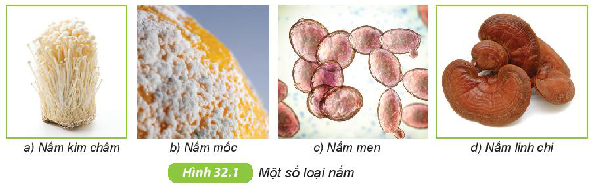
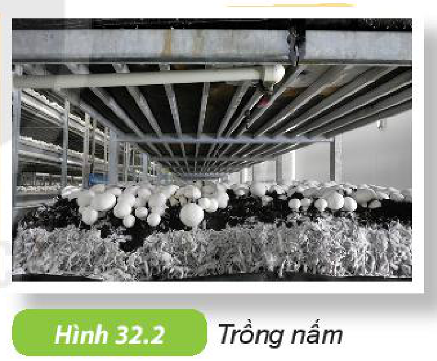
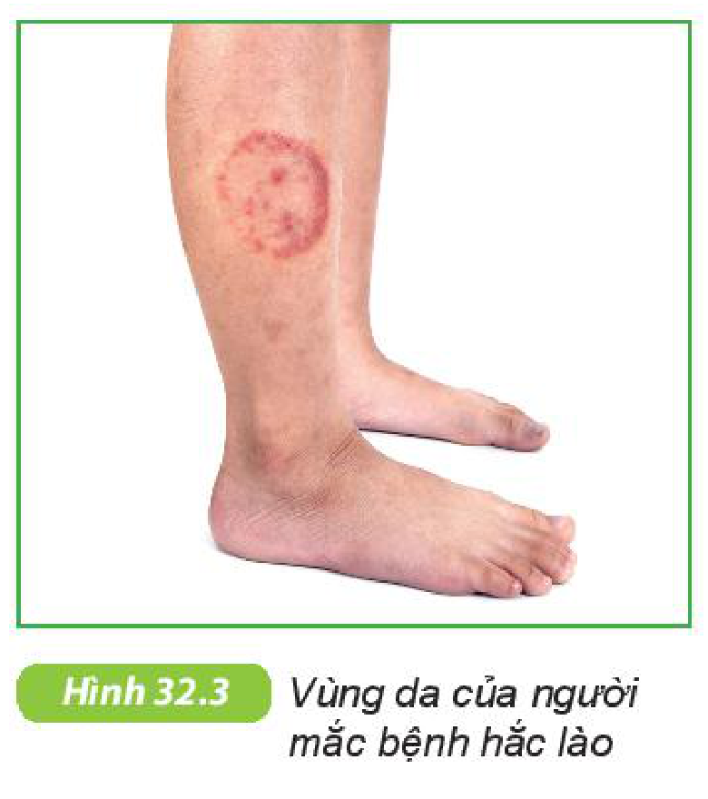
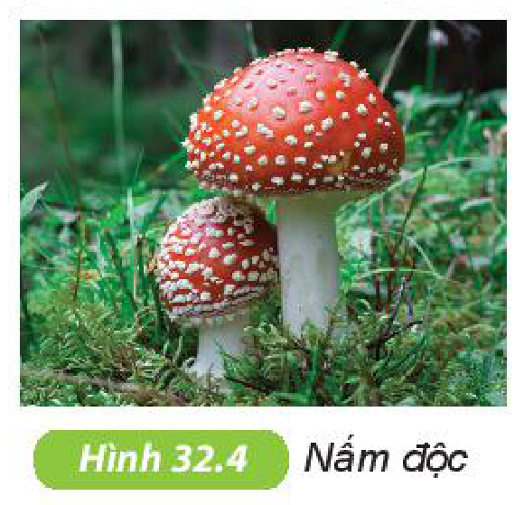
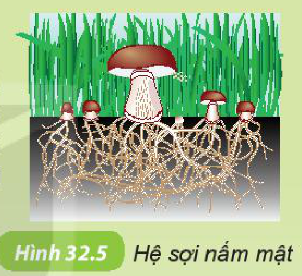
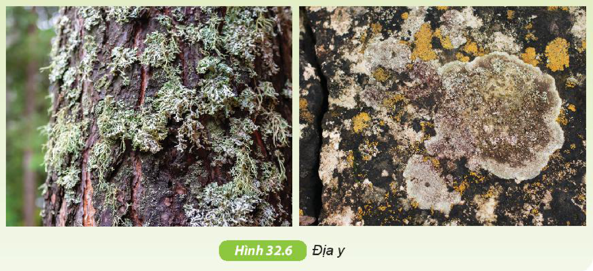

<!-- pdf:109 -->

# BÀI 32: NẤM

## 🎯 Mục tiêu

- Nhận biết được một số đại diện của nấm, nêu được sự đa dạng của nấm.
- Trình bày được vai trò của nấm trong tự nhiên và trong đời sống.
- Nêu được một số bệnh do nấm gây ra và cách phòng, tránh bệnh.
- Vận dụng kiến thức để giải thích một số hiện tượng trong đời sống.

## 🔴 Mở đầu

Các em có biết vì sao những "cây nấm" nhỏ bé này lại được coi là những sinh vật to lớn nhất trên Trái Đất không?

Những "cây nấm" mọc lên sau mưa, những đám mốc đen trên bánh mì hay món mộc nhĩ chúng ta hay ăn, tất cả đều là sinh vật thuộc giới Nấm.

## I. Đa dạng nấm

**Nấm** là những sinh vật nhân thực, đơn bào hoặc đa bào, sống dị dưỡng.

Hình dạng và kích thước của nấm vô cùng đa dạng, có những loại có thể dễ dàng quan sát bằng mắt thường nhưng cũng có loại chỉ có thể quan sát thấy bằng kính hiển vi.

Nấm có thể sinh sống ở nhiều điều kiện môi trường khác nhau, chủ yếu ở những nơi nóng ẩm, giàu dinh dưỡng, một số có thể sống ở điều kiện vô cùng khắc nghiệt.

Dựa vào cấu trúc của cơ quan tạo bào tử, nấm được chia thành một số nhóm, đại diện như:

- **Nấm túi**: sinh sản bằng bào tử túi, ví dụ: nấm mốc đen bánh mì, nấm men rượu,...
- **Nấm đảm**: sinh sản bằng bào tử đảm, ví dụ: nấm rơm, nấm hương, nấm sò, nấm linh chi,...
- **Nấm tiếp hợp**: bao gồm các loài nấm mốc sinh trưởng nhanh gây ra sự ôi thiu của thức ăn như bánh mì, đào, dâu, khoai lang,... trong quá trình cất trữ.

> ❓ Quan sát Hình 32.1, nhận xét về hình dạng của các loại nấm. Hãy kể tên một số loại nấm mà em biết.

Hình 32.1. Một số loại nấm

<!-- pdf:110 -->

## II. Vai trò của nấm

Trong tự nhiên, nấm tham gia vào quá trình phân huỷ chất thải và xác động vật, thực vật thành các chất đơn giản cung cấp cho cây xanh và làm sạch môi trường.

Nhiều loại nấm được sử dụng trực tiếp làm thức ăn. Một số loại nấm được sử dụng làm thuốc như: nấm linh chi, đông trùng hạ thảo,...

Trong công nghiệp chế biến thực phẩm, nấm men được sử dụng trong sản xuất bánh mì, bia, rượu,...; nấm mốc được sử dụng trong sản xuất tương,...

> ✋ 1. Dựa vào thông tin trên, trình bày vai trò của nấm trong tự nhiên và trong đời sống con người.
>
> 2. Nêu tên các loại nấm em biết và tác dụng của chúng rồi hoàn thành bảng theo mẫu sau:
>
> | Vai trò của nấm đối với con người | Tên các loại nấm |
> | --- | --- |
> | Dùng làm thực phẩm | ? |
> | Dùng trong công nghiệp chế biến thực phẩm | ? |
> | Dùng làm dược liệu | ? |

> ❓ Một số loại nấm được trồng làm thực phẩm (Hình 32.2). Trong kĩ thuật trồng nấm, người trồng thường xuyên phải tưới nước sạch cho nấm. Em hãy giải thích vì sao cần tưới nước cho nấm. Nếu lượng nước tưới không đủ hoặc nước tưới kém vệ sinh thì điều gì sẽ xảy ra?

Hình 32.2. Trồng nấm

## III. Một số bệnh do nấm

Ở người, nấm gây ra các bệnh nấm lưỡi, lang ben, hắc lào,... Người bị bệnh hắc lào thường xuất hiện các vùng da có dạng tròn, đóng vảy, có thể sưng đỏ và gây ngứa (Hình 32.3). Bệnh hắc lào thường lây qua tiếp xúc trực tiếp với da của người bệnh.

Ngoài ra, nấm còn gây bệnh ở thực vật và động vật như bệnh mốc cam ở thực vật, bệnh nấm da ở động vật. Cơ thể động vật bị bệnh nấm da có các dấu hiệu: xuất hiện vết loét trên da hoặc da nhăn nheo, dày cộm, lông rụng thành đám. Bệnh dễ lây lan khi tiếp xúc trực tiếp với da, lông của con vật bị bệnh.

Để điều trị các bệnh do nấm gây ra, người ta sử dụng các loại thuốc kháng nấm.

Hình 32.3. Vùng da của người mắc bệnh hắc lào

<!-- pdf:111 -->

Một số loại nấm có thể gây hư hỏng thức ăn, đồ uống, quần áo, đồ dùng bằng gỗ,... Nhiều loại nấm mốc chứa độc tố, nếu con người ăn phải những thực phẩm bị mốc (lạc mốc, bánh mốc,...) sẽ ảnh hưởng đến sức khoẻ, gia tăng nguy cơ mắc bệnh ung thư.

Một số loại nấm có thể gây ngộ độc, thậm chí tử vong khi ăn. Các loại nấm có màu sắc sặc sỡ, có mùi hấp dẫn, vết cắt có rỉ chất trắng như sữa và nấm mọc hoang dại thường là nấm có độc (Hình 32.4).

Hình 32.4. Nấm độc
<!-- ocr-ok: đã đối chiếu p111.png, OCR bỏ sót chữ trắng trên nền xanh 'Hình 32.4' -->

> ❓ 1. Dựa vào kiến thức về điều kiện phát triển của nấm, em hãy đưa ra biện pháp phòng tránh bệnh do nấm gây ra ở người.
>
> 2. Giải thích vì sao khi mua đồ ăn, thức uống chúng ta phải quan tâm đến màu sắc và hạn sử dụng.

## 📌 Em đã học

- Nấm gồm nhiều loại, có nhiều hình dạng khác nhau, chúng là những sinh vật đơn bào hoặc đa bào, nhân thực.
- Nấm có vai trò quan trọng đối với tự nhiên và con người. Nấm phân giải xác sinh vật giúp đất thêm màu mỡ và làm sạch môi trường, làm thực phẩm, làm dược liệu và được dùng trong công nghiệp chế biến thực phẩm.
- Bên cạnh những nấm có ích cũng có một số nấm gây ngộ độc và gây bệnh cho người, động vật, thực vật.
- Để phòng bệnh do nấm cần vệ sinh cá nhân sạch sẽ, vệ sinh môi trường, nơi ở khô ráo, đủ ánh sáng.

## ✏️ Em có thể

1. Biết cách phòng bệnh ngoài da do nấm gây nên.
2. Phân biệt được nấm ăn và nấm độc.
3. Biết cách bảo quản thực phẩm, đồ dùng không bị nấm mốc gây hư hỏng thông qua tìm hiểu nhiệt độ và độ ẩm đến sự hình thành nấm.

*Chuẩn bị dụng cụ, nguyên liệu:*

- Vài lát bánh mì
- Hai chiếc đĩa
- Màng bọc thực phẩm
- Nước lọc
- Bông thấm

<!-- pdf:112 -->

*Tiến hành:*

Bước 1: Đặt lên mỗi đĩa một lát bánh mì.

Bước 2: Dùng bông thấm nước lọc, chấm lên mặt lát bánh mì ở mỗi đĩa sao cho đủ ẩm (không làm nát bánh).

Bước 3: Dùng màng bọc thực phẩm bọc lại.

Bước 4: Đặt một đĩa vào ngăn mát tủ lạnh, một đĩa để ngoài không khí.

Bước 5: Sau 2 – 3 ngày, mở lớp màng bọc ở các đĩa ra và quan sát sự thay đổi trên bề mặt các lát bánh mì. Xác định sự thay đổi đó là gì. Từ đó biết cách bảo quản, phòng tránh nấm mốc gây hỏng thực phẩm.

*Lưu ý:* Có thể thay bánh mì bằng các nguyên liệu khác như cơm, khoai,...

> 💡 Em có biết?
>
> - "Cây nấm" mà chúng ta thường thấy chỉ là cơ quan sinh sản, trong khi cơ thể thật sự của nấm là hệ sợi khổng lồ len lỏi trong đất. Hệ sợi của một cá thể nấm mật đã len lỏi trong khoảng $9,1\text{ km}^2$ đất rừng ở Mĩ (Hình 32.5), chính vì thế nó được coi là cá thể sinh vật lớn nhất trên Trái Đất.
>
> *(Theo Wikipedia: Armillaria ostoyae; tài liệu số 2, 3, 4)*
>
> 
>
> Hình 32.5. Hệ sợi nấm mật
>
> - Các em có biết những mảng bám hình vảy trên đá, thân cây hay trên tường là gì và được hình thành như thế nào không? Đó là **địa y** – một dạng sống đặc biệt.
>
> Địa y được hình thành do sự cộng sinh giữa nấm và một số loài tảo. Nấm hút nước và muối khoáng cung cấp cho tảo, còn tảo có diệp lục nên quang hợp tổng hợp chất hữu cơ nuôi sống cả hai. Địa y có thể sống được ở những nơi khô cằn, sau khi chết tạo thành lớp mùn nhiều dinh dưỡng là thức ăn cho thực vật khác, vì vậy địa y có vai trò như sinh vật tiên phong mở đường.
>
> 
>
> Hình 32.6. Địa y

## 📷 Danh sách hình trong bài

| Mã hình | Trang PDF | Vị trí | Chú thích gốc |
| --- | --- | --- | --- |
| H6-khoa_hoc_tu_nhien-b32-01 | 109 | Mục I | Hình 32.1. Một số loại nấm |
| H6-khoa_hoc_tu_nhien-b32-02 | 110 | Mục II | Hình 32.2. Trồng nấm |
| H6-khoa_hoc_tu_nhien-b32-03 | 110 | Mục III | Hình 32.3. Vùng da của người mắc bệnh hắc lào |
| H6-khoa_hoc_tu_nhien-b32-04 | 111 | Mục III | Hình 32.4. Nấm độc |
| H6-khoa_hoc_tu_nhien-b32-05 | 112 | Hộp Em có biết (nền hộp xanh lá nhạt) | Hình 32.5. Hệ sợi nấm mật |
| H6-khoa_hoc_tu_nhien-b32-06 | 112 | Hộp Em có biết (nền hộp xanh lá nhạt) | Hình 32.6. Địa y |
