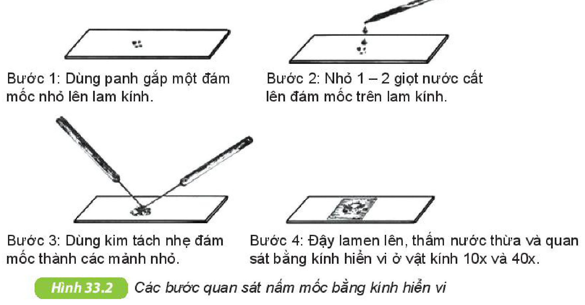
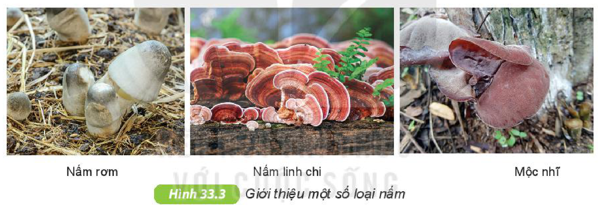
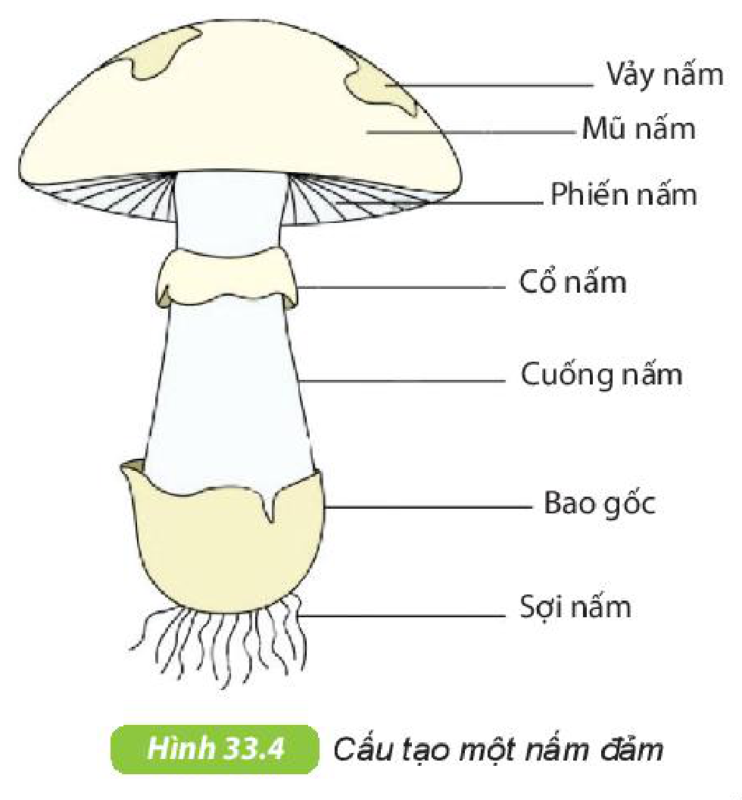

<!-- pdf:113 -->

# BÀI 33: THỰC HÀNH: QUAN SÁT CÁC LOẠI NẤM

## 🎯 Mục tiêu

- Thực hành quan sát nấm bằng mắt thường, kính lúp, kính hiển vi và vẽ lại hình quan sát được.

## I. Chuẩn bị

### 1. Thiết bị, dụng cụ

- Kính hiển vi có vật kính 10x và 40x
- Dao mổ
- Lam kính
- Giấy thấm
- Nước cất
- Găng tay
- Kính lúp
- Panh, kim mũi mác
- Lamen
- Ống nhỏ giọt
- Khẩu trang
- Kính bảo vệ mắt (nếu có)
<!-- ocr-ok: đã đối chiếu p113.png, danh sách dụng cụ chia 2 cột -->

### 2. Mẫu vật

- Một số mẫu vật đã bị mốc: Bánh mì, Mẩu gỗ, Quả cam, Bánh chưng hoặc cơm.
- Một số loại nấm tươi: Mộc nhĩ, Nấm rơm hoặc nấm hương, nấm đùi gà, nấm sò,..., Nấm linh chi.

> ⚠️ **Lưu ý:**
>
> Mẫu vật có thể thay đổi phù hợp với địa phương.

## II. Cách tiến hành

> ⚠️ **Lưu ý:**
>
> Rửa tay trước và sau khi làm thí nghiệm. Đảm bảo đúng quy tắc an toàn trong phòng thí nghiệm.

### 1. Quan sát các loại nấm mốc mọc ở nhiều vật thể khác nhau

Quan sát màu sắc và cấu trúc đám mốc trên các mẫu vật bằng mắt thường và kính lúp.

Hình 33.1. Nấm mốc mọc trên một số mẫu vật

<!-- pdf:114 -->

Quan sát cấu tạo sợi nấm mốc bằng kính hiển vi theo các bước.

- Bước 1: Dùng panh gắp một đám mốc nhỏ lên lam kính.
- Bước 2: Nhỏ 1 – 2 giọt nước cất lên đám mốc trên lam kính.
- Bước 3: Dùng kim tách nhẹ đám mốc thành các mảnh nhỏ.
- Bước 4: Đậy lamen lên, thấm nước thừa và quan sát bằng kính hiển vi ở vật kính $10\times$ và $40\times$.

Hình 33.2. Các bước quan sát nấm mốc bằng kính hiển vi
<!-- ocr-ok: đã đối chiếu p114.png, OCR bỏ sót chữ trắng trên nền xanh 'Hình 33.2' -->

### 2. Quan sát một số loại nấm thường gặp

Quan sát hình dạng của các mẫu nấm (đã chuẩn bị) bằng mắt thường và kính lúp hoặc tham khảo Hình 33.3.

Hình 33.3. Giới thiệu một số loại nấm
<!-- ocr-ok: đã đối chiếu p114.png, OCR bỏ sót chữ trong chú thích Hình 33.3 -->

Quan sát các mẫu vật còn nguyên vẹn, sau đó dùng dao bổ dọc ở chính giữa thân và đối chiếu với Hình 33.4 để tìm ra các bộ phận có trong mẫu vật đã chuẩn bị.

Hình 33.4. Cấu tạo một nấm đảm
<!-- ocr-ok: đã đối chiếu p114.png, OCR bỏ sót chữ trắng trên nền xanh 'Hình 33.4' -->

<!-- pdf:115 -->

## III. Thu hoạch

1. Mô tả các loại nấm mốc trên mẫu vật đã chuẩn bị theo các tiêu chí trong bảng sau:

| Nấm mốc trên mẫu vật \ Tiêu chí so sánh | Màu sắc | Hình dạng | Cấu tạo sợi nấm mốc (có thể vẽ hình) |
| --- | --- | --- | --- |
| ? | ? | ? | ? |
| ? | ? | ? | ? |
<!-- ocr-ok: đã đối chiếu p115.png, bảng mẫu thu hoạch có ô tiêu đề chéo và dấu hỏi chấm -->

2. Dựa trên kết quả quan sát các thành phần cấu tạo của mỗi mẫu nấm đã chuẩn bị, em hãy hoàn thành bảng theo mẫu dưới đây:

| Tên nấm \ Cấu tạo | Vảy nấm | Mũ nấm | Phiến nấm | Cổ nấm | Cuống nấm | Bao gốc | Sợi nấm |
| --- | --- | --- | --- | --- | --- | --- | --- |
| Nấm sò | | ✓ | ✓ | | ✓ | | ✓ |
| ? | ? | ? | ? | ? | ? | ? | ? |
| ? | ? | ? | ? | ? | ? | ? | ? |
<!-- ocr-ok: đã đối chiếu p115.png, bảng mẫu thu hoạch có dấu tích và dấu hỏi chấm -->

3. Vẽ vào vở hình ảnh một số loại nấm đã quan sát, chú thích các bộ phận của nấm.

## 📷 Danh sách hình trong bài

| Mã hình | Trang PDF | Vị trí | Chú thích gốc |
| --- | --- | --- | --- |
| H6-khoa_hoc_tu_nhien-b33-01 | 113 | Mục II.1 | Hình 33.1. Nấm mốc mọc trên một số mẫu vật |
| H6-khoa_hoc_tu_nhien-b33-02 | 114 | Mục II.1 | Hình 33.2. Các bước quan sát nấm mốc bằng kính hiển vi |
| H6-khoa_hoc_tu_nhien-b33-03 | 114 | Mục II.2 | Hình 33.3. Giới thiệu một số loại nấm |
| H6-khoa_hoc_tu_nhien-b33-04 | 114 | Mục II.2 | Hình 33.4. Cấu tạo một nấm đảm |
