<!-- pdf:116 -->

# BÀI 34: THỰC VẬT

## 🎯 Mục tiêu

- Phân biệt được hai nhóm thực vật có mạch và không có mạch.
- Nhận biết được các nhóm thực vật: Rêu, Dương xỉ, Hạt trần, Hạt kín thông qua hình ảnh, mẫu vật.
- Trình bày được vai trò của thực vật trong tự nhiên và trong đời sống.

## 🔴 Mở đầu

Quan sát hình trên và kể tên những loài thực vật trong hình mà em biết. Em có nhận xét gì về môi trường sống của chúng?

## I. Đa dạng thực vật

Thực vật sống ở khắp mọi nơi xung quanh chúng ta. Thực vật gồm nhiều loài, có kích thước và môi trường sống khác nhau.

Trên thế giới có khoảng gần 400 000 loài thực vật đã được phát hiện, trong đó ở Việt Nam là khoảng gần 12 000 loài với thành phần cụ thể như ở bảng bên.

**Bảng số lượng các loài thực vật ở Việt Nam**

| Ngành thực vật | Số lượng loài |
| --- | --- |
| Hạt kín | 10 300 |
| Hạt trần | 69 |
| Dương xỉ | 691 |
| Rêu | 481 |

*(Theo số liệu của Tổ chức Liên minh Quốc tế Bảo tồn thiên nhiên và Tài nguyên thiên nhiên – IUCN)*

> ❓ Dựa vào số liệu bảng bên, em hãy nhận xét về số lượng loài của mỗi ngành thực vật.

<!-- pdf:117 -->

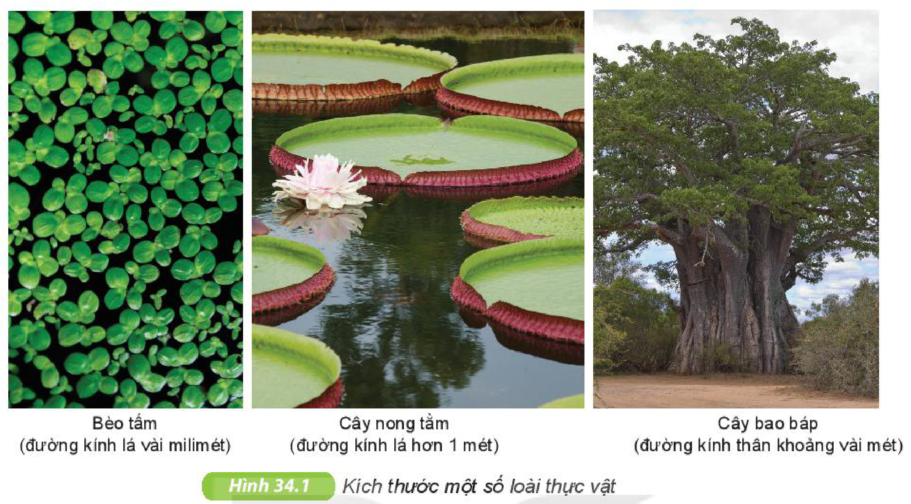

- Bèo tấm (đường kính lá vài milimét)
- Cây nong tằm (đường kính lá hơn 1 mét)
- Cây bao báp (đường kính thân khoảng vài mét)

Hình 34.1. Kích thước một số loài thực vật

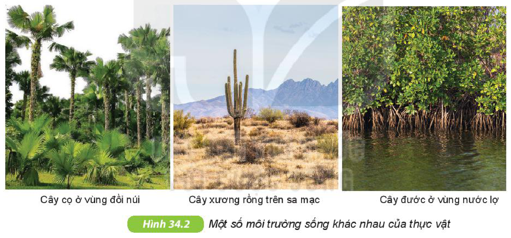

Hình 34.2. Một số môi trường sống khác nhau của thực vật

> ❓ Quan sát Hình 34.1 và 34.2, nhận xét về kích thước và môi trường sống của thực vật.

## II. Các nhóm thực vật

Các loài thực vật đều có một số đặc điểm giống nhau, bên cạnh đó chúng cũng có những sai khác về hình thái, cấu tạo bên trong, đặc điểm sinh sản,... Dựa vào các đặc điểm sai khác đó, thực vật được phân chia thành hai nhóm chính với các ngành đại diện như sơ đồ bên:

<!-- pdf:118 -->

- Giới Thực vật:
  - Thực vật không có mạch: Ngành Rêu
  - Thực vật có mạch:
    - Thực vật không hạt: Ngành Dương xỉ
    - Thực vật có hạt: Ngành Hạt trần, Ngành Hạt kín
<!-- ocr-ok: đã đối chiếu p118.png, OCR bỏ sót chữ trắng trong các ô màu của sơ đồ phân loại thực vật -->

### 1. Thực vật không có mạch

<!-- term: Rêu -->
**Thực vật không có mạch** gồm những loài cơ thể không có mạch dẫn. Rêu là đại diện thuộc nhóm này. Rêu cũng là nhóm thực vật sống trên cạn đầu tiên. Người ta có thể dễ dàng tìm thấy chúng ở những nơi ẩm ướt, ít ánh sáng. Cơ thể rêu nhỏ bé chỉ cao khoảng 1 – 2 cm, có rễ giả, thân và lá không có mạch dẫn. Rêu sinh sản bằng bào tử (Hình 34.3).

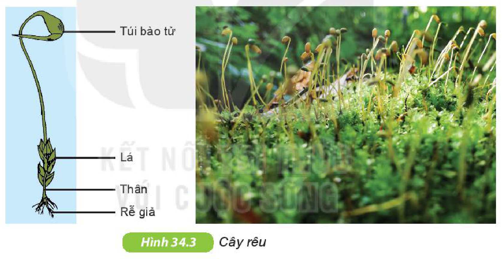

Hình 34.3. Cây rêu
<!-- ocr-ok: đã đối chiếu p118.png, OCR bỏ sót chú thích Hình 34.3 -->

> ❓ 1. Ở những nơi khô hạn, có nắng chiếu trực tiếp thì rêu có sống được không? Vì sao?
>
> 2\*. Để tránh rêu mọc ở chân tường, sân, bậc thềm gây trơn trượt và mất thẩm mĩ, chúng ta nên làm gì?

### 2. Thực vật có mạch

**Thực vật có mạch** là nhóm các loài thực vật có thân, lá, rễ thật và cơ thể có mạch dẫn. Chúng ta cùng tìm hiểu một số ngành chính sau:

<!-- pdf:119 -->

**Dương xỉ**

**Dương xỉ** là đại diện của nhóm thực vật có mạch; sinh sản bằng bào tử. Chúng thường sống ở những nơi ẩm, mát như: bờ ruộng, chân tường, dưới tán rừng,... Một số loài thường gặp như: dương xỉ, cỏ bợ, lông culi, bèo ong,...

> ❓ Quan sát Hình 34.4, cho biết cơ quan sinh dưỡng của dương xỉ có những đặc điểm gì?

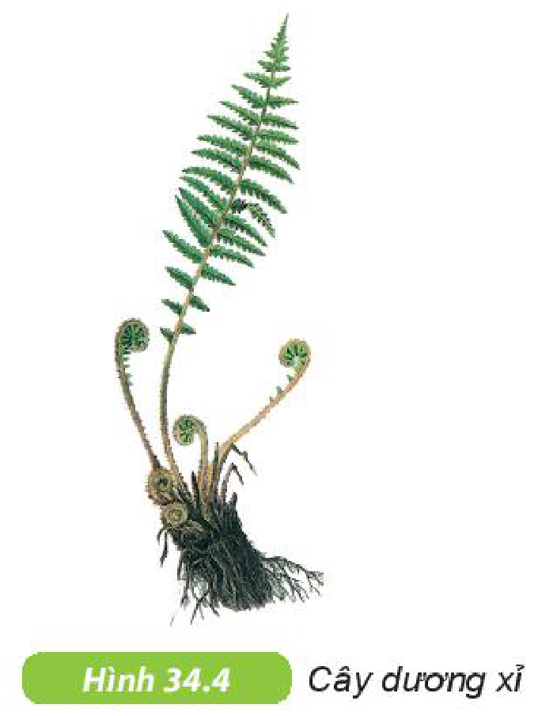

Hình 34.4. Cây dương xỉ
<!-- ocr-ok: đã đối chiếu p119.png, OCR bỏ sót chú thích Hình 34.4 -->

**Thực vật hạt trần**

**Thực vật hạt trần** là những cây gỗ có kích thước lớn với hệ mạch dẫn phát triển, chưa có hoa và quả, sinh sản bằng hạt nằm lộ trên các lá noãn hở (vì vậy có tên là hạt trần). Một số cây có giá trị kinh tế và làm đẹp cảnh quan như: thông, pơmu, hoàng đàn, vạn tuế, bách tán,...

> ❓ Quan sát Hình 34.5, hãy nêu những đặc điểm giúp em biết được cây thông là cây hạt trần.

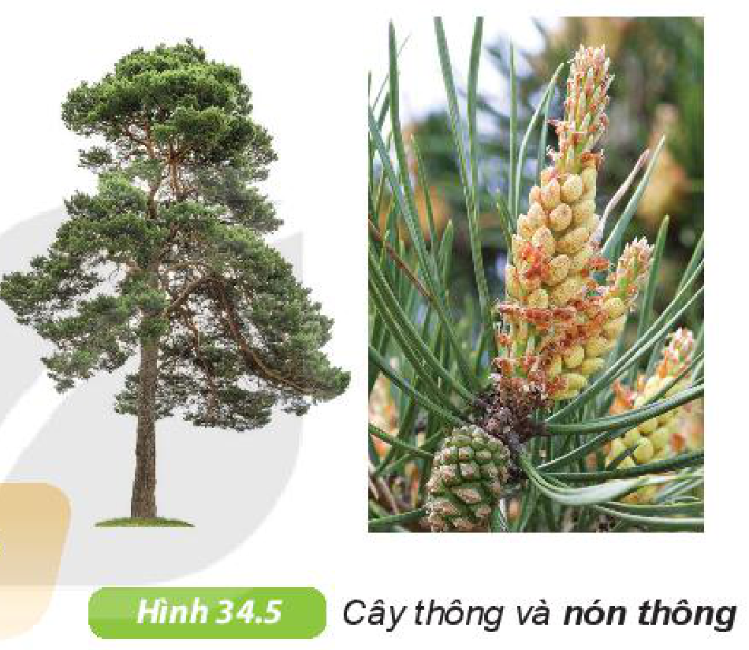

Hình 34.5. Cây thông và ***nón thông***

**Thực vật hạt kín**

**Thực vật hạt kín** có cấu tạo hoàn thiện, thích nghi với nhiều môi trường sống khác nhau và có số lượng loài phong phú nhất. Cơ quan sinh sản là hoa và quả có chứa hạt (Hình 34.6). Cơ quan sinh dưỡng đa dạng về hình thái (lá đơn, lá kép; thân củ, thân rễ; rễ cọc, rễ chùm,...) (Hình 34.7).

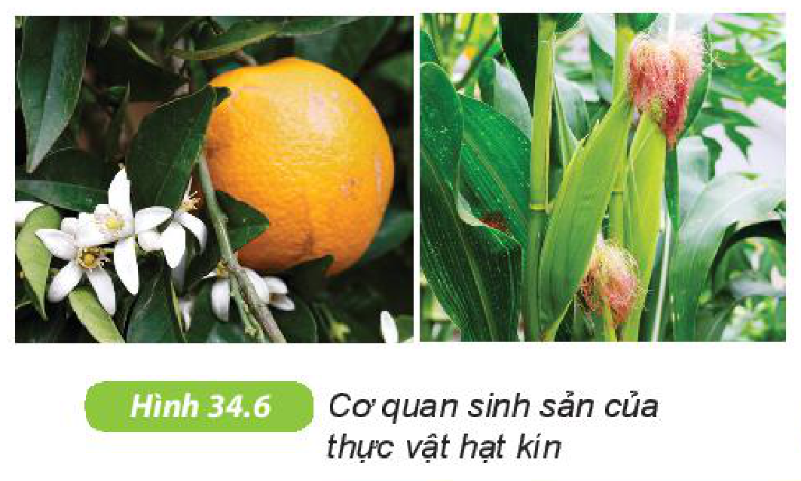

Hình 34.6. Cơ quan sinh sản của thực vật hạt kín

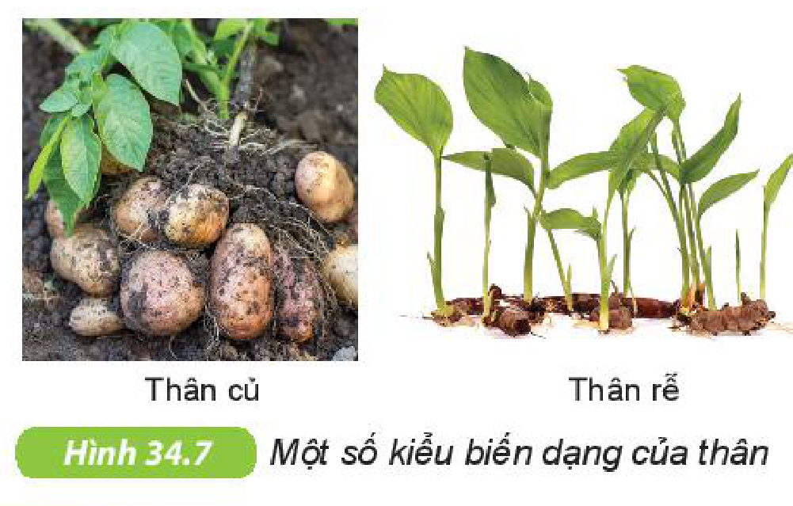

Hình 34.7. Một số kiểu biến dạng của thân

> ❓ Kể tên một số loài thực vật hạt kín mà em biết.

<!-- pdf:120 -->

> ✋ Thảo luận nhóm và hoàn thành các yêu cầu sau:
>
> 1. So sánh các ngành thực vật về môi trường sống, cấu tạo đặc trưng (cơ quan sinh dưỡng, cơ quan sinh sản), hình thức sinh sản.
>
> 2. Sắp xếp các loài thực vật: rêu tường, lúa, đậu tương, bèo ong, hoa hồng, vạn tuế, bưởi, thông, cau vào các ngành thực vật phù hợp theo mẫu bảng sau. Giải thích tại sao em lại sắp xếp như vậy.
>
> | Ngành | Rêu | Dương xỉ | Hạt trần | Hạt kín |
> | --- | --- | --- | --- | --- |
> | Loài | ? | ? | ? | ? |

## III. Vai trò của thực vật

### 1. Vai trò đối với môi trường

Các hiện tượng tự nhiên như núi lửa, cháy rừng,... cùng với các hoạt động công nghiệp, giao thông, sinh hoạt của con người đã thải vào môi trường một lượng lớn khí carbon dioxide và các khí thải độc hại khác gây ô nhiễm môi trường. Cây xanh có khả năng hấp thụ một lượng lớn khí carbon dioxide để thực hiện quá trình quang hợp, tổng hợp nên chất hữu cơ và giải phóng khí oxygen ra môi trường. Như vậy, thực vật giúp cân bằng khí oxygen và carbon dioxide trong khí quyển.

Hiện tượng thoát hơi nước ở lá cây còn góp phần làm giảm nhiệt độ môi trường, điều hoà không khí, giảm **hiệu ứng nhà kính**.

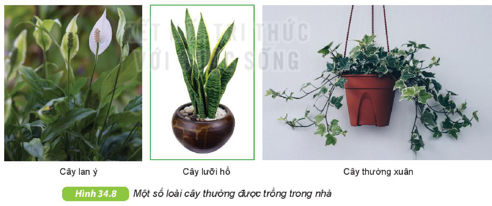

Hình 34.8. Một số loài cây thường được trồng trong nhà

> ❓ Đọc thông tin trên và quan sát Hình 34.8, cho biết việc trồng cây trong nhà có tác dụng gì? Kể thêm một số cây nên trồng trong nhà mà em biết.

<!-- pdf:121 -->

Ngoài ra, thực vật còn góp phần bảo vệ đất và nguồn nước, giúp hạn chế và giảm nhẹ mức độ nguy hiểm của thiên tai như: sạt lở đất, lũ quét,...

> ✋ 1. Quan sát Hình 34.9, so sánh lượng chảy của dòng nước mưa trên mặt đất ở nơi có rừng (Hình 34.9a) với đồi trọc (Hình 34.9b) và giải thích tại sao lại có sự khác nhau đó. Lượng chảy của dòng nước mưa có ảnh hưởng như thế nào đến độ màu mỡ và khả năng giữ nước của đất? Từ đó cho biết đất có rừng che phủ hay đất trên đồi, núi trọc dễ bị xói mòn, sạt lở, hạn hán hơn.
>
> 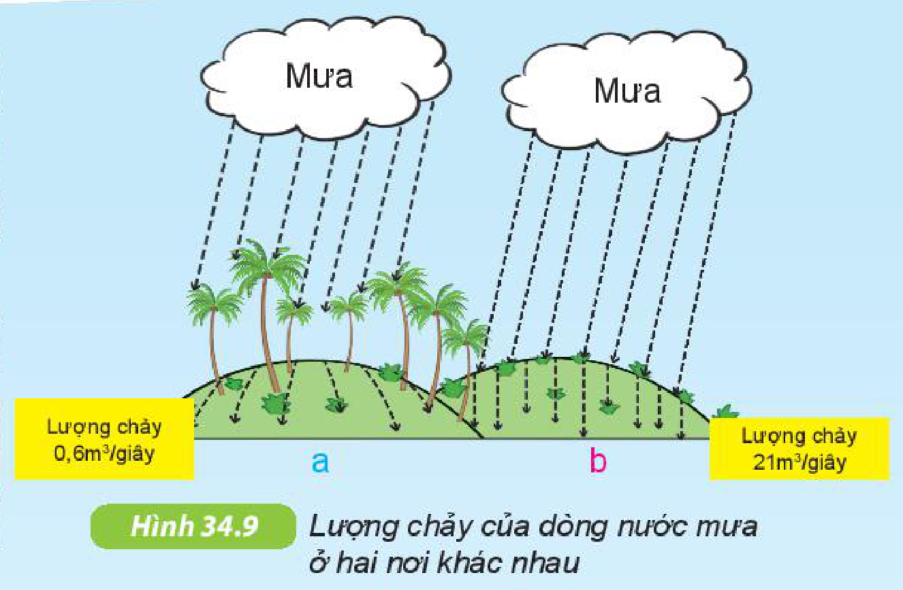
>
> Hình 34.9. Lượng chảy của dòng nước mưa ở hai nơi khác nhau
>
> 2. Quan sát Hình 34.10 và nêu một số thiên tai ở nước ta. Theo em, nguyên nhân nào dẫn đến tình trạng thiên tai ngày càng gia tăng? Hãy đề xuất các biện pháp nhằm hạn chế tình trạng trên.
>
> 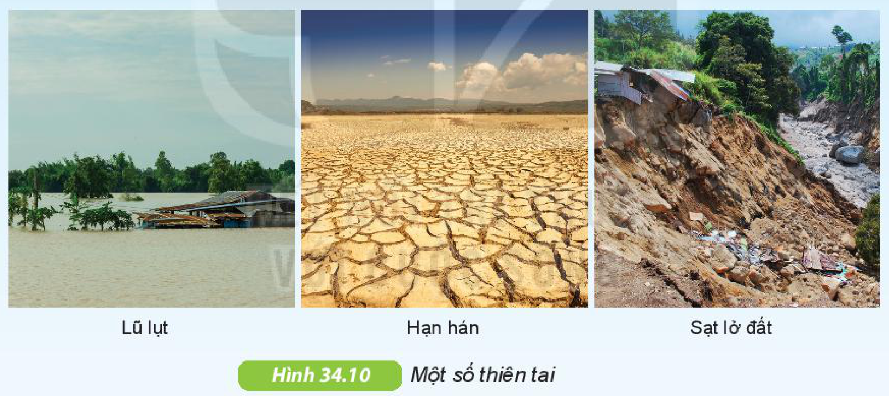
>
> Hình 34.10. Một số thiên tai

### 2. Vai trò đối với động vật và con người

Nhờ quá trình quang hợp, cây xanh tổng hợp chất hữu cơ cho sinh giới và tạo ra oxygen. Đây là nguồn oxygen cung cấp cho hoạt động hô hấp của động vật và con người. Chất hữu cơ do cây xanh tạo ra là nguồn thức ăn cho các loài động vật ăn thực vật, các loài động vật này lại là thức ăn của nhiều loài động vật khác. Vì vậy, thực vật được coi là "nhà máy sản xuất" thức ăn của sinh giới.

Ngoài ra, thực vật còn là "nhà" và nơi sinh sản của nhiều loài động vật sống trên cây như sóc, chim,...

<!-- pdf:122 -->

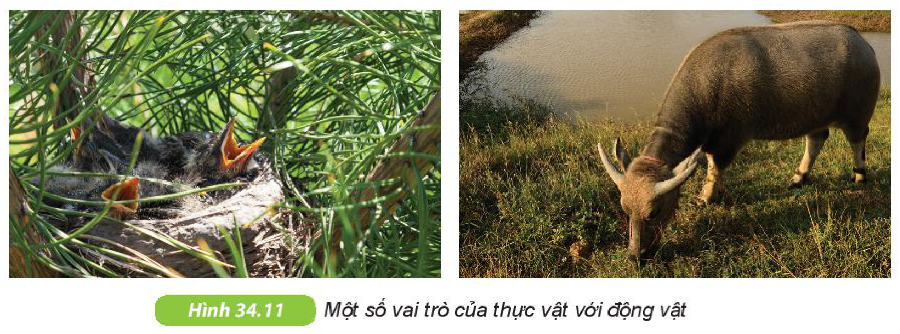

Hình 34.11. Một số vai trò của thực vật với động vật

> ❓ 1. Hình 34.11 cho ta biết những vai trò gì của thực vật?
>
> 2. Em hãy kể tên một số loài động vật ăn thực vật và loại thức ăn của chúng.

Ngoài ra, thực vật mang lại rất nhiều lợi ích cho con người. Con người đã sử dụng chúng để phục vụ đời sống hằng ngày của mình.

> ✋ Quan sát Hình 34.12 và hoàn thành bảng theo mẫu sau. Có thể viết thêm các cây mà em biết.
>
> | Vai trò của thực vật đối với con người | Tên cây |
> | --- | --- |
> | Cung cấp lương thực, thực phẩm | ? |
> | Lấy quả | ? |
> | Làm cảnh | ? |
> | Lấy gỗ | ? |
> | Làm thuốc | ? |
> | Công dụng khác | ? |
>
> 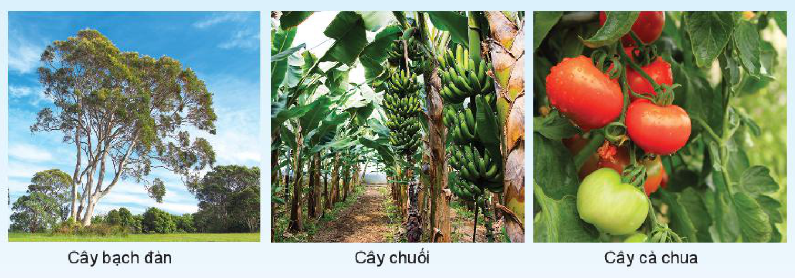
>
> - Cây bạch đàn, Cây chuối, Cây cà chua.

<!-- pdf:123 -->

> 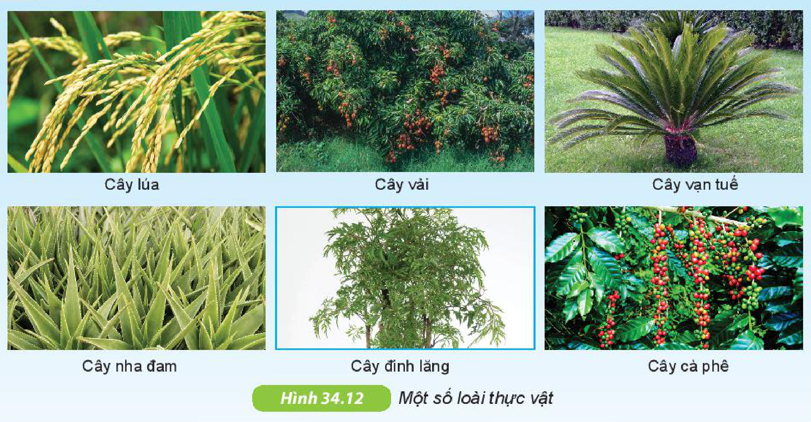
>
> - Cây lúa, Cây vải, Cây vạn tuế, Cây nha đam, Cây đinh lăng, Cây cà phê.
>
> Hình 34.12. Một số loài thực vật
<!-- ocr-ok: đã đối chiếu p123.png, OCR bỏ sót nhãn các cây trong Hình 34.12 -->

Thực vật có vai trò rất quan trọng đối với con người, tuy nhiên một số thực vật có độc có thể ảnh hưởng đến sức khoẻ con người (Hình 34.13).

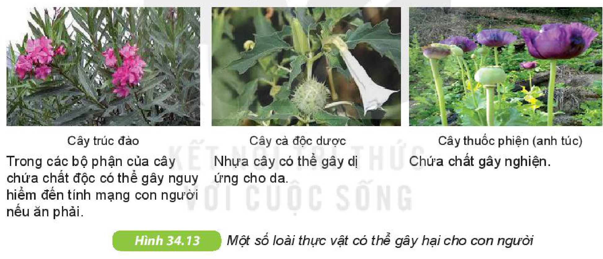

- Cây trúc đào: Trong các bộ phận của cây chứa chất độc có thể gây nguy hiểm đến tính mạng con người nếu ăn phải.
- Cây cà độc dược: Nhựa cây có thể gây dị ứng cho da.
- Cây thuốc phiện (anh túc): Chứa chất gây nghiện.

Hình 34.13. Một số loài thực vật có thể gây hại cho con người

## 📌 Em đã học

- Thế giới thực vật phong phú và đa dạng về loài, kích thước và môi trường sống. Thực vật bao gồm các ngành chính là Rêu, Dương xỉ, Hạt trần và Hạt kín, trong đó ngành Hạt kín có số lượng loài được biết đến nhiều nhất và có khả năng thích nghi với nhiều môi trường sống khác nhau.
- Thực vật có vai trò quan trọng đối với môi trường, con người và động vật. Ngoài những lợi ích mang lại, một số loài thực vật gây hại cho sức khoẻ con người.

## ✏️ Em có thể

Biết tận dụng những lợi ích của cây xanh để chăm sóc sức khoẻ (trồng nhiều cây xanh, lựa chọn được cây làm sạch không khí cho gia đình, lựa chọn thực phẩm,...).

## 📷 Danh sách hình trong bài

| Mã hình | Trang PDF | Vị trí | Chú thích gốc |
| --- | --- | --- | --- |
| H6-khoa_hoc_tu_nhien-b34-01 | 117 | Mục I | Hình 34.1. Kích thước một số loài thực vật |
| H6-khoa_hoc_tu_nhien-b34-02 | 117 | Mục I | Hình 34.2. Một số môi trường sống khác nhau của thực vật |
| H6-khoa_hoc_tu_nhien-b34-03 | 118 | Mục II.1 | Hình 34.3. Cây rêu |
| H6-khoa_hoc_tu_nhien-b34-04 | 119 | Mục II.2 | Hình 34.4. Cây dương xỉ |
| H6-khoa_hoc_tu_nhien-b34-05 | 119 | Mục II.2 | Hình 34.5. Cây thông và nón thông |
| H6-khoa_hoc_tu_nhien-b34-06 | 119 | Mục II.2 | Hình 34.6. Cơ quan sinh sản của thực vật hạt kín |
| H6-khoa_hoc_tu_nhien-b34-07 | 119 | Mục II.2 | Hình 34.7. Một số kiểu biến dạng của thân |
| H6-khoa_hoc_tu_nhien-b34-08 | 120 | Mục III.1 (ảnh phải tràn mép trang) | Hình 34.8. Một số loài cây thường được trồng trong nhà |
| H6-khoa_hoc_tu_nhien-b34-09 | 121 | Hộp Hoạt động mục III.1 (nền hộp xanh nhạt) | Hình 34.9. Lượng chảy của dòng nước mưa ở hai nơi khác nhau |
| H6-khoa_hoc_tu_nhien-b34-10 | 121 | Hộp Hoạt động mục III.1 | Hình 34.10. Một số thiên tai |
| H6-khoa_hoc_tu_nhien-b34-11 | 122 | Mục III.2 | Hình 34.11. Một số vai trò của thực vật với động vật |
| H6-khoa_hoc_tu_nhien-b34-12 | 122 | Hộp Hoạt động mục III.2 (phần 1) | Hình 34.12 (phần 1). Một số loài thực vật (Cây bạch đàn, Cây chuối, Cây cà chua) |
| H6-khoa_hoc_tu_nhien-b34-13 | 123 | Hộp Hoạt động mục III.2 (phần 2, nền hộp xanh nhạt) | Hình 34.12. Một số loài thực vật |
| H6-khoa_hoc_tu_nhien-b34-14 | 123 | Mục III.2 | Hình 34.13. Một số loài thực vật có thể gây hại cho con người |
