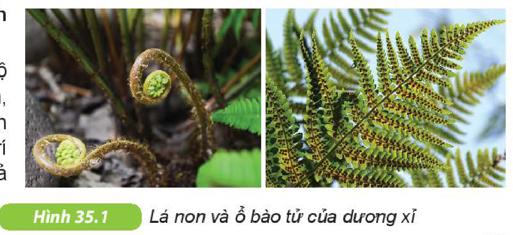
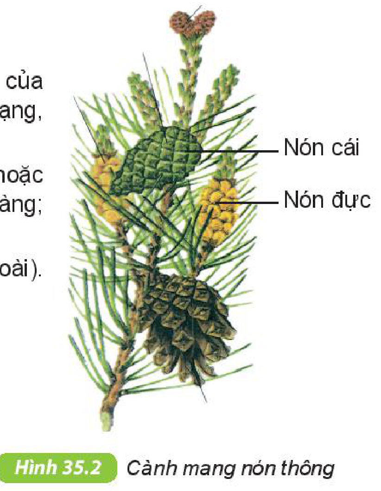
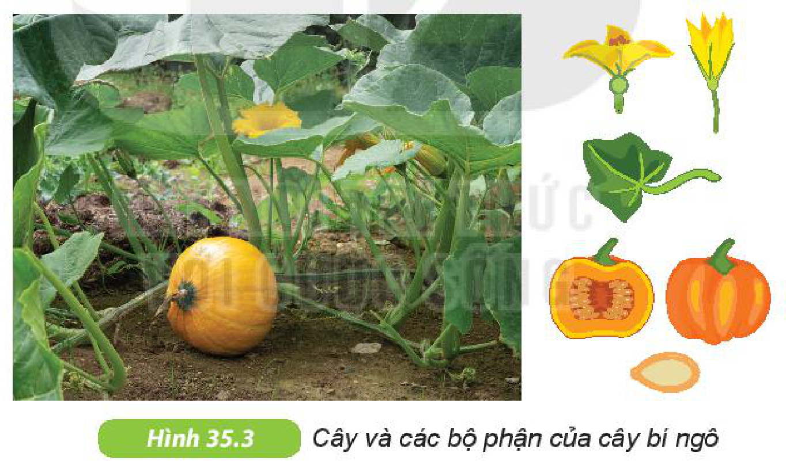

<!-- pdf:124 -->

# BÀI 35: THỰC HÀNH: QUAN SÁT VÀ PHÂN BIỆT MỘT SỐ NHÓM THỰC VẬT

## 🎯 Mục tiêu

- Quan sát hình ảnh, mẫu vật thực vật và phân chia được vào các nhóm thực vật theo tiêu chí đã học.

## I. Chuẩn bị

### 1. Thiết bị, dụng cụ

- Kính hiển vi có vật kính 10x và 40x
- Kính lúp
- Dao lam
- Nước cất
- Ống nhỏ giọt
- Lam kính
- Lamen
<!-- ocr-ok: đã đối chiếu p124.png, danh sách dụng cụ chia 2 cột -->

### 2. Mẫu vật

Rêu tường: mẫu vật thật hoặc ảnh cây rêu có đủ rễ, thân, lá và túi bào tử.

Dương xỉ, cỏ bợ: cây có đủ rễ, thân, lá non, lá già có ổ túi bào tử/quả bào tử hoặc tranh, ảnh minh hoạ.

Thông: cành thông mang cả hai loại nón đực và nón cái hoặc ảnh cây thông có thân, lá, nón đực, nón cái.

Bí ngô: quả bí ngô đã già hoặc ảnh bổ đôi quả bí. Ảnh cây bí ngô có hoa, quả, rễ, thân, lá. Có thể sử dụng mẫu vật khác thuộc ngành Hạt kín.

> ⚠️ **Lưu ý:**
>
> Mẫu vật có thể thay đổi tuỳ từng địa phương.
<!-- ocr-ok: đã đối chiếu p124.png, OCR đọc sai dấu chữ trong hộp Lưu ý -->

## II. Cách tiến hành

### 1. Quan sát đại diện thực vật không có mạch

Sử dụng kính lúp để quan sát các cơ quan của cây rêu: rễ, thân, lá và vị trí của bào tử trên mẫu vật thật hoặc quan sát trên tranh, ảnh.

Quan sát thân có phân nhánh hay không.

Dùng dao lam cắt một lát cắt mỏng ngang thân cây rêu (nếu có), đặt lát cắt lên lam kính, nhỏ một giọt nước cất lên trên mẫu vật và đậy lại bằng lamen. Đặt lên bàn kính của kính hiển vi và quan sát ở vật kính 10x và 40x. Quan sát thân cây có mạch dẫn hay không.

### 2. Quan sát đại diện ngành Dương xỉ

Quan sát, xác định được các bộ phận của cây dương xỉ: rễ, thân, lá. Quan sát đặc điểm của lá non cây dương xỉ. Tìm và chỉ ra vị trí ổ bào tử của dương xỉ hoặc quả bào tử của cây cỏ bợ.

Hình 35.1. Lá non và ổ bào tử của dương xỉ
<!-- ocr-ok: đã đối chiếu p124.png, OCR bỏ sót chữ trắng trên nền xanh 'Hình 35.1' -->

<!-- pdf:125 -->

### 3. Quan sát đại diện ngành Hạt trần

Sử dụng tranh, ảnh hoặc mẫu vật, quan sát hình thái của cây thông: rễ, thân (thân gỗ hay thân bò,...), lá (hình dạng, kích thước).

Quan sát và xác định cơ quan sinh sản trên mẫu vật hoặc trên tranh, ảnh. Nón đực mọc thành cụm, nhỏ, màu vàng; nón cái mọc riêng rẽ, lớn hơn nón đực.

Quan sát vị trí của hạt thông (được bao bọc hay lộ ra ngoài).

Hình 35.2. Cành mang nón thông
<!-- ocr-ok: đã đối chiếu p125.png, OCR bỏ sót toàn bộ dòng chú thích Hình 35.2 -->

### 4. Quan sát đại diện ngành Hạt kín

Sử dụng hình ảnh cây bí ngô (hoặc cây khác thuộc ngành Hạt kín) có hoa, quả, rễ, thân, lá; hình ảnh quả bí ngô bổ đôi hoặc mẫu quả thật.

Quan sát cơ quan sinh sản (hoa): Hoa bí ngô có hoa đực, hoa cái.

Quan sát vị trí của hạt (bên trong hay bên ngoài quả).

Hình 35.3. Cây và các bộ phận của cây bí ngô
<!-- ocr-ok: đã đối chiếu p125.png, OCR bỏ sót dòng chú thích Hình 35.3 -->

## III. Thu hoạch

1. Em hãy sắp xếp các mẫu vật đã quan sát vào vị trí phân loại thực vật cho phù hợp và giải thích vì sao em sắp xếp như vậy. Hoàn thành bảng theo mẫu sau:

| Tên cây | Tên ngành | Lí do |
| --- | --- | --- |
| ? | ? | ? |
| ? | ? | ? |
<!-- ocr-ok: đã đối chiếu p125.png, bảng mẫu thu hoạch có dấu hỏi chấm -->

2. Nêu dấu hiệu nhận biết một số đại diện ngành thực vật thông qua đặc điểm hình thái.

## 📷 Danh sách hình trong bài

| Mã hình | Trang PDF | Vị trí | Chú thích gốc |
| --- | --- | --- | --- |
| H6-khoa_hoc_tu_nhien-b35-01 | 124 | Mục II.2 (nhãn sát cột chữ trái) | Hình 35.1. Lá non và ổ bào tử của dương xỉ |
| H6-khoa_hoc_tu_nhien-b35-02 | 125 | Mục II.3 (nhãn vươn sát chữ bên trái) | Hình 35.2. Cành mang nón thông |
| H6-khoa_hoc_tu_nhien-b35-03 | 125 | Mục II.4 | Hình 35.3. Cây và các bộ phận của cây bí ngô |
