<!-- pdf:126 -->

# BÀI 36: ĐỘNG VẬT

## 🎯 Mục tiêu

- Phân biệt được hai nhóm động vật có xương sống và không có xương sống.
- Nhận biết được các nhóm động vật dựa vào hình ảnh, mẫu vật.
- Nêu được vai trò và một số tác hại của động vật trong đời sống.

## 🔴 Mở đầu

Chỉ ra các loài em cho là động vật trong hình bên và gọi tên các loài em biết. Vì sao em lại xếp chúng vào nhóm động vật?

## I. Đa dạng động vật

Động vật sống xung quanh chúng ta rất phong phú và đa dạng, thể hiện ở số lượng loài và môi trường sống của chúng. Cho đến nay, có khoảng hơn 1,5 triệu loài động vật đã được xác định, mô tả, định tên. Động vật có mặt ở khắp mọi nơi trên Trái Đất: dưới nước, trên cạn, trong đất, trong cơ thể sinh vật khác,...

<!-- term: Động vật -->
Tuy khác nhau về hình dạng, kích thước, cấu tạo và nhiều đặc điểm khác nhưng hầu hết động vật đều là những sinh vật đa bào, nhân thực, dị dưỡng, tế bào không có thành tế bào và hầu hết chúng có khả năng di chuyển.

> ✋ Thảo luận nhóm và thực hiện yêu cầu sau:
>
> Các loài động vật có thể sống ở đâu? Hãy kể tên một số loài động vật sống ở những nơi đó và hoàn thành bảng theo mẫu sau:
>
> | Môi trường sống | Loài động vật |
> | --- | --- |
> | ? | ? |
> | ? | ? |
> | ? | ? |
> | ? | ? |
> | ? | ? |

<!-- pdf:127 -->

## II. Các nhóm động vật

Khoảng 95% các loài động vật đã biết được xếp vào nhóm động vật không xương sống, số còn lại được xếp vào nhóm động vật có xương sống.

### 1. Động vật không xương sống

**Động vật không xương sống** gồm các loài động vật mà cơ thể chúng không có xương sống. Dưới đây là một số ngành chủ yếu:

***Ruột khoang:*** Cơ thể ruột khoang đối xứng toả tròn, khoang cơ thể thông với bên ngoài qua lỗ mở ở phần trên cơ thể gọi là miệng. Quanh miệng có các tua cuốn để bắt mồi.

Đại diện: thuỷ tức (Hình 36.1), sứa, hải quỳ,...

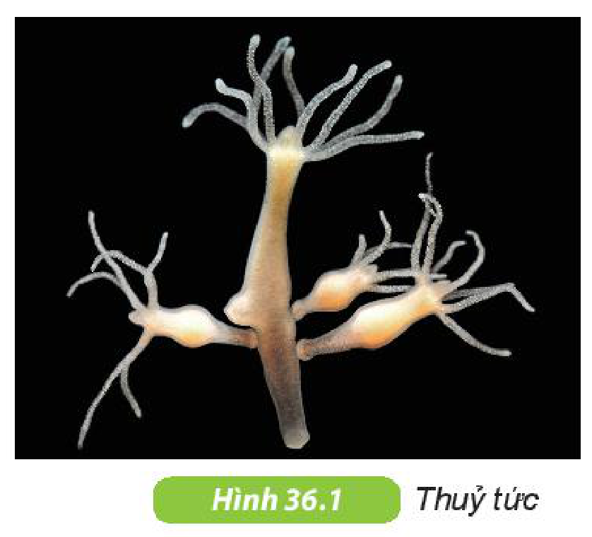

Hình 36.1. Thuỷ tức

***Giun dẹp:*** Đặc điểm nổi bật của ngành này là cơ thể dẹp, đối xứng hai bên. Một số sống tự do trong môi trường nước, còn lại hầu hết các loài giun dẹp sống kí sinh trong cơ thể người và động vật.

Đại diện: sán lá gan, sán dây (Hình 36.2),...

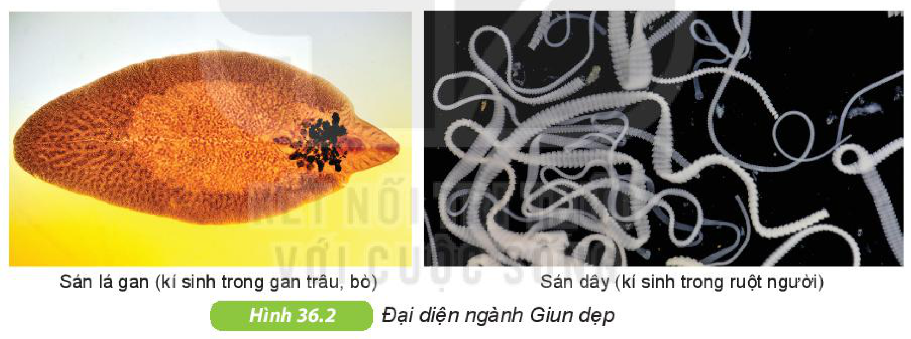

Hình 36.2. Đại diện ngành Giun dẹp

***Giun tròn:*** Cơ thể giun tròn hình trụ, phần lớn có kích thước nhỏ cần quan sát dưới kính hiển vi, nhưng có một số loài kích thước lớn, chiều dài cơ thể lên tới 30 cm. Chúng thường sống trong môi trường nước, đất hoặc sống kí sinh.

Đại diện: giun kim, giun đũa (Hình 36.3),...

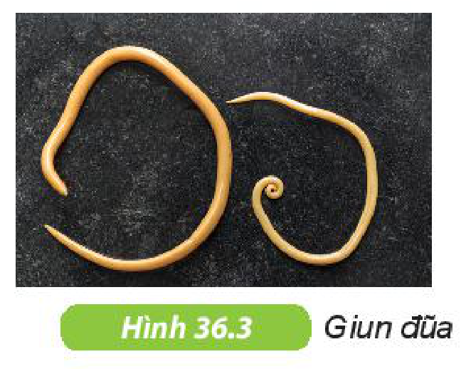

Hình 36.3. Giun đũa

***Giun đốt:*** Nhóm này cơ thể phân đốt. Chúng thường sống ở môi trường ẩm ướt như: đất ẩm, nước (nước mặn, nước ngọt),...

Đại diện: giun đất (Hình 36.4), rươi,...

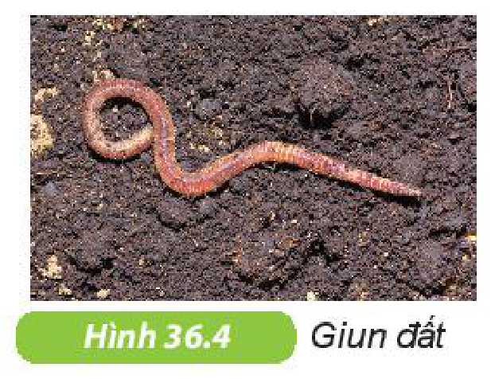

Hình 36.4. Giun đất

<!-- pdf:128 -->

***Thân mềm:*** Các loài thuộc nhóm này có cơ thể rất mềm, thường được bao bọc bởi lớp vỏ cứng bên ngoài. Tuy nhiên có nhiều loài vỏ cứng tiêu giảm hoặc không có vỏ. Chúng phân bố chủ yếu ở môi trường nước, một số sống trên cạn.

Đại diện: trai, ốc, mực, bạch tuộc (Hình 36.5),...

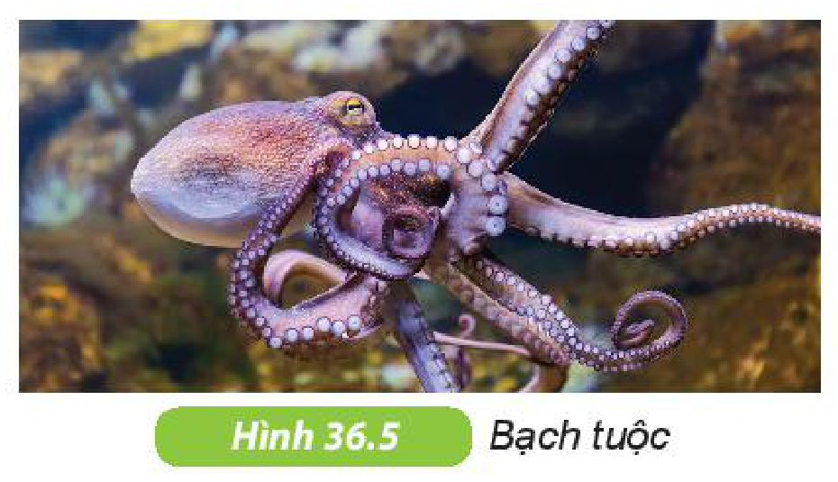

Hình 36.5. Bạch tuộc

***Chân khớp:*** Đặc điểm nổi bật của động vật chân khớp là phần phụ (chân) phân đốt, nối với nhau bằng các khớp động. Chân khớp sống ở nhiều môi trường, kể cả kí sinh trong cơ thể sinh vật khác.

Đại diện: tôm (Hình 36.6), rết, nhện, châu chấu, chuồn chuồn, ve,...

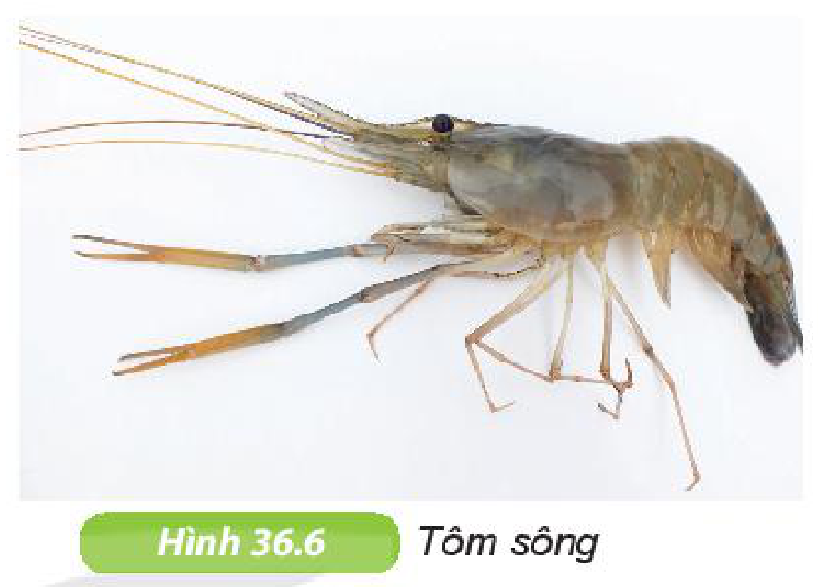

Hình 36.6. Tôm sông
<!-- ocr-ok: đã đối chiếu p128.png, OCR bỏ sót chú thích Hình 36.6 -->

> ❓ Kể thêm những loài thân mềm, chân khớp mà em biết.

> ✋ 1. Với mỗi ngành thuộc nhóm động vật không xương sống, em hãy tìm ra một từ khoá là dấu hiệu giúp em nhận biết được chúng thuộc ngành nào.
>
> 2. Dựa vào câu trả lời ở câu 1, hãy quan sát Hình 36.7 và hoàn thành bảng theo mẫu sau vào vở.
>
> 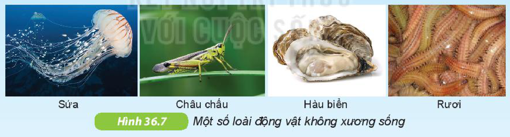
>
> Hình 36.7. Một số loài động vật không xương sống
>
> | Tên loài | Đặc điểm nhận biết | Ngành |
> | --- | --- | --- |
> | Sứa | ? | ? |
> | Châu chấu | ? | ? |
> | Hàu biển | ? | ? |
> | Rươi | ? | ? |

<!-- pdf:129 -->

### 2. Động vật có xương sống

**Động vật có xương sống** gồm các loài động vật mà cơ thể chúng có xương sống. Dưới đây là một số lớp chủ yếu:

***Các lớp cá:*** Cá sống ở nước, hô hấp bằng mang, di chuyển bằng vây, có hình dạng rất khác nhau, phổ biến nhất là thân hình thoi, dẹp hai bên, thích nghi với đời sống bơi lội trong nước.

Cá gồm hai lớp chính:

<!-- term: Lớp Cá sụn -->
Lớp Cá sụn: Sống ở nước mặn và nước lợ, có bộ xương bằng chất sụn. Đại diện: cá nhám, cá đuối (Hình 36.8),...

<!-- term: Lớp Cá xương -->
Lớp Cá xương: Sống ở nước mặn, nước ngọt, nước lợ; có bộ xương bằng chất xương. Đại diện: cá mè, cá chép (Hình 36.9),...

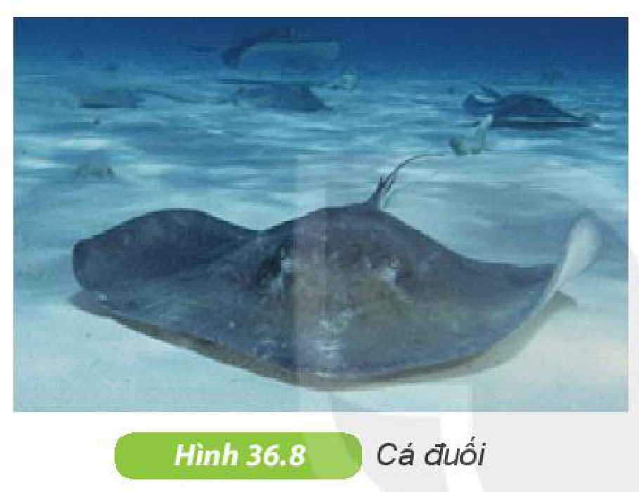

Hình 36.8. Cá đuối
<!-- ocr-ok: đã đối chiếu p129.png, OCR bỏ sót chữ trắng trên nền xanh 'Hình 36.8' -->

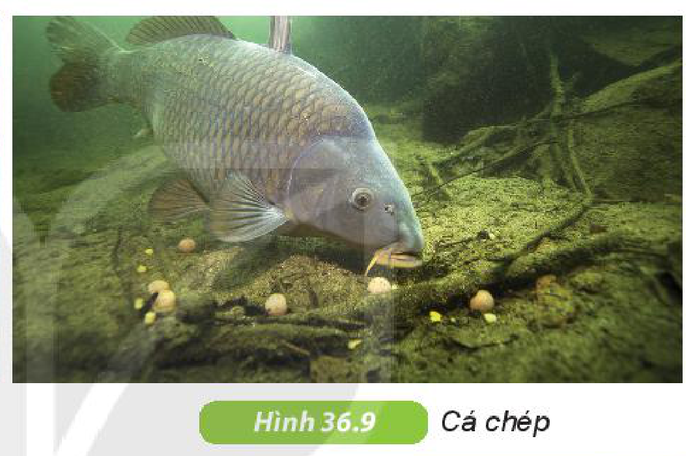

Hình 36.9. Cá chép
<!-- ocr-ok: đã đối chiếu p129.png, OCR bỏ sót chú thích Hình 36.9 -->

> ❓ Em hãy lấy thêm ví dụ về các loài cá mà em biết.

***Lớp Lưỡng cư:*** Là nhóm động vật có xương sống ở cạn đầu tiên nhưng còn giữ lại nhiều nét của tổ tiên sống ở nước. Chúng thường sống ở những nơi ẩm ướt như bờ ao, đầm lầy. Giai đoạn ấu trùng phát triển trong nước và hô hấp bằng mang. Con trưởng thành sống trên cạn, hô hấp bằng da và phổi.

Đại diện: cóc nhà, ếch đồng (Hình 36.10), ếch giun, cá cóc tam đảo,...

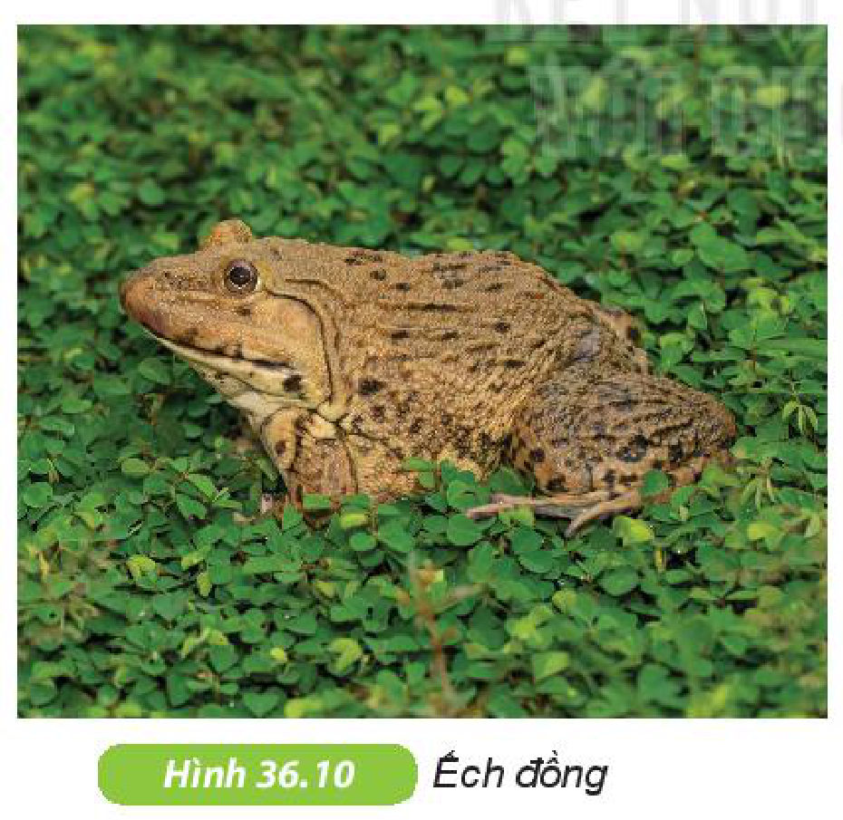

Hình 36.10. Ếch đồng

> ❓ Ếch đồng thường sống ở những nơi ẩm ướt, nếu nuôi nó ở nơi khô ráo, thiếu ẩm thì nó có sống được không? Vì sao?

<!-- pdf:130 -->

***Lớp Bò sát:*** Là nhóm động vật có xương sống thích nghi với đời sống ở cạn. Bò sát hô hấp bằng phổi. Cơ thể có hình dạng khác nhau nhưng đều có vảy sừng che phủ. Hầu hết bò sát có bốn chân, trừ một số loài chân đã tiêu biến (ví dụ: trăn, rắn).

Đại diện: rùa, thằn lằn, rắn, cá sấu (Hình 36.11),...

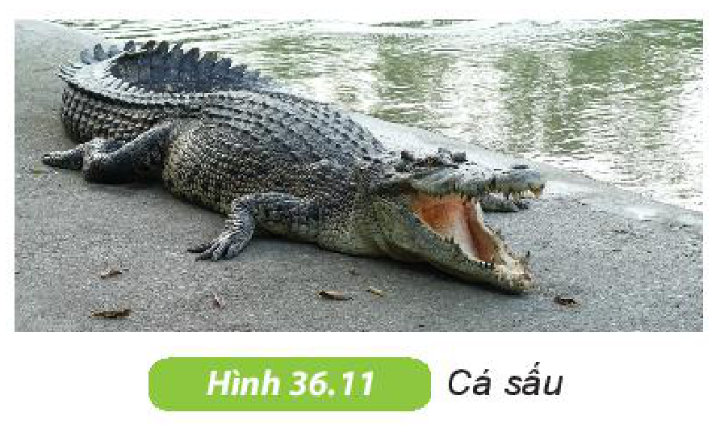

Hình 36.11. Cá sấu
<!-- ocr-ok: đã đối chiếu p130.png, OCR bỏ sót chữ trắng trên nền xanh 'Hình 36.11' -->

***Lớp Chim:*** Là nhóm động vật có xương sống có mặt khắp mọi nơi trên Trái Đất. Chim có bộ lông vũ bao phủ cơ thể, chi trước biến đổi thành cánh, hô hấp bằng phổi với hệ thống túi khí phát triển thích nghi với đời sống bay lượn.

Đại diện: chim bồ câu (Hình 36.12), chim cánh cụt, vịt trời, đà điểu,...

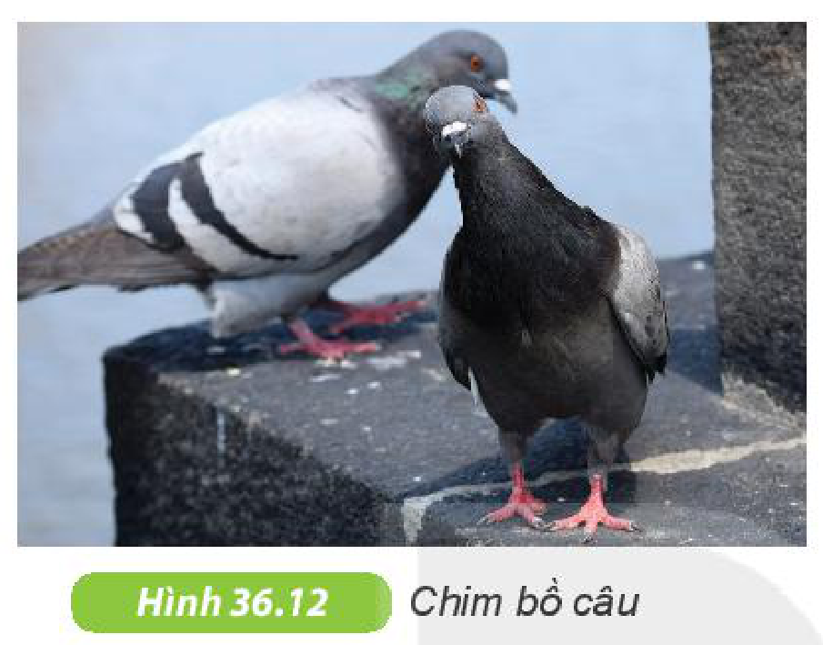

Hình 36.12. Chim bồ câu

***Lớp Động vật có vú*** *(Thú):* Là nhóm động vật có tổ chức cao nhất trong các lớp động vật có xương sống. Cơ thể phủ lông mao, trừ một số rất ít loài không có lông. Động vật có vú hô hấp bằng phổi. Hầu hết các loài động vật có vú đều đẻ con và nuôi con bằng sữa tiết ra từ tuyến vú.

Đại diện: thỏ, bò, voi, lợn (Hình 36.13), cá heo, cá voi,...

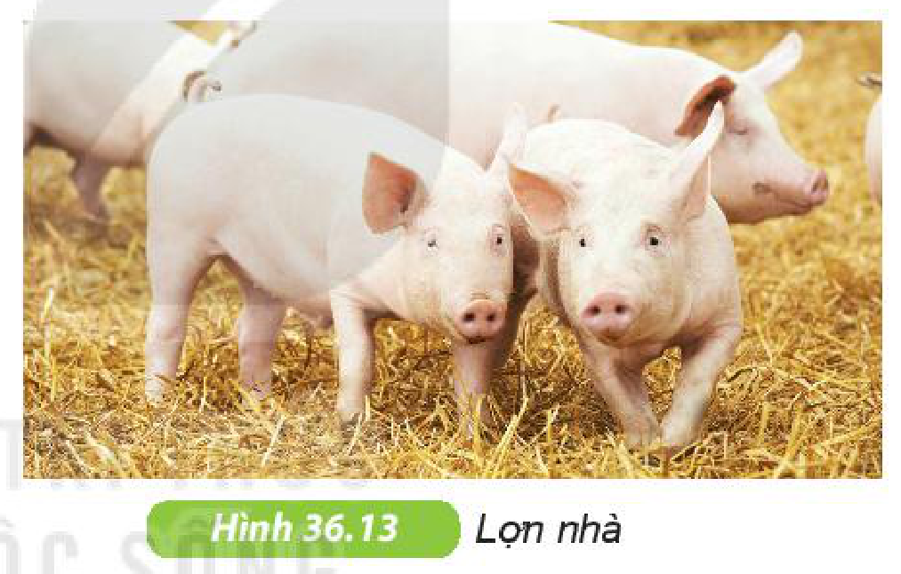

Hình 36.13. Lợn nhà
<!-- ocr-ok: đã đối chiếu p130.png, OCR bỏ sót chú thích Hình 36.13 -->

> ❓ Cá heo và cá voi cùng sống dưới nước và đều được gọi là cá, tuy nhiên chúng không thuộc lớp Cá mà thuộc lớp Động vật có vú. Em hãy tìm hiểu về hai loài trên và giải thích vì sao chúng lại không được xếp vào các lớp Cá.

## III. Vai trò của động vật

### 1. Vai trò đối với tự nhiên

Động vật là mắt xích quan trọng của **chuỗi thức ăn** trong tự nhiên, góp phần duy trì trạng thái cân bằng về mặt số lượng các loài trong **hệ sinh thái** (Hình 36.14).

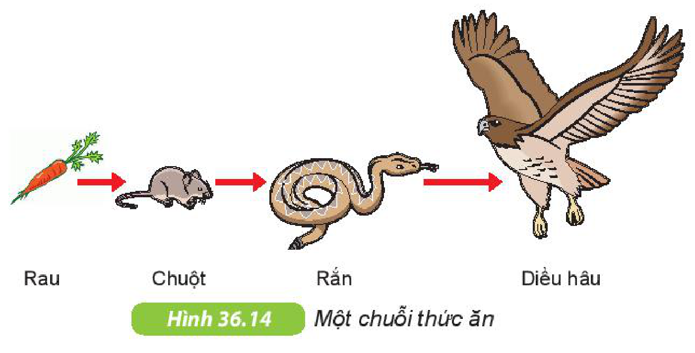

Hình 36.14. Một chuỗi thức ăn

<!-- pdf:131 -->

Nhiều loài động vật có khả năng cải tạo đất như giun đất, dế, bọ hung,... Một số loài giúp thụ phấn cho cây và phát tán hạt cây (Hình 36.15).

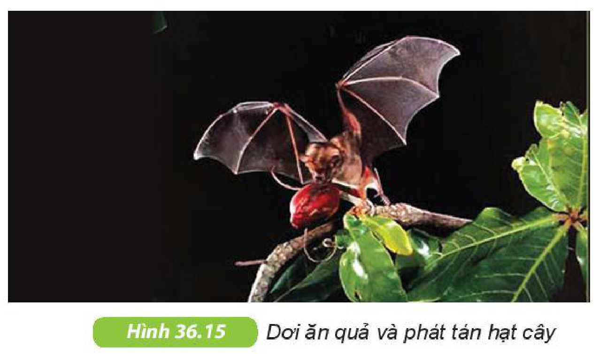

Hình 36.15. Dơi ăn quả và phát tán hạt cây

### 2. Vai trò đối với con người

Động vật cung cấp thức ăn cho con người (như bò, lợn, gà, tôm,...); cung cấp nguyên liệu phục vụ cho đời sống (như cừu, ong,...) (Hình 36.16); một số loài được sử dụng làm đồ mĩ nghệ và đồ trang sức (như ốc, trai,...); phục vụ nhu cầu giải trí và an ninh cho con người. Một số loài có khả năng tiêu diệt các sinh vật gây hại giúp con người bảo vệ mùa màng như ong mắt đỏ tiêu diệt sâu hại, mèo diệt chuột,...

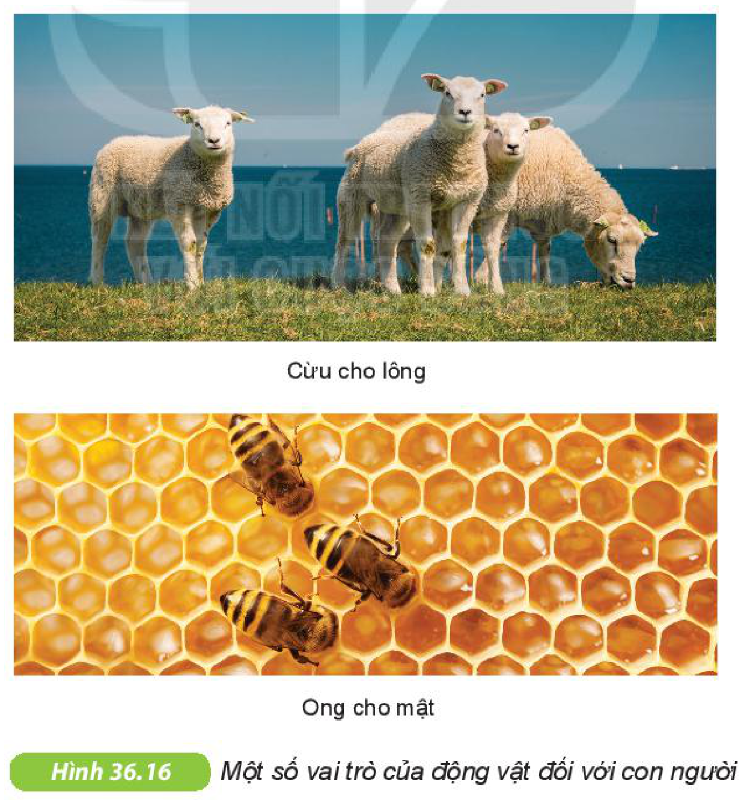

Hình 36.16. Một số vai trò của động vật đối với con người

Mặt khác, động vật còn là đối tượng thí nghiệm phục vụ cho học tập, nghiên cứu, thử nghiệm thuốc chữa bệnh cho con người.

<!-- pdf:132 -->

> ✋ 1. Động vật có những vai trò gì trong cuộc sống hằng ngày của em? Hãy kể tên các sản phẩm có nguồn gốc từ động vật mà em đã sử dụng.
>
> 2. Dựa vào thông tin đã học và Hình 36.16, hãy viết tên các loài động vật tương ứng với các vai trò trong bảng và hoàn thành vào vở theo mẫu sau.
>
> | Vai trò của động vật | Tên các loài động vật |
> | --- | --- |
> | Thực phẩm | ? |
> | Dược phẩm | ? |
> | Nguyên liệu sản xuất | ? |
> | Giải trí - Thể thao | ? |
> | Học tập - Nghiên cứu khoa học | ? |
> | Bảo vệ an ninh | ? |
> | Các vai trò khác | ? |

## IV. Tác hại của động vật

Ngoài các lợi ích, một số loài động vật cũng gây hại cho con người và các loài sinh vật khác.

Giun, sán kí sinh gây bệnh trong cơ thể người, lợn, trâu, bò,... Một số loài là vật trung gian truyền bệnh cho người như: muỗi Anophen truyền bệnh sốt rét; ốc là vật chủ trung gian truyền bệnh giun, sán; chuột truyền bệnh dịch hạch,... Một số loài gây hại cho cây trồng (ốc bươu vàng, ốc sên, các loài sâu hại,...) và vật nuôi (chấy, rận, ruồi, muỗi,...).

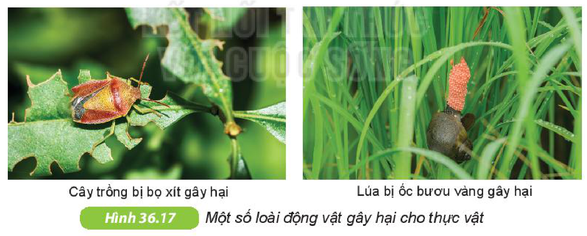

Hình 36.17. Một số loài động vật gây hại cho thực vật

> ❓ 1. Quan sát Hình 36.17, nêu tác hại của động vật đối với thực vật.
>
> 2. Em hãy kể thêm các loài động vật gây hại trong cuộc sống hằng ngày mà em biết.
>
> 3. Khi ăn các loại thức ăn chưa được nấu kĩ, trứng giun hoặc **ấu trùng** sán còn sống sẽ đi vào cơ thể người và sinh sôi, phát triển gây bệnh khiến cơ thể gầy yếu, thiếu máu,... Em hãy tìm hiểu và đưa ra biện pháp phòng tránh các bệnh giun, sán.

<!-- pdf:133 -->

## 📌 Em đã học

- Thế giới động vật rất phong phú và đa dạng được chia thành hai nhóm lớn là Động vật không xương sống và Động vật có xương sống. Mỗi nhóm lại được chia thành nhiều lớp, ngành có đặc điểm khác nhau.
- Nhiều loài động vật có lợi nhưng cũng có những loài gây hại cho con người.

## ✏️ Em có thể

1. Phân biệt được các loài động vật thuộc các lớp, ngành khác nhau dựa vào đặc điểm bên ngoài.
2. Biết cách phòng tránh các bệnh giun, sán.

> 💡 Em có biết?
>
> - **San hô là động vật hay thực vật?**
>
> San hô là sinh vật biển có hình dạng giống như các cụm hoa nhiều màu sắc rực rỡ. Thực tế san hô lại là động vật thuộc ngành Ruột khoang. San hô bắt mồi bằng các tua cuốn quanh miệng. Hầu hết san hô sống cố định và có khung xương đá vôi, chúng tạo thành những rạn san hô rộng lớn (Hình 36.18) ở nhiều vùng biển nhiệt đới.
>
> 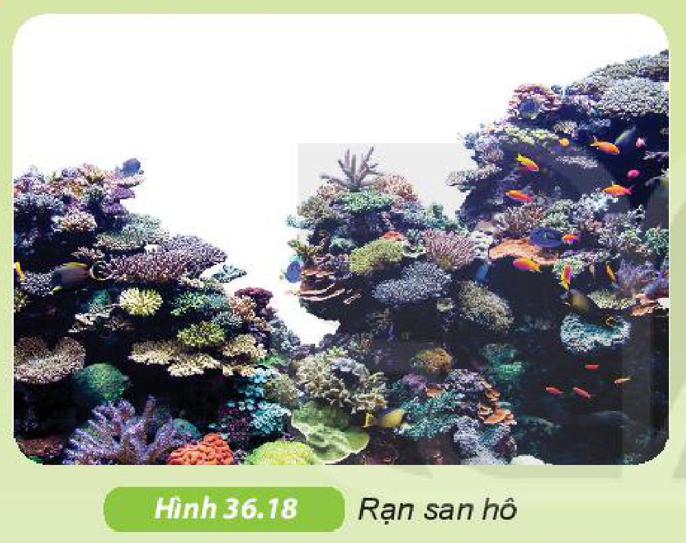
>
> Hình 36.18. Rạn san hô
>
> - **Lợn gạo nguy hiểm như thế nào?**
>
> Bệnh lợn gạo là một bệnh do ấu trùng sán dây lợn gây nên. Nếu ăn phải thịt lợn chứa ấu trùng sán (thịt lợn gạo) (Hình 36.19) còn sống, ấu trùng sau khi đến dạ dày sẽ thoát khỏi nang sán, bám vào thành ruột non và phát triển thành cơ thể trưởng thành gây ra các hiện tượng rối loạn tiêu hoá, đau bụng, cơ thể mệt mỏi,... Mặt khác, ấu trùng đi vào trong máu, đến kí sinh ở cơ, xương, mắt, não,... có thể gây ra các biến chứng như: đau cơ, liệt, giảm trí nhớ, giảm thị lực,... Vì vậy, không nên sử dụng thịt lợn gạo để đảm bảo an toàn.
>
> 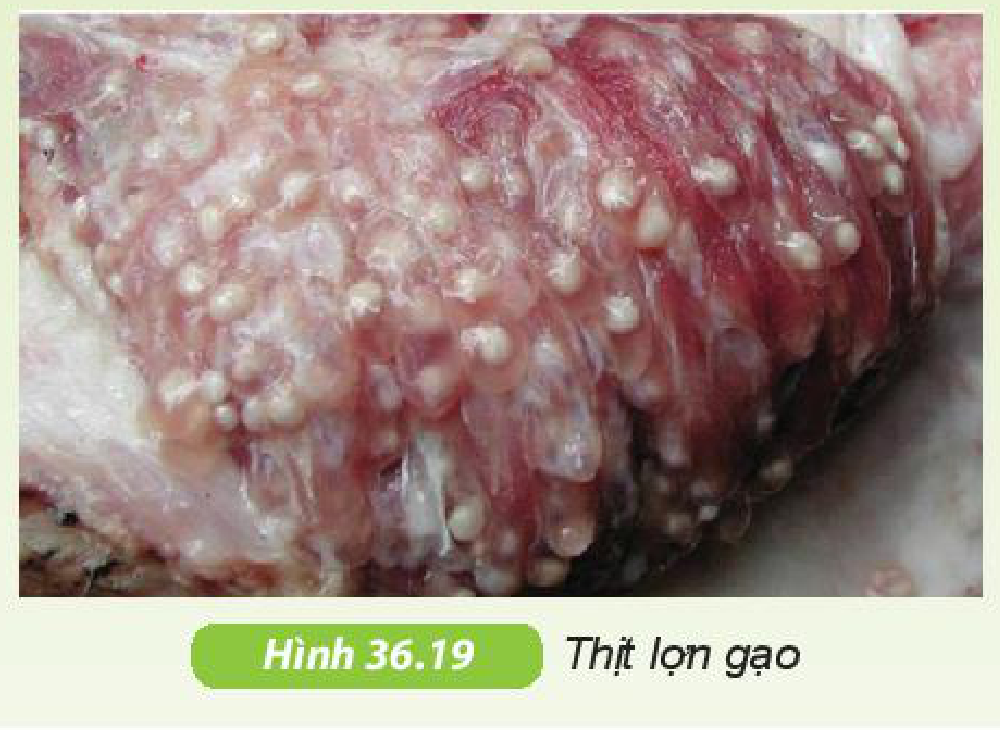
>
> Hình 36.19. Thịt lợn gạo

## 📷 Danh sách hình trong bài

| Mã hình | Trang PDF | Vị trí | Chú thích gốc |
| --- | --- | --- | --- |
| H6-khoa_hoc_tu_nhien-b36-01 | 127 | Mục II.1 | Hình 36.1. Thuỷ tức |
| H6-khoa_hoc_tu_nhien-b36-02 | 127 | Mục II.1 | Hình 36.2. Đại diện ngành Giun dẹp |
| H6-khoa_hoc_tu_nhien-b36-03 | 127 | Mục II.1 | Hình 36.3. Giun đũa |
| H6-khoa_hoc_tu_nhien-b36-04 | 127 | Mục II.1 | Hình 36.4. Giun đất |
| H6-khoa_hoc_tu_nhien-b36-05 | 128 | Mục II.1 | Hình 36.5. Bạch tuộc |
| H6-khoa_hoc_tu_nhien-b36-06 | 128 | Mục II.1 | Hình 36.6. Tôm sông |
| H6-khoa_hoc_tu_nhien-b36-07 | 128 | Hộp Hoạt động mục II.1 (nền hộp xanh nhạt) | Hình 36.7. Một số loài động vật không xương sống |
| H6-khoa_hoc_tu_nhien-b36-08 | 129 | Mục II.2 | Hình 36.8. Cá đuối |
| H6-khoa_hoc_tu_nhien-b36-09 | 129 | Mục II.2 | Hình 36.9. Cá chép |
| H6-khoa_hoc_tu_nhien-b36-10 | 129 | Mục II.2 | Hình 36.10. Ếch đồng |
| H6-khoa_hoc_tu_nhien-b36-11 | 130 | Mục II.2 | Hình 36.11. Cá sấu |
| H6-khoa_hoc_tu_nhien-b36-12 | 130 | Mục II.2 | Hình 36.12. Chim bồ câu |
| H6-khoa_hoc_tu_nhien-b36-13 | 130 | Mục II.2 | Hình 36.13. Lợn nhà |
| H6-khoa_hoc_tu_nhien-b36-14 | 130 | Mục III.1 | Hình 36.14. Một chuỗi thức ăn |
| H6-khoa_hoc_tu_nhien-b36-15 | 131 | Mục III.1 | Hình 36.15. Dơi ăn quả và phát tán hạt cây |
| H6-khoa_hoc_tu_nhien-b36-16 | 131 | Mục III.2 | Hình 36.16. Một số vai trò của động vật đối với con người |
| H6-khoa_hoc_tu_nhien-b36-17 | 132 | Mục IV | Hình 36.17. Một số loài động vật gây hại cho thực vật |
| H6-khoa_hoc_tu_nhien-b36-18 | 133 | Hộp Em có biết (nền hộp xanh lá nhạt) | Hình 36.18. Rạn san hô |
| H6-khoa_hoc_tu_nhien-b36-19 | 133 | Hộp Em có biết | Hình 36.19. Thịt lợn gạo |
