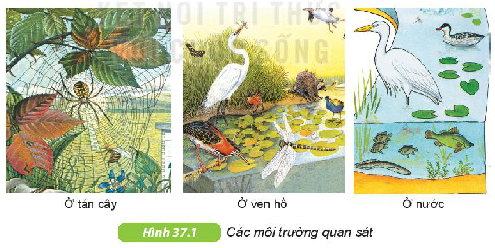
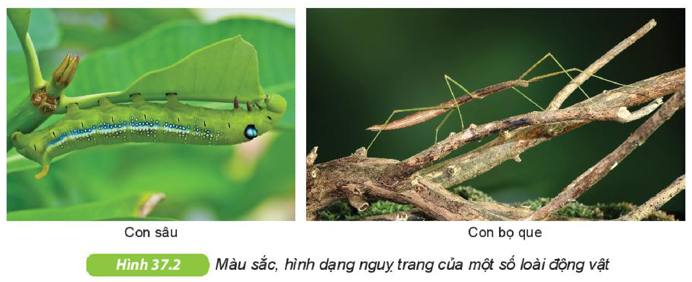

<!-- pdf:134 -->

# BÀI 37: THỰC HÀNH: QUAN SÁT VÀ NHẬN BIẾT MỘT SỐ NHÓM ĐỘNG VẬT NGOÀI THIÊN NHIÊN

## 🎯 Mục tiêu

- Thực hành quan sát và kể tên một số động vật quan sát được ngoài thiên nhiên.

## I. Chuẩn bị

### 1. Địa điểm

Lựa chọn địa điểm gần trường học nhưng phải đa dạng về môi trường sống, có độ đa dạng sinh học cao và đảm bảo an toàn.

Địa điểm có thể là vườn cây, vườn thực nghiệm,... Ở thành phố lớn, có thể chọn địa điểm là công viên hoặc vườn thú có môi trường sống đa dạng.

### 2. Dụng cụ

- Ống nhòm, kính lúp, máy ảnh
- Vở, bút ghi chép
- Tài liệu nhận diện nhanh các động vật ngoài thiên nhiên bằng hình ảnh

### 3. Yêu cầu

Tuân thủ các quy định an toàn và hướng dẫn của giáo viên. Nghiêm túc quan sát theo nhóm với các nội dung được phân công để hoàn thành bài thu hoạch.

Ghi chép lại các thông tin quan sát được theo yêu cầu của bài ngay tại chỗ để phục vụ hoàn thành bài thu hoạch.

Hình 37.1. Các môi trường quan sát

## II. Cách tiến hành

Bước 1: Quan sát động vật ở các khu vực khác nhau.

Tiến hành quan sát, chụp ảnh các loài động vật ở các khu vực.

Ghi lại tên các loài đã quan sát được cùng với môi trường sống của chúng. Có thể sử dụng tài liệu nhận dạng động vật đối với các loài chưa biết tên.

<!-- pdf:135 -->

Bước 2: Quan sát màu sắc, hình dạng, đặc điểm đặc trưng của các loài động vật. Sử dụng kính lúp để quan sát các loài có kích thước nhỏ và ống nhòm để quan sát các loài ở xa. Quan sát bằng mắt thường đối với các loài ở gần và có kích thước đủ lớn.

Hình 37.2. Màu sắc, hình dạng nguỵ trang của một số loài động vật

Bước 3: Quan sát sự di chuyển của các loài động vật.

Quan sát cách thức di chuyển: đi, chạy, bơi hay nhảy,...

Quan sát cơ quan di chuyển: chân, cánh hay vây,...

## III. Thu hoạch

1. Hoàn thành bảng thu hoạch theo mẫu sau:

| STT | Tên động vật quan sát được | Môi trường sống | Đặc điểm (hình dạng, màu sắc,...) |
| --- | --- | --- | --- |
| 1 | Tôm | Dưới nước | Chân phân đốt |
| 2 | ? | ? | ? |
| 3 | ? | ? | ? |
| 4 | ? | ? | ? |
| ... | ? | ? | ? |

2. Trả lời câu hỏi:

a) Trong khu vực quan sát, nhóm động vật nào em gặp nhiều nhất? Nhóm nào em gặp ít nhất? Nhận xét về hình dạng, kích thước, cơ quan di chuyển và cách di chuyển của các loài động vật quan sát được.

b) Nêu tên các động vật có ích cho cây, có hại cho cây mà em quan sát được.

c) Nhiều loài động vật có màu sắc trùng với màu của môi trường hoặc có hình dạng giống với vật nào đó trong môi trường (Hình 37.2). Hãy kể tên các động vật có những đặc điểm trên mà em đã quan sát được. Theo em, những đặc điểm này có lợi gì cho động vật?

3. Chia sẻ những hình ảnh về động vật em đã chụp được trong quá trình quan sát hoặc vẽ lại một loài em đã quan sát được.

## 📷 Danh sách hình trong bài

| Mã hình | Trang PDF | Vị trí | Chú thích gốc |
| --- | --- | --- | --- |
| H6-khoa_hoc_tu_nhien-b37-01 | 134 | Mục I.3 | Hình 37.1. Các môi trường quan sát |
| H6-khoa_hoc_tu_nhien-b37-02 | 135 | Mục II | Hình 37.2. Màu sắc, hình dạng nguỵ trang của một số loài động vật |
