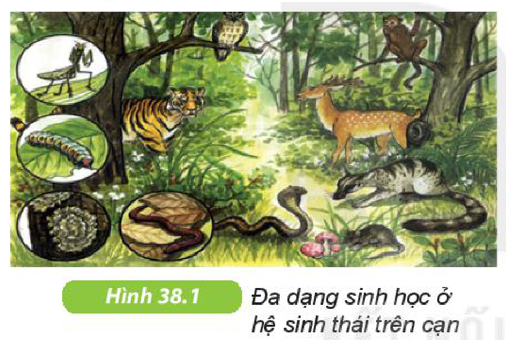
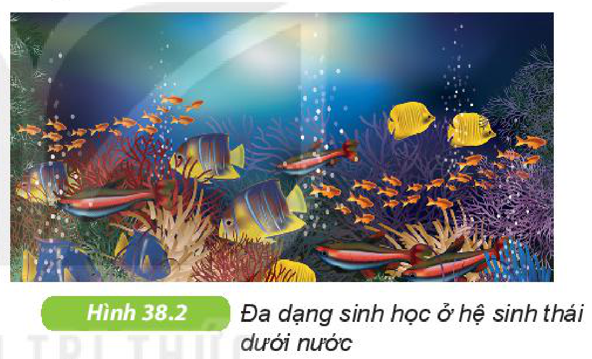
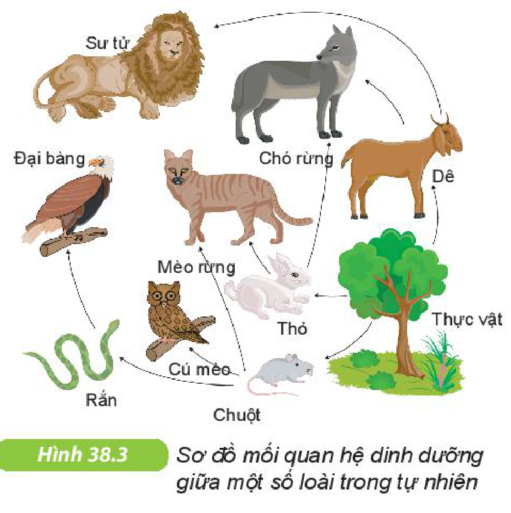
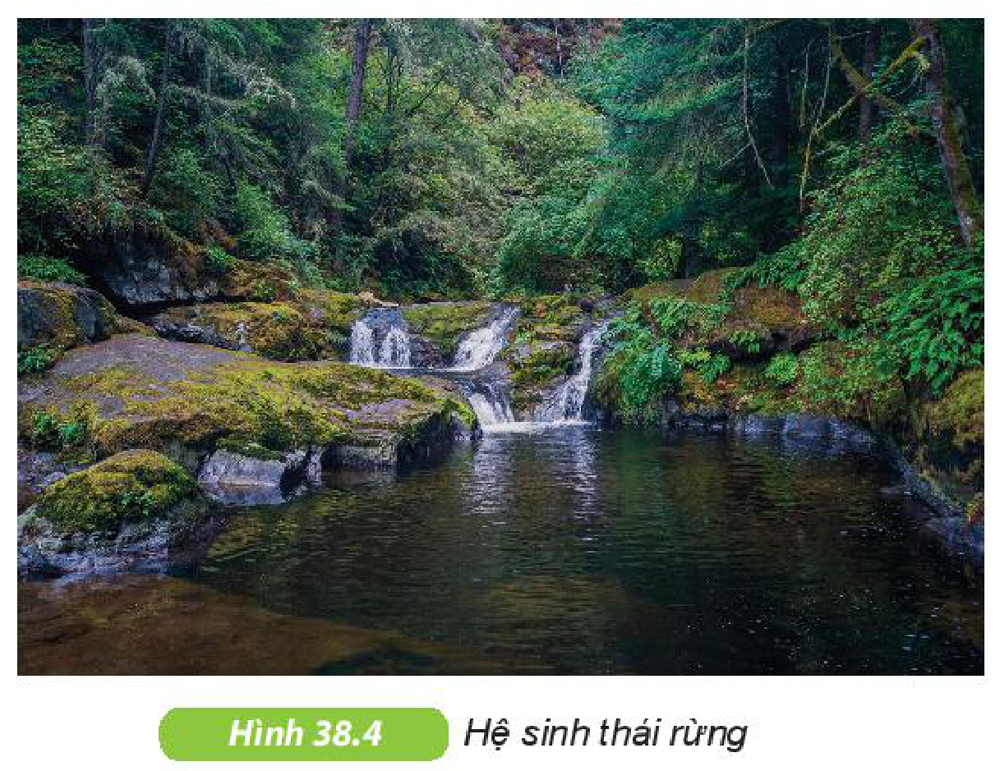
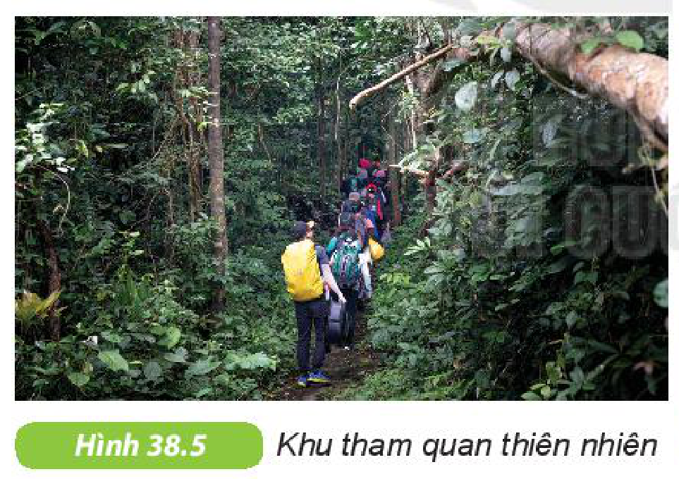
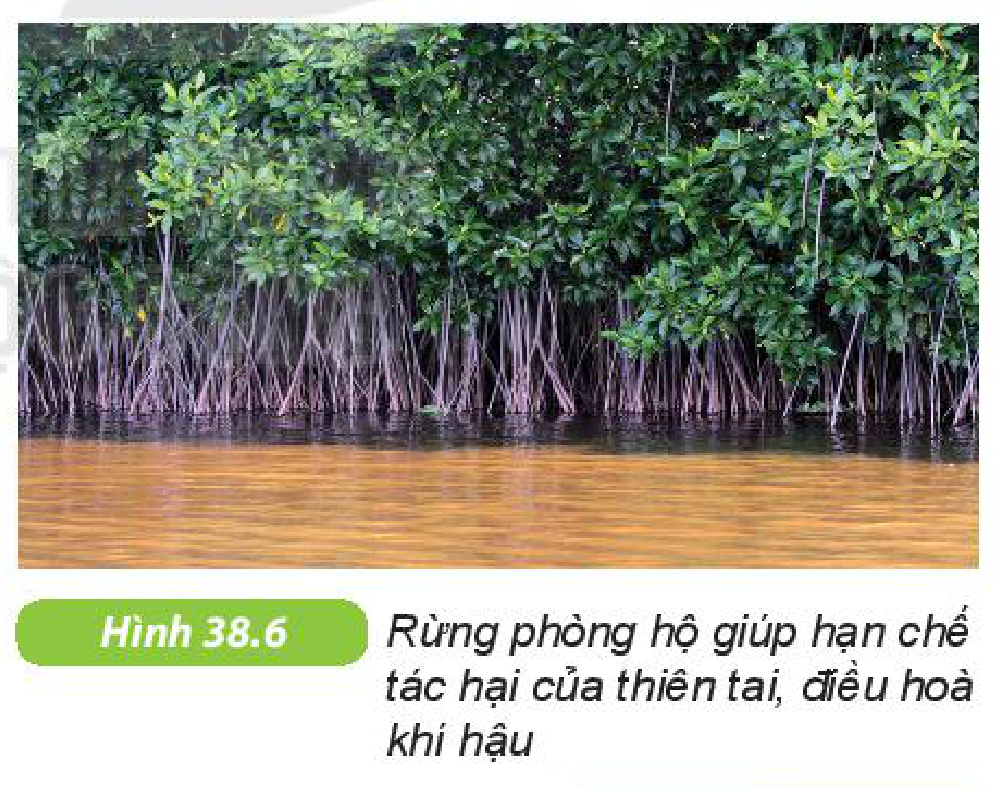
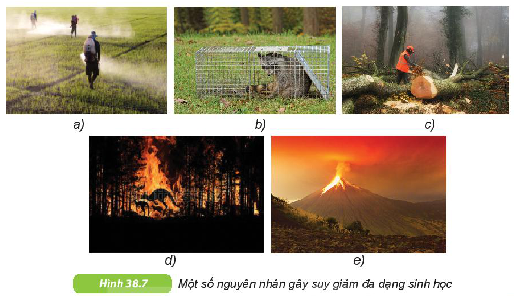
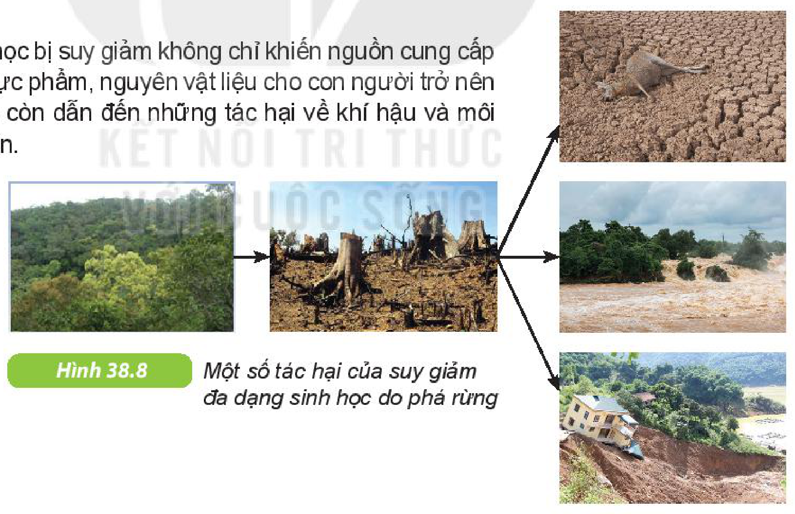
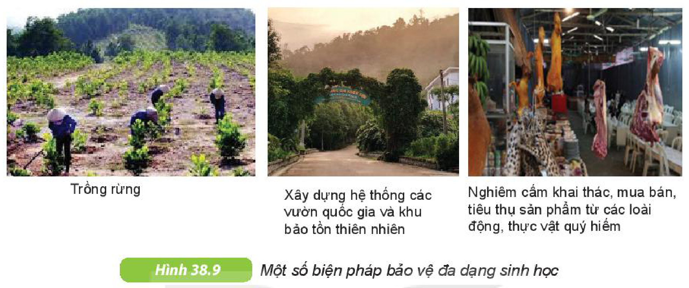

<!-- pdf:136 -->

# BÀI 38: ĐA DẠNG SINH HỌC

## 🎯 Mục tiêu

- Nêu được vai trò của đa dạng sinh học trong tự nhiên và trong đời sống.
- Giải thích được vì sao cần bảo vệ đa dạng sinh học.
- Nêu các biện pháp bảo vệ đa dạng sinh học.

## 🔴 Mở đầu

Sự tồn tại của bất cứ loài sinh vật nào cũng đóng một vai trò nhất định trong tự nhiên và góp phần tạo nên đa dạng sinh học. Đa dạng sinh học có vai trò quan trọng như thế nào và tại sao phải bảo vệ đa dạng sinh học?

## I. Đa dạng sinh học là gì?

<!-- term: Đa dạng sinh học -->
Đa dạng sinh học biểu thị rõ nét nhất ở số lượng loài sinh vật.

Hình 38.1. Đa dạng sinh học ở hệ sinh thái trên cạn

Hình 38.2. Đa dạng sinh học ở hệ sinh thái dưới nước

> ❓ Quan sát Hình 38.1 và 38.2, hãy lấy ví dụ về đa dạng loài ở thực vật, động vật.

## II. Vai trò của đa dạng sinh học

### 1. Vai trò của đa dạng sinh học trong tự nhiên

<!-- term: Đa dạng sinh học -->
Đa dạng sinh học giúp duy trì và ổn định sự sống trên Trái Đất. Trong tự nhiên, các loài sống trong cùng một khu vực có mối quan hệ qua lại khăng khít với nhau, hỗ trợ hoặc cạnh tranh lẫn nhau, từ đó đảm bảo sự tồn tại và ổn định của mỗi loài cùng toàn bộ hệ sinh thái.

> ❓ Quan sát Hình 38.3 và cho biết điều gì sẽ xảy ra nếu loài sau trong hình bị giảm số lượng hoặc biến mất.
>
> 1. Cú mèo.
>
> 2. Thực vật.

Hình 38.3. Sơ đồ mối quan hệ dinh dưỡng giữa một số loài trong tự nhiên

<!-- pdf:137 -->

Rừng tự nhiên (Hình 38.4) với vô số các loài thực vật có vai trò điều hoà khí hậu, bảo vệ đất và nước trong tự nhiên, hạn chế các hiện tượng sạt lở, xói mòn và lũ quét. Ngoài ra, rừng còn là nơi ở của các loài động vật hoang dã. Nhiều loài nấm và vi khuẩn có khả năng phân huỷ xác động, thực vật và chất thải hữu cơ thành những chất đơn giản giúp đất thêm màu mỡ và làm sạch môi trường.

Hình 38.4. Hệ sinh thái rừng

### 2. Vai trò của đa dạng sinh học đối với con người

<!-- term: Đa dạng sinh học -->
Đa dạng sinh học đảm bảo sự phát triển bền vững của con người thông qua việc cung cấp ổn định nguồn nước, lương thực, thực phẩm; đồng thời tạo ra môi trường sống thuận lợi cho con người.

Đa dạng sinh học tạo nên các cảnh quan thiên nhiên tươi đẹp phục vụ nhu cầu tham quan giải trí, nghỉ dưỡng của con người (Hình 38.5).

Ngoài ra, đa dạng sinh học còn giúp con người thích ứng với biến đổi khí hậu qua việc làm giảm ảnh hưởng của thiên tai và khí hậu khắc nghiệt (Hình 38.6).

Hình 38.5. Khu tham quan thiên nhiên

Hình 38.6. Rừng phòng hộ giúp hạn chế tác hại của thiên tai, điều hoà khí hậu

> ❓ Kể tên các loại thực phẩm và đồ dùng của con người có nguồn gốc từ động vật và thực vật.

## III. Nguyên nhân gây suy giảm đa dạng sinh học và hậu quả

### 1. Nguyên nhân

Mặc dù có vai trò rất quan trọng nhưng hiện nay ở nhiều nơi đa dạng sinh học đang ngày càng bị suy giảm nghiêm trọng. Một số loài sinh vật đã biến mất vĩnh viễn trên Trái Đất và nhiều loài đang đứng trước nguy cơ tuyệt chủng. Tình trạng này có nguyên nhân từ cả yếu tố tự nhiên và con người.

<!-- pdf:138 -->

Hình 38.7. Một số nguyên nhân gây suy giảm đa dạng sinh học

> ❓ 1. Quan sát Hình 38.7 và nêu các nguyên nhân gây suy giảm đa dạng sinh học.
>
> 2. Kể thêm các hoạt động khác của con người có thể gây suy giảm đa dạng sinh học.

### 2. Hậu quả

Đa dạng sinh học bị suy giảm không chỉ khiến nguồn cung cấp lương thực, thực phẩm, nguyên vật liệu cho con người trở nên khan hiếm mà còn dẫn đến những tác hại về khí hậu và môi trường tự nhiên.

Hình 38.8. Một số tác hại của suy giảm đa dạng sinh học do phá rừng

> ❓ Quan sát Hình 38.8 và thực hiện các yêu cầu sau:
>
> 1. Nêu sự suy giảm đa dạng sinh học do phá rừng. Phân tích những tác hại do suy giảm đa dạng sinh học từ việc phá rừng có thể gây ra.
>
> 2. Nêu thêm những tác hại khác của suy giảm đa dạng sinh học, từ đó cho biết vì sao cần phải bảo vệ đa dạng sinh học.

<!-- pdf:139 -->

## IV. Bảo vệ đa dạng sinh học

Đa dạng sinh học có vai trò sống còn đối với con người, bảo vệ đa dạng sinh học chính là bảo vệ cuộc sống của con người. Đây là việc làm cấp bách và vô cùng cần thiết, đòi hỏi sự chung tay góp sức của tất cả mọi người và các quốc gia trên thế giới.

- Trồng rừng
- Xây dựng hệ thống các vườn quốc gia và khu bảo tồn thiên nhiên
- Nghiêm cấm khai thác, mua bán, tiêu thụ sản phẩm từ các loài động, thực vật quý hiếm

Hình 38.9. Một số biện pháp bảo vệ đa dạng sinh học

> ✋ 1. Quan sát Hình 38.9, nêu các biện pháp bảo vệ đa dạng sinh học và tác dụng của mỗi biện pháp đó. Kể thêm các biện pháp khác.
>
> 2. Thực hành tuyên truyền và thực hiện các Luật Bảo vệ môi trường, Luật Đa dạng sinh học, Luật Bảo vệ và Phát triển rừng,...

## 📌 Em đã học

- Đa dạng sinh học biểu thị rõ nét nhất ở số loài sinh vật.
- Đa dạng sinh học giúp duy trì sự sống trên Trái Đất. Đa dạng sinh học cung cấp cho con người nguồn tài nguyên phong phú, cung cấp lương thực, thực phẩm và nhiều sản phẩm cần thiết khác cho con người.
- Cần phải giữ gìn và bảo vệ đa dạng sinh học.
- Nguyên nhân gây suy giảm đa dạng sinh học là do yếu tố tự nhiên và hoạt động của con người.
- Suy giảm đa dạng sinh học có thể dẫn đến tình trạng thiếu lương thực, thực phẩm, gây biến đổi khí hậu, gia tăng thiên tai,...
- Để bảo vệ đa dạng sinh học cần tích cực trồng và bảo vệ rừng, cấm săn bắt động vật hoang dã,...

## ✏️ Em có thể

1. Thực hiện những hành động thiết thực góp phần bảo vệ đa dạng sinh học.
2. Tuyên truyền cho mọi người biết được sự cần thiết phải bảo vệ đa dạng sinh học và các biện pháp thực hiện.

## 📷 Danh sách hình trong bài

| Mã hình | Trang PDF | Vị trí | Chú thích gốc |
| --- | --- | --- | --- |
| H6-khoa_hoc_tu_nhien-b38-01 | 136 | Mục I | Hình 38.1. Đa dạng sinh học ở hệ sinh thái trên cạn |
| H6-khoa_hoc_tu_nhien-b38-02 | 136 | Mục I | Hình 38.2. Đa dạng sinh học ở hệ sinh thái dưới nước |
| H6-khoa_hoc_tu_nhien-b38-03 | 136 | Mục II.1 | Hình 38.3. Sơ đồ mối quan hệ dinh dưỡng giữa một số loài trong tự nhiên |
| H6-khoa_hoc_tu_nhien-b38-04 | 137 | Mục II.1 | Hình 38.4. Hệ sinh thái rừng |
| H6-khoa_hoc_tu_nhien-b38-05 | 137 | Mục II.2 | Hình 38.5. Khu tham quan thiên nhiên |
| H6-khoa_hoc_tu_nhien-b38-06 | 137 | Mục II.2 | Hình 38.6. Rừng phòng hộ giúp hạn chế tác hại của thiên tai, điều hoà khí hậu |
| H6-khoa_hoc_tu_nhien-b38-07 | 138 | Mục III.1 | Hình 38.7. Một số nguyên nhân gây suy giảm đa dạng sinh học |
| H6-khoa_hoc_tu_nhien-b38-08 | 138 | Mục III.2 (bố trí chữ L ôm quanh đoạn văn) | Hình 38.8. Một số tác hại của suy giảm đa dạng sinh học do phá rừng |
| H6-khoa_hoc_tu_nhien-b38-09 | 139 | Mục IV | Hình 38.9. Một số biện pháp bảo vệ đa dạng sinh học |
