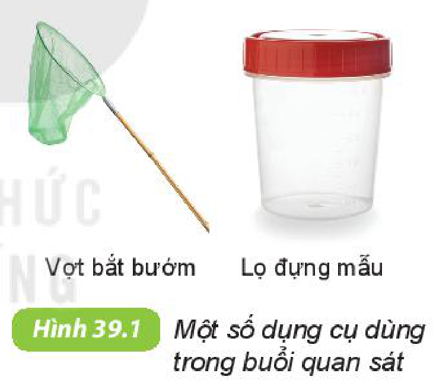
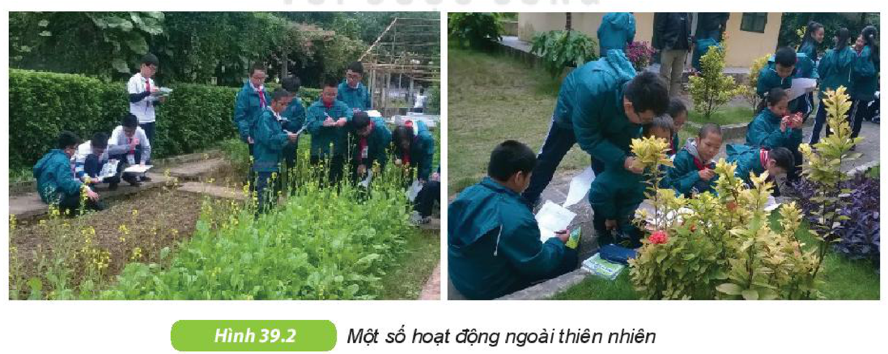
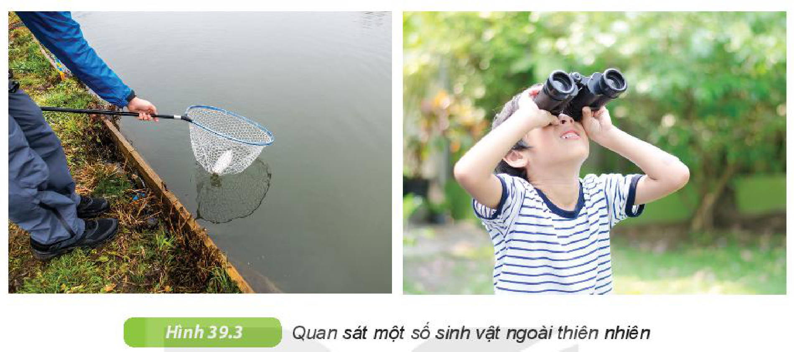
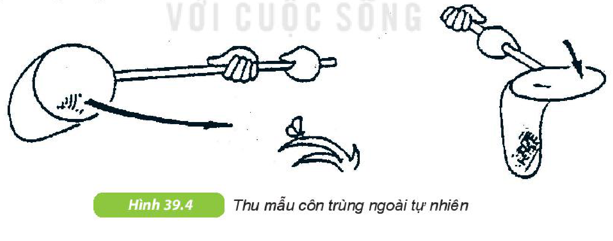

<!-- pdf:140 -->

# BÀI 39: TÌM HIỂU SINH VẬT NGOÀI THIÊN NHIÊN

## 🎯 Mục tiêu

- Thực hiện được một số phương pháp tìm hiểu sinh vật ngoài thiên nhiên.
- Nhận biết được vai trò của sinh vật trong tự nhiên.
- Quan sát và phân biệt được một số nhóm sinh vật ngoài thiên nhiên.
- Sử dụng khoá lưỡng phân để phân biệt một số nhóm sinh vật.
- Làm bộ sưu tập hình ảnh các sinh vật quan sát được và báo cáo kết quả tìm hiểu sinh vật ngoài thiên nhiên.

## 🔴 Mở đầu

Hoạt động trải nghiệm “Tìm hiểu sinh vật ngoài thiên nhiên” sẽ giúp các em củng cố lại những kiến thức đã học về thực vật và động vật, mở rộng kiến thức về sự đa dạng sinh học. Thông qua việc tìm hiểu đặc điểm thích nghi kì diệu của các sinh vật, mối quan hệ khăng khít và vai trò quan trọng của chúng với nhau và với con người, chúng ta càng thêm yêu quý và say mê nghiên cứu thế giới sinh vật, nâng cao ý thức bảo vệ thiên nhiên và đa dạng sinh học. Vậy để việc tìm hiểu sinh vật ngoài thiên nhiên đạt hiệu quả, chúng ta cần chuẩn bị những dụng cụ và thiết bị gì? Cách thực hiện như thế nào?

## I. Chuẩn bị

### 1. Địa điểm

Lựa chọn địa điểm thuận lợi và phù hợp với vị trí, điều kiện của trường.

Địa điểm tìm hiểu có thể là vườn quốc gia, khu bảo tồn thiên nhiên, thảo cầm viên,...

Hình 39.1. Một số dụng cụ dùng trong buổi quan sát
<!-- ocr-ok: đã đối chiếu p140.png, OCR bỏ sót chữ trắng trên nền xanh 'Hình 39.1' -->

### 2. Dụng cụ

| STT | Dụng cụ | STT | Dụng cụ | STT | Dụng cụ |
| --- | --- | --- | --- | --- | --- |
| 1 | Bút viết, bút chì | 5 | Ống nhòm | 9 | Vợt thuỷ sinh |
| 2 | Sổ ghi chép | 6 | Máy ảnh hoặc điện thoại di động có chức năng chụp ảnh | 10 | Panh kẹp |
| 3 | Nhãn dán mẫu | 7 | Lọ đựng mẫu | 11 | Tài liệu ảnh để nhận diện nhanh sinh vật ngoài thiên nhiên |
| 4 | Kính lúp | 8 | Vợt bắt bướm | 12 | Khoá phân loại một số nhóm sinh vật |
<!-- ocr-ok: đã đối chiếu p140.png, bảng 6 cột ghép 3 cặp STT - Dụng cụ -->

<!-- pdf:141 -->

Nhãn dán mẫu bằng giấy trắng được thiết kế theo kích thước $5\text{ cm} \times 8\text{ cm}$, đục lỗ ở góc để buộc dây và để trong túi nylon tránh bị ướt. Nhãn bao gồm các thông tin:

> - Tên loài: ........................................................
> - Địa điểm thu thập: ..........................................
> - Môi trường sống: ............................................
> - Ngày lấy mẫu: .................................................
> - Học sinh lấy mẫu: ...........................................
<!-- ocr-ok: đã đối chiếu p141.png, khung mẫu nhãn dán có các dòng chấm -->

### 3. Yêu cầu

Quan sát theo nhóm với các nội dung được phân công để hoàn thành bài thu hoạch.

Chấp hành nghiêm túc các quy định của buổi ngoại khoá (kỉ luật, nguyên tắc thu mẫu).

Tuyệt đối tuân thủ hướng dẫn của giáo viên.

Trang phục gọn gàng, phù hợp.

Khi thu và bắt, thả mẫu phải lưu ý vì một số sinh vật có thể gây độc.

## II. Cách tiến hành

### 1. Hướng dẫn chung

*Quan sát bằng mắt thường:* quan sát cơ thể và một số bộ phận trên cơ thể của các loài sinh vật có kích thước đủ lớn để nhìn thấy bằng mắt thường.

*Quan sát bằng kính lúp:* sử dụng kính lúp để quan sát cơ thể và một số bộ phận trên cơ thể của các loài có kích thước nhỏ, khó quan sát bằng mắt thường.

*Quan sát bằng ống nhòm:* sử dụng ống nhòm để quan sát động, thực vật ở xa.

*Chụp ảnh:* sử dụng máy ảnh hoặc điện thoại có chức năng chụp ảnh để chụp lại hình các loài sinh vật đã quan sát được nhằm phục vụ cho việc làm bộ sưu tập ảnh các nhóm sinh vật.

*Ghi chép:* ghi lại các thông tin về tên và môi trường sống của các loài đã quan sát được, số lượng cá thể và kích thước các loài.

*Làm bộ sưu tập ảnh:*

Có thể trình bày bộ sưu tập ảnh bằng hình thức làm tập san:

- Sử dụng ảnh sinh vật đã chụp được, phân loại theo các chủ đề: môi trường sống, vai trò hoặc nhóm phân loại.
- Xác định tên các đại diện của các nhóm sinh vật.
- Dán ảnh và trang trí tập san.

<!-- pdf:142 -->

### 2. Tìm hiểu về thực vật và động vật

**a) Quan sát môi trường sống, vai trò của thực vật và động vật**

Yêu cầu:

- Quan sát và ghi vào sổ tên các loài thực vật quan sát được và môi trường sống của chúng (dưới nước, trên cạn, trên cơ thể sinh vật khác,...). Chỉ ra vai trò của các loài đã quan sát (cây bóng mát, làm sạch môi trường, làm thức ăn cho động vật,...).
- Quan sát các loài động vật sống trong các môi trường khác nhau (trên cạn, dưới nước,...). Ghi chép lại tên các loài quan sát được cùng môi trường sống và vai trò của chúng trong tự nhiên (thụ phấn cho hoa, phát tán hạt, làm tơi xốp đất,...).
- Chụp ảnh các loài đã quan sát được cùng môi trường sống của chúng. Thu lại mẫu các thực vật đã quan sát, sử dụng nhãn dán để ghi lại mẫu vật.

Phương pháp quan sát: bằng mắt thường, kính lúp, ống nhòm.

**b) Quan sát hình thái, phân loại một số nhóm thực vật và động vật**

Yêu cầu:

- Quan sát và ghi vào sổ đặc điểm hình thái các loài thực vật bao gồm: đặc điểm rễ, thân, lá, cơ quan sinh sản để phân loại các mẫu đã thu được và các loài đã quan sát vào các ngành phù hợp.
  - Rễ: có rễ thật hay không?
  - Lá: hình dạng và cách sắp xếp lá như thế nào?
  - Thân: thân gỗ hay thân cỏ?
  - Cơ quan sinh sản: bào tử hay hoa?
  - Hạt: hạt ở trong quả hay hạt lộ ra ngoài?
- Sử dụng máy ảnh để chụp lại các đặc điểm nổi bật dùng để phân loại mẫu vật và làm bộ sưu tập ảnh.

Hình 39.2. Một số hoạt động ngoài thiên nhiên

<!-- pdf:143 -->

- Quan sát đặc điểm hình thái của các loài động vật, dựa vào đặc điểm đặc trưng giữa các ngành, lớp động vật đã học để phân loại động vật vào các ngành/lớp (Thân mềm, Chân khớp, Cá,...) thuộc động vật không xương sống hay động vật có xương sống. Đối với các loài có đời sống bay lượn có thể sử dụng ống nhòm để quan sát, chụp ảnh mẫu để quan sát chi tiết.

Hình 39.3. Quan sát một số sinh vật ngoài thiên nhiên

- Tìm và ghi vào sổ các đặc điểm hình thái, cấu tạo phù hợp với môi trường sống của các loài động vật (ví dụ: chân vịt có màng bơi để thích nghi với việc bơi lội,...).

Phân loại một số nhóm động vật thu được: Sử dụng khoá lưỡng phân để phân loại mẫu vật.

Phương pháp quan sát: bằng mắt thường, kính lúp, ống nhòm.

**c) Cách bắt, thả mẫu**

Do động vật có đặc tính di chuyển nên việc bắt, thả mẫu động vật phụ thuộc vào từng đối tượng. Với động vật ở nước, sử dụng vợt bắt động vật thuỷ sinh để vợt lên rồi chuyển sang khay nước.

Hình 39.4. Thu mẫu côn trùng ngoài tự nhiên

Với các động vật có khả năng bay, nhảy như: bướm, cào cào, châu chấu, chuồn chuồn, ong,... sử dụng vợt bắt bướm để thu mẫu. Sau khi đã vợt được côn trùng, cần có động tác khoá vợt để ngăn không cho côn trùng bay ra khỏi vợt (Hình 39.4).

Một số loài côn trùng khác cũng có thể dùng tay để bắt và cho vào lọ như: cào cào, châu chấu, dế, chuồn chuồn, một số loài cánh cứng (xén tóc, cánh cam,...).

<!-- pdf:144 -->

Các loài có khả năng đốt, cắn hoặc tiết ra chất độc thì phải dùng panh kẹp để bắt.

Ví dụ: với các loài ong, dùng panh kẹp chặt cơ thể của chúng từ bên ngoài vợt, sau đó đưa lọ đựng mẫu vào trong vợt, thả con vật vào lọ và đậy nhanh miệng lọ.

Với các động vật lớn hơn như động vật có xương sống (cá, ếch, thằn lằn,...) dùng dụng cụ phù hợp để bắt, thả.

## III. Thu hoạch

1. Trưng bày, giới thiệu với bạn mẫu vật và ảnh chụp các loài động vật, thực vật quan sát được. Có thể lựa chọn các hình thức sau: tập san, hộp bí mật,... để hoàn thành sản phẩm của nhóm.
2. Kể tên các loài thực vật mà em đã quan sát được.
3. Nhóm thực vật và động vật nào em gặp nhiều nhất, ít nhất hoặc không quan sát thấy? Vì sao?
4. Hoàn thành phiếu học tập theo mẫu phiếu học tập số 1 với khoảng từ 5 đến 10 loài thực vật em đã quan sát được.

**Phiếu học tập số 1**

| Tên cây | Môi trường sống | Đặc điểm: Rễ cây | Đặc điểm: Thân cây | Đặc điểm: Cơ quan sinh sản | Vị trí phân loại | Vai trò |
| --- | --- | --- | --- | --- | --- | --- |
| ? | ? | ? | ? | ? | ? | ? |
| ? | ? | ? | ? | ? | ? | ? |
<!-- ocr-ok: đã đối chiếu p144.png, bảng mẫu Phiếu học tập số 1 có gộp ô Đặc điểm và dấu hỏi chấm -->

5. Trong các loài thực vật em đã quan sát, loài nào có kích thước nhỏ nhất, loài nào có kích thước lớn nhất? Em có nhận xét gì về kích thước của các loài thực vật quanh em?
6. Hoàn thành phiếu học tập theo mẫu phiếu học tập số 2 với khoảng 5 đến 10 loài động vật em đã quan sát được.

**Phiếu học tập số 2**

| Tên động vật | Môi trường sống | Đặc điểm hình thái nổi bật | Vị trí phân loại | Vai trò |
| --- | --- | --- | --- | --- |
| ? | ? | ? | ? | ? |
| ? | ? | ? | ? | ? |
| ? | ? | ? | ? | ? |
| ? | ? | ? | ? | ? |
<!-- ocr-ok: đã đối chiếu p144.png, bảng mẫu Phiếu học tập số 2 có dấu hỏi chấm -->

7. Nhận xét sự phân bố của thực vật và động vật ở các môi trường khác nhau và độ đa dạng sinh học ở khu vực em quan sát.

## 📷 Danh sách hình trong bài

| Mã hình | Trang PDF | Vị trí | Chú thích gốc |
| --- | --- | --- | --- |
| H6-khoa_hoc_tu_nhien-b39-01 | 140 | Mục I.1 | Hình 39.1. Một số dụng cụ dùng trong buổi quan sát |
| H6-khoa_hoc_tu_nhien-b39-02 | 142 | Mục II.2.b | Hình 39.2. Một số hoạt động ngoài thiên nhiên |
| H6-khoa_hoc_tu_nhien-b39-03 | 143 | Mục II.2.b | Hình 39.3. Quan sát một số sinh vật ngoài thiên nhiên |
| H6-khoa_hoc_tu_nhien-b39-04 | 143 | Mục II.2.c | Hình 39.4. Thu mẫu côn trùng ngoài tự nhiên |
