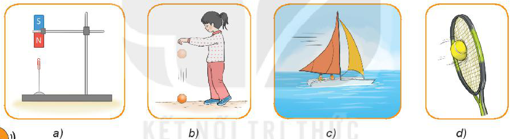
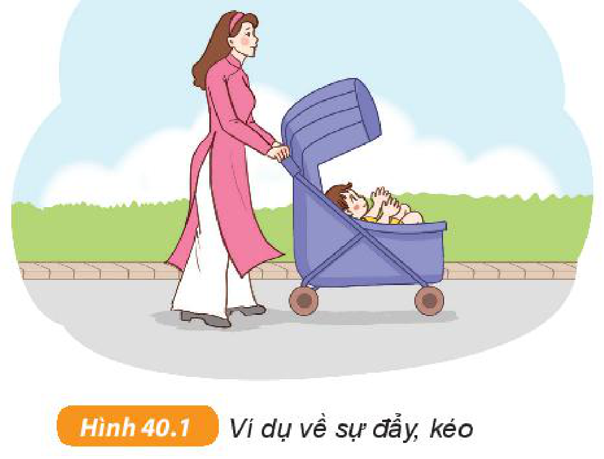
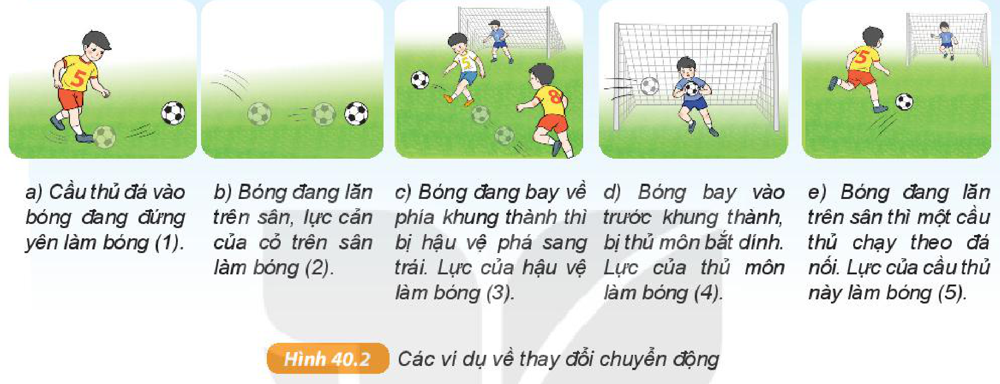
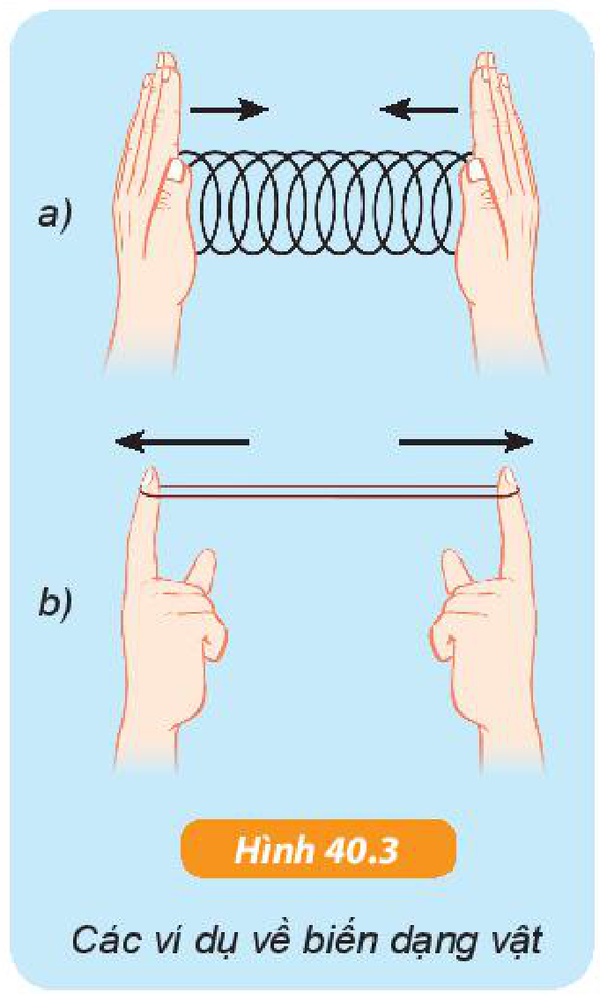
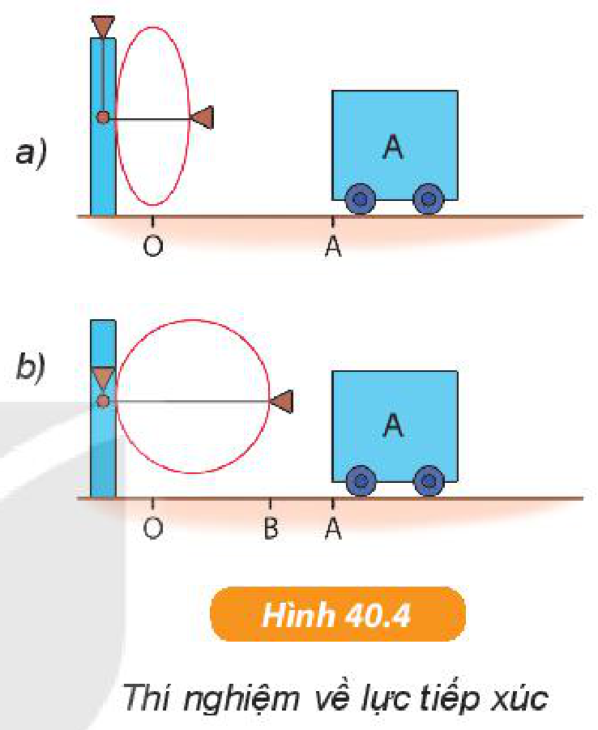
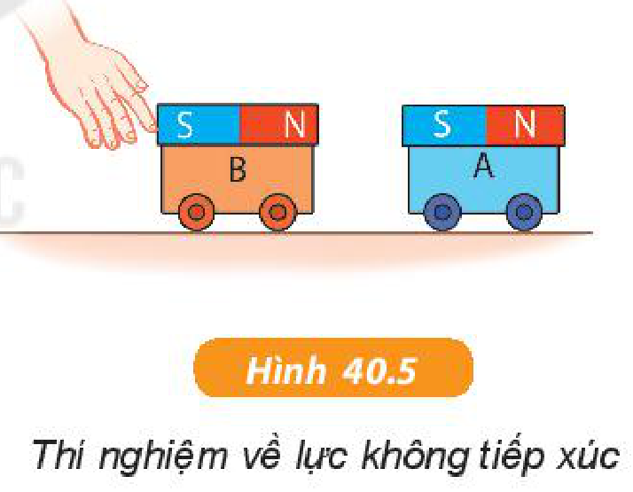

<!-- pdf:145 -->
<!-- CHƯƠNG VIII - LỰC TRONG ĐỜI SỐNG -->

# BÀI 40: LỰC LÀ GÌ?

## 🎯 Mục tiêu

- Lấy được ví dụ để chứng tỏ lực là sự đẩy hoặc sự kéo.
- Lấy được ví dụ về tác dụng của lực làm: thay đổi tốc độ, thay đổi hướng chuyển động, biến dạng vật.
- Nêu được: Lực tiếp xúc xuất hiện khi vật (hoặc đối tượng) gây ra lực có sự tiếp xúc với vật (hoặc đối tượng) chịu tác dụng của lực; lấy được ví dụ về lực tiếp xúc.
- Nêu được: Lực không tiếp xúc xuất hiện khi vật (hoặc đối tượng) gây ra lực không có sự tiếp xúc với vật (hoặc đối tượng) chịu tác dụng của lực; lấy được ví dụ về lực không tiếp xúc.

## 🔴 Mở đầu

> Tuy chưa được học về lực nhưng chắc em đã không ít lần nghe nói tới lực. Em có thể xác định được những lực nào trong các hình trên?

## I. Lực và sự đẩy, kéo

Trong Hình 40.1: Người mẹ **đẩy** xe làm xe bắt đầu chuyển động, chuyển động nhanh dần; người mẹ **kéo** nhẹ xe làm cho xe chuyển động chậm dần, rồi dừng lại.

Sự đẩy, kéo nêu trên được gọi là **lực**. Khi vật A đẩy hoặc kéo vật B ta nói vật A **tác dụng lực** lên vật B.

*Hình 40.1. Ví dụ về sự đẩy, kéo*

> ❓ Tìm ví dụ về lực trong đời sống.

<!-- pdf:146 -->

## II. Tác dụng của lực

### 1. Lực và chuyển động của vật

> 🖐️ Trong khi đá bóng người ta luôn phải tác dụng lực lên quả bóng, khi thì làm bóng *bắt đầu chuyển động*, khi thì làm bóng *chuyển động nhanh dần*, *chuyển động chậm dần*, *dừng lại*, *đổi hướng chuyển động*. Hãy thảo luận nhóm để xác định xem: mỗi hình ứng với tác dụng nào trong 5 tác dụng kể trên của lực và tìm cụm từ thích hợp cho các vị trí (1), (2), (3), (4), (5) mô tả trong Hình 40.2.
>
> - a) Cầu thủ đá vào bóng đang đứng yên làm bóng (1).
> - b) Bóng đang lăn trên sân, lực cản của cỏ trên sân làm bóng (2).
> - c) Bóng đang bay về phía khung thành thì bị hậu vệ phá sang trái. Lực của hậu vệ làm bóng (3).
> - d) Bóng bay vào trước khung thành, bị thủ môn bắt dính. Lực của thủ môn làm bóng (4).
> - e) Bóng đang lăn trên sân thì một cầu thủ chạy theo đá nối. Lực của cầu thủ này làm bóng (5).

*Hình 40.2. Các ví dụ về thay đổi chuyển động*

> ❓ Hãy tìm thêm ví dụ về lực làm thay đổi tốc độ, hướng chuyển động.

Các ví dụ trên cho thấy lực có tác dụng làm thay đổi tốc độ, hướng chuyển động của vật. Vậy lực còn có thể có tác dụng nào khác nữa không?

### 2. Lực và hình dạng của vật

> 🖐️ Nén một lò xo, kéo dãn dây cao su (Hình 40.3). Mô tả sự thay đổi hình dạng của lò xo, dây cao su khi chịu lực tác dụng.

*Hình 40.3. Các ví dụ về biến dạng vật*

> ❓ 1. Hãy tìm thêm ví dụ về lực làm thay đổi hình dạng của vật.
>
> 2. Theo em, lực tác dụng lên vật có thể vừa làm thay đổi chuyển động của vật, vừa làm biến dạng vật không? Nếu có, hãy cho ví dụ hoặc dùng các lực trong hình ở đầu bài để chứng minh.

<!-- pdf:147 -->

## III. Lực tiếp xúc và lực không tiếp xúc

Hằng ngày, chúng ta thường gặp những lực xuất hiện khi vật gây ra lực tiếp xúc với vật chịu tác dụng của lực (*lực tiếp xúc*). Nhưng vẫn có những lực xuất hiện *ngay cả khi* vật gây ra lực không tiếp xúc với vật chịu tác dụng của lực (*lực không tiếp xúc*).

> ❓ 1. Trong các lực ở hình đầu bài, lực nào là lực tiếp xúc, lực nào là lực không tiếp xúc?
>
> 2. Hãy tìm thêm ví dụ về lực tiếp xúc và lực không tiếp xúc.

> 🖐️
> - *Thí nghiệm 1 (Hình 40.4):*
>   - Chuẩn bị: giá gắn lò xo lá tròn có dây kéo, xe lăn.
>   - Bộ thí nghiệm như Hình 40.4.
>   - Dùng dây nén lò xo lá tròn rồi chốt lại. Khi xe đặt ở vị trí A (Hình 40.4a), nếu thả chốt thì lò xo bung ra (Hình 40.4b), nhưng không làm cho xe chuyển động được.
>   1. Tại sao lò xo không làm xe chuyển động được?
>   2. Phải đặt xe ở khoảng nào thì khi lò xo bung ra sẽ làm cho xe chuyển động? Tại sao?
>
> - *Thí nghiệm 2 (Hình 40.5):*
>   - Chuẩn bị: hai xe lăn có đặt nam châm.
>   - Bố trí thí nghiệm như Hình 40.5.
>   - Có phải chỉ khi đẩy xe B cho tới khi tiếp xúc với xe A thì xe B mới làm cho xe A bắt đầu chuyển động không? Tại sao?

*Hình 40.4. Thí nghiệm về lực tiếp xúc*

*Hình 40.5. Thí nghiệm về lực không tiếp xúc*

> ❓ Lực lò xo tác dụng lên xe A ở thí nghiệm 1 và lực xe B tác dụng lên xe A ở thí nghiệm 2 có gì khác nhau?

## 📌 Em đã học

<!-- term: Tác dụng của lực -->
- Tác dụng đẩy, kéo của vật này lên vật khác gọi là lực.
- Khi vật A đẩy hoặc kéo vật B ta nói vật A tác dụng lực lên vật B.
- Lực tác dụng lên vật có thể làm thay đổi tốc độ, hướng chuyển động, biến dạng vật.
- Lực được phân thành lực tiếp xúc và lực không tiếp xúc.

## ✏️ Em có thể

Nhận biết được tác dụng của lực ở một số tình huống thường gặp trong đời sống.

## 📷 Danh sách hình trong bài

| Mã hình | Trang PDF | Vị trí trong bài | Chú thích gốc |
| --- | :---: | --- | --- |
| H6-khoa_hoc_tu_nhien-b40-01 | 145 | Mở đầu | (sách không đánh số, bốn hình minh hoạ các lực a, b, c, d) |
| H6-khoa_hoc_tu_nhien-b40-02 | 145 | Mục I | Hình 40.1. Ví dụ về sự đẩy, kéo |
| H6-khoa_hoc_tu_nhien-b40-03 | 146 | Mục II.1 | Hình 40.2. Các ví dụ về thay đổi chuyển động |
| H6-khoa_hoc_tu_nhien-b40-04 | 146 | Mục II.2 | Hình 40.3. Các ví dụ về biến dạng vật |
| H6-khoa_hoc_tu_nhien-b40-05 | 147 | Mục III | Hình 40.4. Thí nghiệm về lực tiếp xúc |
| H6-khoa_hoc_tu_nhien-b40-06 | 147 | Mục III | Hình 40.5. Thí nghiệm về lực không tiếp xúc |
