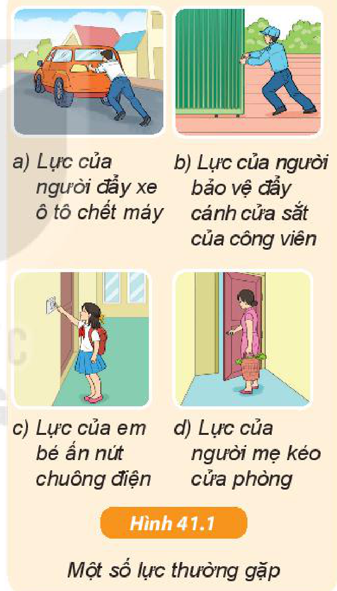
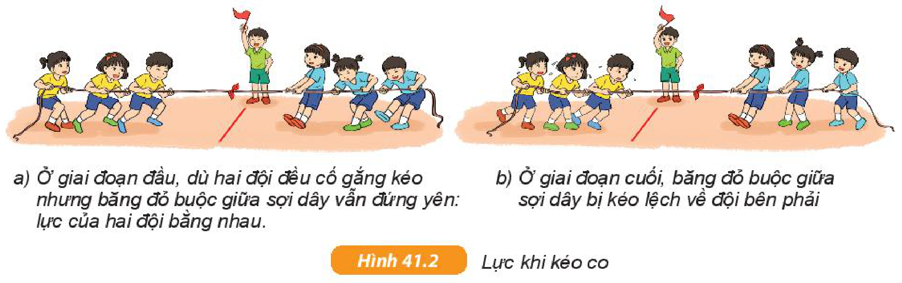
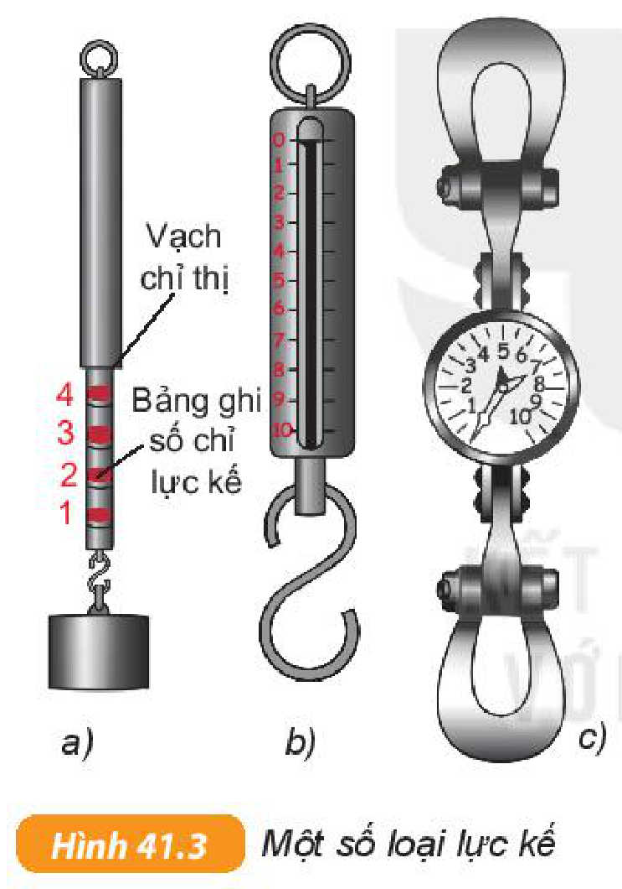
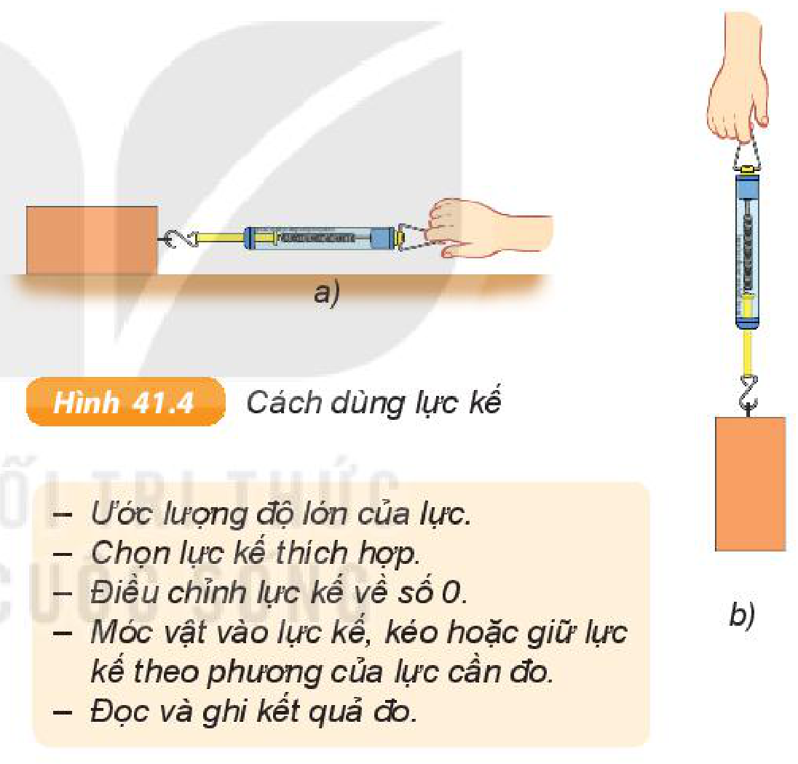
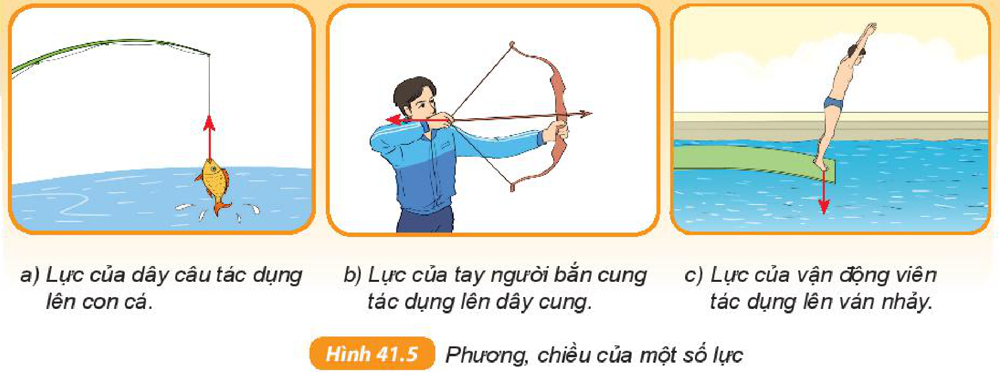
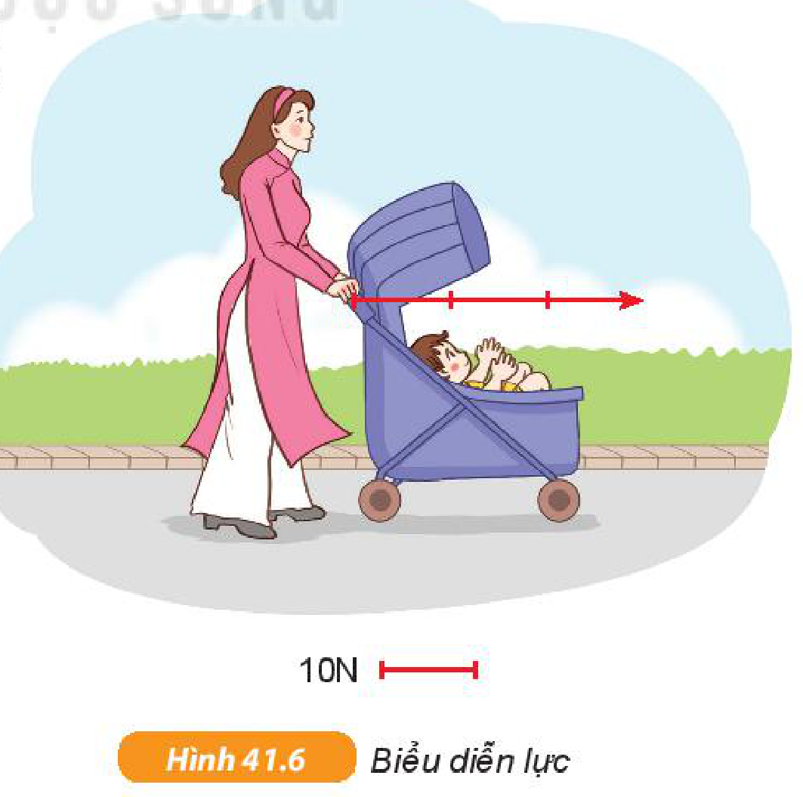
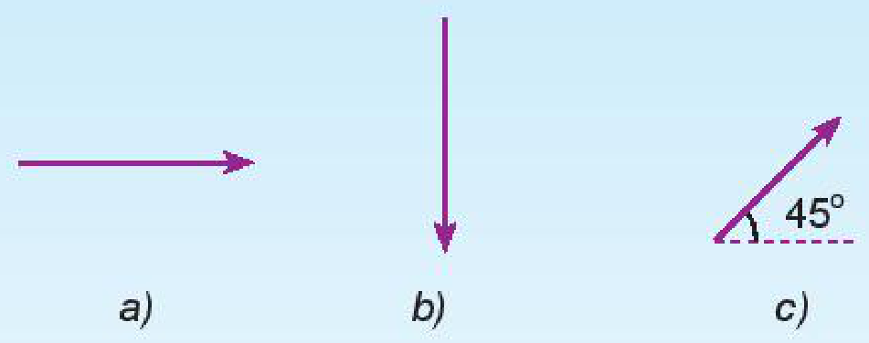
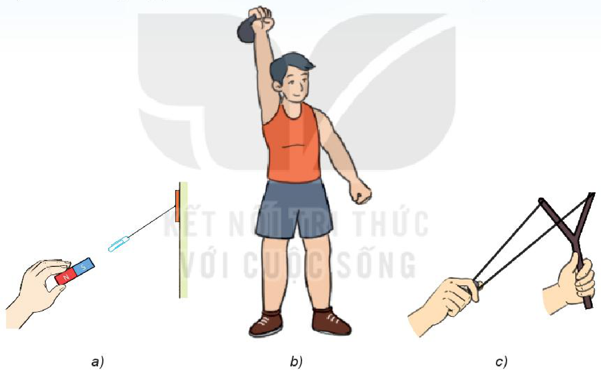

<!-- pdf:148 -->

# BÀI 41: BIỂU DIỄN LỰC

## 🎯 Mục tiêu

- Biểu diễn được một lực bằng một mũi tên có điểm đặt tại vật chịu lực tác dụng, có độ lớn và theo hướng của sự kéo hoặc đẩy.
- Đo được lực bằng lực kế lò xo, đơn vị là niutơn.

## 🔴 Mở đầu

> Khi đặt một hộp bút lên tay, ta dễ dàng cảm thấy có lực tác dụng. Tuy nhiên, ta lại không thể nhìn thấy lực. Vậy theo em, làm thế nào để biểu diễn (vẽ) lực?

## I. Các đặc trưng của lực

Ta không nhìn thấy lực nhưng lại có thể nhận biết được các đặc trưng của mỗi lực. Vậy mỗi lực có những đặc trưng cơ bản nào?

### 1. Độ lớn của lực

Đặc trưng đầu tiên dễ nhận thấy của lực là độ mạnh của nó. Độ mạnh của một lực được gọi là **độ lớn** của lực.

*Hình 41.1. Một số lực thường gặp: a) Lực của người đẩy xe ô tô chết máy; b) Lực của người bảo vệ đẩy cánh cửa sắt của công viên; c) Lực của em bé ấn nút chuông điện; d) Lực của người mẹ kéo cửa phòng*
<!-- ocr-ok: đã đối chiếu ảnh trang PDF 148, OCR bỏ sót nhãn cam Hình 41.1 và đọc đan 2 cột chú thích a–d -->

> ❓ 1. Theo em lực nào trong Hình 41.1 là mạnh nhất, yếu nhất? Hãy sắp xếp các lực này theo thứ tự độ lớn tăng dần.
>
> 2. Hãy so sánh độ lớn lực kéo của hai đội kéo co trong Hình 41.2a và 41.2b.
>
> 3. Hãy tìm hai lực trong đời sống có độ lớn khác nhau.

*Hình 41.2. Lực khi kéo co: a) Ở giai đoạn đầu, dù hai đội đều cố gắng kéo nhưng băng đỏ buộc giữa sợi dây vẫn đứng yên: lực của hai đội bằng nhau; b) Ở giai đoạn cuối, băng đỏ buộc giữa sợi dây bị kéo lệch về đội bên phải*

<!-- pdf:149 -->

### 2. Đơn vị lực và dụng cụ đo lực

<!-- term: Đơn vị lực -->
Trong Hệ đơn vị đo lường hợp pháp của nước ta, đơn vị lực là niutơn$^{(1)}$, kí hiệu là $\text{N}$.

<!-- term: Lực kế -->
Dụng cụ đo lực là lực kế.

Bảng 41.1. Độ lớn một số lực

| Tên lực | Độ lớn (N) |
| --- | --- |
| Lực của ngón tay tác dụng vào nút bấm bút bi | Khoảng $1\text{ N}$ |
| Lực của lực sĩ tác dụng lên tạ | Có thể lên tới $2\,400\text{ N}$ |
| Lực của động cơ xe tải | Có thể lên tới $10\,000\text{ N}$ |

*Hình 41.3. Một số loại lực kế*

*Hình 41.4. Cách dùng lực kế*

> - Ước lượng độ lớn của lực.
> - Chọn lực kế thích hợp.
> - Điều chỉnh lực kế về số 0.
> - Móc vật vào lực kế, kéo hoặc giữ lực kế theo phương của lực cần đo.
> - Đọc và ghi kết quả đo.

> 🖐️ Hãy dự đoán độ lớn lực dùng để kéo hộp bút của em lên khỏi mặt bàn và dùng lực kế kiểm tra.
<!-- ocr-ok: đã đối chiếu ảnh trang PDF 149, OCR nhận dạng sai dấu tiếng Việt (bứt/khởi/bản/đề) -->

### 3. Phương và chiều của lực

Hãy xét lực kéo của hai đội kéo co ở Hình 41.2a.

<!-- term: Phương và chiều của lực -->
- Trong suốt thời gian kéo co sợi dây luôn nằm ngang, chứng tỏ cả hai đội đều kéo theo phương nằm ngang. Ta nói lực kéo của hai đội đều có phương nằm ngang.
- Tuy hai đội đều kéo theo phương nằm ngang, nhưng đội vàng kéo về bên trái, đội xanh kéo về bên phải. Ta nói lực kéo của hai đội cùng phương nhưng chiều ngược nhau.

> $^{(1)}$ *Đơn vị lực được lấy theo tên nhà bác học người Anh Isaac Newton (1642 – 1727), người đầu tiên xây dựng hệ thống các định luật về tác dụng của lực lên chuyển động.*

<!-- pdf:150 -->

> ❓ Hãy mô tả bằng lời phương và chiều của các lực trong Hình 41.5.

*Hình 41.5. Phương, chiều của một số lực: a) Lực của dây câu tác dụng lên con cá; b) Lực của tay người bắn cung tác dụng lên dây cung; c) Lực của vận động viên tác dụng lên ván nhảy*

## II. Biểu diễn lực

<!-- term: Biểu diễn lực -->
Trong Vật lí, người ta dùng một mũi tên để biểu diễn các đặc trưng (điểm đặt, phương, chiều và độ lớn) của lực:
- Gốc của mũi tên có điểm đặt tại vật chịu lực tác dụng;
- Phương và chiều của mũi tên là phương và chiều của lực;
- Độ dài của mũi tên biểu diễn độ lớn của lực theo một tỉ xích.

Ví dụ, nếu người mẹ đẩy xe nôi với lực $30\text{ N}$ theo phương nằm ngang từ trái sang phải, thì lực đẩy của người mẹ sẽ được biểu diễn bằng một mũi tên có:
- Gốc nằm trên xe, tại vị trí tay đặt vào xe để đẩy;
- Phương nằm ngang, chiều từ trái sang phải;
- Nếu quy ước mỗi $\text{cm}$ độ dài của mũi tên tương ứng với $10\text{ N}$ (tỉ xích $1\text{ cm}$ ứng với $10\text{ N}$), thì mũi tên có độ dài là: $\dfrac{30}{10} = 3\text{ cm}$.

*Hình 41.6. Biểu diễn lực*
<!-- ocr-ok: đã đối chiếu ảnh trang PDF 150, OCR không đọc được chữ trắng Hình 41.6 trên nhãn cam -->

<!-- pdf:151 -->

> 🖐️ 1. Hãy nêu các đặc trưng của các lực vẽ trong mặt phẳng đứng dưới đây theo tỉ xích $1\text{ cm}$ ứng với $1\text{ N}$.

> 2. Hãy vẽ các mũi tên biểu diễn các lực ở hình dưới, biết:
>
> a) Lực của nam châm tác dụng lên kẹp giấy ($0,5\text{ N}$).
>
> b) Lực của lực sĩ tác dụng lên quả tạ ($50\text{ N}$).
>
> c) Lực của mỗi dây cao su tác dụng lên viên đạn đất (mỗi dây $6\text{ N}$).
>
> *(Với mỗi trường hợp phải nêu rõ tỉ xích đã chọn cho độ lớn của lực).*

## 📌 Em đã học

<!-- term: Đặc trưng của lực -->
- Mỗi lực đều có 4 đặc trưng cơ bản (còn gọi là 4 yếu tố của lực) là điểm đặt, phương, chiều và độ lớn.
- Mũi tên dùng để biểu diễn lực có gốc đặt tại vật chịu lực tác dụng, có phương và chiều trùng với phương và chiều tác dụng của lực, có độ dài tỉ lệ với độ lớn của lực.

## ✏️ Em có thể

Biểu diễn được lực bằng mũi tên.

## 📷 Danh sách hình trong bài

| Mã hình | Trang PDF | Vị trí trong bài | Chú thích gốc |
| --- | :---: | --- | --- |
| H6-khoa_hoc_tu_nhien-b41-01 | 148 | Mục I.1 | Hình 41.1. Một số lực thường gặp |
| H6-khoa_hoc_tu_nhien-b41-02 | 148 | Mục I.1 | Hình 41.2. Lực khi kéo co |
| H6-khoa_hoc_tu_nhien-b41-03 | 149 | Mục I.2 | Hình 41.3. Một số loại lực kế |
| H6-khoa_hoc_tu_nhien-b41-04 | 149 | Mục I.2 | Hình 41.4. Cách dùng lực kế |
| H6-khoa_hoc_tu_nhien-b41-05 | 150 | Mục I.3 | Hình 41.5. Phương, chiều của một số lực |
| H6-khoa_hoc_tu_nhien-b41-06 | 150 | Mục II | Hình 41.6. Biểu diễn lực |
| H6-khoa_hoc_tu_nhien-b41-07 | 151 | Mục II, HĐ 1 | (sách không đánh số, các mũi tên biểu diễn lực a, b, c trong mặt phẳng đứng, góc $45^\circ$ ở hình c) |
| H6-khoa_hoc_tu_nhien-b41-08 | 151 | Mục II, HĐ 2 | (sách không đánh số, ba trường hợp biểu diễn lực a, b, c) |
