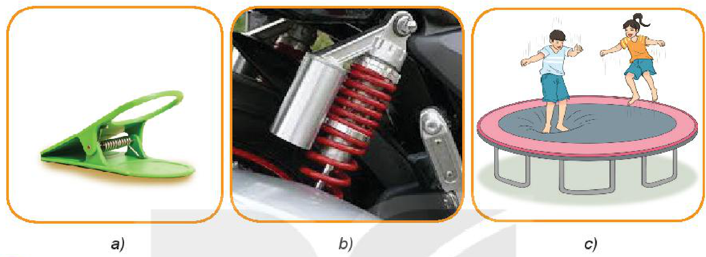
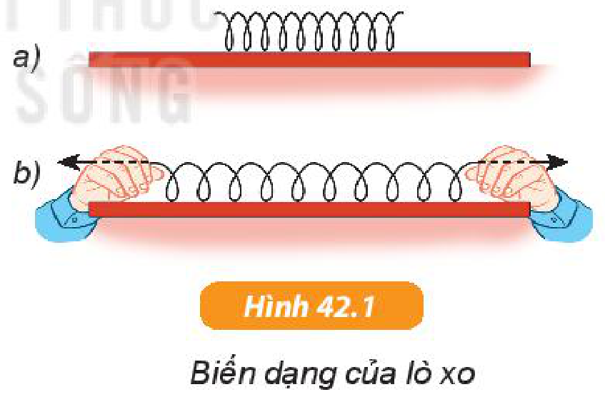
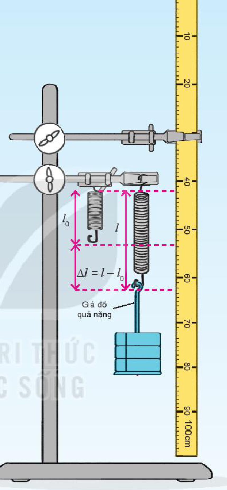
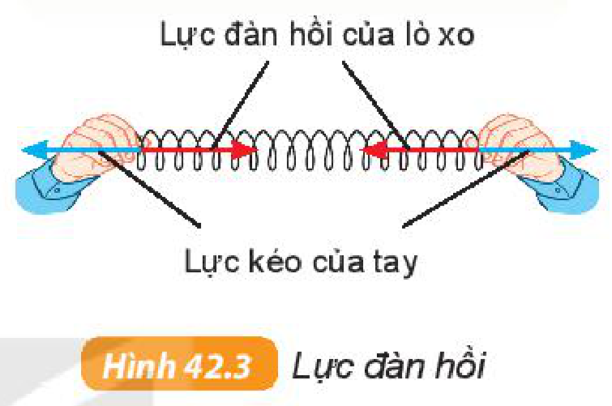

<!-- pdf:152 -->

# BÀI 42: BIẾN DẠNG CỦA LÒ XO

## 🎯 Mục tiêu

- Thực hiện thí nghiệm chứng minh được độ dãn của lò xo treo thẳng đứng tỉ lệ với khối lượng vật treo.

## 🔴 Mở đầu

> Các vật trong hình trên: a) kẹp quần áo; b) giảm xóc xe máy; c) bạt nhún, đều có cấu tạo và hoạt động dựa trên sự biến dạng của lò xo.
>
> Em có biết biến dạng này được sử dụng trong dụng cụ, thiết bị, máy móc nào khác không?

## I. Hiện tượng biến dạng của lò xo

<!-- term: Biến dạng của lò xo -->
Dùng tay kéo hai đầu của một lò xo xoắn (Hình 42.1a) thì lò xo dãn ra (Hình 42.1b). Khi tay thôi tác dụng lực thì lò xo tự co lại, trở về hình dạng ban đầu. Hiện tượng trên gọi là biến dạng của lò xo.

*Hình 42.1. Biến dạng của lò xo*

> ❓ Hãy tìm ra 4 vật trong số các vật sau đây có thể biến dạng giống như biến dạng của lò xo:
>
> | | |
> | --- | --- |
> | a) Quả bóng cao su | e) Hòn đá |
> | b) Cái bình sứ | g) Cây tre |
> | c) Dây cao su | h) Miếng kính |
> | d) Lưỡi cưa | i) Cái tẩy |

<!-- pdf:153 -->

## II. Đặc điểm biến dạng của lò xo

<!-- term: Độ dãn của lò xo -->
> 🖐️ Thí nghiệm mô tả ở Hình 42.2 giúp chúng ta khám phá đặc điểm dãn ra của lò xo khi bị biến dạng.
> - Dụng cụ: giá đỡ thí nghiệm, thước thẳng, lò xo xoắn, các quả nặng giống nhau, giá đỡ quả nặng.
> - Bố trí thí nghiệm như Hình 42.2.
> - Tiến hành thí nghiệm
>   - Treo lò xo thẳng đứng trên giá thí nghiệm.
>   - Đo độ dài ban đầu $l_0$ của lò xo
>   - Đo độ dài $l$ của lò xo khi treo vật nặng
>   - Xác định độ dãn của lò xo (còn gọi là độ biến dạng của lò xo): $\Delta l = l - l_0$
> - Tìm hiểu mối liên hệ giữa độ dãn $\Delta l$ của lò xo và khối lượng $m$ của vật nặng treo vào lò xo. Làm việc theo nhóm để:
>   - Dự đoán về mối liên hệ giữa $\Delta l$ và $m$. Cụ thể là nếu tăng $m$ lên $2, 3, 4,\dots$ lần thì $\Delta l$ thay đổi như thế nào.
>   - Kiểm tra dự đoán bằng thí nghiệm.
> - Rút ra kết luận.

*Hình 42.2. Thí nghiệm về mối liên hệ giữa độ dãn của lò xo và khối lượng của vật treo vào lò xo*

Mẫu ghi kết quả đo:

| Số quả nặng treo vào lò xo | Tổng khối lượng vật treo (g) | Chiều dài ban đầu của lò xo (mm) | Chiều dài của lò xo khi bị dãn (mm) | Độ dãn của lò xo (mm) |
| :---: | :---: | :---: | :---: | :---: |
| 1 | $m_1 = ?$ | $l_0 = ?$ | $l_1 = ?$ | $\Delta l_1 = l_1 - l_0 = ?$ |
| 2 | $m_2 = ?$ | $l_0 = ?$ | $l_2 = ?$ | $\Delta l_2 = l_2 - l_0 = ?$ |
| 3 | $m_3 = ?$ | $l_0 = ?$ | $l_3 = ?$ | $\Delta l_3 = l_3 - l_0 = ?$ |

<!-- pdf:154 -->

> 🖐️ 1. Một lò xo treo thẳng đứng có chiều dài ban đầu $l_0 = 25\text{ cm}$. Chiều dài $l$ của lò xo khi bị kéo dãn bởi các vật treo có khối lượng $m$ khác nhau được cho trong bảng dưới đây. Hãy cho biết các độ lớn cần ghi vào các ô có dấu (?).
>
> | $m\text{ (g)}$ | 10 | 20 | 30 | 40 | 50 | 60 |
> | :---: | :---: | :---: | :---: | :---: | :---: | :---: |
> | $l\text{ (cm)}$ | 25,5 | ? | 26,5 | 27 | ? | ? |
>
> 2. Hãy quan sát, mô tả cấu tạo (mặt trước và bên trong) của cân lò xo và giải thích tại sao cân này có thể dùng để xác định khối lượng của vật.

<!-- term: Lực đàn hồi của lò xo -->
> 🔭 *Em có biết?*
>
> Khi dùng tay kéo dãn một lò xo, ta thấy lò xo tác dụng lại tay ta một lực. Lực này gọi là lực đàn hồi của lò xo.
>
> Lực của tay tác dụng lên lò xo và lực đàn hồi của lò xo tác dụng lên tay là hai lực cùng phương, ngược chiều, cùng độ lớn (Hình 42.3).

*Hình 42.3. Lực đàn hồi*

> 🔭 *Em có biết?*
>
> - Lò xo thường được làm bằng thép, đồng thau do hai chất này đàn hồi tốt. Nhôm, chì,... đàn hồi kém nên không được dùng để làm lò xo.
> - Trên lực kế và cân lò xo người ta thường ghi giá trị lớn nhất mà các dụng cụ này có thể đo được. Nếu dùng các dụng cụ này để đo những giá trị lớn hơn GHĐ thì chúng có thể bị hỏng. Lí do là khi lò xo bị dãn quá nhiều thì nó không thể lấy lại được hình dạng ban đầu, nghĩa là đã mất tính đàn hồi.

## 📌 Em đã học

- Khi có lực tác dụng lên lò xo thì lò xo biến dạng. Khi lực thôi tác dụng thì lò xo tự trở về hình dạng ban đầu.
- Độ dãn của lò xo treo thẳng đứng tỉ lệ với khối lượng vật treo.

## ✏️ Em có thể

1. Làm việc theo nhóm để tự thiết kế và chế tạo một cái cân dùng để cân những vật có khối lượng nhỏ bằng các dụng cụ dễ kiếm như: dây cao su, lò xo, gỗ dán, kẹp giấy, dây thép,... và các quả cân mượn ở phòng thí nghiệm của nhà trường.

2. Làm cách nào để dùng cái cân này làm lực kế?

## 📷 Danh sách hình trong bài

| Mã hình | Trang PDF | Vị trí trong bài | Chú thích gốc |
| --- | :---: | --- | --- |
| H6-khoa_hoc_tu_nhien-b42-01 | 152 | Mở đầu | (sách không đánh số, a) kẹp quần áo; b) giảm xóc xe máy; c) bạt nhún) |
| H6-khoa_hoc_tu_nhien-b42-02 | 152 | Mục I | Hình 42.1. Biến dạng của lò xo |
| H6-khoa_hoc_tu_nhien-b42-03 | 153 | Mục II | Hình 42.2. Thí nghiệm về mối liên hệ giữa độ dãn của lò xo và khối lượng của vật treo vào lò xo |
| H6-khoa_hoc_tu_nhien-b42-04 | 154 | Mục II, Em có biết? | Hình 42.3. Lực đàn hồi |
