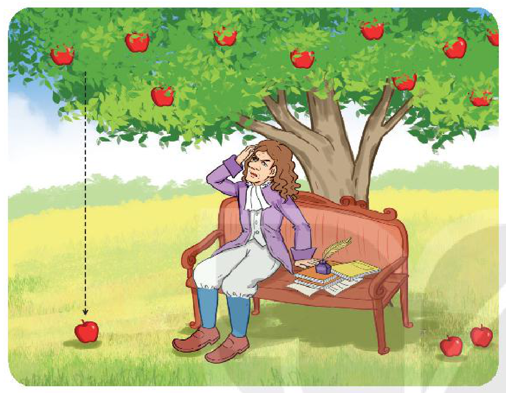
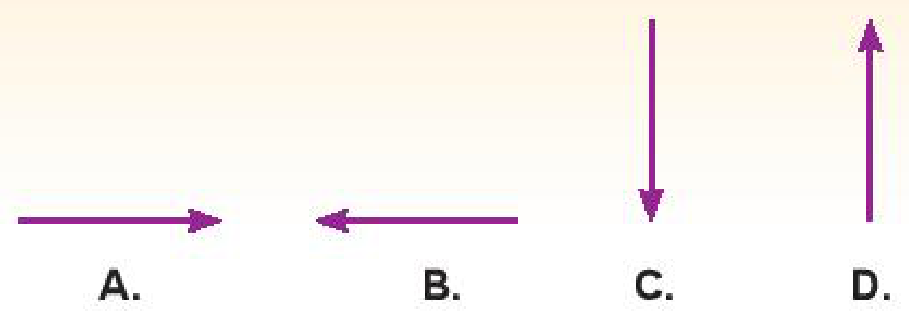
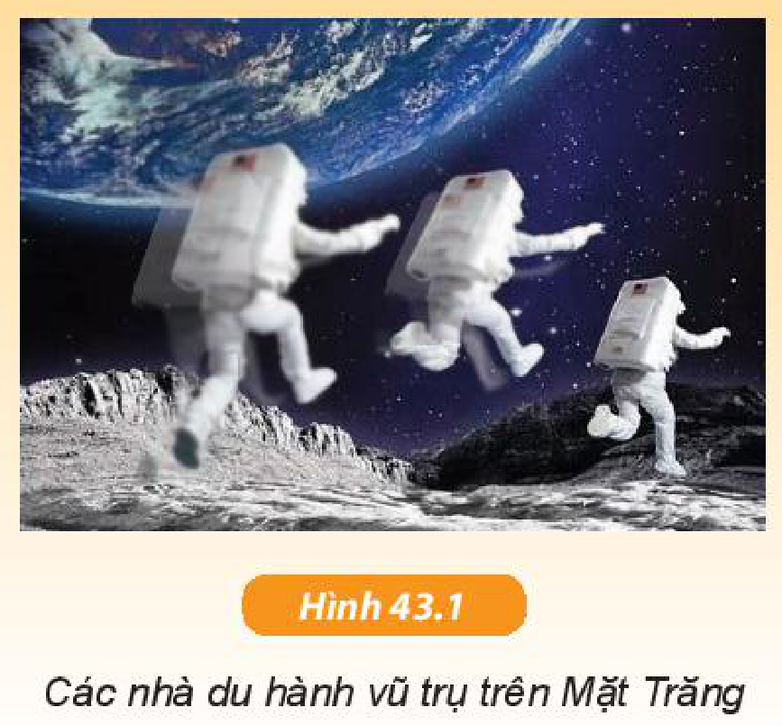

<!-- pdf:155 -->

# BÀI 43: TRỌNG LƯỢNG, LỰC HẤP DẪN

## 🎯 Mục tiêu

- Nêu được các khái niệm: khối lượng, lực hấp dẫn, trọng lượng của vật.

## 🔴 Mở đầu

> Theo truyền thuyết, vào một ngày đẹp trời của năm 1666, khi Niu-tơn đang ngồi suy nghĩ dưới bóng mát của một cây táo trong vườn, thì thấy một quả táo chín rơi. Theo em, hiện tượng này đã làm ông nảy sinh ý tưởng gì về lực?

## I. Lực hút của Trái Đất

<!-- term: Lực hút của Trái Đất -->
Khi thả một vật đang cầm trên tay thì vật đó rơi xuống do chịu tác dụng bởi lực hút của Trái Đất.

> ❓ 1. Tìm thêm ví dụ về lực hút của Trái Đất.
>
> 2. Lực nào sau đây là lực hút của Trái Đất?
> - Lực làm cho chiếc thuyền nổi trên mặt nước.
> - Lực kéo chiếc thuyền chìm xuống khi bị nước tràn vào.
> - Lực đẩy thuyền đi theo dòng nước.
>
> 3. Các lực vẽ trong một mặt phẳng đứng dưới đây, lực nào có thể là lực hút của Trái Đất? Vì sao?

<!-- pdf:156 -->

## II. Trọng lượng và lực hút của Trái Đất

Độ lớn lực hút của Trái Đất tác dụng lên một vật được gọi là **trọng lượng** của vật đó. Trọng lượng thường được kí hiệu bằng chữ $P$. Đơn vị đo trọng lượng là đơn vị đo lực.

> 🖐️ Hãy dự đoán trọng lượng của một số vật quanh em, rồi dùng lực kế kiểm tra.

## III. Trọng lượng và khối lượng

Trọng lượng và khối lượng của một vật tuy là hai đại lượng khác nhau, nhưng có liên quan mật thiết với nhau. Trọng lượng là độ lớn lực hút của Trái Đất tác dụng lên vật, còn khối lượng là số đo lượng chất của vật đó, khối lượng của vật càng lớn thì trọng lượng của vật càng lớn.

> ❓ Trong các nội dung sau đây, nội dung nào phù hợp với khối lượng, với lực hút của Trái Đất, trọng lượng?
>
> a) Có đơn vị đo là niutơn.
>
> b) Có đơn vị đo là kilôgam.
>
> c) Có phương và chiều.
>
> d) Đo bằng lực kế.
>
> e) Đo bằng cân.
>
> g) Không có phương và chiều.

## IV. Lực hấp dẫn

Không chỉ Trái Đất hút các vật mà mọi vật có khối lượng đều hút lẫn nhau. Lực hút này được gọi chung là **lực hấp dẫn**. Nhà bác học Niu-tơn phát hiện ra lực hấp dẫn chính là nhờ vào ý tưởng mà ông đã nảy sinh khi quan sát thấy quả táo rơi.

> ❓ Trái Đất hút quả táo thì quả táo có hút Trái Đất không? Nếu có thì lực này gọi là gì?

Độ lớn lực hấp dẫn phụ thuộc vào khối lượng của các vật. Ví dụ, cùng một vật đặt trên các thiên thể khác nhau sẽ chịu lực hấp dẫn khác nhau (có “trọng lượng”$^{(1)}$ khác nhau).

Bảng 43.1

| Vị trí đặt vật | Khối lượng vật | “Trọng lượng” vật |
| --- | :---: | :---: |
| Trái Đất | $1\text{ kg}$ | $9,8\text{ N}$ |
| Mặt Trăng | $1\text{ kg}$ | $1,7\text{ N}$ |
| Hoả tinh | $1\text{ kg}$ | $3,6\text{ N}$ |
<!-- ocr-ok: đã đối chiếu ảnh trang PDF 156, OCR bỏ sót dòng tiêu đề nền hồng của Bảng 43.1 -->

> $^{(1)}$ *Người ta thường dùng khái niệm “trọng lượng” của một vật ở trên một thiên thể nào đó để chỉ độ lớn lực hấp dẫn của thiên thể đó lên vật.*

<!-- pdf:157 -->

> ❓ Trang phục của các nhà du hành vũ trụ có khối lượng khoảng $50\text{ kg}$. Tại sao họ vẫn có thể di chuyển dễ dàng trên Mặt Trăng?

*Hình 43.1. Các nhà du hành vũ trụ trên Mặt Trăng*

<!-- term: Liên hệ giữa trọng lượng và khối lượng -->
> 🔭 *Em có biết?*
>
> - Quan sát đường rơi của các vật dưới tác dụng của lực hút của Trái Đất, có thể biết được phương và chiều của lực này. Lực hút của Trái Đất có phương thẳng đứng, chiều từ trên xuống dưới.
> - Liên hệ giữa trọng lượng và khối lượng của vật:
>   Hãy dùng lực kế đo trọng lượng của các quả cân khối lượng $100\text{ g}$, $200\text{ g}$, $500\text{ g}$ và ghi kết quả vào vở theo mẫu bảng sau:
>
> Bảng 43.2
>
> | Lần đo | Khối lượng ($m$) | Trọng lượng ($P$) |
> | :---: | :---: | :---: |
> | 1 | $100\text{ g}$ | ..?.. |
> | 2 | $200\text{ g}$ | ..?.. |
> | 3 | $500\text{ g}$ | ..?.. |
>
> Từ kết quả đo trên hãy phát biểu mối liên hệ giữa trọng lượng và khối lượng.
>
> Số đo trọng lượng $P$ (tính ra niutơn) gần bằng $10$ lần số đo khối lượng $m$ của nó (tính ra kilôgam).

## 📌 Em đã học

- Lực hút của các vật có khối lượng gọi là lực hấp dẫn.
- Trọng lượng của vật là độ lớn lực hút của Trái Đất tác dụng lên vật.
- Khối lượng của vật là số đo lượng chất của vật.

## ✏️ Em có thể

Dùng khái niệm lực hấp dẫn, trọng lượng, khối lượng để giải thích một số hiện tượng có liên quan thường gặp trong đời sống.

## 📷 Danh sách hình trong bài

| Mã hình | Trang PDF | Vị trí trong bài | Chú thích gốc |
| --- | :---: | --- | --- |
| H6-khoa_hoc_tu_nhien-b43-01 | 155 | Mở đầu | (sách không đánh số, minh hoạ Niu-tơn ngồi dưới gốc cây táo thấy quả táo chín rơi) |
| H6-khoa_hoc_tu_nhien-b43-02 | 155 | Mục I, Câu hỏi 3 | (sách không đánh số, bốn mũi tên biểu diễn lực A, B, C, D trong mặt phẳng đứng) |
| H6-khoa_hoc_tu_nhien-b43-03 | 157 | Mục IV | Hình 43.1. Các nhà du hành vũ trụ trên Mặt Trăng |
