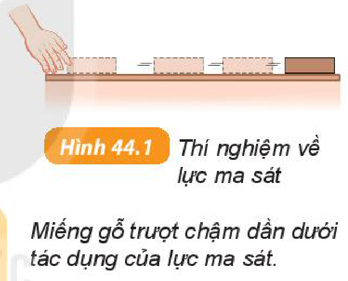
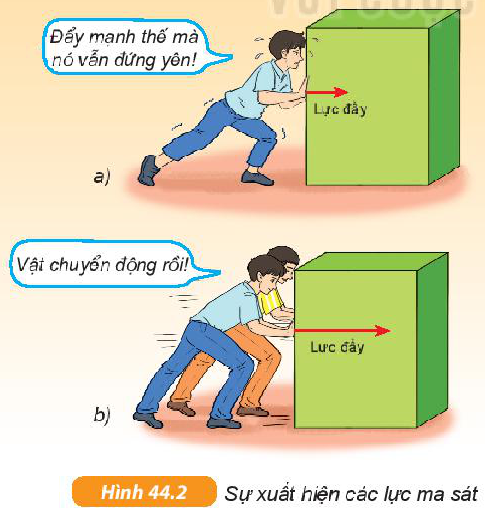
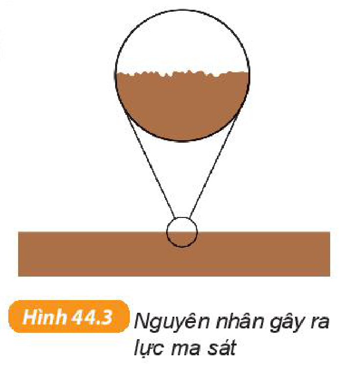
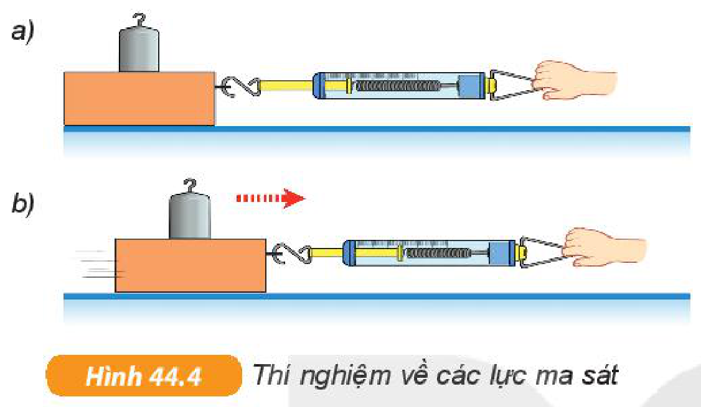
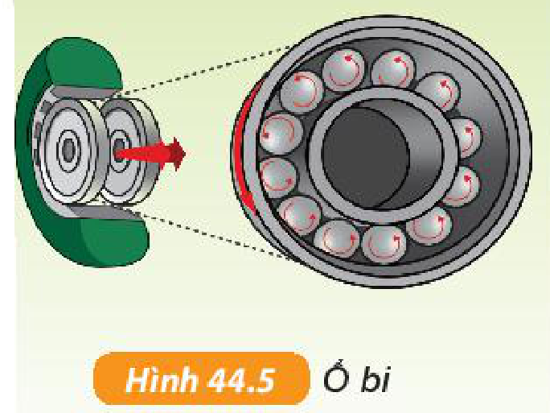
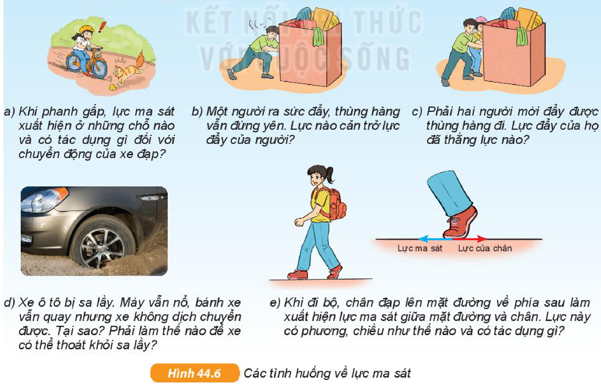
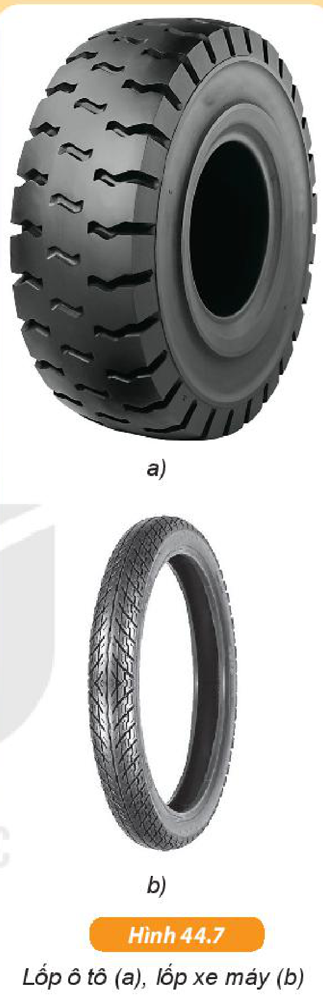
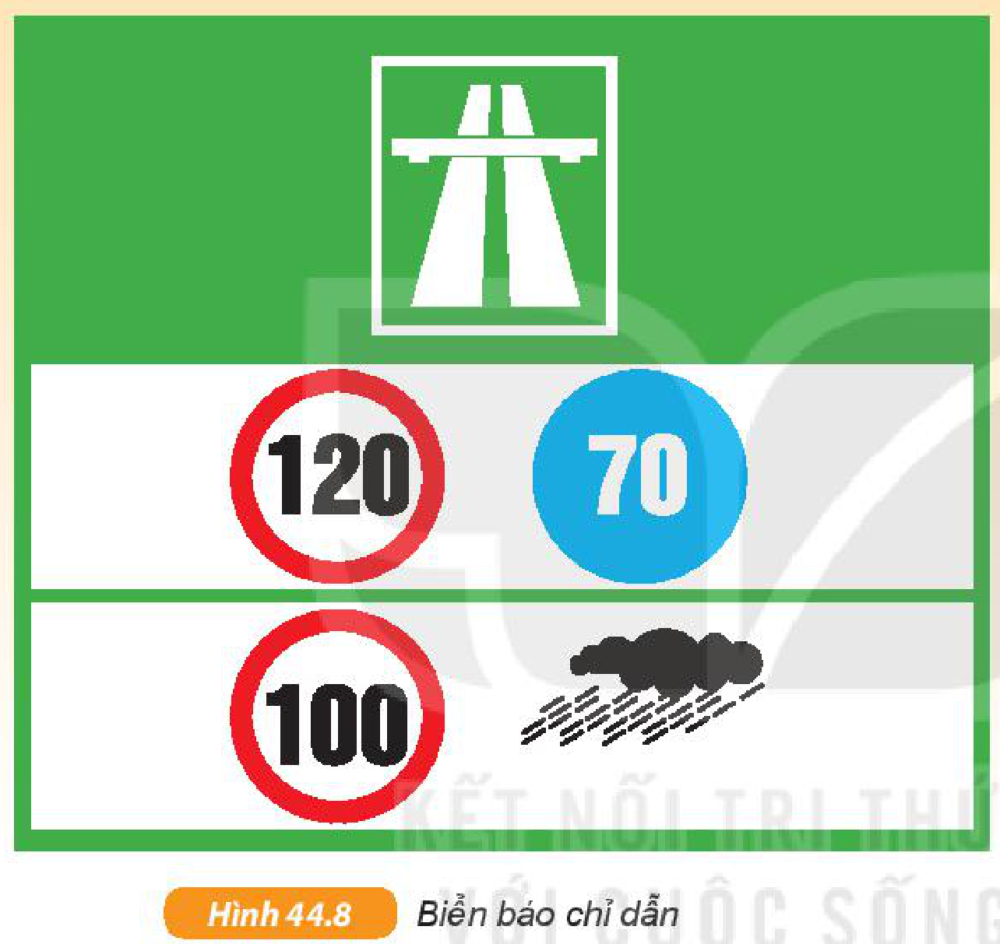

<!-- pdf:158 -->

# BÀI 44: LỰC MA SÁT

## 🎯 Mục tiêu

- Nêu được: Lực ma sát là lực tiếp xúc xuất hiện ở bề mặt tiếp xúc giữa hai vật; khái niệm về lực ma sát trượt; khái niệm về lực ma sát nghỉ.
- Sử dụng tranh, ảnh (hình vẽ, học liệu điện tử) để nêu được: Sự tương tác giữa bề mặt của hai vật tạo ra lực ma sát giữa chúng.
- Nêu được tác dụng cản trở và tác dụng thúc đẩy chuyển động của lực ma sát.
- Lấy được ví dụ về một số ảnh hưởng của lực ma sát trong an toàn giao thông đường bộ.

## 🔴 Mở đầu

> Khi đi trên sàn nhà trơn ướt, ta có thể bị trượt ngã. Em có thể giải thích tại sao không?

## I. Lực ma sát là gì?

Dùng tay búng nhẹ vào miếng gỗ đặt trên mặt bàn. Miếng gỗ trượt trên mặt bàn chậm dần rồi dừng lại (Hình 44.1).

Lực do mặt bàn tác dụng lên bề mặt miếng gỗ tiếp xúc với mặt bàn làm miếng gỗ thay đổi chuyển động. Lực này được gọi là **lực ma sát**.

*Hình 44.1. Thí nghiệm về lực ma sát — Miếng gỗ trượt chậm dần dưới tác dụng của lực ma sát.*

> ❓ 1. Lực ma sát là lực tiếp xúc hay lực không tiếp xúc?
>
> 2. Theo em, lực ma sát phải có phương và chiều như thế nào so với phương và chiều của lực đẩy?

*Hình 44.2. Sự xuất hiện các lực ma sát*
<!-- ocr-ok: đã đối chiếu ảnh trang PDF 158, OCR bỏ sót nhãn cam Hình 44.2 -->

*Hình 44.3. Nguyên nhân gây ra lực ma sát*

<!-- term: Nguyên nhân gây ra lực ma sát -->
*Bề mặt miếng gỗ và mặt bàn nhìn có vẻ rất nhẵn. Tuy nhiên, khi phóng đại lên sẽ thấy chúng rất gồ ghề. Đó là nguyên nhân chính gây ra lực ma sát khi hai mặt tiếp xúc nhau.*

<!-- pdf:159 -->

## II. Lực ma sát nghỉ và lực ma sát trượt

Hai loại lực ma sát thường gặp là lực ma sát nghỉ và lực ma sát trượt.

1. Lực ma sát nghỉ là lực giữ cho vật đứng yên ngay cả khi nó bị kéo hoặc đẩy (Hình 44.4a).

2. Lực ma sát trượt là lực xuất hiện khi vật trượt trên bề mặt của vật khác (Hình 44.4b).

*Hình 44.4. Thí nghiệm về các lực ma sát*

> 🔭 *Em có biết?*
>
> Ổ bi lắp ở trục quay (Hình 44.5) có tác dụng gì?

*Hình 44.5. Ổ bi*
<!-- ocr-ok: đã đối chiếu ảnh trang PDF 159, OCR bỏ sót nhãn cam Hình 44.5 và chú thích Ổ bi -->

> ❓ Mỗi em hãy tìm một ví dụ cho mỗi loại lực ma sát.
<!-- ocr-ok: đã đối chiếu ảnh trang PDF 159, OCR nhận dạng sai dấu (Mối/vi dụ) trên nền vàng cam -->

## III. Tác dụng của lực ma sát đối với chuyển động

> 🖐️ Hãy chỉ ra lực ma sát trong các tình huống sau đây và nói rõ nó có tác dụng cản trở hay thúc đẩy chuyển động.
> - a) Khi phanh gấp, lực ma sát xuất hiện ở những chỗ nào và có tác dụng gì đối với chuyển động của xe đạp?
> - b) Một người ra sức đẩy, thùng hàng vẫn đứng yên. Lực nào cản trở lực đẩy của người?
> - c) Phải hai người mới đẩy được thùng hàng đi. Lực đẩy của họ đã thắng lực nào?
> - d) Xe ô tô bị sa lầy. Máy vẫn nổ, bánh xe vẫn quay nhưng xe không dịch chuyển được. Tại sao? Phải làm thế nào để xe có thể thoát khỏi sa lầy?
> - e) Khi đi bộ, chân đạp lên mặt đường về phía sau làm xuất hiện lực ma sát giữa mặt đường và chân. Lực này có phương, chiều như thế nào và có tác dụng gì?

*Hình 44.6. Các tình huống về lực ma sát*

<!-- pdf:160 -->

## IV. Ma sát trong an toàn giao thông

> ❓ 1. Tại sao trên mặt lốp xe lại có các khía rãnh (Hình 44.7)? Đi xe mà lốp có các khía rãnh đã bị mòn thì có an toàn không? Tại sao?
>
> 2. Tại sao khi phanh gấp, lốp xe ô tô để lại một vệt đen dài trên đường nhựa?
>
> 3. Hãy giải thích ý nghĩa của biển báo chỉ dẫn tốc độ giới hạn chạy trên đường cao tốc mô tả trong Hình 44.8.

*Hình 44.7. Lốp ô tô (a), lốp xe máy (b)*

*Hình 44.8. Biển báo chỉ dẫn*

## 📌 Em đã học

- Lực ma sát là lực tiếp xúc xuất hiện ở bề mặt tiếp xúc giữa hai vật.
- Lực ma sát có tác dụng cản trở hoặc thúc đẩy chuyển động.
- Hai loại lực ma sát thường gặp là lực ma sát nghỉ và lực ma sát trượt.
- Một số ví dụ về lực ma sát trong đời sống.

## ✏️ Em có thể

1. Thảo luận về sự lợi, hại của việc dùng ô tô bánh lốp cao su chạy trên đường nhựa và tàu hoả bánh sắt chạy trên đường sắt. Tập trung vào khía cạnh an toàn giao thông.

2. Hãy thử tưởng tượng xem cuộc sống của chúng ta sẽ như thế nào nếu không có lực ma sát?

## 📷 Danh sách hình trong bài

| Mã hình | Trang PDF | Vị trí trong bài | Chú thích gốc |
| --- | :---: | --- | --- |
| H6-khoa_hoc_tu_nhien-b44-01 | 158 | Mục I | Hình 44.1. Thí nghiệm về lực ma sát |
| H6-khoa_hoc_tu_nhien-b44-02 | 158 | Mục I | Hình 44.2. Sự xuất hiện các lực ma sát |
| H6-khoa_hoc_tu_nhien-b44-03 | 158 | Mục I | Hình 44.3. Nguyên nhân gây ra lực ma sát |
| H6-khoa_hoc_tu_nhien-b44-04 | 159 | Mục II | Hình 44.4. Thí nghiệm về các lực ma sát |
| H6-khoa_hoc_tu_nhien-b44-05 | 159 | Mục II, Em có biết? | Hình 44.5. Ổ bi |
| H6-khoa_hoc_tu_nhien-b44-06 | 159 | Mục III | Hình 44.6. Các tình huống về lực ma sát |
| H6-khoa_hoc_tu_nhien-b44-07 | 160 | Mục IV | Hình 44.7. Lốp ô tô (a), lốp xe máy (b) |
| H6-khoa_hoc_tu_nhien-b44-08 | 160 | Mục IV | Hình 44.8. Biển báo chỉ dẫn |
