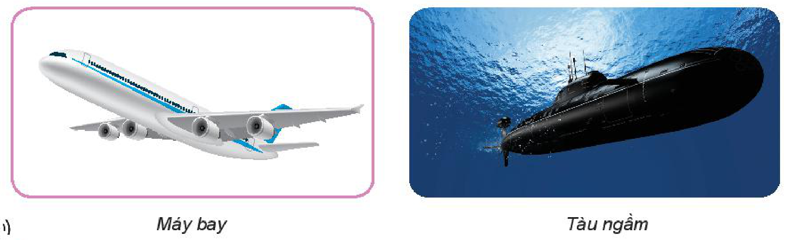
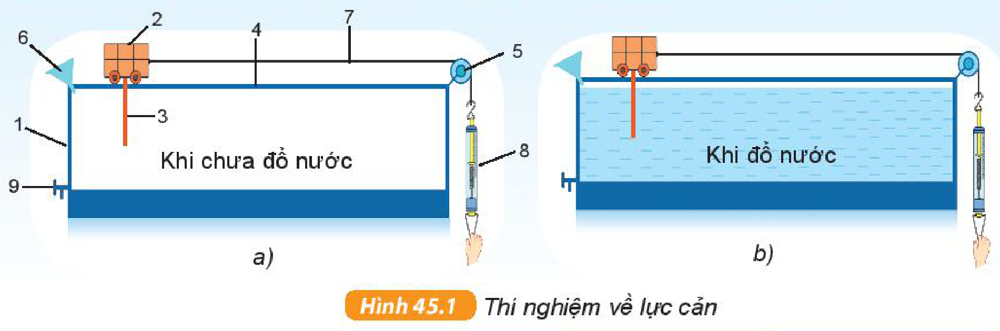
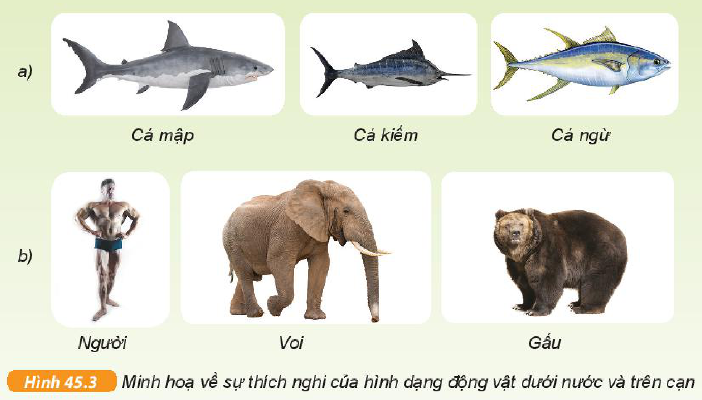

<!-- pdf:161 -->

# BÀI 45: LỰC CẢN CỦA NƯỚC

## 🎯 Mục tiêu

- Thực hiện được thí nghiệm chứng tỏ vật chịu tác dụng của lực cản khi chuyển động trong nước.

## 🔴 Mở đầu

> Trong hai phương tiện ở trên thì tàu ngầm có tốc độ nhỏ hơn nhiều. Theo em, những yếu tố nào có thể gây ra sự chênh lệch tốc độ này?

## I. Thí nghiệm về lực cản của nước

> 🖐️ *Dụng cụ thí nghiệm*: 1 hộp thuỷ tinh hoặc nhựa cứng, trong suốt hình hộp chữ nhật (1); 1 xe lăn (2); 1 tấm cản hình chữ nhật (3); 1 đường ray cho xe lăn chạy, có xẻ rãnh ở giữa để lắp tấm cản (4); 1 ròng rọc cố định (5); 1 phễu rót nước (6); 1 đoạn dây mảnh (7); 1 lực kế lò xo có GHĐ $5\text{ N}$ (8); 1 van xả nước (9) (Hình 45.1).
>
> *Tiến hành thí nghiệm:*
>
> *Bước 1*: Lắp dụng cụ thí nghiệm như Hình 45.1a, kéo từ từ lực kế theo phương thẳng đứng để xe lăn chuyển động ổn định (khi đó lực kế chỉ một giá trị nhất định), đọc và ghi số chỉ của lực kế.
>
> *Bước 2*: Cho nước vào hộp lặp lại thí nghiệm như bước 1 (Hình 45.1b).

*Hình 45.1. Thí nghiệm về lực cản*

> ❓ 1. Tại sao khi có nước trong hộp thì số chỉ của lực kế lớn hơn khi chưa có nước trong hộp?
>
> 2. Tìm thêm ví dụ về lực cản vật chuyển động trong nước.

<!-- pdf:162 -->

## II. Lực cản của nước phụ thuộc yếu tố nào?

Lực cản của nước phụ thuộc vào nhiều yếu tố, ví dụ: Độ lớn lực cản của nước càng mạnh khi diện tích mặt cản càng lớn.

> 🖐️ Hãy nghĩ cách dùng hai tấm cản có kích thước khác nhau để làm thí nghiệm chứng tỏ đặc điểm trên của lực cản của nước.

<!-- term: Hình khí động học -->
> 🔭 *Em có biết?*
> - Không chỉ nước mà cả không khí cũng tác dụng lực cản lên vật chuyển động trong nó. Độ lớn của lực cản của không khí cũng càng mạnh khi diện tích mặt cản càng lớn.
> - Các vận động viên đua xe đạp luôn đội một loại mũ có hình dạng đặc biệt (hình khí động học), và khi muốn tăng tốc độ phải cúi gập người xuống (Hình 45.2).
> - Các động vật sống dưới nước đều có hình dạng gần với hình khí động học vì lực cản của nước rất lớn (Hình 45.3a). Các động vật sống trên mặt đất không cần có dạng khí động học vì lực cản của không khí không lớn (Hình 45.3b).

*Hình 45.2. Lực cản của không khí*

*Hình 45.3. Minh hoạ về sự thích nghi của hình dạng động vật dưới nước và trên cạn*

## 📌 Em đã học

- Các vật chuyển động trong nước chịu tác dụng của lực cản.

## ✏️ Em có thể

Dùng khái niệm lực cản của nước để giải thích một số hiện tượng có liên quan trong đời sống.

## 📷 Danh sách hình trong bài

| Mã hình | Trang PDF | Vị trí trong bài | Chú thích gốc |
| --- | :---: | --- | --- |
| H6-khoa_hoc_tu_nhien-b45-01 | 161 | Mở đầu | (sách không đánh số, hình Máy bay và Tàu ngầm) |
| H6-khoa_hoc_tu_nhien-b45-02 | 161 | Mục I | Hình 45.1. Thí nghiệm về lực cản |
| H6-khoa_hoc_tu_nhien-b45-03 | 162 | Mục II, Em có biết? | Hình 45.2. Lực cản của không khí |
| H6-khoa_hoc_tu_nhien-b45-04 | 162 | Mục II, Em có biết? | Hình 45.3. Minh hoạ về sự thích nghi của hình dạng động vật dưới nước và trên cạn |
