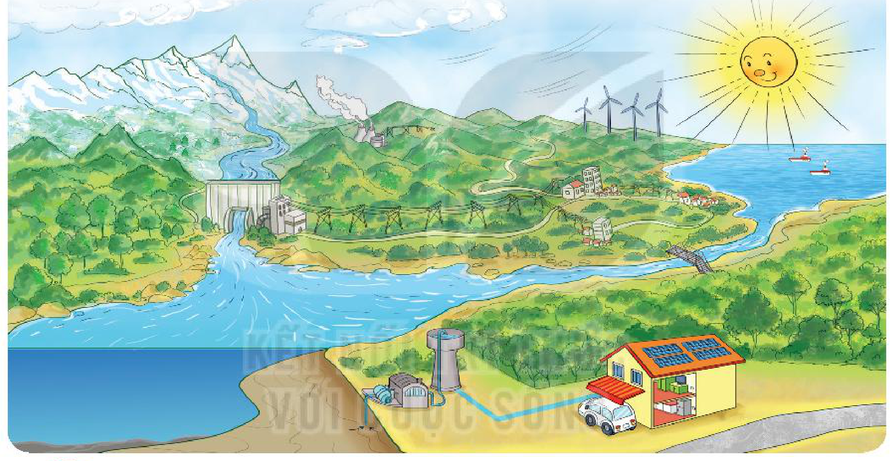
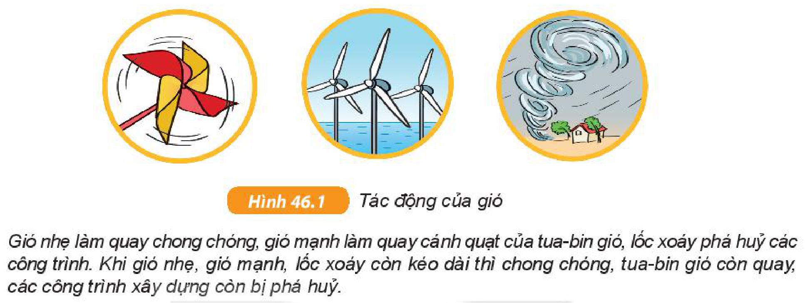
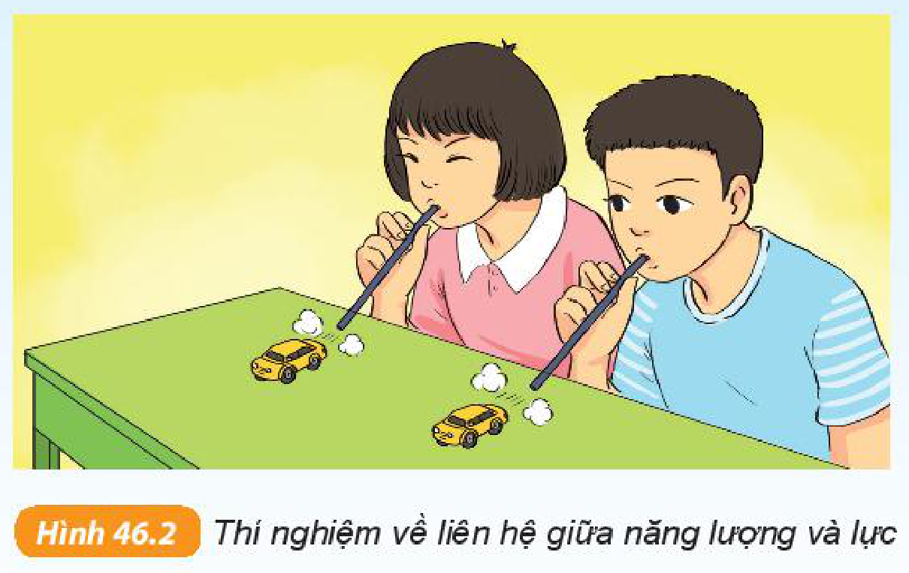

<!-- pdf:163 -->
<!-- CHƯƠNG IX - NĂNG LƯỢNG -->

# BÀI 46: NĂNG LƯỢNG VÀ SỰ TRUYỀN NĂNG LƯỢNG

## 🎯 Mục tiêu

- Từ tranh ảnh (hình vẽ, học liệu điện tử), hiện tượng trong khoa học hoặc thực tế, lấy được ví dụ để chứng tỏ năng lượng đặc trưng cho khả năng tác dụng lực.
- Nêu được: Vật liệu giải phóng năng lượng, tạo ra nhiệt và ánh sáng khi bị đốt cháy gọi là nhiên liệu.
- Nêu được sự truyền năng lượng trong một số trường hợp đơn giản trong thực tiễn.

## 🔴 Mở đầu

> Trong hình trên có những dạng năng lượng nào mà em đã biết?

## I. Năng lượng

<!-- term: Năng lượng -->
Chúng ta không nhìn thấy năng lượng nhưng có thể cảm nhận được tác dụng của nó.
- Mọi hoạt động hằng ngày của chúng ta đều cần đến năng lượng. Năng lượng này được lấy từ năng lượng dự trữ trong thức ăn.
- Khi lắp pin vào đèn pin và bật công tắc thì bóng đèn pin phát ra ánh sáng. Ánh sáng được tạo ra là nhờ có năng lượng dự trữ trong pin.
- Cây cối lớn lên, ra hoa, kết trái được là nhờ hấp thụ năng lượng của ánh sáng mặt trời.

> ❓ Nếu không có năng lượng của thức ăn, của pin, năng lượng của ánh sáng mặt trời thì những hiện tượng nêu trên có thể diễn ra được không?
>
> *Mọi hiện tượng trong tự nhiên đều cần năng lượng.*

<!-- pdf:164 -->

## II. Năng lượng và tác dụng lực

> ❓ Quan sát và đọc phần mô tả trong Hình 46.1, rồi thảo luận nhóm để làm sáng tỏ hai ý:
> - Khi năng lượng càng nhiều thì lực tác dụng có thể càng mạnh.
> - Khi năng lượng càng nhiều thì thời gian tác dụng của lực có thể càng dài.

*Hình 46.1. Tác động của gió — Gió nhẹ làm quay chong chóng, gió mạnh làm quay cánh quạt của tua-bin gió, lốc xoáy phá huỷ các công trình. Khi gió nhẹ, gió mạnh, lốc xoáy còn kéo dài thì chong chóng, tua-bin gió còn quay, các công trình xây dựng còn bị phá huỷ.*

> 🖐️ 1. Thổi xe đồ chơi
>
> Chuẩn bị: vài chiếc xe đồ chơi giống nhau và một số ống hút.
>
> Tiến hành: thổi hơi qua ống hút để tạo ra lực đẩy đủ mạnh làm cho xe đồ chơi chuyển động (Hình 46.2).
>
> Thảo luận:
>
> a) Muốn cho xe chuyển động nhanh hơn và xa hơn thì phải làm thế nào?
>
> b) Từ thí nghiệm trên hãy rút ra mối quan hệ giữa năng lượng truyền cho vật với độ lớn lực tác dụng và thời gian lực tác dụng lên vật.

*Hình 46.2. Thí nghiệm về liên hệ giữa năng lượng và lực*

> 2. Hãy tìm thêm ví dụ về mối liên hệ giữa năng lượng và tác dụng lực.

> 🔭 *Em có biết?*
> **Đơn vị năng lượng**
> Đơn vị năng lượng là jun, kí hiệu là $\text{J}$ (lấy theo tên của nhà bác học người Anh James Prescott Joule, 1818 – 1889).
> - $1\text{ J}$ là năng lượng cần để nâng một vật nặng $1\text{ N}$ lên độ cao $1\text{ m}$.
> - $1\text{ kJ} = 1\,000\text{ J}$.
> - $1\text{ cal}$ (calo) $\approx 4,2\text{ J}$.
<!-- ocr-ok: đã đối chiếu ảnh trang PDF 164, OCR đọc dính chữ trong hộp Em có biết? và các công thức đơn vị J, kJ, cal -->

<!-- pdf:165 -->

> ❓ Hoàn thành các câu sau đây bằng cách ghi vào vở (hay phiếu học tập) các từ thích hợp trong khung, được đánh số thứ tự từ (1) đến (7). Ví dụ: (1) – ánh sáng.
> - Khung từ gợi ý: ánh sáng; năng lượng; nhiệt; phát triển; sống.
> - a) Năng lượng ____(1)____ của Mặt Trời chiếu xuống Trái Đất được các loài thực vật hấp thụ để ____(2)____ và ____(3)____.
> - b) ____(4)____ dự trữ trong pin của điện thoại di động giúp điện thoại ghi và phát ra âm thanh, hình ảnh. ____(5)____ lưu trữ trong xăng, dầu cần cho hoạt động của xe máy, ô tô, máy bay, tàu thuỷ và các phương tiện giao thông khác.
> - c) Xăng, dầu và các chất đốt (than, gỗ, rác thải,...) được gọi là nhiên liệu. Chúng giải phóng ____(6)____ , tạo ra nhiệt và ____(7)____ khi bị đốt cháy.

## III. Sự truyền năng lượng

<!-- term: Sự truyền năng lượng -->
Năng lượng có thể truyền đi từ vật này sang vật khác, từ nơi này đến nơi khác bằng nhiều cách.
Ví dụ:
1. Qua tác dụng lực: như gió truyền năng lượng cho cánh quạt (Hình 46.1).
2. Qua truyền nhiệt: năng lượng từ bếp truyền cho ấm nước làm cho nhiệt độ của ấm nước tăng lên.

> ❓ Hãy tìm thêm ví dụ về sự truyền năng lượng trong thực tiễn.

## 📌 Em đã học

<!-- term: Năng lượng -->
- Mọi biến đổi trong tự nhiên đều cần năng lượng.
- Năng lượng có thể truyền từ vật này sang vật khác thông qua tác dụng lực, truyền nhiệt.

## ✏️ Em có thể

1. Trình bày được việc sử dụng năng lượng trong hoạt động hằng ngày của em.

2. Nhận biết được sự truyền năng lượng trong một số tình huống đơn giản thường gặp.

## 📷 Danh sách hình trong bài

| Mã hình | Trang PDF | Vị trí trong bài | Chú thích gốc |
| --- | :---: | --- | --- |
| H6-khoa_hoc_tu_nhien-b46-01 | 163 | Mở đầu | (sách không đánh số, tranh các dạng năng lượng trong tự nhiên và đời sống) |
| H6-khoa_hoc_tu_nhien-b46-02 | 164 | Mục II | Hình 46.1. Tác động của gió |
| H6-khoa_hoc_tu_nhien-b46-03 | 164 | Mục II | Hình 46.2. Thí nghiệm về liên hệ giữa năng lượng và lực |
