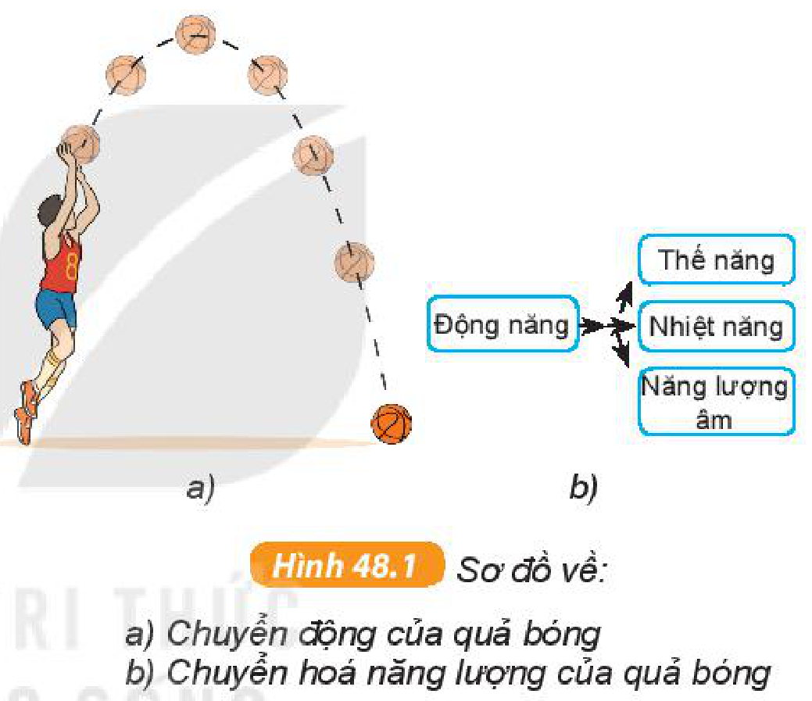
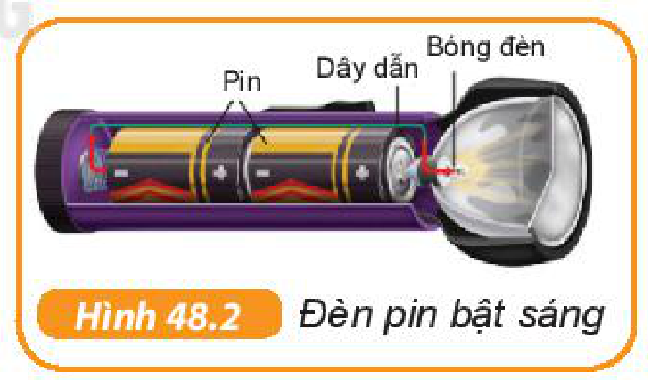
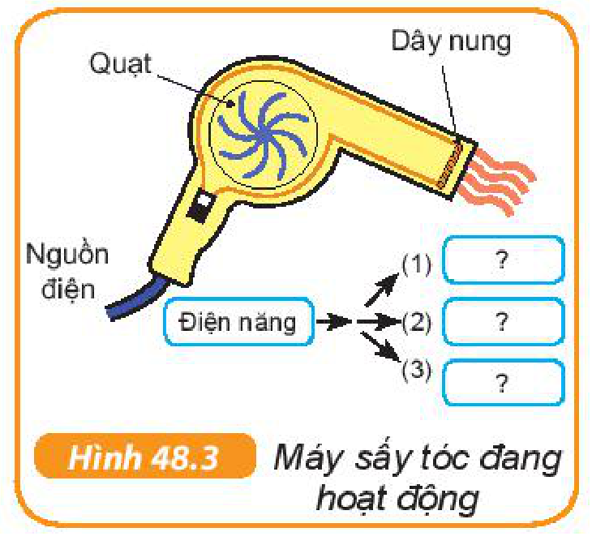
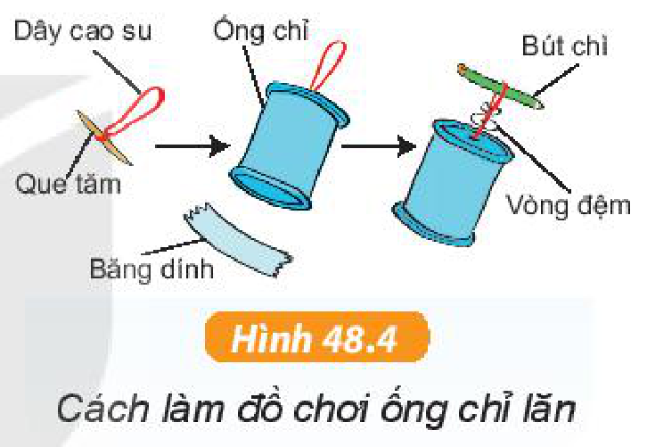
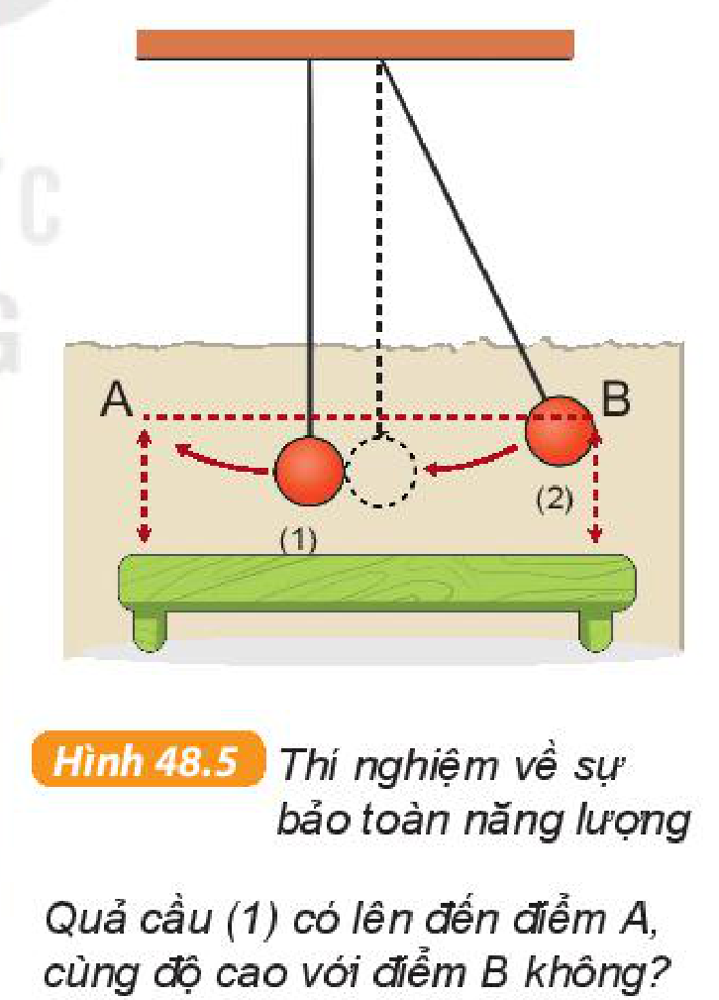
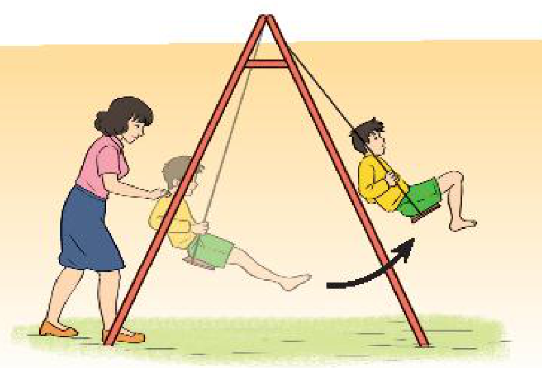
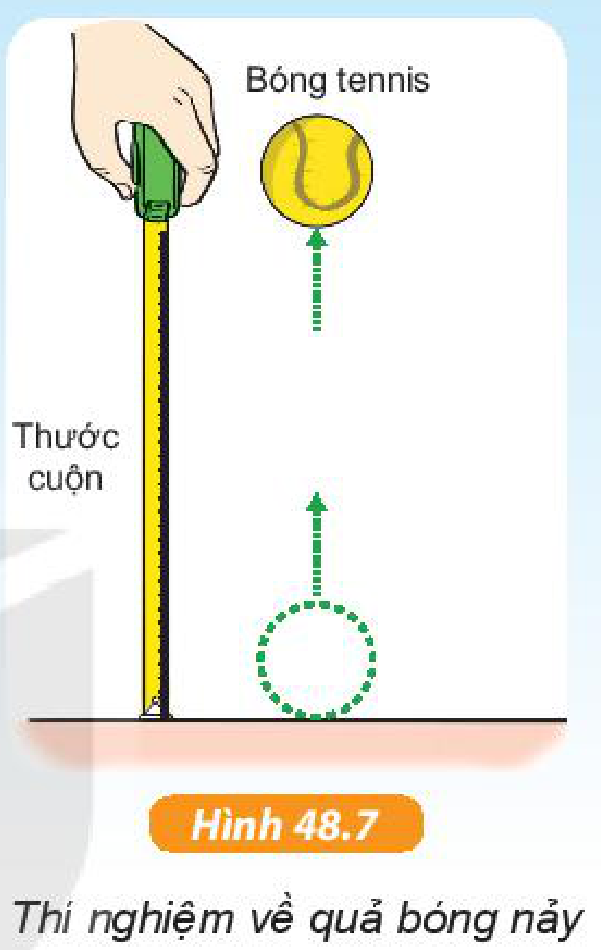

<!-- pdf:169 -->

# BÀI 48: SỰ CHUYỂN HOÁ NĂNG LƯỢNG

## 🎯 Mục tiêu

- Lấy ví dụ chứng tỏ được: Năng lượng có thể chuyển từ dạng này sang dạng khác, từ vật này sang vật khác.
- Nêu được định luật bảo toàn năng lượng và lấy được ví dụ minh hoạ.

## 🔴 Mở đầu

> - Khi trời lạnh, ta thường xoa hai bàn tay vào nhau và thấy tay nóng lên. Tại sao?
> - Khi vỗ hai tay vào nhau, ta nghe được tiếng vỗ tay. Trong hoạt động này đã có sự chuyển hoá năng lượng nào?

## I. Chuyển hoá năng lượng

Một quả bóng rổ được ném lên cao, sau khi đạt đến điểm cao nhất, nó rơi xuống mặt đất, rồi nảy lên (Hình 48.1a).

<!-- term: Chuyển hoá năng lượng -->
Khi bóng đi lên, động năng chuyển hoá thành thế năng. Khi bóng rơi xuống, thế năng chuyển hoá thành động năng. Khi bóng chạm mặt đất và phát ra tiếng động, một phần năng lượng chuyển hoá thành nhiệt năng và năng lượng âm (Hình 48.1b).

*Hình 48.1. Sơ đồ về: a) Chuyển động của quả bóng; b) Chuyển hoá năng lượng của quả bóng*

<!-- term: Sơ đồ dòng năng lượng -->
> ❓ 1. Gọi tên các dạng năng lượng xuất hiện khi đèn pin được bật sáng (Hình 48.2). Vẽ sơ đồ chỉ ra sự chuyển hoá năng lượng (còn được gọi là sơ đồ dòng năng lượng) của đèn pin.
>
> 2. Hình 48.3 mô tả một máy sấy tóc đang hoạt động. Mũi tên trên sơ đồ dòng năng lượng cho thấy sự chuyển hoá điện năng thành ba dạng năng lượng khác.
>    a) Tên ba dạng năng lượng đó là gì?
>    b) Nêu thêm một thiết bị điện biến đổi điện năng thành các dạng năng lượng khác.
>
> 3. Hoá năng có thể chuyển hoá thành các dạng năng lượng nào?

*Hình 48.2. Đèn pin bật sáng*

*Hình 48.3. Máy sấy tóc đang hoạt động*

<!-- pdf:170 -->

> ❓ 4. Hoàn thành các câu sau đây bằng cách ghi vào vở (hay phiếu học tập) các từ hoặc cụm từ trong khung thích hợp với các khoảng trống, được đánh số thứ tự từ (1) đến (6).
> - Khung từ gợi ý: động năng; thế năng; điện năng; nhiệt năng; năng lượng ánh sáng.
> - a) Hoá năng lưu trữ trong thực phẩm, khi ta ăn, được chuyển hoá thành ____(1)____ giúp ta đạp xe.
> - b) Hoá năng lưu trữ trong que diêm, khi cọ xát với vỏ bao diêm, được chuyển hoá thành ____(2)____ và ____(3)____ .
> - c) Hoá năng trong nhiên liệu (xăng, dầu) khi đốt cháy được chuyển hoá thành ____(4)____, ____(5)____ và ____(6)____ của máy bay, tàu hoả.

> 🖐️ *Ống chỉ biết lăn*
>
> Thực hiện
> - Quấn một dây cao su xung quanh que tăm và luồn qua lõi ống chỉ như Hình 48.4.
> - Dùng băng dính dán để giữ cố định que tăm vào ống chỉ.
> - Luồn dây cao su qua vòng đệm và quấn quanh bút chì.
> - Vặn bút chì để xoắn dây cao su.
> - Đặt ống chỉ trên một bề mặt mịn và thả tay giữ bút chì ra.
>
> a) Tại sao ống chỉ lăn được?
>
> b) Làm thế nào để ống chỉ lăn xa hơn?

*Hình 48.4. Cách làm đồ chơi ống chỉ lăn*

## II. Định luật bảo toàn năng lượng

> 🖐️ *Thí nghiệm về sự bảo toàn năng lượng*
>
> Thực hiện thí nghiệm sau đây để nghiên cứu về sự chuyển hoá và bảo toàn năng lượng trong một chuyển động cơ học.
> - Chuẩn bị: Hai con lắc (gồm 2 quả cầu giống hệt nhau, treo bằng hai dây nhẹ dài bằng nhau), giá treo cố định, thước mét, tấm bìa đánh dấu hai điểm A, B có cùng độ cao (Hình 48.5).
> - Tiến hành:
>   - Kéo quả cầu (2) đến điểm B (nằm trong mặt phẳng của tấm bìa như Hình 48.5) rồi thả ra.
>   - Quả cầu (2) chuyển động về vị trí ban đầu va chạm vào quả cầu (1), làm cho quả cầu (1) chuyển động lên đến vị trí A cùng độ cao với vị trí B.
> - Thảo luận: Thí nghiệm trên chứng tỏ điều gì?

*Hình 48.5. Thí nghiệm về sự bảo toàn năng lượng — Quả cầu (1) có lên đến điểm A, cùng độ cao với điểm B không?*

Qua nhiều thí nghiệm chính xác, người ta đã rút ra **Định luật bảo toàn năng lượng**, phát biểu như sau:

*“Năng lượng không tự sinh ra hoặc tự mất đi mà chỉ chuyển hoá từ dạng này sang dạng khác hoặc truyền từ vật này sang vật khác”.*

> 🔭 *Em có biết?*
>
> Thực ra quả cầu (1) không hoàn toàn lên đúng vị trí A. Tại sao?

<!-- pdf:171 -->

> ❓ Một em bé đang chơi xích đu trong sân. Muốn cho xích đu luôn lên tới độ cao ban đầu, thỉnh thoảng người mẹ phải đẩy vào xích đu (Hình 48.6). Tại sao cần làm như thế?

*Hình 48.6. Ví dụ về chuyển hoá và bảo toàn năng lượng*

> 🖐️ *Quả bóng nảy*
> - Chuẩn bị: 1 quả bóng tennis hoặc bóng cao su, thước dây (hoặc thước cuộn), một sợi dây dài hơn $1\text{ m}$.
> - Tiến hành:
>   - Thả rơi quả bóng tennis ở độ cao $1\text{ m}$ so với sàn nhà. Dùng sợi dây căng ngang ở độ cao $1\text{ m}$ để làm mốc (Hình 48.7).
>   - Yêu cầu các bạn trong nhóm đo độ cao mà quả bóng đạt được sau lần nảy đầu tiên.
> - Thảo luận:
>   - Nêu nhận xét về kết quả đo được. Giải thích tại sao.
>   - Có phải trong trường hợp này định luật bảo toàn năng lượng không còn đúng?

*Hình 48.7. Thí nghiệm về quả bóng nảy*

> ❓ Hoàn thành các câu sau đây bằng cách ghi vào vở (hay Phiếu học tập) các từ hoặc cụm từ trong khung thích hợp với các khoảng trống, được đánh số thứ tự từ (1) đến (10). Ví dụ: (1) – thế năng.
> - Khung từ gợi ý: động năng; thế năng; nhiệt năng; chuyển hoá; bảo toàn; tự mất đi; năng lượng âm.
> - a) Khi quả bóng được giữ yên ở trên cao, nó đang có __(1)__ . Khi quả bóng được thả rơi, __(2)__ của nó được chuyển hoá thành __(3)__ .
> - b) Quả bóng không thể nảy trở lại độ cao ban đầu, nơi nó được thả rơi, bởi vì không phải tất cả __(4)__ của nó biến thành __(5)__ . Thực tế, luôn có một phần năng lượng của nó được chuyển hoá thành ___(6)___ và ___(7)___ trong khi va chạm.
> - c) Trong quá trình chuyển động của quả bóng, luôn có sự ___(8)___ từ dạng năng lượng này sang dạng năng lượng khác. Năng lượng toàn phần của quả bóng luôn được _____(9)_____ không bao giờ ____(10)____ hoặc được tạo ra thêm.

## 📌 Em đã học

- Định luật bảo toàn năng lượng: Năng lượng không tự sinh ra hoặc tự mất đi mà chỉ chuyển hoá từ dạng này sang dạng khác hoặc truyền từ vật này sang vật khác.

## ✏️ Em có thể

Vận dụng sự chuyển hoá và bảo toàn năng lượng để giải thích một số hiện tượng có liên quan.

## 📷 Danh sách hình trong bài

| Mã hình | Trang PDF | Vị trí trong bài | Chú thích gốc |
| --- | :---: | --- | --- |
| H6-khoa_hoc_tu_nhien-b48-01 | 169 | Mục I | Hình 48.1. Sơ đồ về: a) Chuyển động của quả bóng; b) Chuyển hoá năng lượng của quả bóng |
| H6-khoa_hoc_tu_nhien-b48-02 | 169 | Mục I | Hình 48.2. Đèn pin bật sáng |
| H6-khoa_hoc_tu_nhien-b48-03 | 169 | Mục I | Hình 48.3. Máy sấy tóc đang hoạt động |
| H6-khoa_hoc_tu_nhien-b48-04 | 170 | Mục I, HĐ | Hình 48.4. Cách làm đồ chơi ống chỉ lăn |
| H6-khoa_hoc_tu_nhien-b48-05 | 170 | Mục II | Hình 48.5. Thí nghiệm về sự bảo toàn năng lượng |
| H6-khoa_hoc_tu_nhien-b48-06 | 171 | Mục II | Hình 48.6. Ví dụ về chuyển hoá và bảo toàn năng lượng |
| H6-khoa_hoc_tu_nhien-b48-07 | 171 | Mục II, HĐ | Hình 48.7. Thí nghiệm về quả bóng nảy |
