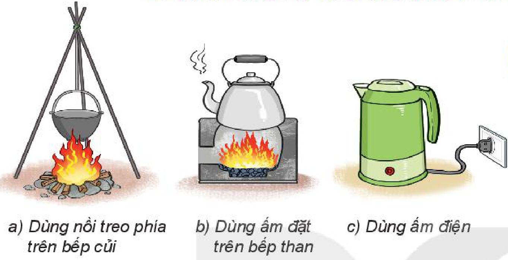
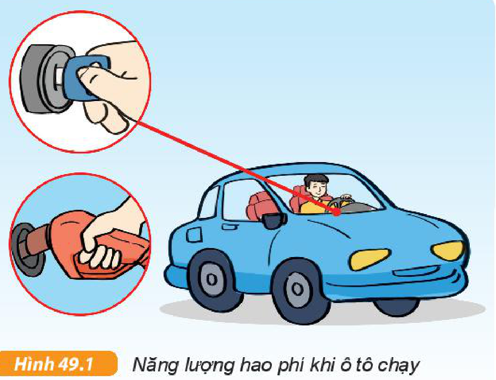
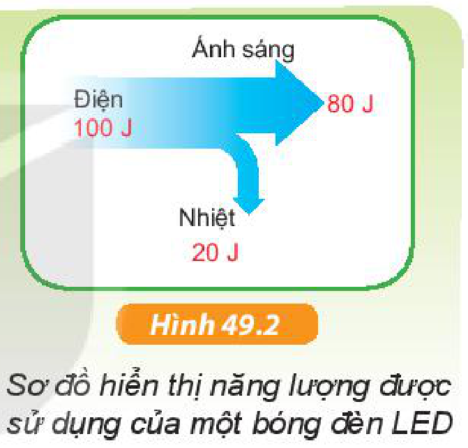
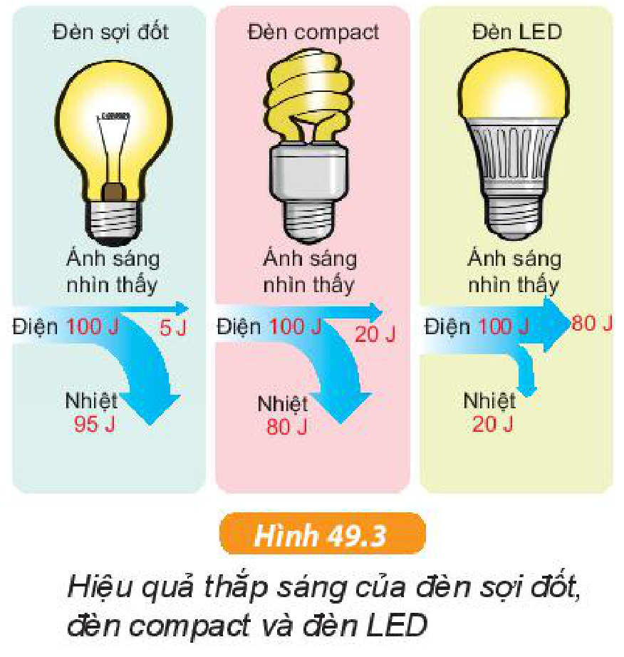

<!-- pdf:172 -->

# BÀI 49: NĂNG LƯỢNG HAO PHÍ

## 🎯 Mục tiêu

- Nêu được: Năng lượng hao phí luôn xuất hiện khi năng lượng được chuyển từ dạng này sang dạng khác, từ vật này sang vật khác.

## 🔴 Mở đầu

*a) Dùng nồi treo phía trên bếp củi; b) Dùng ấm đặt trên bếp than; c) Dùng ấm điện*
<!-- ocr-ok: đã đối chiếu ảnh trang PDF 172, OCR đọc dính liền các chữ chú thích hình mở đầu a, b, c -->

> Trong ba cách đun nước ở hình bên, cách đun nào ít hao phí năng lượng nhất? Tại sao?

## I. Năng lượng hữu ích

<!-- term: Năng lượng hữu ích -->
Khi sử dụng năng lượng vào một mục đích nào đó thì luôn có một phần năng lượng là hữu ích, phần còn lại là hao phí.

> ❓ Trong việc đun sôi nước như hình trên, năng lượng nào là hữu ích, năng lượng nào là hao phí?

## II. Năng lượng hao phí

<!-- term: Năng lượng hao phí -->
Năng lượng hao phí thường xuất hiện dưới dạng nhiệt năng.

> ❓ 1. Hãy tìm ví dụ để minh hoạ cho nhận định trên.
>
> 2. Nêu tình huống (ở gia đình, ở lớp học) cho thấy luôn có năng lượng hao phí xuất hiện trong quá trình sử dụng năng lượng. Xác định nguyên nhân gây ra sự hao phí đó.

> 🖐️ 1. Năng lượng hao phí khi đi xe đạp
>
> a) Dự đoán xem ở bộ phận nào của xe đạp có thể xảy ra sự hao phí năng lượng nhiều nhất?
>
> b) Dạng năng lượng nào là hữu ích, là hao phí đối với người và xe?

<!-- pdf:173 -->

> 🖐️ 2. Năng lượng hao phí khi ô tô chạy
>
> Nêu tên các dạng năng lượng hao phí có thể xuất hiện khi ô tô chuyển động trên đường.
>
> Những hao phí này ảnh hưởng ra sao đến môi trường?

*Hình 49.1. Năng lượng hao phí khi ô tô chạy*

> 🔭 *Em có biết?*
>
> Để hiển thị lượng năng lượng được truyền bởi một thiết bị, người ta có thể dùng một sơ đồ như Hình 49.2.
>
> Ví dụ, một bóng đèn LED được cung cấp $100\text{ J}$ năng lượng điện, nó chuyển hoá $20\text{ J}$ thành năng lượng nhiệt và $80\text{ J}$ thành năng lượng ánh sáng. Độ rộng của mũi tên đầu ra của sơ đồ cho thấy các tỉ lệ này.

*Hình 49.2. Sơ đồ hiển thị năng lượng được sử dụng của một bóng đèn LED*

## 📌 Em đã học

<!-- term: Năng lượng hao phí -->
- Năng lượng hao phí luôn xuất hiện trong quá trình chuyển hoá từ dạng này sang dạng khác, từ vật này sang vật khác.
- Năng lượng hao phí thường được sinh ra dưới dạng nhiệt (đôi khi có cả âm thanh hoặc ánh sáng).

## ✏️ Em có thể

**Nói về lợi ích dùng đèn LED trong việc thắp sáng**

Hãy tìm kiếm thông tin về: giá cả, thời gian sử dụng, mức tiêu thụ năng lượng, hiệu quả thắp sáng, tác động đến môi trường của mỗi loại đèn trong Hình 49.3 để nêu lí do tại sao nên dùng đèn LED để thắp sáng thay cho đèn sợi đốt và đèn compact.

*Hình 49.3. Hiệu quả thắp sáng của đèn sợi đốt, đèn compact và đèn LED*

## 📷 Danh sách hình trong bài

| Mã hình | Trang PDF | Vị trí trong bài | Chú thích gốc |
| --- | :---: | --- | --- |
| H6-khoa_hoc_tu_nhien-b49-01 | 172 | Mở đầu | (sách không đánh số, a) Dùng nồi treo phía trên bếp củi; b) Dùng ấm đặt trên bếp than; c) Dùng ấm điện) |
| H6-khoa_hoc_tu_nhien-b49-02 | 173 | Mục II, HĐ 2 | Hình 49.1. Năng lượng hao phí khi ô tô chạy |
| H6-khoa_hoc_tu_nhien-b49-03 | 173 | Mục II, Em có biết? | Hình 49.2. Sơ đồ hiển thị năng lượng được sử dụng của một bóng đèn LED |
| H6-khoa_hoc_tu_nhien-b49-04 | 173 | Em có thể | Hình 49.3. Hiệu quả thắp sáng của đèn sợi đốt, đèn compact và đèn LED |
