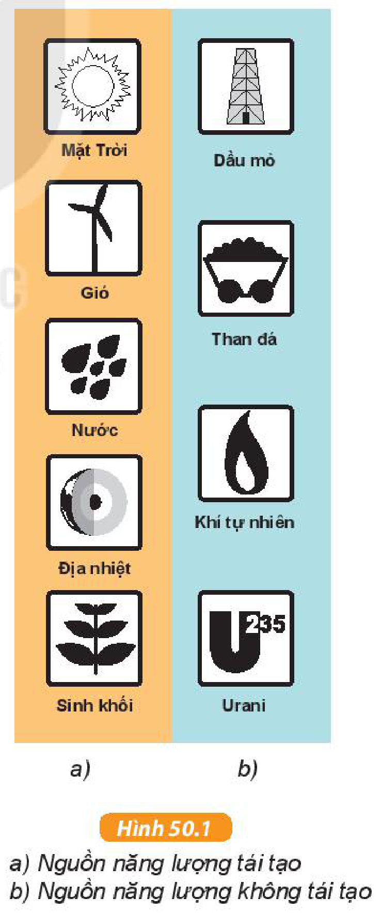
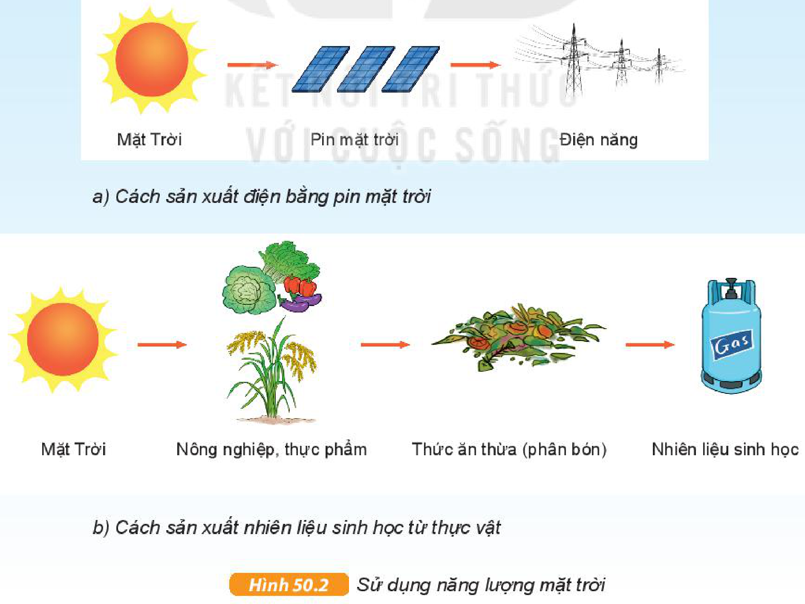
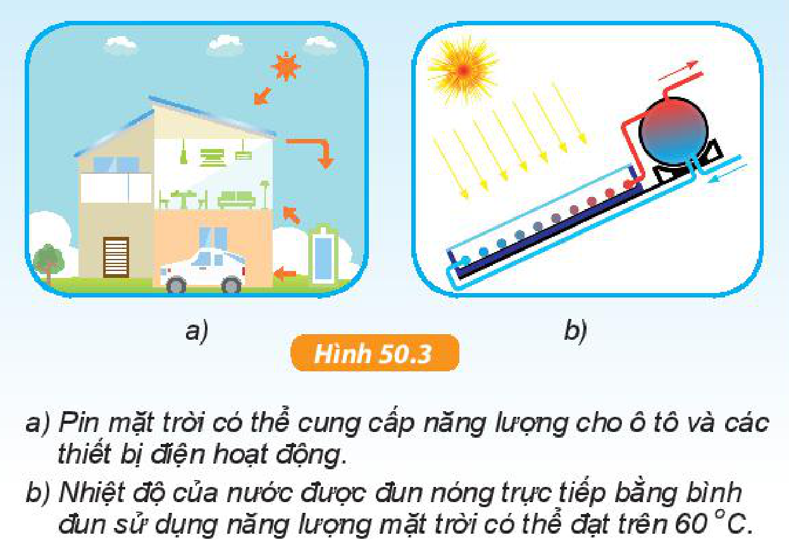
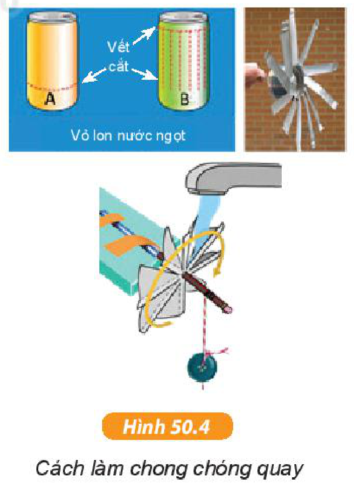

<!-- pdf:174 -->

# BÀI 50: NĂNG LƯỢNG TÁI TẠO

## 🎯 Mục tiêu

- Lấy được ví dụ về một số loại năng lượng tái tạo thông dụng.

## 🔴 Mở đầu

<!-- Biểu đồ tròn bên phải hộp Mở đầu: Năng lượng tái tạo 45,9%; Nhiệt điện than 28,9%; Nhiệt điện dầu 3,4%; Nhiệt điện khí 21,8% -->

> Hình bên là cơ cấu nguồn năng lượng dùng để sản xuất điện ở nước ta năm 2015 (Năng lượng tái tạo $45,9\%$; Nhiệt điện than $28,9\%$; Nhiệt điện dầu $3,4\%$; Nhiệt điện khí $21,8\%$). Theo em, năng lượng tái tạo là gì?

## I. Nguồn năng lượng trong tự nhiên

Nguồn năng lượng trong tự nhiên gồm nguồn năng lượng tái tạo và nguồn năng lượng không tái tạo.

Nguồn năng lượng tái tạo là nguồn năng lượng có sẵn trong thiên nhiên, liên tục được bổ sung thông qua các quá trình tự nhiên (Hình 50.1a).

Nguồn năng lượng không tái tạo phải mất hàng triệu đến hàng trăm triệu năm để hình thành và không thể bổ sung nhanh nên sẽ cạn kiệt trong tương lai gần (Hình 50.1b).

*Hình 50.1. a) Nguồn năng lượng tái tạo; b) Nguồn năng lượng không tái tạo*

> ❓ Hãy kể tên các dụng cụ có trong lớp học hoạt động bằng năng lượng lấy từ nguồn năng lượng tái tạo, nguồn năng lượng không tái tạo.

## II. Nguồn năng lượng tái tạo

Các nguồn năng lượng tái tạo bao gồm năng lượng từ Mặt Trời, năng lượng gió, năng lượng nước, năng lượng sinh khối, năng lượng địa nhiệt,...

<!-- term: Năng lượng mặt trời và năng lượng gió -->
- Năng lượng từ Mặt Trời và năng lượng từ gió luôn có sẵn trong thiên nhiên, thực tế được coi là vô hạn.

<!-- term: Năng lượng nước -->
- Năng lượng nước là năng lượng lấy từ sức chảy của dòng nước (như thuỷ triều, sóng biển,...).

<!-- term: Năng lượng địa nhiệt -->
- Năng lượng địa nhiệt là năng lượng thu được từ sức nóng bên trong lõi Trái Đất (nhiệt toả ra từ các giếng phun, suối nước nóng, khu vực gần núi lửa,...).

<!-- term: Năng lượng sinh khối -->
- Năng lượng sinh khối là năng lượng thu được từ thực vật, gỗ, rơm, rác và chất thải,...

<!-- pdf:175 -->

Các nguồn năng lượng này có ưu điểm:
- Liên tục được bổ sung nhanh chóng và có sẵn để sử dụng.
- Có thể sử dụng để tạo ra điện và nhiệt.
- Ít tác động tiêu cực đến môi trường so với nhiên liệu hoá thạch (than đá, dầu mỏ và khí tự nhiên).

> ❓ 1. a) Nêu những điểm khác nhau giữa nguồn năng lượng tái tạo và nguồn năng lượng không tái tạo.
>
> b) Những nguồn năng lượng nào sau đây là năng lượng tái tạo: than, xăng, Mặt Trời, khí tự nhiên, gió.
>
> 2. Các nhà khoa học dự đoán rằng đến năm 2100 sẽ không còn dầu và than trên Trái Đất. Cuộc sống của chúng ta sẽ thay đổi ra sao khi nguồn nhiên liệu này cạn kiệt?

> 🖐️ *Ưu điểm và nhược điểm của việc sử dụng năng lượng mặt trời*
>
> 1. Quan sát Hình 50.2 dưới đây và trả lời các câu hỏi:
>
> a) Năng lượng ánh sáng từ Mặt Trời có thể được chuyển hoá thành điện như thế nào? (Hình 50.2a)
>
> b) Năng lượng ánh sáng từ Mặt Trời có thể được sử dụng để sản xuất nhiên liệu từ thực vật bằng cách nào? (Hình 50.2b)

*Hình 50.2. Sử dụng năng lượng mặt trời: a) Cách sản xuất điện bằng pin mặt trời; b) Cách sản xuất nhiên liệu sinh học từ thực vật*

<!-- pdf:176 -->

> 2. Thảo luận về những ưu điểm và nhược điểm trong việc sử dụng năng lượng mặt trời thay thế nhiên liệu hoá thạch trong Hình 50.3.

*Hình 50.3. a) Pin mặt trời có thể cung cấp năng lượng cho ô tô và các thiết bị điện hoạt động; b) Nhiệt độ của nước được đun nóng trực tiếp bằng bình đun sử dụng năng lượng mặt trời có thể đạt trên $60\,^\circ\text{C}$.*

> 🔭 *Em có biết?*
>
> *Cảnh báo về sử dụng năng lượng mặt trời.*
>
> Các nhà khoa học cảnh báo nếu cứ tăng cường việc sử dụng năng lượng mặt trời để sản xuất điện như hiện nay thì chỉ trong vòng 20 năm nữa Trái Đất có thể sẽ tràn ngập rác thải là các pin mặt trời đã qua sử dụng trong đó có chứa các hoá chất độc hại.

> 🖐️ *Tự làm mô hình tuabin hoạt động bằng nguồn năng lượng tái tạo*
> - Chuẩn bị: làm một chong chóng cắt ra từ vỏ lon nước ngọt như Hình 50.4, một que cứng gắn trên một giá cố định để làm trục quay, một vật nhẹ (nút áo bằng nhựa) được buộc vào đầu sợi dây dài khoảng $1\text{ m}$ quấn quanh trục.
> - Tiến hành:
>   - Đặt các cánh quạt của chong chóng bên dưới vòi nước.
>   - Mở vòi nước. Sức nước chảy mạnh làm chong chóng quay và tạo ra lực nâng vật lên cao.
> - Thảo luận:
>   - a) Có sự chuyển hoá năng lượng gì xảy ra?
>   - b) Nghĩ cách cải tiến làm cho chong chóng quay nhanh hơn và liên tục.

*Hình 50.4. Cách làm chong chóng quay*

## 📌 Em đã học

- Nguồn năng lượng trong tự nhiên được phân loại thành 2 nhóm: nguồn năng lượng tái tạo và nguồn năng lượng không tái tạo.
- Các nguồn năng lượng tái tạo bao gồm Mặt Trời, gió, nước, sinh khối, địa nhiệt,...

## ✏️ Em có thể

Tìm được các thiết bị trong gia đình em có thể sử dụng năng lượng tái tạo thay cho năng lượng hoá thạch.

## 📷 Danh sách hình trong bài

| Mã hình | Trang PDF | Vị trí trong bài | Chú thích gốc |
| --- | :---: | --- | --- |
| H6-khoa_hoc_tu_nhien-b50-01 | 174 | Mục I | Hình 50.1. a) Nguồn năng lượng tái tạo; b) Nguồn năng lượng không tái tạo |
| H6-khoa_hoc_tu_nhien-b50-02 | 175 | Mục II, HĐ 1 | Hình 50.2. Sử dụng năng lượng mặt trời |
| H6-khoa_hoc_tu_nhien-b50-03 | 176 | Mục II, HĐ 2 | Hình 50.3 |
| H6-khoa_hoc_tu_nhien-b50-04 | 176 | Mục II, HĐ | Hình 50.4. Cách làm chong chóng quay |
