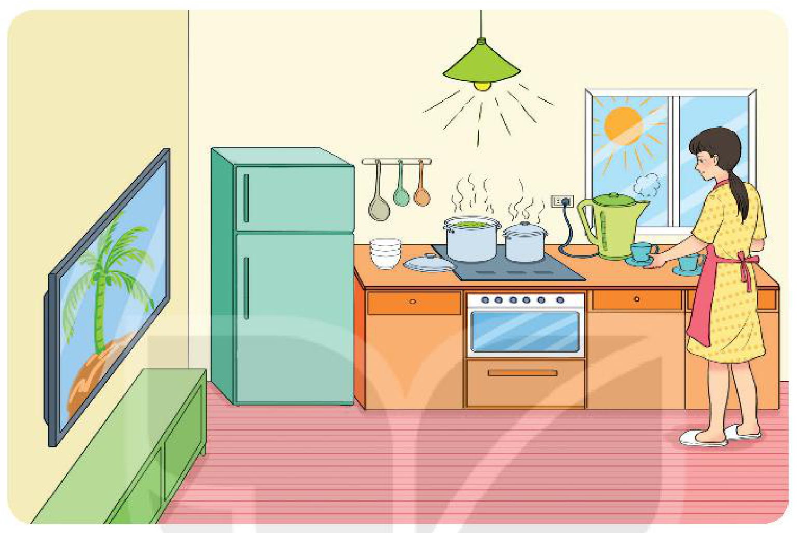
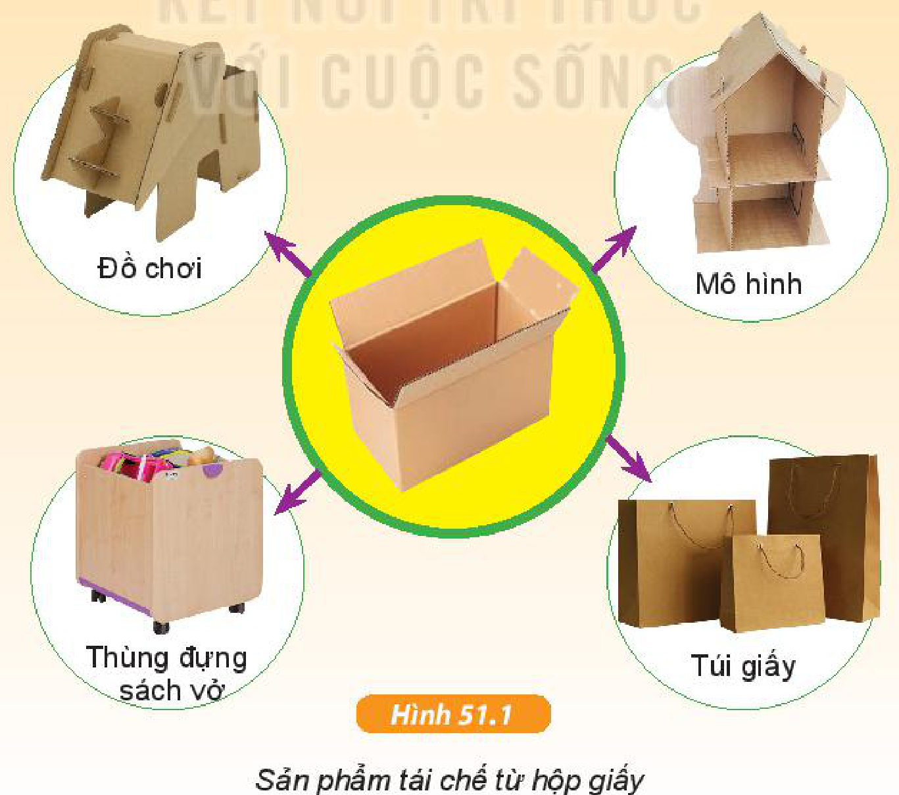

<!-- pdf:177 -->

# BÀI 51: TIẾT KIỆM NĂNG LƯỢNG

## 🎯 Mục tiêu

- Đề xuất được biện pháp để tiết kiệm năng lượng trong các hoạt động hằng ngày.

## 🔴 Mở đầu

> Chỉ ra những chi tiết trong hình trên có sự lãng phí năng lượng. Em hãy đưa ra các gợi ý giúp điều chỉnh hoặc khắc phục sự lãng phí năng lượng đó.

## I. Tại sao cần tiết kiệm năng lượng?

Hằng ngày, chúng ta thường sử dụng nhiều năng lượng hơn mức cần thiết, vì thế vừa gây ra sự lãng phí năng lượng, vừa tốn nhiều chi phí. Mặt khác, năng lượng không tái tạo đang cạn kiệt dần và khi bị đốt cháy lại gây ô nhiễm môi trường.

<!-- term: Tiết kiệm năng lượng -->
Vì vậy, tiết kiệm năng lượng giúp:
- Tiết kiệm chi phí;
- Bảo tồn các nguồn năng lượng không tái tạo;
- Góp phần giảm lượng chất thải, giảm ô nhiễm môi trường.

> 🔭 *Em có biết?*
>
> Nguồn năng lượng không tái tạo là nguyên nhân gây ra các vấn đề nghiêm trọng về hô hấp cho trẻ em và cả người lớn, ảnh hưởng đến sự thay đổi thời tiết ngày càng khắc nghiệt, cháy rừng, hạn hán, lũ lụt và sự nóng lên của Trái Đất.

> ❓ 1. Hãy nêu một số ví dụ có thể gây lãng phí năng lượng xảy ra trong lớp học, trong nhà trường.
>
> 2. Hãy thảo luận về các biện pháp tiết kiệm năng lượng trong lớp học.

<!-- pdf:178 -->

## II. Một số biện pháp tiết kiệm năng lượng trong hoạt động hằng ngày

> ❓ 1. Những biện pháp nào dưới đây giúp tiết kiệm năng lượng?
> - a) Sử dụng ánh nắng mặt trời để làm khô quần áo ướt thay vì dùng máy sấy khô quần áo.
> - b) Dùng đèn LED để thắp sáng thay thế đèn huỳnh quang hoặc đèn sợi đốt.
> - c) Tận dụng ánh sáng tự nhiên thay vì dùng đèn thắp sáng vào ban ngày.
> - d) Rút phích cắm hoặc tắt các thiết bị điện khi không sử dụng.
> - e) Đóng, mở tủ lạnh hoặc máy điều hòa đúng cách.
> - g) Bật tivi xem cả ngày.
> - h) Tắt vòi nước trong khi đánh răng.
> - i) Thu gom các vật dụng (giấy, đồ nhựa,...) đã dùng có thể tái sử dụng hoặc tái chế.
>
> 2. Kẻ Bảng 51.1 ra Phiếu học tập. Ghi các biện pháp tiết kiệm năng lượng đã chọn ở câu 1 và đánh dấu “X” vào các cột thích hợp trong bảng. Ví dụ, biện pháp a) đã được đánh dấu “X” vào các cột mô tả tương ứng để minh hoạ.

Bảng 51.1

| Biện pháp | Tiết kiệm điện | Tiết kiệm nước | Tiết kiệm nhiên liệu | Dùng nguồn năng lượng tái tạo |
| :---: | :---: | :---: | :---: | :---: |
| a) | x | ? | x | x |
| b) | ? | ? | ? | ? |
| ... | ? | ? | ? | ? |

> 🖐️ Bảng số liệu về thời gian thắp sáng tối đa và điện năng tiêu thụ của một số bóng đèn có độ sáng như nhau.

Bảng 51.2

| Loại bóng đèn | Thời gian thắp sáng tối đa | Điện năng tiêu thụ trong $1\text{ h}$ | Giá |
| :---: | :---: | :---: | :---: |
| Dây tóc ($220\text{ V} - 75\text{ W}$) | $1000\text{ h}$ | $0,075\text{ kW.h}$ | $5\,000$ đồng |
| Compact ($220\text{ V} - 20\text{ W}$) | $5000\text{ h}$ | $0,020\text{ kW.h}$ | $40\,000$ đồng |
<!-- ocr-ok: đã đối chiếu ảnh trang PDF 178, OCR bỏ sót dòng tiêu đề nền hồng và đọc gãy chữ cột đầu của Bảng 51.2 -->

> Dựa vào bảng số liệu về hai loại bóng đèn (Bảng 51.2), em hãy tính toàn bộ chi phí mua bóng đèn và tiền điện phải trả cho việc sử dụng mỗi loại bóng đèn trên trong 1 năm. Từ đó, đưa ra ý kiến của mình về việc sử dụng tiết kiệm điện năng. Cho biết giá điện là $1\,500$ đồng/$\text{kW.h}$ và một năm có 365 ngày, mỗi ngày các đèn hoạt động $12\text{ h}$.

<!-- pdf:179 -->

## 📌 Em đã học

Tiết kiệm năng lượng giúp:
- Tiết kiệm chi phí.
- Bảo tồn các nguồn năng lượng không tái tạo.
- Góp phần giảm lượng chất thải và giảm ô nhiễm môi trường.

<!-- term: Biện pháp tiết kiệm năng lượng -->
Một số biện pháp tiết kiệm năng lượng:
- Sử dụng điện, nước hợp lí.
- Tiết kiệm nhiên liệu.
- Ưu tiên dùng các nguồn năng lượng tái tạo.

## ✏️ Em có thể

1. Nói về lợi ích của việc tái sử dụng và tái chế:

a) Tái sử dụng và tái chế có những lợi ích gì?

b) Tại sao cần hạn chế sử dụng túi nylon, chai nhựa, ống hút nhựa và nên thay thế bằng túi giấy, bình đựng nước cá nhân, ống hút bằng giấy?

c) Em và các bạn trong nhóm hãy giới thiệu một số sản phẩm hữu ích tự làm từ các vật dụng phế thải, dễ tìm (như sử dụng các chai nhựa, giấy thải văn phòng, hộp giấy,...).

2. Nếu được đề cử là một “Đại sứ Môi trường” của nhà trường, em hãy đề ra một “dự án” để góp phần bảo tồn năng lượng và bảo vệ môi trường.

*Hình 51.1. Sản phẩm tái chế từ hộp giấy*

## 📷 Danh sách hình trong bài

| Mã hình | Trang PDF | Vị trí trong bài | Chú thích gốc |
| --- | :---: | --- | --- |
| H6-khoa_hoc_tu_nhien-b51-01 | 177 | Mở đầu | (sách không đánh số, các chi tiết lãng phí năng lượng trong nhà bếp) |
| H6-khoa_hoc_tu_nhien-b51-02 | 179 | Em có thể | Hình 51.1. Sản phẩm tái chế từ hộp giấy |
