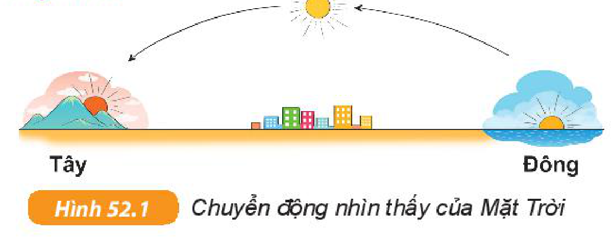
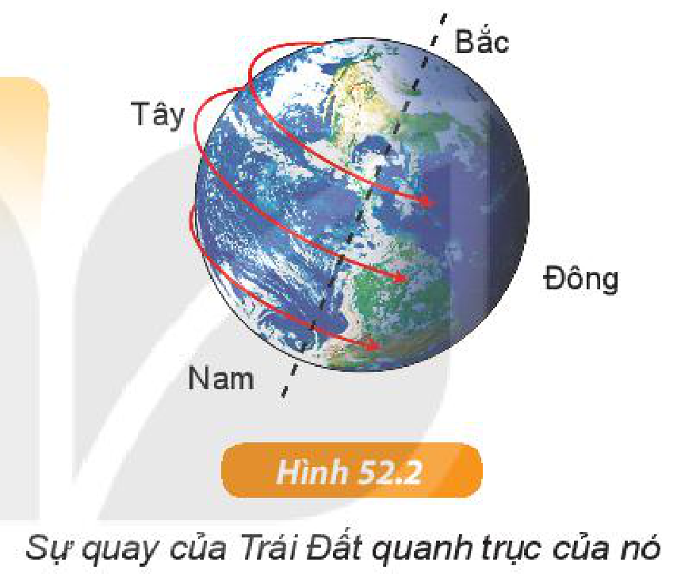
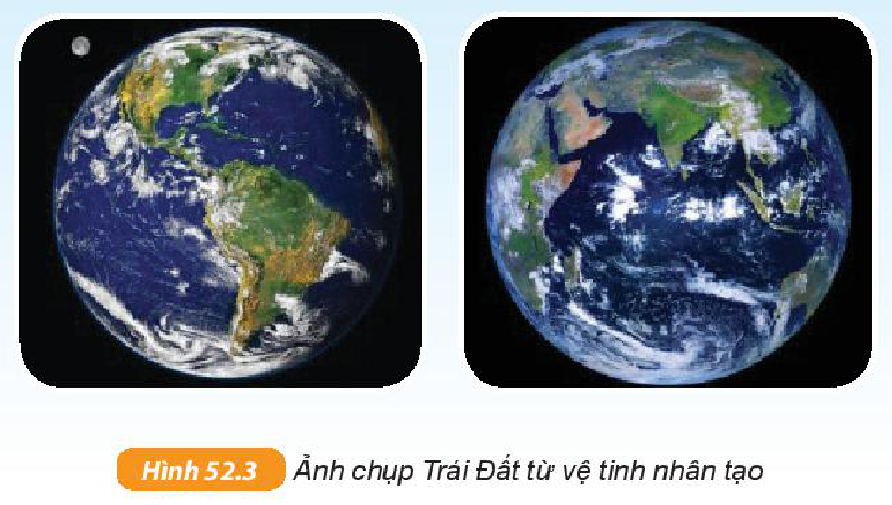
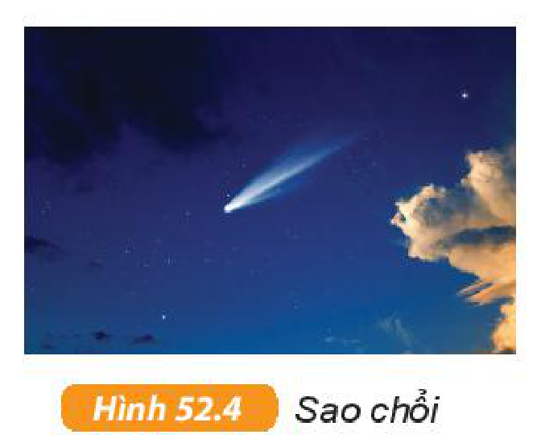
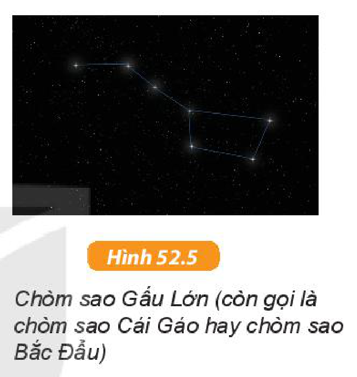
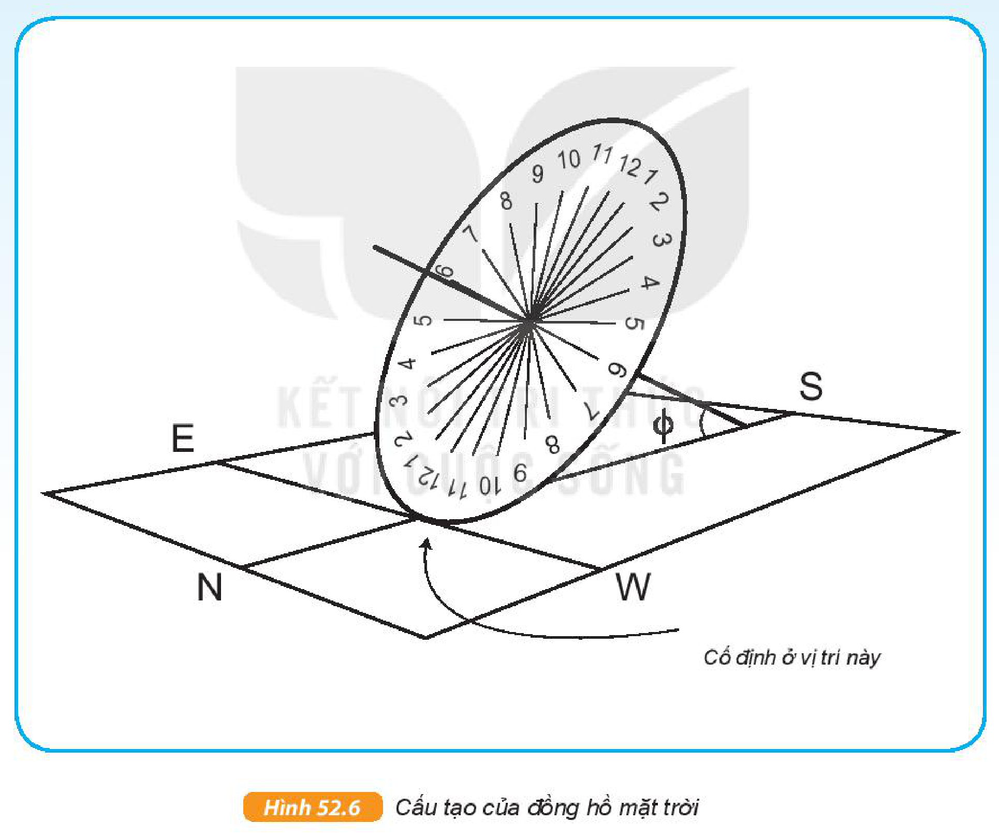

<!-- pdf:180 -->

# BÀI 52: CHUYỂN ĐỘNG NHÌN THẤY CỦA MẶT TRỜI. THIÊN THỂ

## 🎯 Mục tiêu

- Giải thích được một cách định tính và sơ lược: từ Trái Đất thấy Mặt Trời mọc và lặn hằng ngày.
- Nêu được Mặt Trời và sao là các thiên thể phát sáng; Mặt Trăng, các hành tinh và sao chổi phản xạ ánh sáng Mặt Trời.

## 🔴 Mở đầu

> Có người nói ban ngày Mặt Trời chuyển động trên bầu trời từ đông sang tây. Em nghĩ gì về điều này?
>
> 

## I. Chuyển động "nhìn thấy" và chuyển động "thực"

<!-- term: Chuyển động nhìn thấy -->
<!-- term: Chuyển động thực -->
Khi tự quay quanh mình, ta nhìn thấy các vật xung quanh quay theo chiều ngược lại. Chuyển động quay của các vật quanh ta chỉ là chuyển động "nhìn thấy", không phải là chuyển động thực. Chuyển động quay của ta mới là chuyển động thực.

> **Câu hỏi:**
>
> Tìm thêm ví dụ về chuyển động nhìn thấy và chuyển động thực.

## II. Chuyển động nhìn thấy của Mặt Trời

### 1. Mặt Trời mọc và lặn

Quan sát bầu trời, chúng ta thấy buổi sáng Mặt Trời mọc ở hướng đông, sau đó chuyển động ngang qua bầu trời để đến buổi chiều lặn ở hướng tây (Hình 52.1).

Làm thế nào để giải thích hiện tượng này?

Trước Công nguyên người ta giải thích hiện tượng này là do Trái Đất đứng yên và là trung tâm của vũ trụ, Mặt Trời và các hành tinh quay quanh Trái Đất.

<!-- pdf:181 -->

> **Câu hỏi:**
>
> Theo em, có thể giải thích hiện tượng từ Trái Đất nhìn thấy Mặt Trời chuyển động từ đông sang tây bằng cách khác được không? Hãy sử dụng nội dung đã học ở mục I để giải thích hiện tượng này.

### 2. Giải thích chuyển động của Mặt Trời nhìn từ Trái Đất

Sau một thời gian dài, tới thế kỉ XVI, người ta mới dùng hiện tượng tự quay của Trái Đất quanh trục của nó để giải thích chuyển động của Mặt Trời trên bầu trời.

<!-- term: Chuyển động nhìn thấy -->
Do Trái Đất tự quay quanh trục của nó từ tây sang đông, nên người trên Trái Đất nhìn thấy Mặt Trời quay xung quanh Trái Đất từ đông sang tây. Chuyển động nhìn thấy của Mặt Trời từ Trái Đất không phải là chuyển động thực, chuyển động quay của Trái Đất quanh trục của nó mới là chuyển động thực.

Trái Đất quay một vòng xung quanh trục của nó hết 24 giờ (một ngày – đêm).

> **Câu hỏi:**
>
> Hình 52.2 có mô tả đúng sự quay của Trái Đất quanh trục của nó không?

> **Hoạt động:**
>
> 1. Mặt Trời lúc nào cũng chiếu sáng Trái Đất. Tại sao trên Trái Đất lại có ngày và đêm liên tiếp? Hãy dùng quả địa cầu là mô hình của Trái Đất được chiếu sáng bởi ánh sáng Mặt Trời để minh hoạ câu trả lời của em.
> 2. Hình 52.3 là ảnh chụp Trái Đất từ vệ tinh nhân tạo. Mỗi ảnh chỉ ghi được các vùng lãnh thổ của một nửa phần Trái Đất. Tại sao? Hai ảnh này được chụp cách nhau ít nhất là bao nhiêu giờ?
>
> 

<!-- pdf:182 -->

## III. Phân biệt các thiên thể

Thiên thể là tên gọi chung các vật thể tự nhiên tồn tại trong không gian vũ trụ. Người ta phân biệt:

<!-- term: Sao chổi -->
<!-- term: Chòm sao -->
- Sao là thiên thể tự phát sáng, ví dụ Mặt Trời.
- Hành tinh là thiên thể không tự phát sáng, quay quanh sao, người ta nhìn thấy nó là nhờ nó được sao chiếu sáng. Ví dụ Trái Đất là hành tinh quay quanh Mặt Trời và được Mặt Trời chiếu sáng.
- Vệ tinh là thiên thể không tự phát sáng, quay quanh hành tinh, người ta nhìn thấy nó là nhờ nó được sao chiếu sáng. Ví dụ, Mặt Trăng là vệ tinh quay quanh Trái Đất và được Mặt Trời chiếu sáng.
- Sao chổi là trường hợp đặc biệt. Tuy cũng là tiểu hành tinh, nhưng khác các tiểu hành tinh khác ở chỗ được cấu tạo chủ yếu bằng các khối khí đóng băng và bụi vũ trụ; không có dạng hình cầu mà có hình dáng giống cái chổi (Hình 52.4).
- Chòm sao là tập hợp các sao mà đường tưởng tượng nối chúng với nhau có dạng hình học xác định (Hình 52.5).

> **Câu hỏi:**
>
> Spút-nhích (Sputnik) là vệ tinh nhân tạo đầu tiên được Liên Xô (cũ) phóng lên bầu trời vào năm 1957, bay được 1440 vòng quanh Trái Đất, mỗi vòng hết 96 phút 17 giây.
>
> Spút-nhích có phải là một thiên thể không? Tại sao?

## 📌 Em đã học

- Ban ngày chúng ta thấy Mặt Trời mọc ở hướng đông, lặn ở hướng tây là do Trái Đất quay quanh trục của nó từ tây sang đông.
- Sao là thiên thể tự phát sáng, hành tinh là thiên thể không tự phát sáng và chuyển động quanh sao, vệ tinh là thiên thể không tự phát sáng và chuyển động quanh hành tinh.

## ✏️ Em có thể

Với một chiếc ghế quay mượn ở văn phòng nhà trường, hãy thiết kế một hoạt động đóng vai nhằm chứng minh chuyển động người ta nhìn thấy được của Mặt Trời, của các sao không phải chuyển động thực, chuyển động quay của Trái Đất mới là chuyển động thực.

<!-- pdf:183 -->

## 🚀 Vận dụng

<!-- term: Đồng hồ mặt trời -->
> **Vận dụng:** Tự chế tạo một đồng hồ mặt trời đơn giản.
>
> Vì Trái Đất quay quanh trục của nó nên độ dài của bóng các vật trên mặt đất do ánh nắng mặt trời tạo ra thay đổi theo thời gian. Người xưa đã biết ứng dụng hiện tượng này để chế tạo ra đồng hồ mặt trời dùng để xác định thời gian vào ban ngày.
>
> Có thể làm mặt đồng hồ bằng một tấm bìa cứng hình tròn, đường kính khoảng $15\text{ cm}$. Chia mặt đồng hồ thành 24 vạch ứng với 24 giờ (mỗi giờ ứng với một góc $15^\circ$). Dùng một dây kim loại nhỏ (nan hoa xe đạp, dây thép) xuyên qua tâm của mặt đồng hồ sao cho một đầu dây nhô lên khỏi mặt đồng hồ khoảng $5\text{ cm}$, đầu còn lại phải có độ dài sao cho góc giữa dây và mặt đất bằng vĩ độ nơi em sống (Ví dụ, Hà Nội là $21^\circ$, Thành phố Hồ Chí Minh là $11^\circ$,...).
>
> Đặt mặt đồng hồ hướng về phía Bắc. Dùng đồng hồ để chỉnh hướng của mặt đồng hồ mặt trời sao cho bóng kim chỉ đúng thời gian (Hình 52.6).
>
> 

## 📷 Danh sách hình trong bài

| Mã hình | Số hình SGK | Trang PDF | Chú thích |
| --- | --- | --- | --- |
| H6-khoa_hoc_tu_nhien-b52-01 | Hình mở đầu | 180 | Mặt Trời mọc trên Biển Đông |
| H6-khoa_hoc_tu_nhien-b52-02 | Hình 52.1 | 180 | Chuyển động nhìn thấy của Mặt Trời |
| H6-khoa_hoc_tu_nhien-b52-03 | Hình 52.2 | 181 | Sự quay của Trái Đất quanh trục của nó |
| H6-khoa_hoc_tu_nhien-b52-04 | Hình 52.3 | 181 | Ảnh chụp Trái Đất từ vệ tinh nhân tạo |
| H6-khoa_hoc_tu_nhien-b52-05 | Hình 52.4 | 182 | Sao chổi |
| H6-khoa_hoc_tu_nhien-b52-06 | Hình 52.5 | 182 | Chòm sao Gấu Lớn (còn gọi là chòm sao Cái Gáo hay chòm sao Bắc Đẩu) |
| H6-khoa_hoc_tu_nhien-b52-07 | Hình 52.6 | 183 | Cấu tạo của đồng hồ mặt trời |
