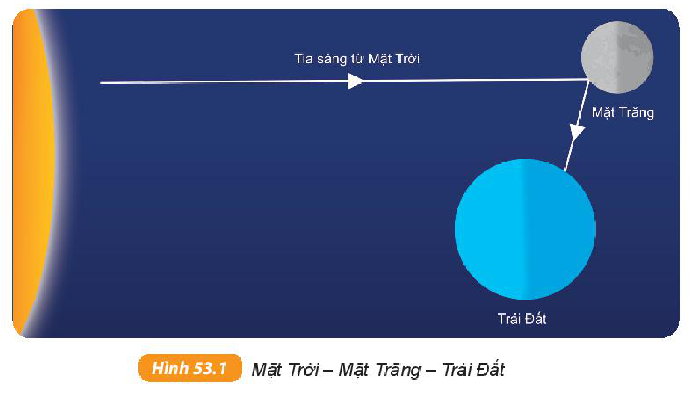
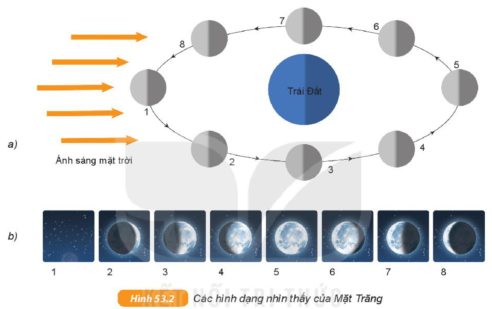
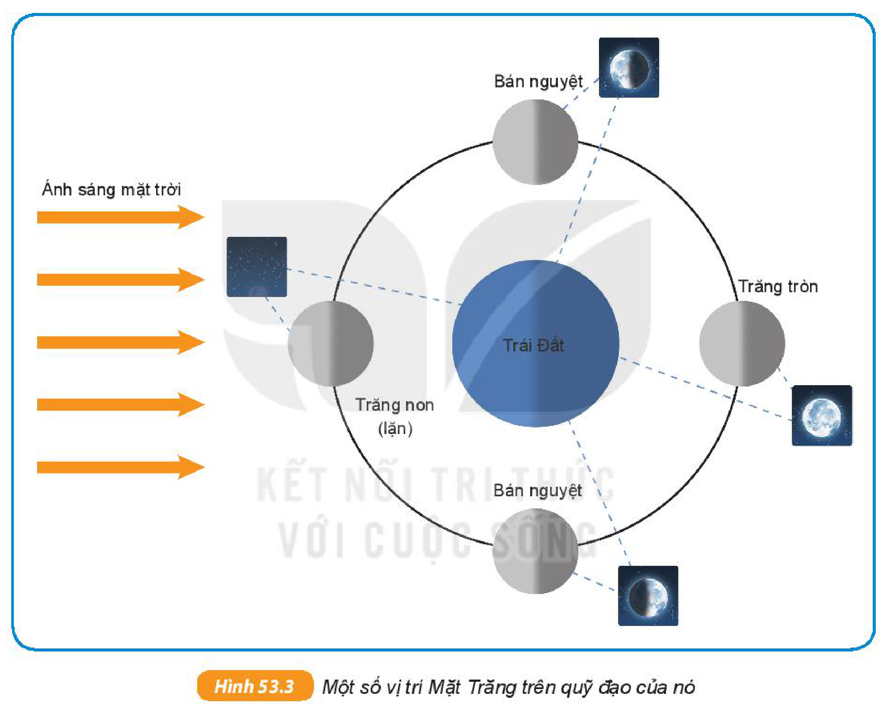
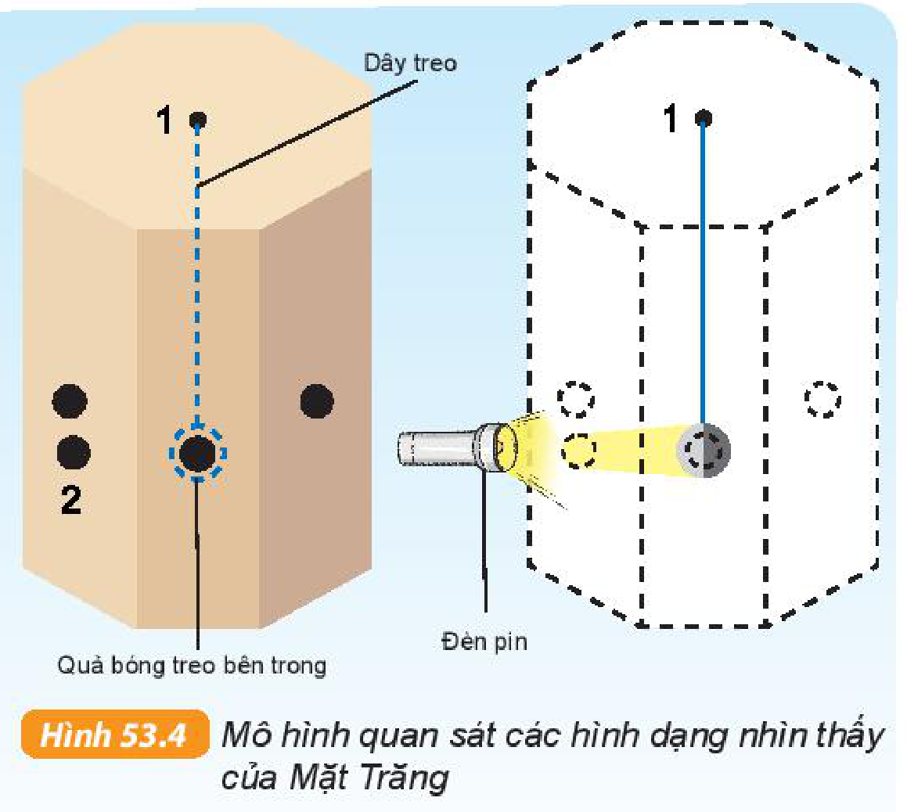

<!-- pdf:184 -->

# BÀI 53: MẶT TRĂNG

## 🎯 Mục tiêu

- Thiết kế mô hình thực tế (hoặc hình vẽ) để giải thích được một số hình dạng nhìn thấy của Mặt Trăng trong Tuần Trăng.

## 🔴 Mở đầu

> Em hãy mô tả các hình dạng của Mặt Trăng mà em đã nhìn thấy vào ban đêm. Vì sao chúng ta nhìn thấy Mặt Trăng có hình dạng khác nhau?
>
> 

## I. Mặt Trăng và các hình dạng nhìn thấy

### 1. Mặt Trăng

Mặt Trăng là một vệ tinh của Trái Đất mà chúng ta có thể nhìn thấy trên bầu trời. Đôi khi chúng ta thấy nó rất sáng vào đêm.

Mặt Trăng là một vật thể không tự phát sáng. Chúng ta thấy Mặt Trăng là do nó phản chiếu ánh sáng mặt trời (Hình 53.1).

Mặt Trăng có dạng hình cầu nên một nửa Mặt Trăng, phần hướng về Mặt Trời sẽ được Mặt Trời chiếu sáng; nửa còn lại không được chiếu sáng và do đó ở Trái Đất ta không quan sát được.

<!-- pdf:185 -->

### 2. Hình dạng nhìn thấy của Mặt Trăng

Hình dạng Mặt Trăng ta nhìn thấy trên bầu trời thay đổi mỗi ngày. Người ta nói đó là **các pha của Mặt Trăng**.

**Không Trăng** (còn gọi là Trăng non): khi quan sát từ Trái Đất, ta không quan sát được phần bề mặt của Mặt Trăng đang được Mặt Trời chiếu sáng.

**Trăng tròn**: khi quan sát từ Trái Đất, ta quan sát được toàn bộ phần bề mặt của Mặt Trăng đang được Mặt Trời chiếu sáng.

<!-- term: Trăng khuyết -->
<!-- term: Bán nguyệt -->
*Chú thích:*
*Hình 53.2a: Một số vị trí của Mặt Trăng*
1. Ứng với ngày không có Trăng (không Trăng)
2. Ứng với 4 ngày sau (Trăng khuyết)
3. Ứng với 8 ngày sau (bán nguyệt$^{(1)}$)
4. Ứng với 12 ngày sau (Trăng khuyết)
5. Ứng với 16 ngày sau (Trăng tròn)
6. Ứng với 19 ngày sau (Trăng khuyết)
7. Ứng với 23 ngày sau (bán nguyệt)
8. Ứng với 27 ngày sau (Trăng khuyết)
*Hình 53.2b: Hình dạng nhìn thấy của Mặt Trăng tương ứng với các vị trí trên.*

> **Câu hỏi:**
>
> 1. Em có nhận xét gì về Trăng khuyết ở nửa đầu tháng và ở nửa cuối tháng?
> 2. Giữa hai lần Trăng tròn liên tiếp cách nhau bao nhiêu tuần?

<!-- term: Bán nguyệt -->
> $^{(1)}$ *Bán nguyệt có nghĩa là nửa Trăng.*

<!-- pdf:186 -->

## II. Giải thích sự khác nhau về hình dạng nhìn thấy của Mặt Trăng (các pha của Mặt Trăng)

Mặt Trăng quay quanh Trái Đất, mất khoảng một tháng để đi hết một vòng.

<!-- term: Tuần Trăng -->
Hình 53.3 cho thấy vị trí Mặt Trăng ở các thời điểm khác nhau trên quỹ đạo của nó. Phía Mặt Trăng hướng về Mặt Trời lúc nào cũng sáng. Chúng ta thấy các hình dạng khác nhau của Mặt Trăng trong Tuần Trăng là do Mặt Trăng chuyển động quanh Trái Đất, Trái Đất chuyển động quanh Mặt Trời, nên vị trí tương đối giữa Mặt Trời, Trái Đất, Mặt Trăng thay đổi liên tục theo thời gian. Ở Trái Đất ta chỉ nhìn thấy phần Mặt Trăng được chiếu sáng (Mô hình 53.4).

> **Hoạt động:**
>
> 1. Mô hình quan sát các pha của Mặt Trăng.
>
> Chúng ta có thể dùng mô hình để giải thích tại sao nhìn thấy Mặt Trăng có hình dạng khác nhau.
>
> a) Dụng cụ cần thiết:
> - Một, vài tấm bìa các-tông (làm buồng tối).
> - Một quả bóng nhỏ (làm Mặt Trăng).
> - Một đèn pin (làm Mặt Trời).
> - Băng dính, kéo, sợi dây treo.

<!-- pdf:187 -->

> b) Chế tạo
> - Cắt hai tấm bìa hình tám cạnh đều, độ dài cạnh $20\text{ cm}$.
> - Cắt tám tấm bìa hình chữ nhật ($20\text{ cm} \times 50\text{ cm}$), khoét một lỗ nhỏ ở tâm của mỗi tấm, lấy riêng một tấm và khoét thêm một lỗ để chiếu đèn pin.
> - Dùng băng dính ghép các tấm bìa thành một hình lăng trụ tám cạnh đều, treo quả bóng vào vị trí 1 Hình 53.4.
>
> 
>
> c) Quan sát
> - Chiếu đèn pin vào lỗ số 2.
> - Đặt mắt vào các lỗ đã khoét ở tâm các cạnh còn lại để quan sát các pha của Mặt Trăng.
>
> 2. Vẽ một sơ đồ cho thấy vị trí của Mặt Trời, Mặt Trăng và Trái Đất khi ta quan sát thấy bán nguyệt.

## 📌 Em đã học

- Mặt Trăng là vệ tinh tự nhiên duy nhất của Trái Đất.
- Bên phía Mặt Trăng hướng về Mặt Trời được chiếu sáng. Chúng ta nhìn thấy Mặt Trăng do nó phản chiếu ánh sáng mặt trời.
- Hình dạng của Mặt Trăng mà ta nhìn thấy thay đổi khi nó di chuyển trong quỹ đạo bởi vì ta thấy nó ở các góc nhìn khác nhau.

## ✏️ Em có thể

Dựa vào hình dạng nhìn thấy của Mặt Trăng để đoán ngày Âm lịch trong tháng.
<!-- ocr-ok: đã đối chiếu ảnh trang gốc PDF 187 (trang in 186), OCR nhận nhầm "Âm lịch trong tháng" thành "Am'ely trong táng" -->

<!-- term: Tuần Trăng -->
> **Em có biết?**
>
> **Mặt Trăng** (tiếng La-tinh: Luna, kí hiệu: ☾) là vệ tinh tự nhiên duy nhất của Trái Đất và là vệ tinh tự nhiên lớn thứ năm trong Hệ Mặt Trời.
>
> Mặt Trăng quay một vòng quanh Trái Đất mất 27,32 ngày, trong khi đó Trái Đất lại quay quanh Mặt Trời, nên chu kì biểu kiến của pha Mặt Trăng (cũng là Tuần Trăng) là 29,5 ngày. Sự biến đổi vị trí tương đối của Trái Đất – Mặt Trăng – Mặt Trời là nguyên nhân gây ra các pha Mặt Trăng.
>
> Khi Mặt Trăng quay quanh trục của nó được một vòng thì đồng thời cũng quay quanh Trái Đất được đúng một vòng. Do đó, luôn luôn chỉ có một phía của Mặt Trăng hướng về Trái Đất cho ta quan sát được.
>
> Mặt Trăng là thiên thể duy nhất ngoài Trái Đất mà con người đã đặt chân tới. Năm 1959, nước Nga (Liên Xô cũ) phóng vệ tinh nhân tạo Luna 1 lên Mặt Trăng, mở đầu cho công cuộc khám phá Mặt Trăng. Trong giai đoạn từ năm 1969 tới năm 1972, chương trình A-pô-lô của Mĩ đã thực hiện những cuộc đổ bộ của con người xuống Mặt Trăng.

## 📷 Danh sách hình trong bài

| Mã hình | Số hình SGK | Trang PDF | Chú thích |
| --- | --- | --- | --- |
| H6-khoa_hoc_tu_nhien-b53-01 | Hình mở đầu | 184 | Ở nước ta, hình dạng vết đen trên Mặt Trăng được mô tả như là "chú Cuội ngồi gốc cây đa". |
| H6-khoa_hoc_tu_nhien-b53-02 | Hình 53.1 | 184 | Mặt Trời – Mặt Trăng – Trái Đất |
| H6-khoa_hoc_tu_nhien-b53-03 | Hình 53.2 | 185 | Các hình dạng nhìn thấy của Mặt Trăng |
| H6-khoa_hoc_tu_nhien-b53-04 | Hình 53.3 | 186 | Một số vị trí Mặt Trăng trên quỹ đạo của nó |
| H6-khoa_hoc_tu_nhien-b53-05 | Hình 53.4 | 187 | Mô hình quan sát các hình dạng nhìn thấy của Mặt Trăng |
