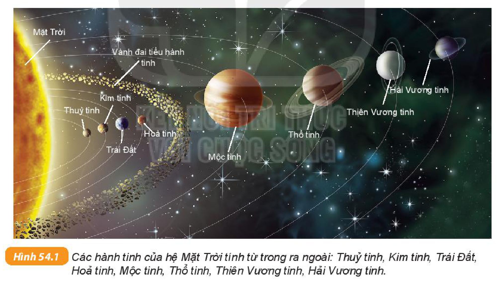
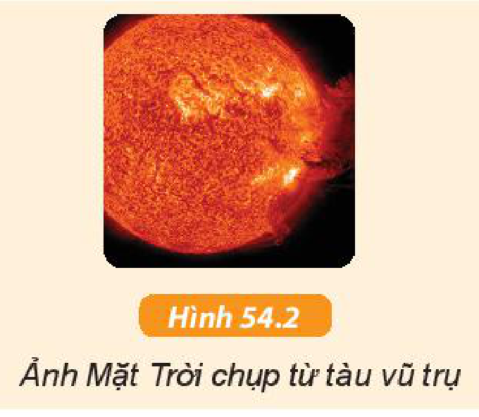
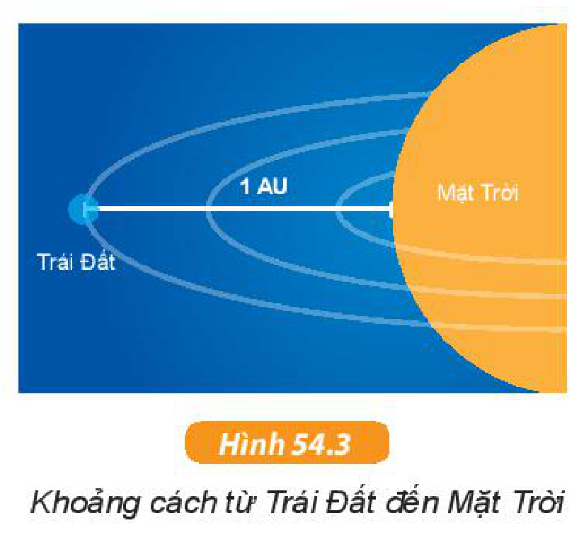

<!-- pdf:188 -->

# BÀI 54: HỆ MẶT TRỜI

## 🎯 Mục tiêu

- Mô tả được sơ lược cấu trúc của hệ Mặt Trời, nêu được các hành tinh cách Mặt Trời các khoảng cách khác nhau và có chu kì quay khác nhau.

## 🔴 Mở đầu

> Em đã biết Trái Đất quay quanh Mặt Trời, Mặt Trăng quay quanh Trái Đất. Vậy còn có những thiên thể nào khác quay quanh Mặt Trời không?

## I. Hệ Mặt Trời

<!-- term: Hệ Mặt Trời -->
Hệ Mặt Trời, còn gọi là Thái Dương hệ, gồm Mặt Trời và các thiên thể chuyển động xung quanh Mặt Trời.

<!-- term: Hệ Mặt Trời -->
<!-- term: Tiểu hành tinh -->
<!-- term: Thiên thạch -->
Hệ Mặt Trời gồm Mặt Trời, tám hành tinh, các hành tinh lùn, hơn một trăm vệ tinh, các sao chổi, các tiểu hành tinh, các thiên thạch và bụi vũ trụ (Hình 54.1).

Các hành tinh vừa chuyển động quanh Mặt Trời vừa tự quay quanh trục của nó.

> **Lưu ý:**
>
> **Có được nhìn trực tiếp Mặt Trời không?**
>
> Nhìn thẳng vào Mặt Trời rất nguy hiểm. Ánh sáng mặt trời có thể làm tổn thương mắt. Các nhà thiên văn học không bao giờ nhìn thẳng trực tiếp vào Mặt Trời mà phải dùng một loại kính thiên văn đặc biệt để chụp ảnh bề mặt Mặt Trời (Hình 54.2).
>
> 

<!-- pdf:189 -->

> **Câu hỏi:**
>
> 1. Hành tinh nào gần Mặt Trời nhất, hành tinh nào xa Mặt Trời nhất?
> 2. Lực hấp dẫn gây ra chuyển động của tám hành tinh xung quanh Mặt Trời phụ thuộc khối lượng và khoảng cách đến Mặt Trời của các hành tinh. Theo em dự đoán, thời gian quay quanh Mặt Trời của các hành tinh có giống nhau không?

## II. Các hành tinh của hệ Mặt Trời

### 1. Các hành tinh vòng trong của hệ Mặt Trời

<!-- term: Hành tinh vòng trong -->
<!-- term: Tiểu hành tinh -->
Bốn hành tinh vòng trong là: Thuỷ tinh, Kim tinh, Trái Đất, Hoả tinh nằm ở phía trong vành đai tiểu hành tinh chính, có thành phần chủ yếu từ silicat và các kim loại. Các thiên thể thuộc vùng này nằm khá gần Mặt Trời nên có nhiệt độ cao.

| Hành tinh | Thuỷ tinh | Kim tinh | Trái Đất | Hoả tinh |
| --- | --- | --- | --- | --- |
| Chu kì tự quay (ngày) | 58,9 | 244 | 1 | 1,03 |
| Chu kì quay quanh Mặt Trời (ngày) | 88 | 224,7 | 365,2 | 687 |
| Khoảng cách đến Mặt Trời ($\text{AU}^{(1)}$) | 0,39 | 0,72 | 1 | 1,52 |
<!-- ocr-ok: đã đối chiếu ảnh trang gốc PDF 189 (trang in 188), bảng có hình hành tinh và chữ chìm nền khiến OCR nhận nhầm số 1 thành 4 -->

> **Câu hỏi:**
>
> Trong bốn hành tinh vòng trong của hệ Mặt Trời, một ngày của hành tinh nào có thời gian gần bằng một ngày của Trái Đất?

### 2. Các hành tinh vòng ngoài của hệ Mặt Trời

<!-- term: Hành tinh vòng ngoài -->
<!-- term: Hành tinh khí khổng lồ -->
Bốn hành tinh vòng ngoài là: Mộc tinh, Thổ tinh, Thiên Vương tinh, Hải Vương tinh, được gọi là các hành tinh khí khổng lồ vì chúng có thành phần chủ yếu là các hợp chất khí và có kích thước rất lớn. Các thiên thể thuộc vùng này nằm xa Mặt Trời, nên có nhiệt độ thấp.

<!-- term: Đơn vị thiên văn -->
> $^{(1)}$ *AU là đơn vị đo chiều dài trong thiên văn học, 1 AU còn gọi là đơn vị thiên văn (đvtv) có chiều dài bằng khoảng cách từ Trái Đất đến Mặt Trời, xấp xỉ bằng 150 triệu km.*

<!-- pdf:190 -->

| Hành tinh | Mộc tinh | Thổ tinh | Thiên Vương tinh | Hải Vương tinh |
| --- | --- | --- | --- | --- |
| Chu kì tự quay (ngày) | 0,41 | 0,43 | 0,72 | 0,67 |
| Chu kì quay quanh Mặt Trời (ngày) | 4343,5 | 10767,5 | 30587 | 60152 |
| Khoảng cách đến Mặt Trời (AU) | 5,20 | 9,54 | 19,2 | 30,07 |
<!-- ocr-ok: đã đối chiếu ảnh trang gốc PDF 190 (trang in 189), bảng 4 hành tinh vòng ngoài có hình hành tinh -->

> **Câu hỏi:**
>
> 1. Người ta vẫn nói sao Hoả, sao Kim, sao Thổ,... đều là các ngôi sao trong hệ Mặt Trời. Nói như thế là đúng hay sai? Tại sao?
> 2. Vì sao ta nhìn thấy các hành tinh trong hệ Mặt Trời? Em hãy giải thích bằng hình vẽ.
> 3. Nếu như em đứng trên Hải Vương tinh, sẽ nhìn thấy Mặt Trời lớn hơn hay nhỏ hơn so với khi ở Trái Đất?

> **Hoạt động:**
>
> 1. Vẽ sơ đồ biểu diễn khoảng cách từ Mặt Trời đến các hành tinh theo tỉ lệ $1\text{ cm}$ ứng với $1\text{ AU}$.
> 2. Có nhận xét gì về khoảng cách giữa các hành tinh?

## 📌 Em đã học

- Hệ Mặt Trời (hay Thái Dương hệ) gồm Mặt Trời ở trung tâm và tám hành tinh quay quanh là Thuỷ tinh, Kim tinh, Trái Đất, Hoả tinh, Mộc tinh, Thổ tinh, Thiên Vương tinh, Hải Vương tinh.
- Các hành tinh vừa chuyển động quanh Mặt Trời vừa tự quay quanh trục của nó.
- Khoảng cách từ các hành tinh đến Mặt Trời là khác nhau, Thuỷ tinh gần Mặt Trời nhất, Hải Vương tinh xa Mặt Trời nhất.

## ✏️ Em có thể

Chỉ ra được vị trí của Trái Đất trong hệ Mặt Trời.

## 📷 Danh sách hình trong bài

| Mã hình | Số hình SGK | Trang PDF | Chú thích |
| --- | --- | --- | --- |
| H6-khoa_hoc_tu_nhien-b54-01 | Hình 54.1 | 188 | Các hành tinh của hệ Mặt Trời tính từ trong ra ngoài: Thuỷ tinh, Kim tinh, Trái Đất, Hoả tinh, Mộc tinh, Thổ tinh, Thiên Vương tinh, Hải Vương tinh. |
| H6-khoa_hoc_tu_nhien-b54-02 | Hình 54.2 | 188 | Ảnh Mặt Trời chụp từ tàu vũ trụ |
| H6-khoa_hoc_tu_nhien-b54-03 | Hình 54.3 | 189 | Khoảng cách từ Trái Đất đến Mặt Trời |
