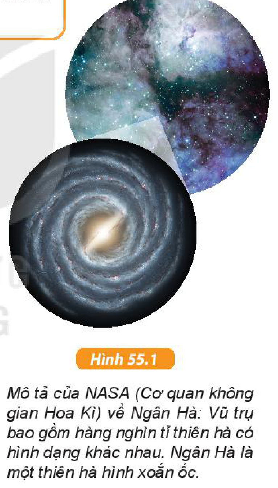
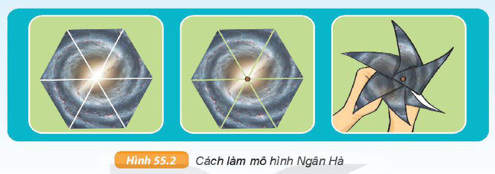
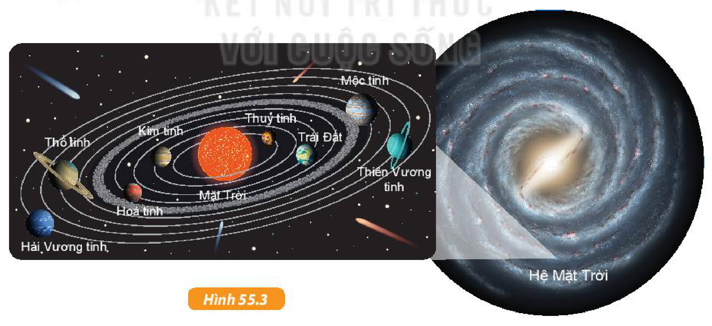
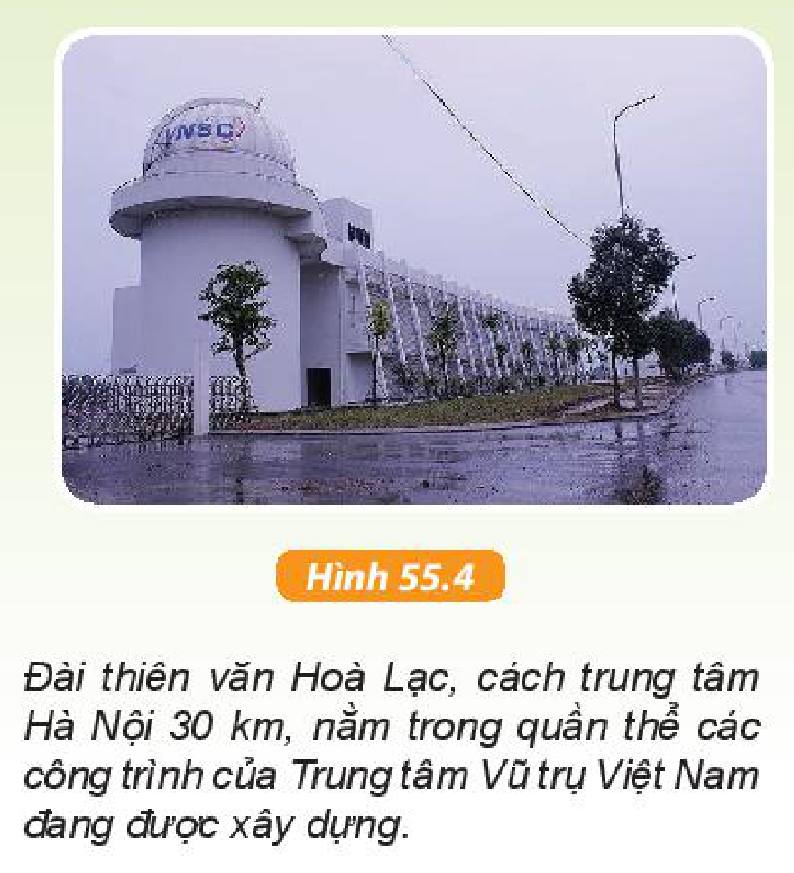
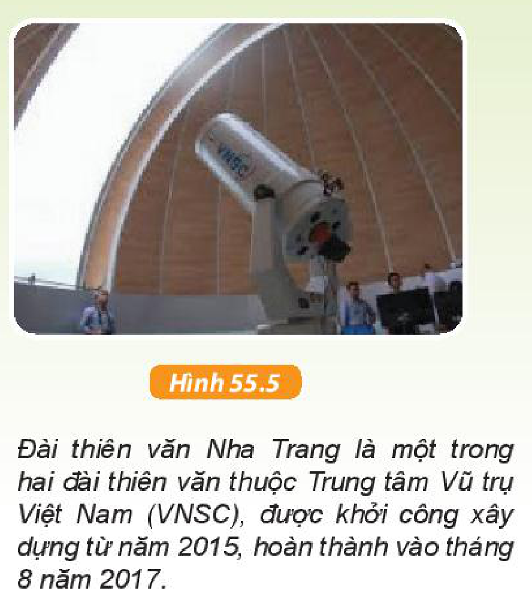

<!-- pdf:191 -->

# BÀI 55: NGÂN HÀ

## 🎯 Mục tiêu

- Sử dụng tranh ảnh (hình vẽ hoặc học liệu điện tử) chỉ ra được hệ Mặt Trời là một phần nhỏ của Ngân Hà.

## 🔴 Mở đầu

> Em đã từng nghe kể chuyện về dải Ngân Hà chưa? Em nhìn thấy dải Ngân Hà khi nào? Em có thể mô tả về nó không?
>
> 

## I. Ngân Hà là gì?

Vào những đêm trời trong, không Trăng, nhìn bầu trời ta sẽ thấy xen lẫn những vì sao lấp lánh là một dải sáng mờ vắt ngang bầu trời.

Người châu Á thấy nó giống một dòng sông bạc nên gọi là Ngân Hà (trong chữ Hán, Ngân là bạc, Hà là sông).

Ngân Hà là một tập hợp hàng trăm tỉ thiên thể liên kết với nhau bằng lực hấp dẫn, trong đó có hệ Mặt Trời của chúng ta.

Nếu nhìn Ngân Hà từ bên trên theo hướng vuông góc với mặt Ngân Hà ta sẽ thấy nó có hình xoắn ốc với 4 vòng xoắn chính (còn gọi là 4 cánh tay) (Hình 55.1).

Do hệ Mặt Trời của chúng ta nằm ở gần rìa của một trong 4 vòng xoắn của Ngân Hà, nên từ Trái Đất ta chỉ nhìn thấy một mẩu của vòng xoắn này và thấy nó giống một dòng sông.

Đường kính của Ngân Hà vào khoảng từ $100\,000$ năm ánh sáng$^{(1)}$, bề dày của Ngân Hà khoảng $300$ năm ánh sáng.

> **Câu hỏi:**
>
> Theo em, dùng tên Ngân Hà để gọi tập hợp các thiên thể trong đó có hệ Mặt Trời của chúng ta có hoàn toàn chính xác không? Tại sao?

<!-- term: Năm ánh sáng -->
> $^{(1)}$ *Năm ánh sáng là đơn vị đo khoảng cách trong thiên văn. Một năm ánh sáng bằng quãng đường mà ánh sáng truyền đi với vận tốc gần bằng $300\,000\text{ km/s}$ trong 1 năm (xấp xỉ bằng 95 nghìn tỉ kilômét).*

<!-- pdf:192 -->

> **Hoạt động:**
>
> Hãy làm một mô hình bằng giấy về Ngân Hà.
> - Cắt một tấm bìa màu xanh thẫm, theo mẫu. Dùng màu vẽ Ngân Hà xoắn màu trắng mờ với nhiều chấm sáng.
> - Dùng tờ bìa này để làm một chong chóng.
> - Cho gió thổi mạnh vào chong chóng sẽ thấy hình ảnh của Ngân Hà đang quay trong vũ trụ (Hình 55.2).
>
> 

## II. Ngân Hà và hệ Mặt Trời

Hệ Mặt Trời của chúng ta nằm ở rìa của một vòng xoắn của Ngân Hà, cách tâm Ngân Hà khoảng $26\,000$ năm ánh sáng (Hình 55.3).

Kích thước của hệ Mặt Trời vô cùng nhỏ so với kích thước của Ngân Hà. Nếu ta xem hệ Mặt Trời bé bằng một đồng xu thì kích thước của Ngân Hà phải lớn bằng cả một lục địa.

Mặt Trời chuyển động quanh tâm của Ngân Hà với tốc độ lên tới $220\,000\text{ m/s}$ nhưng cũng phải mất 230 triệu năm mới quay được 1 vòng.

> **Câu hỏi:**
>
> Theo em dải Ngân Hà có chuyển động trên bầu trời đêm như các sao mà ta nhìn thấy không?

<!-- pdf:193 -->

## 📌 Em đã học

- Ngân Hà là một tập hợp hàng trăm tỉ thiên thể liên kết với nhau bằng lực hấp dẫn, trong đó có hệ Mặt Trời của chúng ta.
- Ngân Hà có hình xoắn ốc với 4 vòng xoắn chính. Nhìn từ Trái Đất chỉ thấy một phần của một vòng xoắn ốc của Ngân Hà.

## ✏️ Em có thể

Chỉ ra được vị trí của Trái Đất trong Ngân Hà.

> **Em có biết?**
>
> **Chuyển động của Ngân Hà**
>
> Ngân Hà chuyển động trong vũ trụ với tốc độ khoảng $600\,000\text{ m/s}$. Ngoài ra, Ngân Hà còn tự quay quanh lõi của mình.
>
> Những vòng xoắn ốc của Ngân Hà trong đó có các thiên thể, chuyển động cùng với Ngân Hà. Các thiên thể trong Ngân Hà không những chuyển động theo Ngân Hà mà còn có chuyển động riêng của mình. Do đó, quỹ đạo cũng như tốc độ chuyển động của chúng rất phức tạp.

<!-- term: Thiên hà -->
<!-- term: Đài thiên văn -->
> **Em có biết?**
>
> Ga-li-lê là người đầu tiên quan sát được các ngôi sao riêng biệt trong dải Ngân Hà vào năm 1610. Mãi cho tới năm 1920, người ta vẫn tưởng toàn bộ thiên thể của vũ trụ đều nằm trong Ngân Hà, ngoài Ngân Hà chỉ là khoảng không. Ngày nay, người ta đã phát hiện được ngoài Ngân Hà của chúng ta còn hàng nghìn tỉ các hệ thống sao khác như Ngân Hà, được gọi chung là các thiên hà.
>
> Đài thiên văn (hay trạm quan sát thiên văn) là công trình trang bị các loại kính thiên văn cùng các thiết bị cần thiết khác để thực hiện việc quan sát, nghiên cứu các thiên thể trên bầu trời.
>
> Một số đài thiên văn ở Việt Nam
>
> 
>
> 

## 📷 Danh sách hình trong bài

| Mã hình | Số hình SGK | Trang PDF | Chú thích |
| --- | --- | --- | --- |
| H6-khoa_hoc_tu_nhien-b55-01 | Hình mở đầu | 191 | Ảnh chụp Ngân Hà từ Trái Đất |
| H6-khoa_hoc_tu_nhien-b55-02 | Hình 55.1 | 191 | Mô tả của NASA (Cơ quan không gian Hoa Kì) về Ngân Hà: Vũ trụ bao gồm hàng nghìn tỉ thiên hà có hình dạng khác nhau. Ngân Hà là một thiên hà hình xoắn ốc. |
| H6-khoa_hoc_tu_nhien-b55-03 | Hình 55.2 | 192 | Cách làm mô hình Ngân Hà |
| H6-khoa_hoc_tu_nhien-b55-04 | Hình 55.3 | 192 | Vị trí của hệ Mặt Trời trong Ngân Hà |
| H6-khoa_hoc_tu_nhien-b55-05 | Hình 55.4 | 193 | Đài thiên văn Hoà Lạc, cách trung tâm Hà Nội 30 km, nằm trong quần thể các công trình của Trung tâm Vũ trụ Việt Nam đang được xây dựng. |
| H6-khoa_hoc_tu_nhien-b55-06 | Hình 55.5 | 193 | Đài thiên văn Nha Trang là một trong hai đài thiên văn thuộc Trung tâm Vũ trụ Việt Nam (VNSC), được khởi công xây dựng từ năm 2015, hoàn thành vào tháng 8 năm 2017. |
