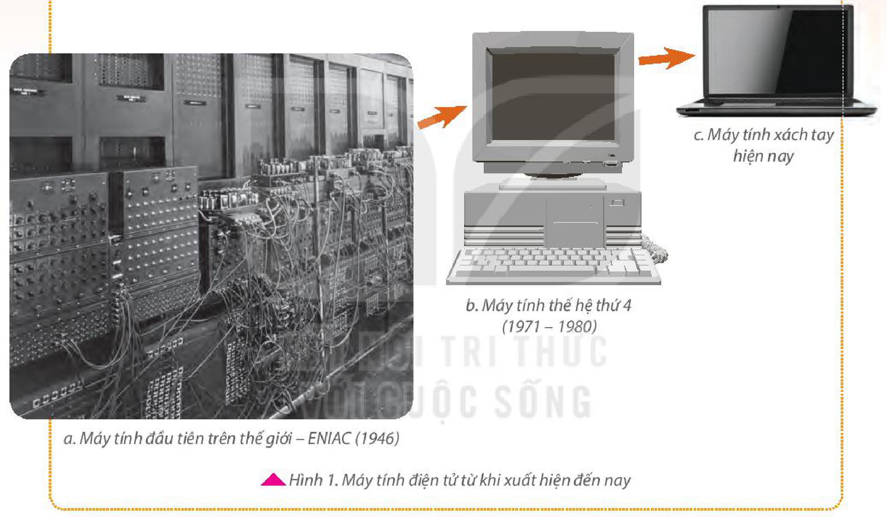
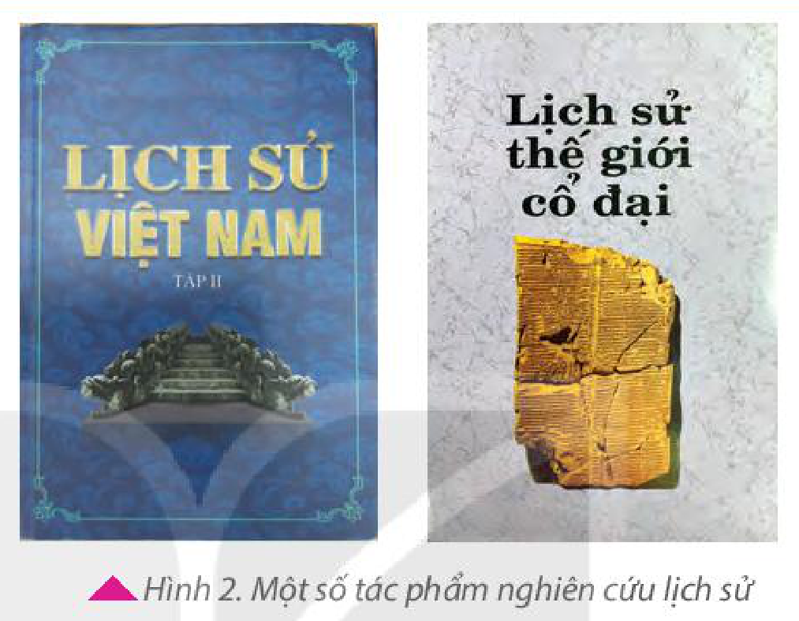
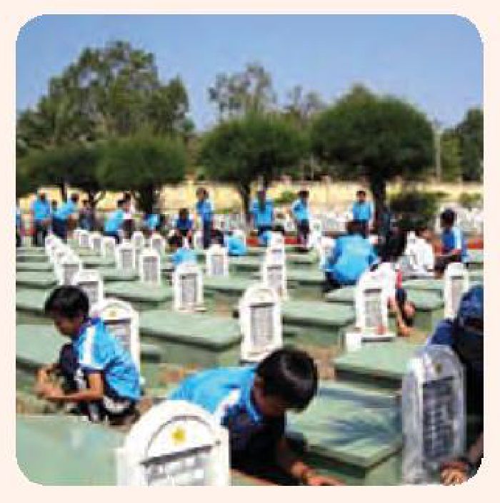

<!-- pdf:10 -->

# BÀI 1: LỊCH SỬ VÀ CUỘC SỐNG

## 🎯 Học xong bài này, em sẽ:

- Nêu được khái niệm lịch sử và môn Lịch sử.
- Hiểu được lịch sử là những gì đã diễn ra trong quá khứ.
- Giải thích được vì sao cần học lịch sử.

## 🔴 Mở đầu

Quan sát hình 1, em hãy chỉ ra những điểm thay đổi theo thời gian của máy tính điện tử. Theo em, sự thay đổi theo thời gian như vậy được hiểu là gì?

*Hình 1. Máy tính điện tử từ khi xuất hiện đến nay*

## 1. Lịch sử là gì?

Máy tính điện tử cũng như mọi sự vật xung quanh chúng ta, cả con người và xã hội loài người đều biến đổi theo thời gian. Sự thay đổi đó chính là lịch sử.

<!-- term: Lịch sử -->
*Lịch sử* là tất cả những gì đã xảy ra và lịch sử còn được hiểu là một khoa học nghiên cứu và phục dựng lại quá khứ.

<!-- term: Môn Lịch sử -->
*Môn Lịch sử* là môn học tìm hiểu quá trình hình thành và phát triển của xã hội loài người từ khi con người xuất hiện trên Trái Đất cho đến ngày nay.

> ❓ Khái niệm lịch sử được hiểu như thế nào? Nêu ví dụ cụ thể.

<!-- pdf:11 -->

## 2. Vì sao phải học lịch sử?

<!-- term: Ý nghĩa của việc học lịch sử -->
Học lịch sử giúp chúng ta tìm hiểu quá khứ, tìm về cội nguồn của chính bản thân, gia đình, dòng họ,... và rộng hơn là của cả dân tộc, nhân loại.

> *Dân ta phải biết sử ta*
> *Cho tường gốc tích nước nhà Việt Nam.*
>
> (Hồ Chí Minh)
<!-- ocr-ok: đã đối chiếu p011.png, hộp thơ in nền màu nên OCR nhầm dấu ("biêt", "góc tích") -->

> 🔗 **Kết nối với ngày nay**
>
> Ngày 19 – 9 – 1954, tại Đền Hùng (Phú Thọ), Bác Hồ đã căn dặn các chiến sĩ: "Hôm nay gặp các chú ở Đền Hùng có ý nghĩa to lớn vì Vua Hùng là vị vua khai quốc... Các Vua Hùng đã có công dựng nước, Bác cháu ta phải cùng nhau giữ lấy nước".

*Hình 2. Một số tác phẩm nghiên cứu lịch sử*

<!-- term: Ý nghĩa của việc học lịch sử -->
Học lịch sử còn để đúc kết những bài học kinh nghiệm về sự thành công và thất bại của quá khứ để phục vụ hiện tại và xây dựng cuộc sống mới trong tương lai.

> ❓ 1. Nêu ý nghĩa hai câu thơ trên của Chủ tịch Hồ Chí Minh.
>
> 2. Theo em, việc biên soạn các tác phẩm lịch sử (như hình 2) có tác dụng gì?
>
> 3. Vì sao phải học lịch sử?

## ✏️ Luyện tập và Vận dụng

1. Nhà chính trị nổi tiếng của La Mã cổ đại Xi-xê-rông đã nói: “Lịch sử là thầy dạy của cuộc sống”. Em có đồng ý với nhận xét đó không? Vì sao?

2. Các bạn trong hình bên đang làm gì? Theo em, việc làm đó có ý nghĩa như thế nào?

3. Hãy chia sẻ với thầy/cô giáo và các bạn các hình thức học lịch sử mà em biết; cách học lịch sử giúp em hứng thú và đạt hiệu quả tốt nhất.

4. Hãy tìm hiểu xem trong lớp có bao nhiêu bạn thích học môn Toán, môn Ngữ văn và môn Lịch sử. Theo em, các bạn thích học những môn khác có cần biết lịch sử không? Vì sao?

## 📷 Danh sách hình trong bài

| Mã hình | Trang PDF | Trang sách | Chú thích |
| --- | --- | --- | --- |
| H6-lich_su_va_dia_ly-ls-b01-01 | 10 | 9 | Hình 1. Máy tính điện tử từ khi xuất hiện đến nay |
| H6-lich_su_va_dia_ly-ls-b01-02 | 11 | 10 | Hình 2. Một số tác phẩm nghiên cứu lịch sử |
| H6-lich_su_va_dia_ly-ls-b01-03 | 11 | 10 | [Hình minh hoạ câu hỏi 2 mục Luyện tập và Vận dụng] |
