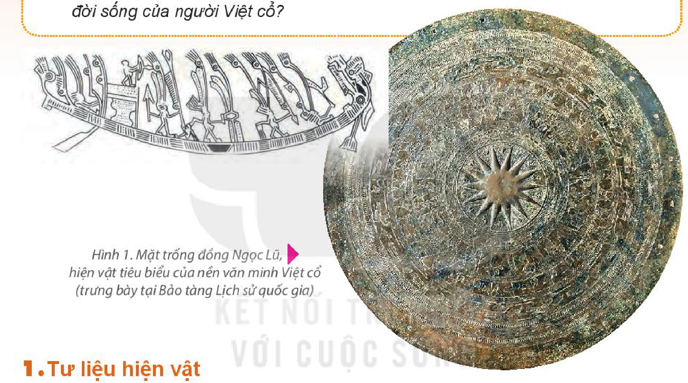
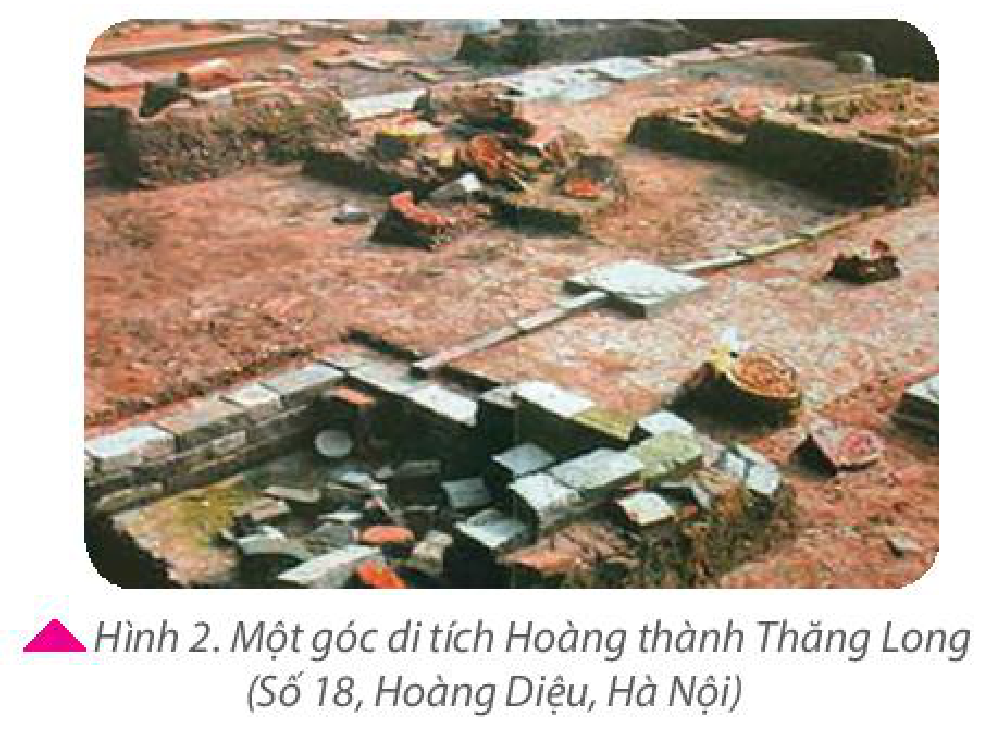
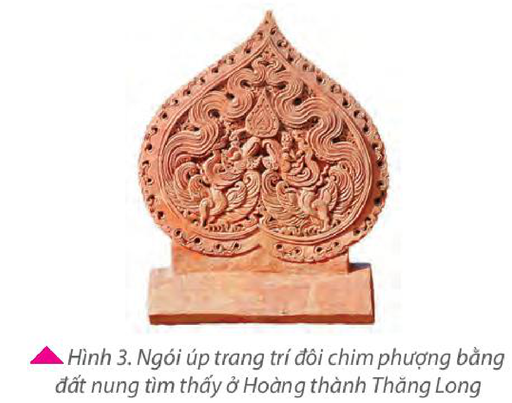
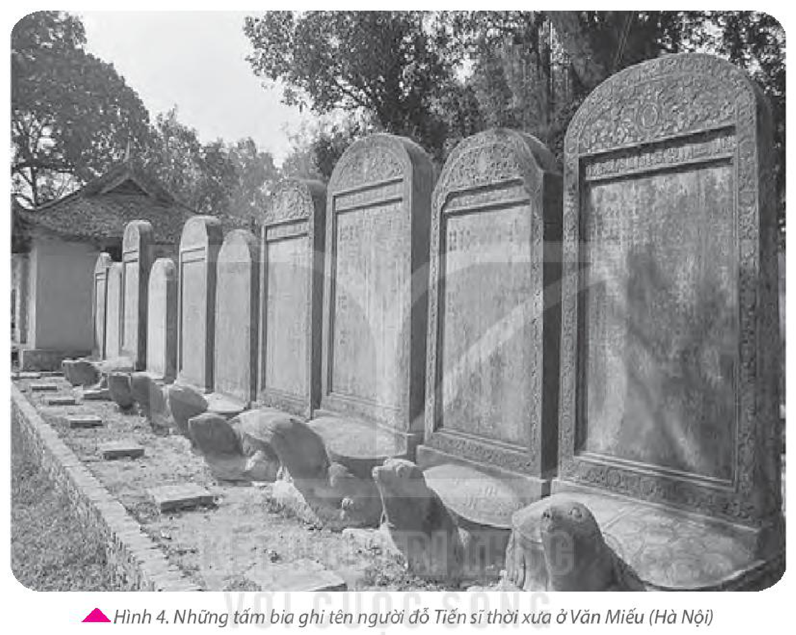
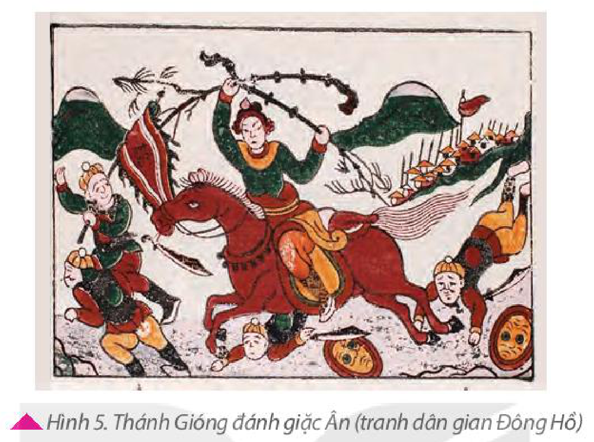

<!-- pdf:12 -->

# BÀI 2: DỰA VÀO ĐÂU ĐỂ BIẾT VÀ PHỤC DỰNG LẠI LỊCH SỬ?

## 🎯 Học xong bài này, em sẽ:

- Phân biệt được các nguồn sử liệu cơ bản: tư liệu hiện vật, chữ viết, truyền miệng, gốc,...
- Trình bày được ý nghĩa và giá trị của các nguồn sử liệu trên.

## 🔴 Mở đầu

<!-- term: Tư liệu lịch sử -->
Các nhà sử học làm công việc tương tự như những thám tử. Muốn dựng lại lịch sử, họ phải đi tìm các bằng chứng, tức là các tư liệu lịch sử. Hình ảnh dưới đây là một dạng tư liệu lịch sử. Quan sát hình ảnh, em nhận thấy những hoa văn trên mặt trống đồng miêu tả những gì? Qua đó, em có thể biết được gì về đời sống của người Việt cổ?

*Hình 1. Mặt trống đồng Ngọc Lũ, hiện vật tiêu biểu của nền văn minh Việt cổ (trưng bày tại Bảo tàng Lịch sử quốc gia)*

## 1. Tư liệu hiện vật

<!-- term: Tư liệu hiện vật -->
Tư liệu hiện vật là những di tích, đồ vật,... của người xưa còn lưu giữ lại trong lòng đất hay trên mặt đất. Tuy đây chỉ là những hiện vật, nhưng nếu biết khai thác, chúng có thể cho ta biết khá cụ thể và trung thực về đời sống vật chất và phần nào đời sống tinh thần của người xưa.

*Hình 2. Một góc di tích Hoàng thành Thăng Long (Số 18, Hoàng Diệu, Hà Nội)*

*Hình 3. Ngói úp trang trí đôi chim phượng bằng đất nung tìm thấy ở Hoàng thành Thăng Long*

<!-- pdf:13 -->

> ❓ Thế nào là tư liệu hiện vật? Từ hình 2 và 3, em hãy kể thêm một số tư liệu hiện vật mà em biết.

## 2. Tư liệu chữ viết

<!-- term: Tư liệu chữ viết -->
Những bản ghi, tài liệu chép tay hay sách được in, khắc chữ được gọi chung là *tư liệu chữ viết*. Nguồn tư liệu này ghi chép tương đối đầy đủ về đời sống con người. Tuy nhiên, tư liệu chữ viết thường mang ý thức chủ quan của tác giả tư liệu.

*Hình 4. Những tấm bia ghi tên người đỗ Tiến sĩ thời xưa ở Văn Miếu (Hà Nội)*

> *10/5/1969*
>
> *"Cuộc chống Mỹ, cứu nước của nhân dân ta dù phải kinh qua gian khổ hi sinh nhiều hơn nữa, song nhất định thắng lợi hoàn toàn.*
>
> *Đó là một điều chắc chắn.*
>
> *Tôi có ý định đến ngày đó, tôi sẽ đi khắp hai miền Nam Bắc, để chúc mừng đồng bào, cán bộ, và chiến sĩ anh hùng, thăm hỏi các cụ phụ lão, các cháu thanh niên và nhi đồng yêu quý của chúng ta."*
>
> (Trích *Di chúc*, *Hồ Chí Minh toàn tập*, Tập 15, NXB Chính trị quốc gia, Hà Nội, 2011, tr. 610.)

> ❓ 1. Đoạn tư liệu trên từ *Di chúc* của Chủ tịch Hồ Chí Minh cho em biết thông tin gì?
>
> 2. Em hiểu thế nào là tư liệu chữ viết? Vì sao bia Tiến sĩ ở Văn Miếu (hình 4) được coi là tư liệu chữ viết?

<!-- pdf:14 -->

## 3. Tư liệu truyền miệng

<!-- term: Tư liệu truyền miệng -->
Những câu chuyện dân gian (thần thoại, truyền thuyết, cổ tích,...) được kể truyền miệng từ đời này qua đời khác gọi là *tư liệu truyền miệng*. Loại tư liệu này thường không cho biết chính xác về thời gian và địa điểm, nhưng phần nào phản ánh hiện thực lịch sử.

*Hình 5. Thánh Gióng đánh giặc Ân (tranh dân gian Đông Hồ)*

> ❓ 1. Thế nào là tư liệu truyền miệng?
>
> 2. Hình 5 giúp em liên tưởng đến truyền thuyết nào trong dân gian?

## 4. Tư liệu gốc

<!-- term: Tư liệu gốc -->
Tư liệu gốc là tư liệu cung cấp những thông tin đầu tiên và trực tiếp về sự kiện hoặc thời kì lịch sử nào đó. Đây là nguồn tư liệu đáng tin cậy nhất khi tìm hiểu lịch sử.

Dựa vào các nguồn tư liệu, mỗi nhà sử học thường chỉ có thể làm sáng tỏ được một phần lịch sử theo quan điểm của mình, vì vậy, chúng ta có thể bắt gặp nhiều cách giải thích khác nhau về cùng một sự việc trong quá khứ. Khi nào chính em tự mình lí giải được sự việc đã xảy ra dựa trên những chứng cứ khoa học có được là em đã sắp trở thành "nhà sử học" rồi đấy.

> ❓ Em hiểu thế nào là tư liệu gốc? Nêu ví dụ cụ thể.

## ✏️ Luyện tập và Vận dụng

1. Theo em, tư liệu hiện vật, tư liệu chữ viết, tư liệu truyền miệng và tư liệu gốc có ý nghĩa và giá trị gì?

2. Theo em, đoạn tư liệu và các hình 2, 3, 4 và 5 trong bài học, hình ảnh, tư liệu nào thuộc tư liệu gốc?

3. Hãy kể tên một số truyền thuyết có liên quan đến lịch sử mà em biết.

4. Ở nhà em hoặc nơi em sinh sống có những hiện vật nào có thể giúp tìm hiểu lịch sử? Hãy giới thiệu ngắn gọn một hiện vật mà em thích nhất.

## 📷 Danh sách hình trong bài

| Mã hình | Trang PDF | Trang sách | Chú thích |
| --- | --- | --- | --- |
| H6-lich_su_va_dia_ly-ls-b02-01 | 12 | 11 | Hình 1. Mặt trống đồng Ngọc Lũ, hiện vật tiêu biểu của nền văn minh Việt cổ (trưng bày tại Bảo tàng Lịch sử quốc gia) |
| H6-lich_su_va_dia_ly-ls-b02-02 | 12 | 11 | Hình 2. Một góc di tích Hoàng thành Thăng Long (Số 18, Hoàng Diệu, Hà Nội) |
| H6-lich_su_va_dia_ly-ls-b02-03 | 12 | 11 | Hình 3. Ngói úp trang trí đôi chim phượng bằng đất nung tìm thấy ở Hoàng thành Thăng Long |
| H6-lich_su_va_dia_ly-ls-b02-04 | 13 | 12 | Hình 4. Những tấm bia ghi tên người đỗ Tiến sĩ thời xưa ở Văn Miếu (Hà Nội) |
| H6-lich_su_va_dia_ly-ls-b02-05 | 14 | 13 | Hình 5. Thánh Gióng đánh giặc Ân (tranh dân gian Đông Hồ) |
