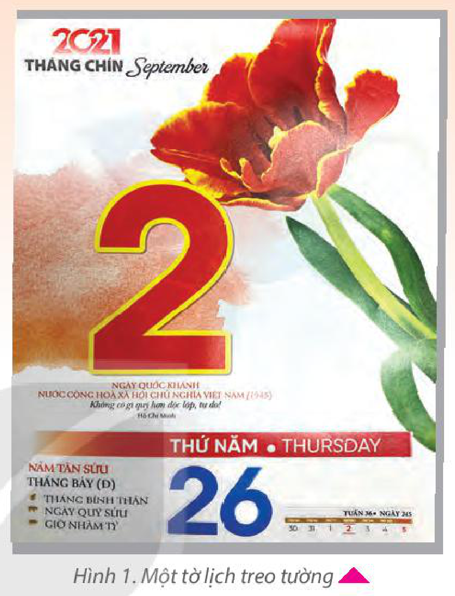
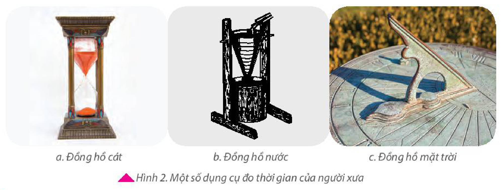
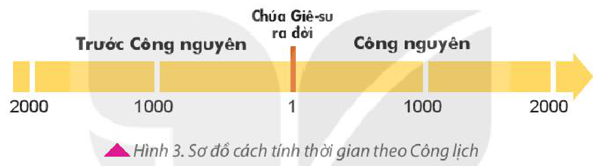

<!-- pdf:15 -->

# BÀI 3: THỜI GIAN TRONG LỊCH SỬ

## 🎯 Học xong bài này, em sẽ:

- Nêu được một số khái niệm (thập kỉ, thế kỉ, thiên niên kỉ, trước Công nguyên, Công nguyên, âm lịch, dương lịch,...); cách tính thời gian trong lịch sử.
- Biết cách đọc, ghi các mốc thời gian trong lịch sử.

## 🔴 Mở đầu

Hãy quan sát tờ lịch bên cạnh và cho biết vì sao trên cùng một tờ lịch lại ghi hai ngày khác nhau?

*Hình 1. Một tờ lịch treo tường*

## 1. Vì sao phải xác định thời gian trong lịch sử?

Lịch sử là những gì đã xảy ra trong quá khứ theo trình tự thời gian. Muốn hiểu và dựng lại lịch sử, cần sắp xếp tất cả sự kiện theo đúng trình tự của nó.

Để xác định được thời gian, ta cần biết cách tính. Từ xa xưa, các dân tộc trên thế giới đã sáng tạo ra nhiều cách đo thời gian khác nhau.

*Hình 2. Một số dụng cụ đo thời gian của người xưa*

> ❓ Tại sao phải xác định thời gian trong lịch sử? Con người thời xưa đã xác định thời gian bằng những cách nào?

<!-- pdf:16 -->

## 2. Các cách tính thời gian trong lịch sử

Từ xa xưa con người đã nghĩ ra cách làm lịch. Người Ai Cập, Lưỡng Hà hay Trung Quốc cổ đại và một số dân tộc phương Đông khác thì tính theo *âm lịch*, còn người La Mã và nhiều tộc người ở châu Âu,... thì tính theo *dương lịch*.

<!-- term: Âm lịch -->
Âm lịch là hệ lịch được tính theo chu kì chuyển động của Mặt Trăng quanh Trái Đất.

<!-- term: Dương lịch -->
Dương lịch là hệ lịch được tính theo chu kì chuyển động của Trái Đất quanh Mặt Trời.

<!-- term: Công lịch -->
<!-- term: Công nguyên -->
<!-- term: Trước Công nguyên -->
<!-- term: Thập kỉ -->
<!-- term: Thế kỉ -->
<!-- term: Thiên niên kỉ -->
Về sau, dương lịch đã được hoàn chỉnh và thống nhất để các dân tộc đều có thể sử dụng, đó là Công lịch. Công lịch lấy năm ra đời của Chúa Giê-su – tương truyền là người sáng lập ra đạo Thiên Chúa, là năm đầu tiên của Công nguyên. Ngay trước năm đó là năm 1 trước Công nguyên (TCN). Đồng thời còn có cách phân chia thời gian thành thập kỉ (10 năm), thế kỉ (100 năm) và thiên niên kỉ (1 000 năm), tính từ năm đầu tiên của các khoảng thời gian đó.

*Hình 3. Sơ đồ cách tính thời gian theo Công lịch*

Hiện nay, ở Việt Nam, Công lịch được dùng chính thức trong các cơ quan và văn bản nhà nước, tuy nhiên, âm lịch vẫn được phổ biến rộng rãi trong nhân dân. Vì vậy, trên tờ lịch đều in ngày, tháng, năm của cả hai loại lịch này.

> ❓ 1. Muốn biết năm 2000 TCN cách năm hiện tại bao nhiêu năm thì em sẽ tính như thế nào?
>
> 2. Hãy cho biết các cách tính thời gian trong lịch sử.

## ✏️ Luyện tập và Vận dụng

1. Các sự kiện dưới đây xảy ra cách năm hiện tại khoảng bao nhiêu năm?
- Khoảng thiên niên kỉ III TCN, người Ai Cập đã biết làm lịch.
- Thục Phán lập ra nước Âu Lạc vào khoảng năm 208 TCN.

2. Hãy kể những ngày nghỉ lễ theo âm lịch và dương lịch ở nước ta.

3. Hãy lựa chọn và sắp xếp những sự kiện quan trọng của cá nhân em trong khoảng 5 năm gần đây theo đúng trình tự (có thể thể hiện trên trục thời gian).

## 📷 Danh sách hình trong bài

| Mã hình | Trang PDF | Trang sách | Chú thích |
| --- | --- | --- | --- |
| H6-lich_su_va_dia_ly-ls-b03-01 | 15 | 14 | Hình 1. Một tờ lịch treo tường |
| H6-lich_su_va_dia_ly-ls-b03-02 | 15 | 14 | Hình 2. Một số dụng cụ đo thời gian của người xưa |
| H6-lich_su_va_dia_ly-ls-b03-03 | 16 | 15 | Hình 3. Sơ đồ cách tính thời gian theo Công lịch |
