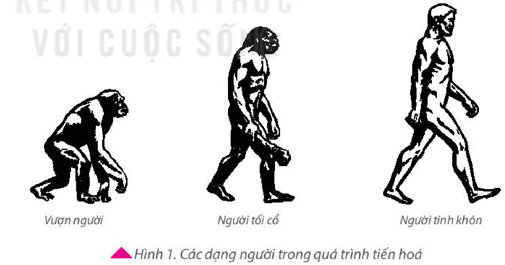
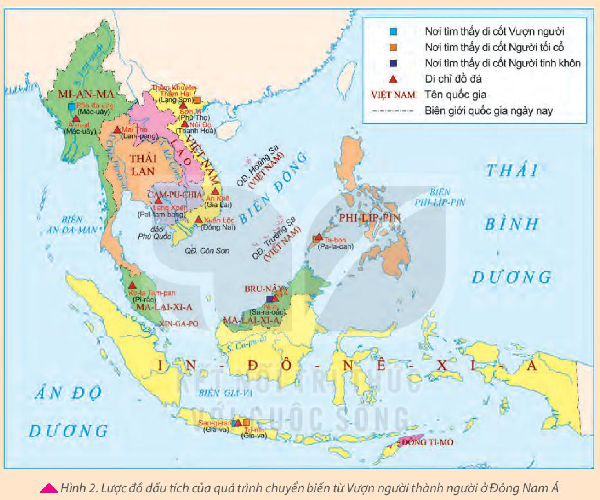
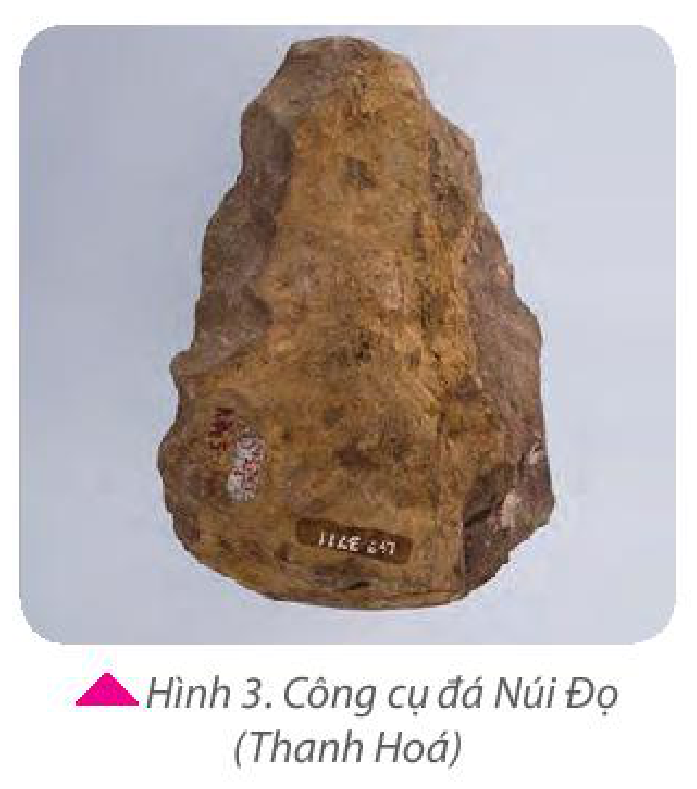
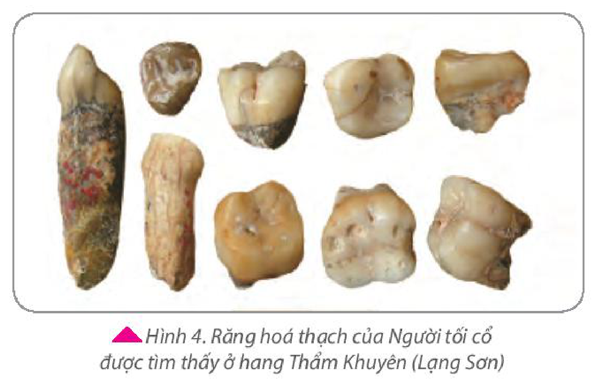
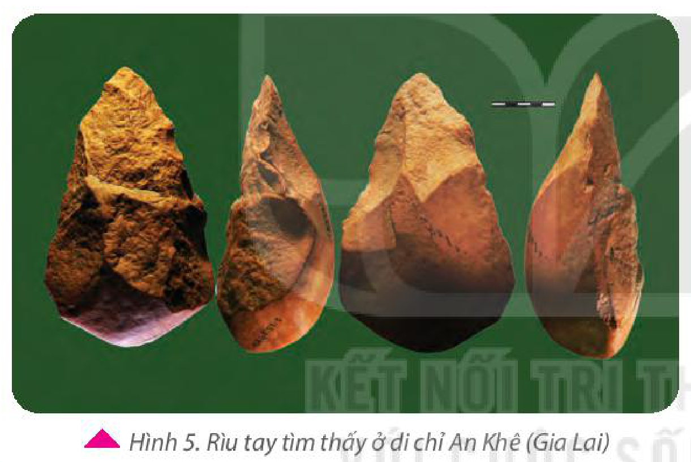

<!-- pdf:18 -->

# BÀI 4: NGUỒN GỐC LOÀI NGƯỜI

## 🎯 Học xong bài này, em sẽ:

- Mô tả được quá trình tiến hoá từ Vượn người thành người trên Trái Đất.
- Xác định được dấu tích của Người tối cổ ở Đông Nam Á và Việt Nam.

## 🔴 Mở đầu

Người châu Phi, châu Á và châu Âu có màu da như thế nào? Liệu họ có cùng chung một nguồn gốc hay không? Nếu có thì từ đâu mà ra?

## 1. Quá trình tiến hoá từ Vượn người thành người

<!-- term: Vượn người -->
<!-- term: Người tối cổ -->
<!-- term: Người tinh khôn -->
Quá trình tiến hoá từ Vượn người thành người đã diễn ra cách đây hàng triệu năm. Ở chặng đầu của quá trình đó, cách ngày nay khoảng 5 – 6 triệu năm, đã có một loài Vượn người sinh sống. Từ loài Vượn người, một nhánh đã phát triển lên thành Người tối cổ. Dạng người này xuất hiện khoảng 4 triệu năm trước, đến khoảng 15 vạn năm trước(1) thì biến đổi thành Người tinh khôn.

<!-- term: Người tối cổ -->
> 💡 **Em có biết?**
>
> - Những phát hiện gần đây ở Đông Phi đã dẫn tới quan điểm cho rằng nơi đây là một trong những “cái nôi” của loài người.
> - Người tối cổ thường xuyên đi, đứng bằng hai chân, hai chi trước thành hai tay, có thể cầm nắm, thể tích sọ não lớn hơn và đã hình thành trung tâm phát tiếng nói trong não.

*Hình 1. Các dạng người trong quá trình tiến hoá*

> ❓ Dựa vào hình trên và trục thời gian (tr.16), em hãy cho biết quá trình tiến hoá từ Vượn người thành người đã trải qua các giai đoạn nào? Cho biết niên đại tương ứng của các giai đoạn đó.

<!-- term: Người tinh khôn -->
*(1) Về niên đại xuất hiện Người tinh khôn, có sách viết: khoảng 4 vạn năm trước.*

<!-- pdf:19 -->

## 2. Những dấu tích của quá trình chuyển biến từ Vượn người thành người ở Đông Nam Á và Việt Nam

Tại khu vực Đông Nam Á đã diễn ra quá trình tiến hoá từ Vượn người thành người từ rất sớm. Dấu tích của Người tối cổ đã được tìm thấy ở khắp Đông Nam Á, trong đó có Việt Nam. Đó là những di cốt hoá thạch và công cụ đá do con người chế tạo ra.

*Hình 2. Lược đồ dấu tích của quá trình chuyển biến từ Vượn người thành người ở Đông Nam Á*

> *Di cốt của loài Vượn người sống cách ngày nay khoảng 5 triệu năm đã được tìm thấy ở Mi-an-ma và In-đô-nê-xi-a. Đặc biệt, hoá thạch phát hiện trên đảo Gia-va (In-đô-nê-xi-a) có niên đại khoảng 2 triệu năm trước là dấu vết xưa nhất của Người tối cổ ở Đông Nam Á. Di cốt, mảnh di cốt và những công cụ đá của Người tối cổ còn được tìm thấy ở Thái Lan, Phi-líp-pin, Ma-lai-xi-a. Chiếc sọ Người tinh khôn tìm thấy ở hang Ni-a (Ma-lai-xi-a) có niên đại cách ngày nay khoảng 4 vạn năm.*

<!-- pdf:20 -->

Ở Việt Nam cũng đã phát hiện răng của Người tối cổ ở Thẩm Khuyên, Thẩm Hai (Lạng Sơn),... Những công cụ đá được ghè đẽo thô sơ của Người tối cổ cũng đã có mặt ở An Khê (Gia Lai), Núi Đọ (Thanh Hoá), Xuân Lộc (Đồng Nai), An Lộc (Bình Phước),...

*Hình 3. Công cụ đá Núi Đọ (Thanh Hoá)*

*Hình 4. Răng hoá thạch của Người tối cổ được tìm thấy ở hang Thẩm Khuyên (Lạng Sơn)*

*Hình 5. Rìu tay tìm thấy ở di chỉ An Khê (Gia Lai)*

> 💡 **Em có biết?**
>
> Tại di chỉ An Khê (thị xã An Khê, tỉnh Gia Lai), người ta đã phát hiện được trên 3 000 hiện vật đá (gồm rìu tay, công cụ ghè đẽo thô sơ,...) có niên đại cách ngày nay 80 vạn năm. Đây là dấu tích cổ xưa nhất chứng tỏ sự xuất hiện sớm của người nguyên thuỷ trên đất nước Việt Nam.

> ❓ Hãy xác định những dấu tích của Người tối cổ tìm được ở Đông Nam Á và Việt Nam trên lược đồ (hình 2, tr.18). Những dấu tích đó chứng tỏ điều gì?

## ✏️ Luyện tập và Vận dụng

1. Từ những thông tin và hình ảnh trong bài học, hãy cho biết những bằng chứng nào chứng tỏ ở khu vực Đông Nam Á và Việt Nam diễn ra quá trình tiến hoá từ Vượn người thành người?

2. Quan sát hình 1 (tr.17), em thấy Vượn người, Người tinh khôn và Người tối cổ có điểm gì khác nhau?

3. Làm việc theo nhóm: Hãy sưu tầm tư liệu (chữ viết, hình ảnh) và giới thiệu quá trình phát triển của người nguyên thuỷ trên thế giới hoặc ở Việt Nam.

## 📷 Danh sách hình trong bài

| Mã hình | Trang PDF | Trang sách | Chú thích |
| --- | --- | --- | --- |
| H6-lich_su_va_dia_ly-ls-b04-01 | 18 | 17 | Hình 1. Các dạng người trong quá trình tiến hoá |
| H6-lich_su_va_dia_ly-ls-b04-02 | 19 | 18 | Hình 2. Lược đồ dấu tích của quá trình chuyển biến từ Vượn người thành người ở Đông Nam Á |
| H6-lich_su_va_dia_ly-ls-b04-03 | 20 | 19 | Hình 3. Công cụ đá Núi Đọ (Thanh Hoá) |
| H6-lich_su_va_dia_ly-ls-b04-04 | 20 | 19 | Hình 4. Răng hoá thạch của Người tối cổ được tìm thấy ở hang Thẩm Khuyên (Lạng Sơn) |
| H6-lich_su_va_dia_ly-ls-b04-05 | 20 | 19 | Hình 5. Rìu tay tìm thấy ở di chỉ An Khê (Gia Lai) |
