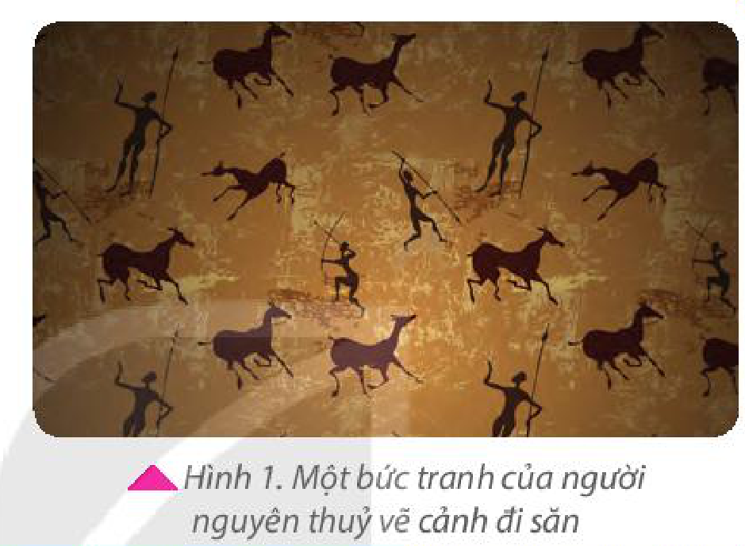
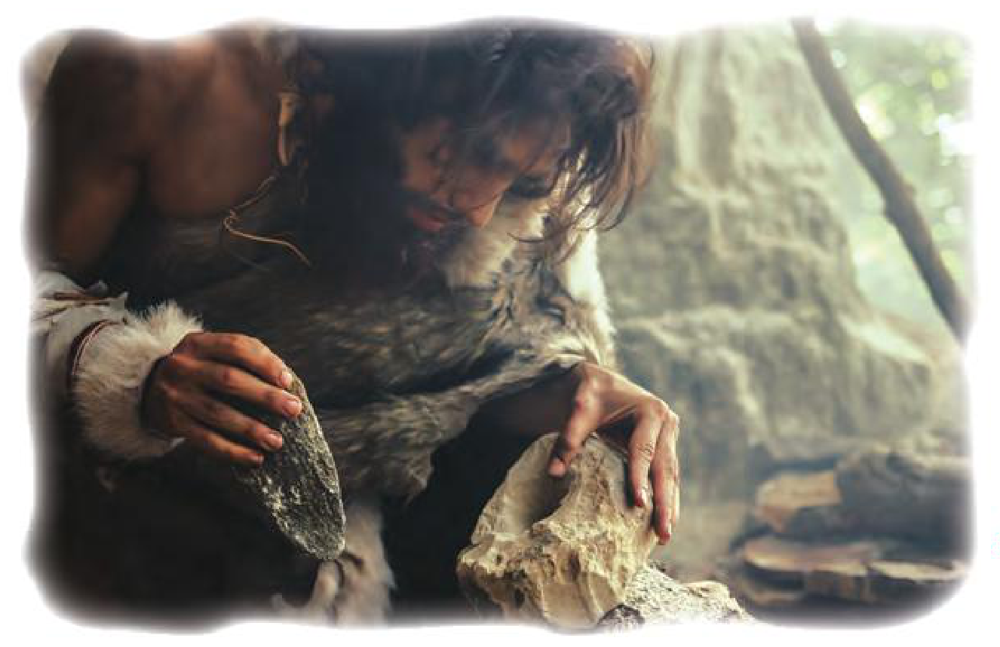
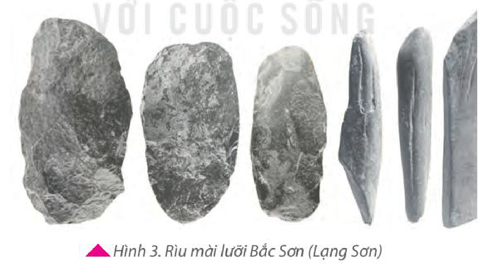
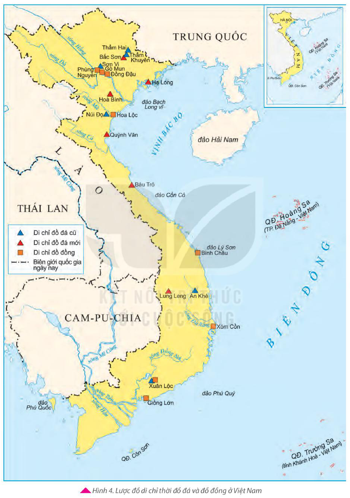
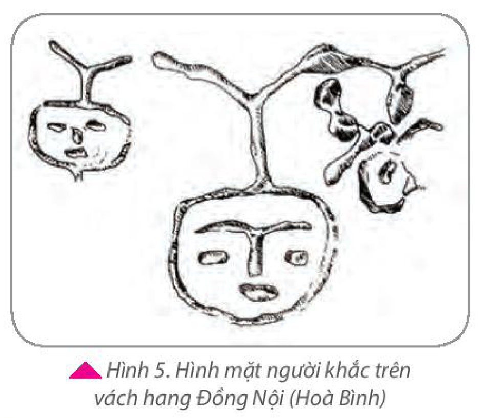
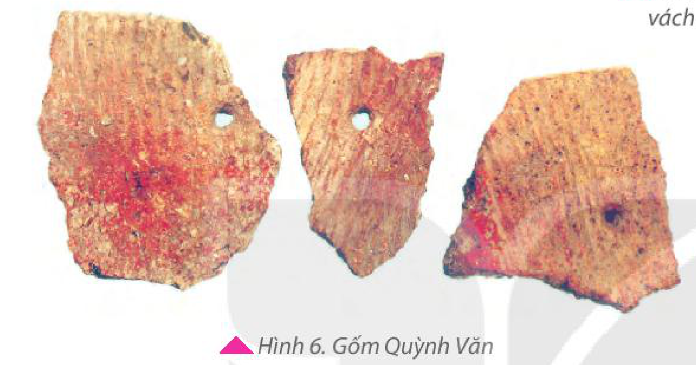

<!-- pdf:21 -->

# BÀI 5: XÃ HỘI NGUYÊN THUỶ

## 🎯 Học xong bài này, em sẽ:

- Mô tả được sơ lược các giai đoạn tiến triển của xã hội nguyên thuỷ.
- Trình bày được những nét chính về đời sống vật chất, tinh thần và tổ chức xã hội của người nguyên thuỷ.
- Nhận biết được vai trò của lao động đối với quá trình phát triển của người nguyên thuỷ cũng như xã hội loài người.
- Nêu được đôi nét về đời sống của người nguyên thuỷ trên đất nước Việt Nam.

## 🔴 Mở đầu

Có một số bức tranh được cho là của người nguyên thuỷ vẽ trên vách hang đá. Một số người cho rằng người nguyên thuỷ sống như những bầy động vật hoang dã, lang thang trong các khu rừng rậm, không có tổ chức, ăn sống nuốt tươi,... Liệu trong thực tế có đúng như vậy không?

*Hình 1. Một bức tranh của người nguyên thuỷ vẽ cảnh đi săn*

## 1. Các giai đoạn phát triển của xã hội nguyên thuỷ

<!-- term: Bầy người nguyên thuỷ -->
<!-- term: Công xã thị tộc -->
Xã hội nguyên thuỷ kéo dài hàng triệu năm, trải qua hai giai đoạn: bầy người nguyên thuỷ và công xã thị tộc.

<!-- term: Người tinh khôn -->
<!-- term: Bầy người nguyên thuỷ -->
<!-- term: Công xã thị tộc -->
| | Bầy người nguyên thuỷ | Công xã thị tộc |
| --- | --- | --- |
| Dạng người | Người tối cổ | Người tinh khôn. Hình thành ba chủng tộc lớn: da vàng, da trắng và da đen. |
| Đời sống vật chất | Sống trong hang, động, dựa vào săn bắt và hái lượm. | Biết trồng trọt, chăn nuôi, dệt vải và làm gốm. |
| Tổ chức xã hội | Sống thành bầy, có người đứng đầu, có sự phân công lao động và cùng chăm sóc con cái. | Công xã thị tộc gồm 2, 3 thế hệ, có cùng dòng máu, làm chung và hưởng chung. |
| Đời sống tinh thần | Biết làm đồ trang sức, vẽ tranh trên vách đá,... | Biết làm đồ trang sức tinh tế hơn, làm tượng bằng đá hoặc đất nung,... Đã có tục chôn người chết và đời sống tâm linh. |

*Bảng hệ thống các giai đoạn phát triển của xã hội nguyên thuỷ trên thế giới*

<!-- pdf:22 -->

*Hình 2. Hình ảnh thực nghiệm cách chế tạo công cụ đá của người nguyên thuỷ*

<!-- term: Thị tộc -->
<!-- term: Bộ lạc -->
> 💡 **Em có biết?**
>
> *Thị tộc* là một nhóm người, gồm khoảng 2 – 3 thế hệ có cùng dòng máu, sống quần tụ với nhau. Nhiều thị tộc sống cạnh nhau, có quan hệ họ hàng và gắn bó với nhau hợp thành *bộ lạc*.

Trong quá trình lao động, tìm kiếm thức ăn, đôi bàn tay của người nguyên thuỷ dần trở nên khéo léo hơn, cơ thể cũng dần biến đổi để trở thành Người hiện đại. Nhờ có lao động, con người đã từng bước tự cải biến, hoàn thiện mình và làm cho đời sống ngày càng phong phú hơn.

> ❓ 1. Xã hội nguyên thuỷ đã trải qua những giai đoạn phát triển nào?
>
> 2. Dựa vào bảng (tr.20), hãy cho biết đời sống vật chất, tinh thần và tổ chức xã hội của Người tối cổ và Người tinh khôn.

## 2. Đời sống vật chất và tinh thần của người nguyên thuỷ trên đất nước Việt Nam

Ở Việt Nam, người nguyên thuỷ đã biết mài đá, tạo ra nhiều loại công cụ khác nhau (rìu, bôn, chày, cuốc đá) và vũ khí (mũi tên, mũi lao). Đồ gốm đã dần phổ biến với hoa văn trang trí phong phú.

*Hình 3. Rìu mài lưỡi Bắc Sơn (Lạng Sơn)*

<!-- term: Văn hoá Hoà Bình -->
Trong các hang động thuộc văn hoá Hoà Bình đã tìm thấy nhiều xương của một số loại gia súc và dấu vết của các loại cây ăn quả, rau đậu, chứng tỏ cư dân Hoà Bình đã bước đầu biết làm nông nghiệp.

Họ sống chủ yếu trong các hang động, mái đá hoặc các túp lều lợp bằng cỏ khô hay lá cây. Nguồn thức ăn bao gồm cả những sản phẩm săn bắn, hái lượm và tự trồng trọt, chăn nuôi.

<!-- pdf:23 -->

*Hình 4. Lược đồ di chỉ thời đồ đá và đồ đồng ở Việt Nam*

<!-- pdf:24 -->

Trong các di chỉ, người ta đã tìm thấy nhiều viên đất nung có dùi lỗ và xâu thành chuỗi, nhiều vỏ ốc biển được mài thủng, có thể xâu dây làm đồ trang sức, những bộ đàn đá, vòng tay,... Hoa văn trên đồ gốm cũng dần mang tính chất nghệ thuật, trang trí.

Trong nhiều hang động, người ta đã phát hiện các mộ táng, có chôn theo công cụ và đồ trang sức.

*Hình 5. Hình mặt người khắc trên vách hang Đồng Nội (Hoà Bình)*

*Hình 6. Gốm Quỳnh Văn*

<!-- term: Văn hoá Quỳnh Văn -->
> 💡 **Em có biết?**
>
> Văn hoá Quỳnh Văn tập trung chủ yếu ở vùng ven biển Quỳnh Lưu (Nghệ An). Người Quỳnh Văn có nghề làm gốm rất phát triển với hoa văn phong phú.
<!-- ocr-ok: đã đối chiếu p024.png, hộp Em có biết? đặt sát Hình 6 nên OCR trộn dòng chú thích và nhầm dấu ("Quynh Lưu", "phone phú") -->

> ❓ 1. Em nhận thấy kĩ thuật chế tác công cụ Bắc Sơn có điểm gì tiến bộ hơn so với Núi Đọ?
>
> 2. Khai thác kênh hình và thông tin ở mục 2, hãy cho biết những nét chính về đời sống vật chất, tinh thần của người nguyên thuỷ trên đất nước Việt Nam.

## ✏️ Luyện tập và Vận dụng

1. Theo em, lao động có vai trò như thế nào trong việc làm thay đổi con người và cuộc sống của người nguyên thuỷ?

2. Đời sống vật chất, tinh thần và tổ chức xã hội của Người tinh khôn có những điểm nào tiến bộ hơn so với Người tối cổ?

3. Tìm trên lược đồ hình 4 (tr.22) kết hợp với tra cứu thông tin từ sách, báo và internet, hãy cho biết các di tích thời đồ đá được phân bố ở những tỉnh nào của nước ta ngày nay và sự phân bố đó nói lên điều gì.

## 📷 Danh sách hình trong bài

| Mã hình | Trang PDF | Trang sách | Chú thích |
| --- | --- | --- | --- |
| H6-lich_su_va_dia_ly-ls-b05-01 | 21 | 20 | Hình 1. Một bức tranh của người nguyên thuỷ vẽ cảnh đi săn |
| H6-lich_su_va_dia_ly-ls-b05-02 | 22 | 21 | Hình 2. Hình ảnh thực nghiệm cách chế tạo công cụ đá của người nguyên thuỷ |
| H6-lich_su_va_dia_ly-ls-b05-03 | 22 | 21 | Hình 3. Rìu mài lưỡi Bắc Sơn (Lạng Sơn) |
| H6-lich_su_va_dia_ly-ls-b05-04 | 23 | 22 | Hình 4. Lược đồ di chỉ thời đồ đá và đồ đồng ở Việt Nam |
| H6-lich_su_va_dia_ly-ls-b05-05 | 24 | 23 | Hình 5. Hình mặt người khắc trên vách hang Đồng Nội (Hoà Bình) |
| H6-lich_su_va_dia_ly-ls-b05-06 | 24 | 23 | Hình 6. Gốm Quỳnh Văn |
