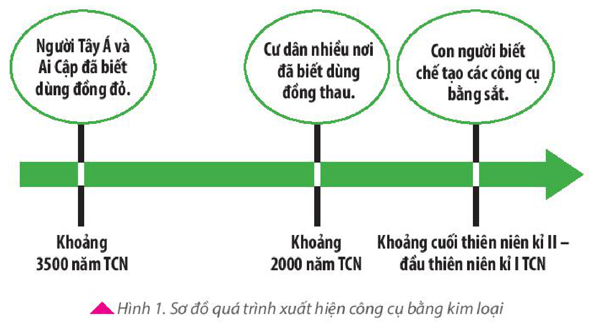
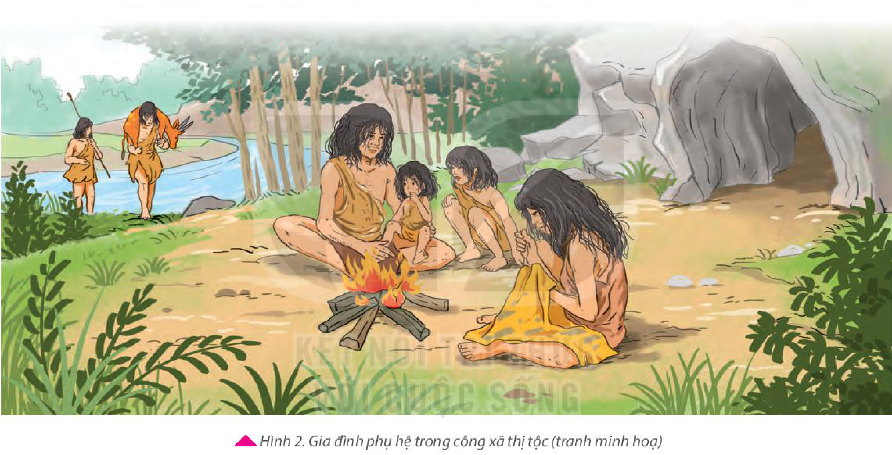
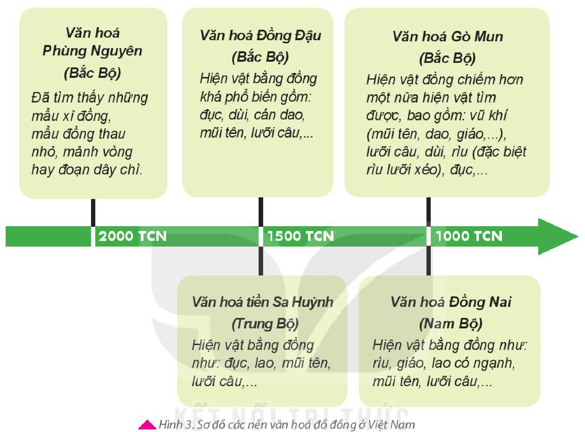
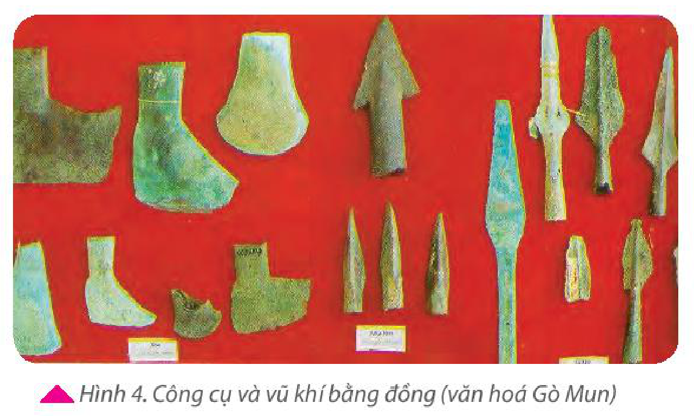

<!-- pdf:25 -->

# BÀI 6: SỰ CHUYỂN BIẾN VÀ PHÂN HOÁ CỦA XÃ HỘI NGUYÊN THUỶ

## 🎯 Học xong bài này, em sẽ:

- Trình bày được quá trình phát hiện ra kim loại và vai trò của nó đối với sự chuyển biến và phân hoá từ xã hội nguyên thuỷ sang xã hội có giai cấp.
- Giải thích được vì sao xã hội nguyên thuỷ tan rã.
- Mô tả được sự hình thành xã hội có giai cấp.
- Mô tả và giải thích được sự phân hoá không triệt để của xã hội nguyên thuỷ ở phương Đông.
- Nêu được một số nét cơ bản của xã hội nguyên thuỷ ở Việt Nam (qua các nền văn hoá khảo cổ Phùng Nguyên – Đồng Đậu – Gò Mun).

## 🔴 Mở đầu

Trong đời sống thường ngày, chúng ta sử dụng rất nhiều các vật dụng được làm từ đồng và sắt, bởi các nguyên liệu này đã trở nên rất quen thuộc và cần thiết đối với con người từ rất lâu đời. Em hãy kể tên một số vật dụng đó. Em có biết các nguyên liệu đồng và sắt được phát hiện như thế nào, từ bao giờ và chúng đã làm thay đổi đời sống xã hội ra sao?

## 1. Sự phát hiện ra kim loại và bước tiến của xã hội nguyên thuỷ

### a) Sự phát hiện ra kim loại và những chuyển biến trong đời sống vật chất

<!-- term: Công cụ kim khí -->
Vào khoảng thiên niên kỉ IV TCN, người nguyên thuỷ đã phát hiện ra một loại nguyên liệu mới để chế tạo công cụ và vũ khí thay thế cho đồ đá. Đó là kim loại.

<!-- term: Đồng đỏ và đồng thau -->
> 💡 **Em có biết?**
>
> Đồng được phát hiện một cách ngẫu nhiên, tìm thấy từ các đám cháy. Những thỏi đồng nóng chảy, vón cục là đồng đỏ (đồng nguyên chất). Sau đó, người ta biết pha chế,... để tạo ra đồng thau.
>
> Sắt được phát hiện muộn hơn, do cứng hơn đồng nên được sử dụng rộng rãi.

*Hình 1. Sơ đồ quá trình xuất hiện công cụ bằng kim loại*

- Khoảng 3500 năm TCN: Người Tây Á và Ai Cập đã biết dùng đồng đỏ.
- Khoảng 2000 năm TCN: Cư dân nhiều nơi đã biết dùng đồng thau.
- Khoảng cuối thiên niên kỉ II – đầu thiên niên kỉ I TCN: Con người biết chế tạo các công cụ bằng sắt.

<!-- pdf:26 -->

<!-- term: Công cụ kim khí -->
Nhờ có công cụ mới bằng kim loại như lưỡi cày, cuốc, rìu,... con người có thể khai hoang, mở rộng diện tích trồng trọt. Nông nghiệp dùng cày và chăn nuôi cũng có bước phát triển. Nghề luyện kim và chế tạo đồ đồng yêu cầu kĩ thuật cao, cùng với nghề dệt vải, làm đồ gốm, đồ mộc,... dần trở thành ngành sản xuất riêng. Quá trình chuyên môn hoá trong sản xuất lại có tác dụng thúc đẩy năng suất lao động, tạo ra sản phẩm ngày càng nhiều cho xã hội. Con người không chỉ đủ ăn mà còn có của cải dư thừa.

### b) Sự thay đổi trong đời sống xã hội

<!-- term: Gia đình phụ hệ -->
Trong thị tộc, đàn ông có vai trò ngày càng lớn và trở thành chủ gia đình. Con cái lấy theo họ cha. Đó là các gia đình phụ hệ.

*Hình 2. Gia đình phụ hệ trong công xã thị tộc (tranh minh hoạ)*

Cùng với sự xuất hiện ngày càng nhiều của cải dư thừa, xã hội dần có sự phân hoá kẻ giàu, người nghèo. Xã hội nguyên thuỷ dần tan rã.

<!-- term: Sự phân hoá xã hội nguyên thuỷ ở phương Đông -->
Tuy nhiên, quá trình này diễn ra không đều ở các khu vực trên thế giới. Ở phương Đông (Ai Cập, Lưỡng Hà, Trung Quốc,...), do sinh sống ven các con sông lớn, cư dân phải liên kết với nhau trong các cộng đồng vốn là các công xã thị tộc để làm thuỷ lợi và chống ngoại xâm nên tính liên kết cộng đồng và nhiều tập tục của xã hội nguyên thuỷ vẫn tiếp tục được bảo lưu. Do vậy, mặc dù xã hội nguyên thuỷ ở đây phân hoá sớm hơn so với các nơi khác nhưng không triệt để.

> ❓ 1. Nêu quá trình con người phát hiện ra kim loại.
>
> 2. Hãy chỉ ra những thay đổi trong đời sống xã hội khi công cụ bằng kim loại xuất hiện.
>
> 3. Vì sao xã hội nguyên thuỷ ở các nước phương Đông phân hoá nhưng không triệt để?

<!-- pdf:27 -->

## 2. Sự tan rã của xã hội nguyên thuỷ ở Việt Nam

### a) Sự xuất hiện kim loại

<!-- term: Các nền văn hoá đồ đồng ở Việt Nam -->
Từ khoảng 4 000 năm trước, cư dân ở Bắc Bộ, Trung Bộ và Nam Bộ đã biết tới đồ đồng.

*Hình 3. Sơ đồ các nền văn hoá đồ đồng ở Việt Nam*

<!-- term: Các nền văn hoá đồ đồng ở Việt Nam -->
- *Văn hoá Phùng Nguyên (Bắc Bộ) – 2000 TCN:* Đã tìm thấy những mẩu xỉ đồng, mẩu đồng thau nhỏ, mảnh vòng hay đoạn dây chì.
- *Văn hoá Đồng Đậu (Bắc Bộ) – 1500 TCN:* Hiện vật bằng đồng khá phổ biến gồm: đục, dùi, cán dao, mũi tên, lưỡi câu,...
- *Văn hoá tiền Sa Huỳnh (Trung Bộ) – 1500 TCN:* Hiện vật bằng đồng như: đục, lao, mũi tên, lưỡi câu,...
- *Văn hoá Gò Mun (Bắc Bộ) – 1000 TCN:* Hiện vật đồng chiếm hơn một nửa hiện vật tìm được, bao gồm: vũ khí (mũi tên, dao, giáo,...), lưỡi câu, dùi, rìu (đặc biệt rìu lưỡi xéo), đục,...
- *Văn hoá Đồng Nai (Nam Bộ) – 1000 TCN:* Hiện vật bằng đồng như: rìu, giáo, lao có ngạnh, mũi tên, lưỡi câu,...

### b) Sự phân hoá và tan rã của xã hội nguyên thuỷ ở Việt Nam

Việc sử dụng các công cụ bằng kim loại đã giúp cho người nguyên thuỷ mở rộng địa bàn cư trú. Một số đã rời khỏi vùng trung du, chuyển xuống các vùng đồng bằng ven sông. Họ đã biết dùng cày gỗ có lắp lưỡi bằng đồng để cày ruộng, trồng lúa, dùng lưỡi hái để gặt.

*Hình 4. Công cụ và vũ khí bằng đồng (văn hoá Gò Mun)*

<!-- pdf:28 -->

Sự phát triển kinh tế đã dẫn đến phân hoá trong đời sống xã hội. Cuộc sống của người nguyên thuỷ ngày càng ổn định. Họ định cư lâu dài ven các con sông lớn như sông Hồng, sông Mã, sông Thu Bồn, sông Đồng Nai,... Ở đây đã hình thành những khu vực dân cư đông đúc, là cơ sở cho sự xuất hiện các quốc gia cổ đầu tiên trên đất nước Việt Nam.

> ❓ 1. Thời đại đồ đồng ở Việt Nam đã trải qua những nền văn hoá khảo cổ nào? Đời sống kinh tế, xã hội của cư dân có những biến đổi gì?
>
> 2. Quan sát hình 4, hãy kể tên một số công cụ, vũ khí được tìm thấy thuộc văn hoá Gò Mun.

## ✏️ Luyện tập và Vận dụng

1. Sự xuất hiện của kim loại đã có tác động như thế nào tới đời sống của con người?

2. Lập bảng theo mẫu sau và điền những nội dung phù hợp.

| Nền văn hoá | Niên đại | Công cụ tìm thấy |
| --- | --- | --- |
| Phùng Nguyên | ? | ? |
| Đồng Đậu | ? | ? |
| Gò Mun | ? | ? |
| Tiền Sa Huỳnh | ? | ? |
| Đồng Nai | ? | ? |

3. Hãy tìm hiểu thêm và cho biết nguyên liệu đồng hiện nay còn được dùng để chế tạo những công cụ, vật dụng gì. Tại sao các loại công cụ và vũ khí bằng đồng ngày càng ít được sử dụng trong đời sống?

## 📷 Danh sách hình trong bài

| Mã hình | Trang PDF | Trang sách | Chú thích |
| --- | --- | --- | --- |
| H6-lich_su_va_dia_ly-ls-b06-01 | 25 | 24 | Hình 1. Sơ đồ quá trình xuất hiện công cụ bằng kim loại |
| H6-lich_su_va_dia_ly-ls-b06-02 | 26 | 25 | Hình 2. Gia đình phụ hệ trong công xã thị tộc (tranh minh hoạ) |
| H6-lich_su_va_dia_ly-ls-b06-03 | 27 | 26 | Hình 3. Sơ đồ các nền văn hoá đồ đồng ở Việt Nam |
| H6-lich_su_va_dia_ly-ls-b06-04 | 27 | 26 | Hình 4. Công cụ và vũ khí bằng đồng (văn hoá Gò Mun) |
