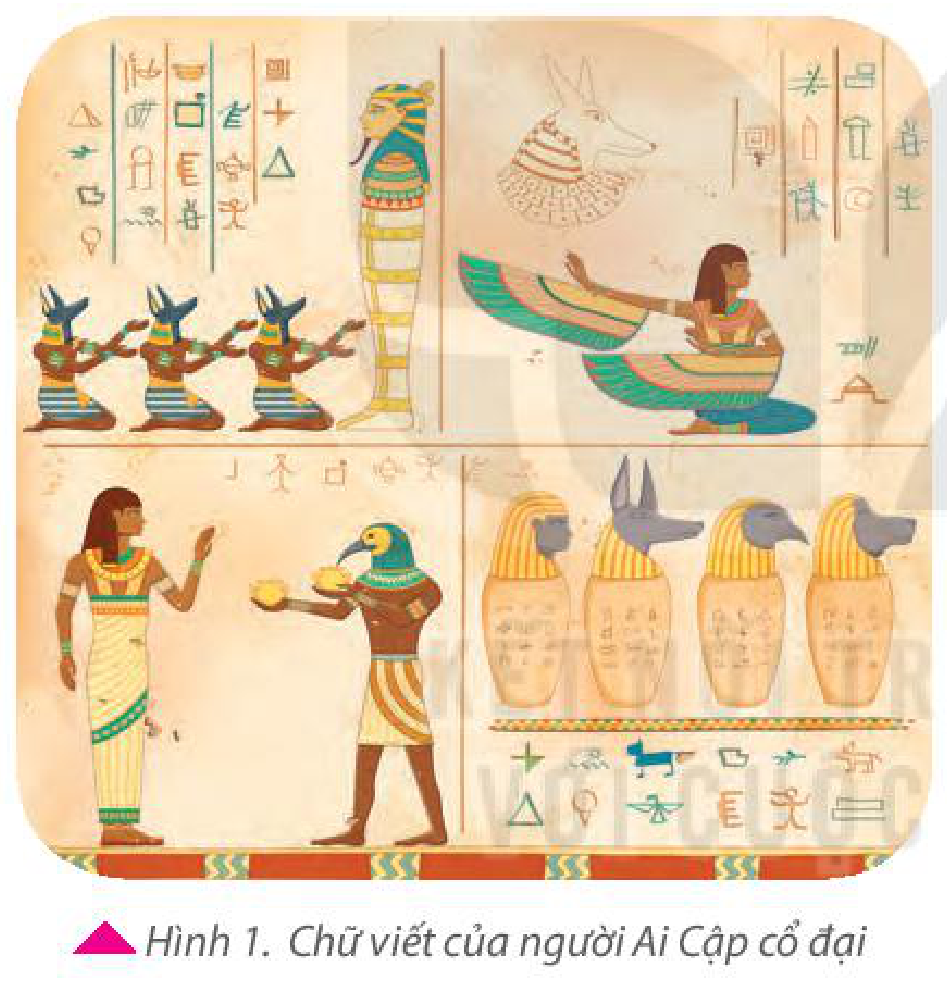
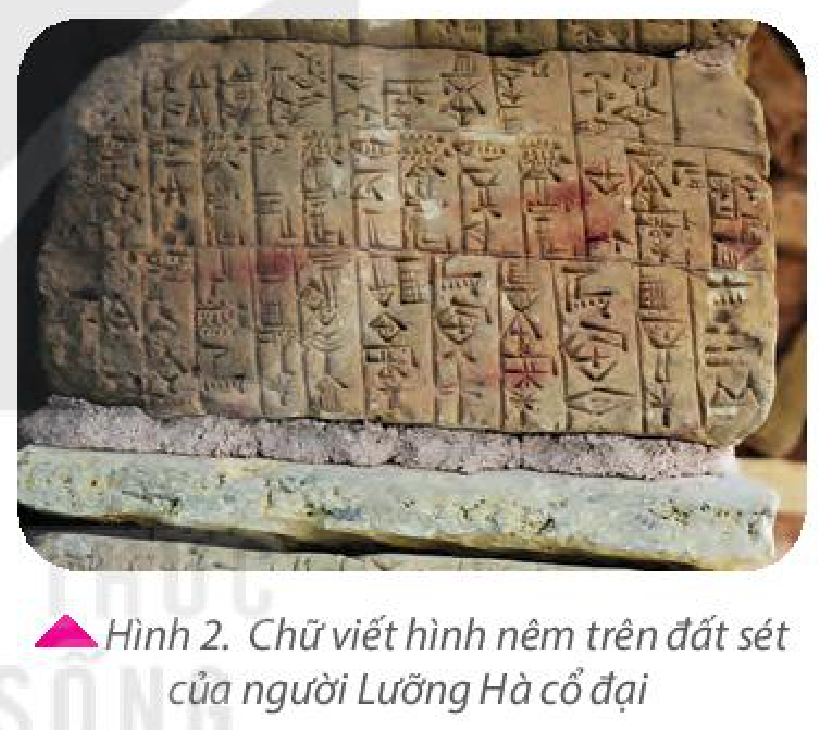
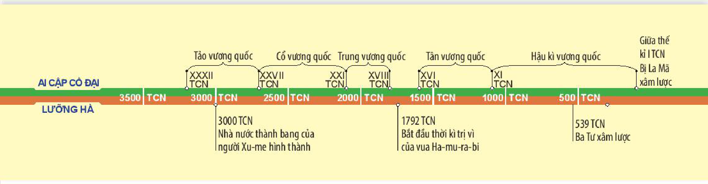
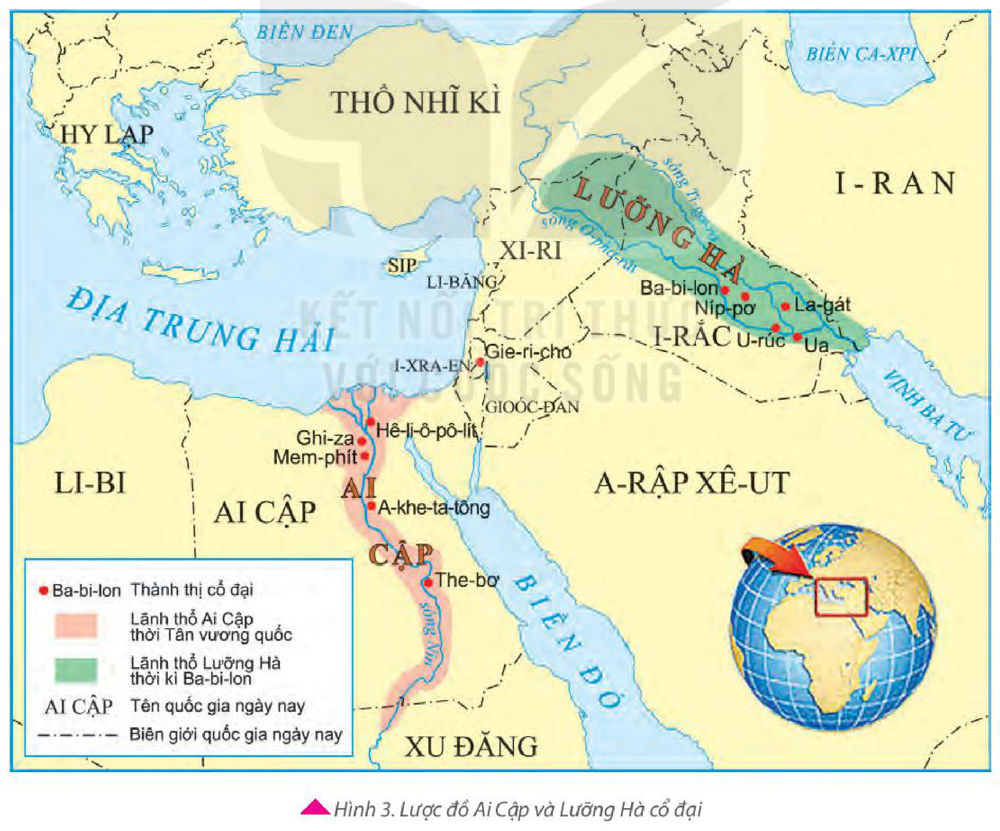
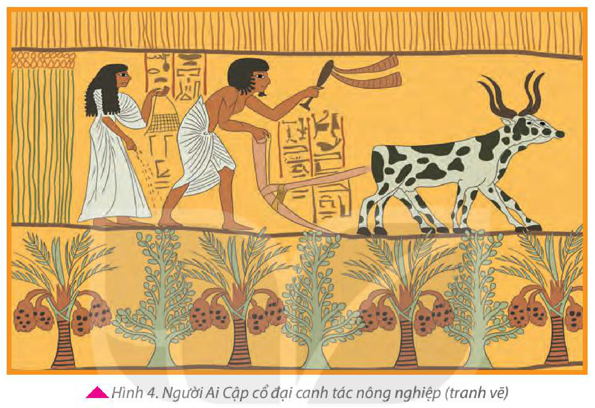
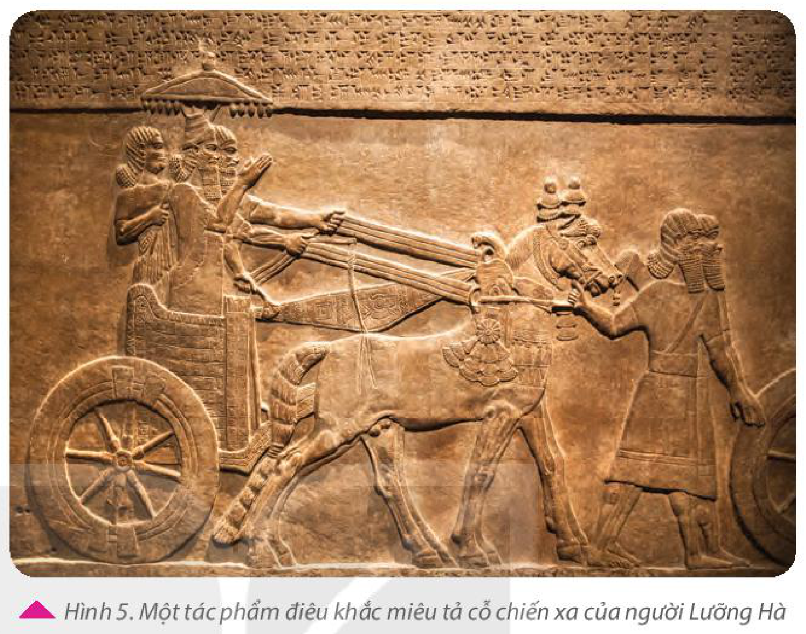
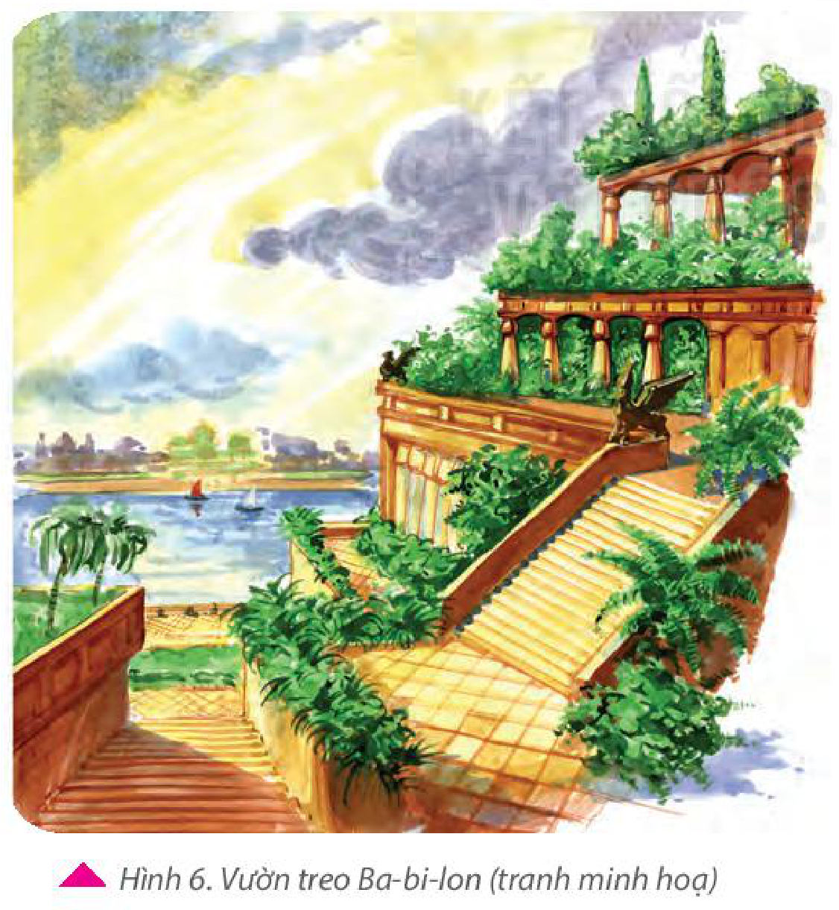
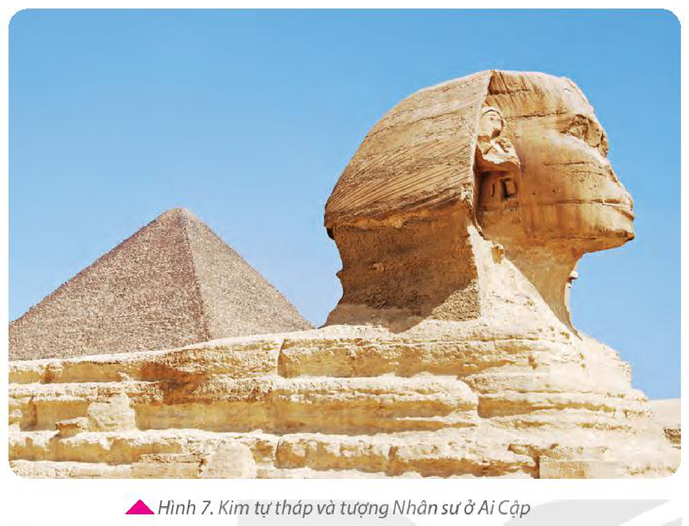
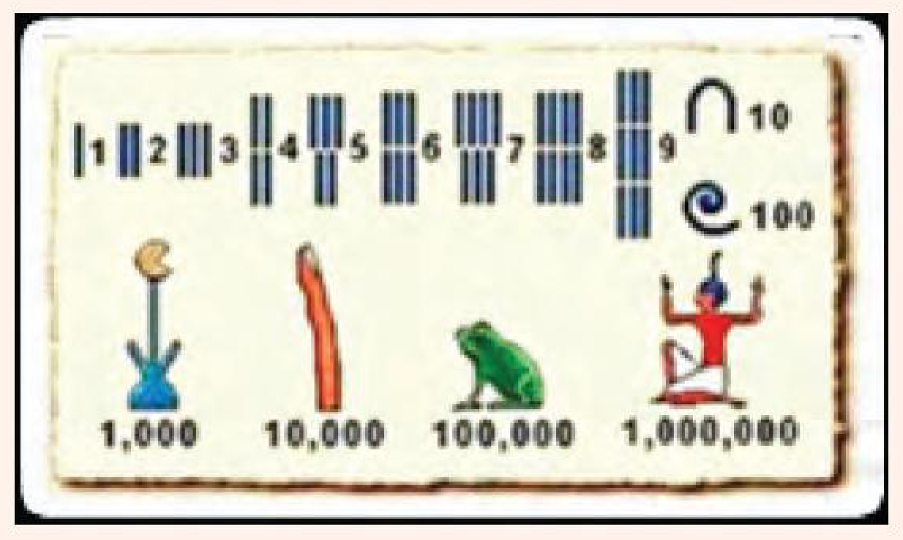

<!-- pdf:30 -->

# BÀI 7: AI CẬP VÀ LƯỠNG HÀ CỔ ĐẠI

## 🎯 Học xong bài này, em sẽ:

- Nêu được tác động của điều kiện tự nhiên (sông ngòi, đất đai) đối với sự hình thành nền văn minh Ai Cập và Lưỡng Hà.
- Trình bày được quá trình thành lập nhà nước của người Ai Cập và Lưỡng Hà.
- Kể được tên và nêu được những thành tựu văn hoá chủ yếu của Ai Cập, Lưỡng Hà.

## 🔴 Mở đầu

Dưới đây là hình ảnh chữ viết của người Ai Cập và Lưỡng Hà cổ đại. Em có biết người Ai Cập, Lưỡng Hà đã sáng tạo ra loại chữ viết này như thế nào không? Họ đã xây dựng nền văn minh của mình trong điều kiện ra sao?

Hình 1. Chữ viết của người Ai Cập cổ đại
<!-- ocr-ok: đã đối chiếu ảnh trang gốc p030, OCR thiếu dòng chú thích Hình 1 -->

Hình 2. Chữ viết hình nêm trên đất sét của người Lưỡng Hà cổ đại

> **Trục thời gian:**
> - *AI CẬP CỔ ĐẠI:* Tảo vương quốc (XXXII TCN – XXVII TCN) → Cổ vương quốc (XXVII TCN – XXI TCN) → Trung vương quốc (XXI TCN – XVIII TCN) → Tân vương quốc (XVI TCN – XI TCN) → Hậu kì vương quốc (XI TCN – Giữa thế kỉ I TCN: Bị La Mã xâm lược).
> - *LƯỠNG HÀ:* 3000 TCN: Nhà nước thành bang của người Xu-me hình thành → 1792 TCN: Bắt đầu thời kì trị vì của vua Ha-mu-ra-bi → 539 TCN: Ba Tư xâm lược.
<!-- ocr-ok: đã đối chiếu ảnh trang gốc p030, chữ trên trục thời gian nhỏ và nhiều màu nên OCR đọc rời rạc -->

<!-- pdf:31 -->

## 1. Tặng phẩm của những dòng sông

**Ai Cập** nằm ở vùng Đông Bắc của châu Phi, nơi có dòng sông Nin chảy qua. **Lưỡng Hà** là tên gọi vùng đất giữa hai con sông Ơ-phơ-rát và Ti-gơ-rơ ở khu vực Tây Nam Á.

> **Kết nối với địa lí**
>
> Sông Nin dài khoảng 6 400km, đoạn chảy qua Ai Cập dài 700km, là con đường giao thông huyết mạch của đất nước.
>
> Sông Ơ-phơ-rát và Ti-gơ-rơ bắt nguồn từ vùng núi thuộc Thổ Nhĩ Kì, chảy qua I-rắc và đổ ra vịnh Ba Tư.

> - *Hê-rô-đốt đã từng viết: Ai Cập là tặng phẩm của sông Nin. Sông Nin không chỉ tạo nên ở vùng thung lũng một dải đất phù sa màu mỡ, có chỗ dày tới 10m, mà hằng năm còn mang nước tưới cho cây cối, hoa màu tốt tươi, biến Ai Cập từ “một đồng cát bụi” trở thành “một vườn hoa”...*
> - *Về mùa xuân, nước sông Ơ-phơ-rát và Ti-gơ-rơ dâng cao, mang phù sa màu mỡ bồi đắp cho vùng hạ lưu, biến vùng cửa sông trở thành đồng bằng, bờ biển của vịnh Ba Tư phải lùi xa gần 200km.*
>
> (Theo Lương Ninh (Chủ biên), *Lịch sử thế giới cổ đại*, NXB Giáo dục Việt Nam, Hà Nội, 2015, tr.34, 63)

Hình 3. Lược đồ Ai Cập và Lưỡng Hà cổ đại

<!-- pdf:32 -->

Khoảng 6 000 năm trước, người Ai Cập và Lưỡng Hà đã biết làm nông nghiệp. Họ đã phát minh ra cái cày, biết sử dụng sức kéo của động vật để cày ruộng, biết đắp đê, đào hồ và làm hệ thống kênh mương tưới tiêu.

Các dòng sông trở thành những tuyến đường giao thương chính, thúc đẩy thương mại ở Ai Cập và Lưỡng Hà phát triển.

Nhờ biết khai thác những thuận lợi của điều kiện tự nhiên, cư dân Ai Cập, Lưỡng Hà đã sớm tạo dựng được nền văn minh của mình.

Hình 4. Người Ai Cập cổ đại canh tác nông nghiệp (tranh vẽ)

> ❓ 1. Dựa vào hai đoạn tư liệu (tr.30), hãy chỉ ra những điểm nổi bật về điều kiện tự nhiên ở Ai Cập, Lưỡng Hà cổ đại.
>
> 2. Hình 4 cho em biết điều gì về sản xuất nông nghiệp của người Ai Cập cổ đại?

## 2. Hành trình lập quốc của người Ai Cập và Lưỡng Hà

Khoảng năm 3200 TCN, ông vua huyền thoại có tên là Mê-nét đã thống nhất các công xã (còn gọi là các **nôm**) thành Nhà nước Ai Cập. Từ đó, Ai Cập đã trải qua các giai đoạn: Tảo kì vương quốc, Cổ vương quốc, Trung vương quốc, Tân vương quốc và Hậu kì vương quốc. Đến giữa thế kỉ I TCN thì bị La Mã xâm lược và thống trị.

Ở Lưỡng Hà, vào khoảng thiên niên kỉ IV TCN, người Xu-me đến định cư và xây dựng các nhà nước thành bang tại vùng hạ lưu hai dòng sông. Sau đó người Ác-cát, Át-xi-ri, Ba-bi-lon,... đã thành lập vương triều của mình, thay nhau làm chủ vùng đất này cho đến khi bị Ba Tư xâm lược vào năm 539 TCN.

Ở Ai Cập, vua được gọi là **pha-ra-ông** (kẻ ngự trong cung điện), còn ở Lưỡng Hà gọi là **en-xi** (người đứng đầu).

Nhà nước do vua đứng đầu và có toàn quyền gọi là **nhà nước quân chủ chuyên chế**.

> ❓ Dựa vào thông tin trên và khai thác trục thời gian (tr.29), hãy nêu quá trình thành lập nhà nước của người Ai Cập và Lưỡng Hà.

<!-- pdf:33 -->

## 3. Những thành tựu văn hoá chủ yếu

Người Ai Cập và Lưỡng Hà cổ đại có nhiều phát minh quan trọng còn có giá trị đến ngày nay như cách làm thuỷ lợi, phát minh ra cái cày, bánh xe, chữ viết,...

> **Em có biết?**
>
> Người Ai Cập đã dùng thân cây **pa-pi-rút** (papyrus) để tạo ra giấy. Từ “paper” (*giấy viết* trong tiếng Anh) có gốc từ “papyrus”. Người Lưỡng Hà dùng những vật nhọn có hình tam giác làm “bút” rồi viết lên tấm đất sét ướt, tạo thành chữ giống hình cái nêm nên gọi là **chữ hình nêm**.

Hình 5. Một tác phẩm điêu khắc miêu tả cỗ chiến xa của người Lưỡng Hà

Người Ai Cập dùng hình vẽ thực để biểu đạt ý niệm gọi là **chữ tượng hình** (hình 1, tr.29). Người Lưỡng Hà dùng chữ hình nêm. Đó là những loại chữ cổ nhất thế giới.

Người Ai Cập đã biết làm các phép tính theo hệ đếm thập phân, còn người Lưỡng Hà thì theo hệ đếm 60, tính được diện tích các hình. Họ cũng biết làm lịch, một năm có 12 tháng, một tháng có 29 hoặc 30 ngày. Kĩ thuật ướp xác của người Ai Cập cũng còn nhiều điều bí ẩn mà ngày nay các nhà khoa học đang tìm lời giải đáp.

Người Ai Cập và Lưỡng Hà đã tạo dựng nhiều công trình kiến trúc nổi tiếng, tiêu biểu nhất là các **kim tự tháp** và tượng Nhân sư ở Ai Cập, vườn treo Ba-bi-lon ở Lưỡng Hà, đều là kì quan của thế giới cổ đại.

Hình 6. Vườn treo Ba-bi-lon (tranh minh hoạ)

<!-- pdf:34 -->

Hình 7. Kim tự tháp và tượng Nhân sư ở Ai Cập

> **Em có biết?**
>
> Kim tự tháp Kê-ốp cao tới 147m. Để xây dựng công trình này, người ta sử dụng tới 2,3 triệu tảng đá, mỗi tảng nặng từ 2,5 đến 4 tấn được ghè đẽo theo kích thước đã định, rồi mài nhẵn và xếp chồng lên nhau mà không dùng bất cứ vật liệu kết dính nào. Trải qua hàng nghìn năm, đến nay các kim tự tháp vẫn đứng vững như muốn thách thức với thời gian.

> ❓ Nêu những thành tựu văn hoá chủ yếu của Ai Cập và Lưỡng Hà cổ đại.

## ✏️ Luyện tập và Vận dụng

1. Từ các hình ảnh và thông tin ở mục 3, em ấn tượng nhất với thành tựu văn hoá nào của người Ai Cập và Lưỡng Hà cổ đại? Vì sao?

2. Em hãy nêu một số vật dụng hay lĩnh vực mà ngày nay chúng ta đang thừa hưởng từ các phát minh của người Ai Cập và Lưỡng Hà cổ đại.

3. Dựa vào bảng chữ số của người Ai Cập cổ đại dưới đây, em hãy làm các phép tính sau: 124 + 321 = ? và 1565 – 1243 = ? theo cách viết của họ.

## 📷 Danh sách hình trong bài

| Mã hình | Trang PDF | Vị trí trong bài | Chú thích gốc |
| --- | :---: | --- | --- |
| H6-lich_su_va_dia_ly-ls-b07-01 | 30 | Mở đầu (trang 29) | Hình 1. Chữ viết của người Ai Cập cổ đại |
| H6-lich_su_va_dia_ly-ls-b07-02 | 30 | Mở đầu (trang 29) | Hình 2. Chữ viết hình nêm trên đất sét của người Lưỡng Hà cổ đại |
| H6-lich_su_va_dia_ly-ls-b07-03 | 30 | Cuối trang 29 (trục thời gian tràn sát mép trái và mép phải trang sách) | (sách không đánh số, trục thời gian lịch sử Ai Cập cổ đại và Lưỡng Hà cổ đại) |
| H6-lich_su_va_dia_ly-ls-b07-04 | 31 | Mục 1 (trang 30) | Hình 3. Lược đồ Ai Cập và Lưỡng Hà cổ đại |
| H6-lich_su_va_dia_ly-ls-b07-05 | 32 | Mục 1 (trang 31) | Hình 4. Người Ai Cập cổ đại canh tác nông nghiệp (tranh vẽ) |
| H6-lich_su_va_dia_ly-ls-b07-06 | 33 | Mục 3 (trang 32) | Hình 5. Một tác phẩm điêu khắc miêu tả cỗ chiến xa của người Lưỡng Hà |
| H6-lich_su_va_dia_ly-ls-b07-07 | 33 | Mục 3 (trang 32) | Hình 6. Vườn treo Ba-bi-lon (tranh minh hoạ) |
| H6-lich_su_va_dia_ly-ls-b07-08 | 34 | Mục 3 (trang 33) | Hình 7. Kim tự tháp và tượng Nhân sư ở Ai Cập |
| H6-lich_su_va_dia_ly-ls-b07-09 | 34 | Luyện tập và Vận dụng, câu 3 (trang 33) | (sách không đánh số, bảng chữ số của người Ai Cập cổ đại) |
